::::: cover
[第 01 讲 · 多账户治理基础]{.kicker}

# Landing Zone：新账户如何从“能用”变成“受治理”？

[以支付公司新增 payments-nonprod 账户为线索，理解 AWS Control Tower 4.0 的结构、集成依赖、基线与控制，并用只读命令、控制台走查和 Terraform 测试完成一次“零费用”的设计验收。]{.subtitle}

::: cover-meta
- **讲次**：01 / 19
- **建议学时**：4 课时（讲授 2 + 实验 2）
- **实验费用**：0 元（只读 + 本地测试）
- **适用版本**：Control Tower LZ 4.0 · AWS Provider 6.x
:::

::: scenario
支付公司要新增一个非生产账户 payments-nonprod。要求：开发者用公司身份登录；安全团队能审计所有管理 API 调用；有人把资源改成不合规时能被及时发现；以后再加 10 个账户，也不必把这些事情重做一遍。**只在 AWS Organizations 里建一个账户、放进某个 OU，够吗？**
:::

## 学习目标 {.nonum}

:::: cards
::: {.card title="理解"}
- 说出“受治理账户”的五个组成部分
- 区分控制面、治理面与工作负载面
- 解释 LZ 4.0 集成之间的依赖链
:::
::: {.card title="应用"}
- 把业务需求翻译成 manifest
- 为一条规则选择预防 / 检测 / 主动实现
- 用 Terraform 表达 LZ、OU、基线与控制
:::
::: {.card title="验证"}
- 用只读命令判断账户能否部署
- 用 `terraform test` 在本地验证配置
- 用五类证据证明账户真的受治理
:::
::: {.card title="排障"}
- “ACTIVE 却没有组织日志”
- Account Factory 找不到可用 OU
- 升级 4.0 后收不到漂移通知
:::
::::

| 本讲结构 | 要回答的问题 | 产出 |
|---|---|---|
| 一、机制 | 受治理的账户由哪几部分组成？ | 三平面模型、参考架构 |
| 二、Control Tower 4.0 | 集成可选，但谁依赖谁？ | 集成依赖图 |
| 三、基线与控制 | “装什么”和“允许什么”怎样分工？ | 控制行为时间轴 |
| 四、部署决策 | 哪些选择落地后不能改？ | 需求 → manifest |
| 五～七、实操 | 怎样不花钱地完成侦察、走查和 IaC 验证？ | 脚本、截图、Terraform 测试 |
| 八～九、验收与排障 | 怎样证明“真的受治理”？出了问题怎么推理？ | 证据链、故障卡 |
:::::

::: {.opener .nobreak}
[一 · 机制]{.kicker}

# Landing Zone 由哪几层组成？

[先建立模型：一个账户要“受治理”，需要哪些部件同时成立。]{.subtitle}
:::

## 什么是 Landing Zone

**Landing Zone（着陆区）**是一个预先设计好、可重复交付的多账户 AWS 环境。它回答五个问题：账户怎样被创建、放在哪里、谁能登录、受哪些规则约束、留下什么审计证据。AWS Control Tower 是 AWS 提供的托管实现；另外两条常见路线是 Landing Zone Accelerator（LZA）和“Organizations + Terraform”自建，第 18 讲会对三者做取舍比较。本讲以 Control Tower 的 **Landing Zone 4.0** 为准。

像物理里用一个公式把“加速度”说清楚一样，我们先给“受治理”下一个可检验的定义：

::: formula
受治理的账户 ＝ 账户 ＋ OU 基线 ＋ OU 控制 ＋ 身份入口 ＋ 审计证据

[缺任何一项，“受治理”都只是名义上的]{.unit}
:::

- **账户**：资源和费用的隔离边界。一个账户出事，影响被限制在这个账户之内（爆炸半径）。
- **OU（组织单元）**：把需要同一套规则的账户归为一组。基线和控制都“挂”在 OU 上，由其中的账户**继承**，而不是逐个账户手工配置。
- **基线（Baseline）**：部署到账户里的“资源包”，例如 Config 记录器、安全团队的审计角色、Identity Center 的访问配置。
- **控制（Control）**：规则，例如“禁止为 root 用户创建访问密钥”。
- **身份入口**：IAM Identity Center 的权限集，决定谁能以什么权限进入哪个账户。
- **审计证据**：组织 CloudTrail 和 Config 配置记录——它们证明前面几项真的在起作用。

图 1-1 是本讲的参考架构，读图时抓住两个方向。**向下**的是治理：Control Tower 把集成基线部署到 Security OU 的账户里，把 OU 基线和控制（以 SCP、RCP、Config 规则等形式）下发到 Workloads 下的各个 OU。**向上**的是证据：成员账户的管理事件进入组织 Trail，落到 Log Archive 账户的集中日志桶；配置变化进入 Config 账户中的服务关联聚合器。日志与业务分属不同账户，业务账户的管理员即使权限很大，也删不掉自己留下的审计记录——这就是职责分离。

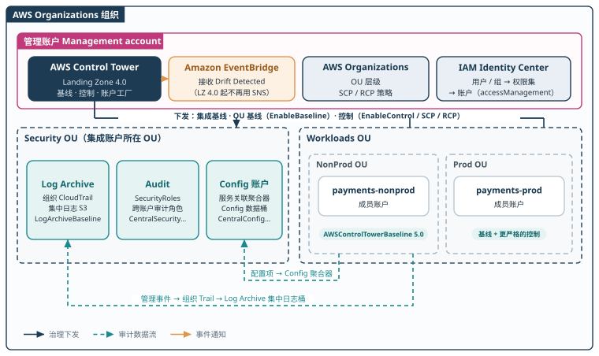

## 三个平面：控制面、治理面、工作负载面

:::: {.cards .three}
::: {.card title="控制面 · 管理账户"}
Control Tower、Organizations、Identity Center、EventBridge 都在这里。**只做治理，不跑业务**；权限最高，所以访问的人最少。
:::
::: {.card title="治理面 · Security OU"}
Log Archive（集中日志）、Audit（安全团队跨账户角色）、Config 账户（4.0 起可以独立指定）。业务团队通常只读或无权访问。
:::
::: {.card title="工作负载面 · Workloads OU"}
业务账户按环境或合规级别分 OU（NonProd、Prod）。账户的规则来自所在 OU，换 OU 就换规则。
:::
::::

::: why
管理账户为什么不能跑业务？第一，SCP 对管理账户**不生效**，放在管理账户里的业务资源得不到任何预防性控制的保护；第二，管理账户能修改整个组织的策略、关闭任何账户，一旦凭证泄露，影响的是全部账户。所以管理账户要“空着”，只承载治理服务。
:::

## 三个最容易混淆的判断

::: pitfalls
1. **有 Organizations 和 OU，不等于有 Landing Zone。** OU 只是分组。没有基线和控制，账户放进去之后什么也不会自动发生。
2. **Landing Zone 显示 ACTIVE，不等于成员账户已受治理。** ACTIVE 描述的是 Landing Zone 自身部署完成；成员账户要看 OU 上基线与控制的状态。
3. **在 Landing Zone 级启用 config 集成，不等于每个成员账户都有 Config 记录器。** LZ 级只部署到集成账户；成员账户要靠 OU 上的 AWSControlTowerBaseline 或 ConfigBaseline。
:::

::: {.opener}
[二 · Control Tower 4.0]{.kicker}

# 集成可以选，但谁依赖谁？

[4.0 把服务集成全部变成可选项。可选不等于彼此独立——集成之间有一条必须按顺序满足的依赖链。]{.subtitle}
:::

## 五个服务集成与 manifest

Control Tower 用一份 JSON **manifest** 描述 Landing Zone。4.0 中每个集成都有一个**必填**的 `enabled` 布尔值；当 `enabled` 为 `true` 时，`accountId` 才是必填项。整个 manifest 在 API 层面也变成了可选——不带任何集成，也能建出一个“只有 Organizations 集成 + 控制”的最小 Landing Zone。

| 集成 | manifest 字段 | 启用后部署的集成基线 | 部署位置 | 依赖 |
|---|---|---|---|---|
| AWS Config | `config` | CentralConfigBaseline：服务关联聚合器、专用 Config 数据桶 | Config 集成账户；各集成账户开启 Config 记录 | 无 |
| 集中日志 | `centralizedLogging` | LogArchiveBaseline：组织 CloudTrail、专用日志桶与访问日志桶 | Log Archive 账户 | 无 |
| 安全角色 | `securityRoles` | CentralSecurityRolesBaseline：安全团队的跨账户角色 | Audit 账户 | config |
| 访问管理 | `accessManagement` | IdentityCenterBaseline：Identity Center 资源 | 组织范围（管理账户） | securityRoles |
| 备份 | `backup` | BackupCentralVaultBaseline、BackupAdminBaseline | 中央备份账户、备份管理员账户 | securityRoles |
| 受治理区域 | `governedRegions` | —— | —— | 须含 Home Region |

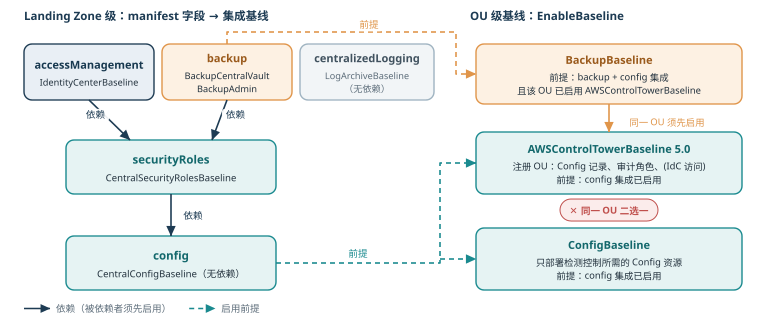

把图 1-2 当成一张“先修课程表”来读。想给开发者开通 Identity Center 登录（accessManagement），必须先有 securityRoles；securityRoles 又要求 config。所以“只要单点登录、不要 Config”这种组合**在 4.0 中不存在**。关闭的顺序正好相反：要关掉 config，得先关掉依赖它的 securityRoles、Identity Center 和备份集成。

## 4.0 相对 3.x 的四个关键变化

:::: cards
::: {.card title="1. 组织结构不再强制"}
Control Tower 不再创建或管理固定的 Security OU。存放集成账户的 OU 就是“指定的 Security OU”，**所有集成账户必须位于同一个父 OU 下**。控制台向导仍会建议创建 Security 与 Sandbox 两个 OU（见图 1-10）。
:::
::: {.card title="2. 集成全部可选"}
Config、CloudTrail、SecurityRoles、Backup 都可以关闭。代价是：关掉的集成对应的能力**不会**以别的方式自动出现。
:::
::: {.card title="3. 漂移通知改走 EventBridge"}
4.0 起，漂移事件发往管理账户的 EventBridge（`source = aws.controltower`，`detail-type = Drift Detected`），**不再推送到 SNS 主题**。没有自建规则，就没人收到通知（实验 1-5）。
:::
::: {.card title="4. 关闭集中日志会删除资源"}
3.x 关闭 CentralizedLogging 只是停掉组织 Trail；4.0 会删除日志账户中相关的 Trail 栈实例、Config 记录器和投递通道，此后 Control Tower 不再管理该账户。
:::
::::

::: warn
从 3.3 升级到 4.0 时，**不要在同一次升级里关闭 Config 或 SecurityRoles 集成**——3.x 中它们是隐式开启的，官方要求先完成升级、再按需关闭。通过 API 升级前，还要把 `AWSControlTowerCloudTrailRole` 上的内联策略换成托管策略 `AWSControlTowerCloudTrailRolePolicy`。
:::

::: {.opener}
[三 · 基线与控制]{.kicker}

# 基线和控制，分别管什么？

[基线负责“在账户里装上什么”，控制负责“允许什么、发现什么”。两者都挂在 OU 上，由账户继承。]{.subtitle}
:::

## 基线：把资源包部署到 OU

在 OU 上启用一个基线，会产生一个 `EnabledBaseline` 资源；OU 中的每个账户随之获得一个继承而来的“子基线”。**基线不能直接指定账户**，要看某个账户的状态，用 `ListEnabledBaselines` 加上 `--include-children`。能在 OU 上启用的基线只有三种：

| OU 级基线 | 部署内容 | 前提 | 需要注意 |
|---|---|---|---|
| AWSControlTowerBaseline（LZ 4.0 对应 5.0 版） | 注册 OU：Config 记录、审计角色，按配置开通 Identity Center 访问 | config 集成已启用 | 继承 LZ 的 Region deny 设置；Account Factory 创建账户的目标 OU 必须启用它 |
| ConfigBaseline | 只部署检测控制所需的 Config 资源（上者的子集） | config 集成已启用 | 与 AWSControlTowerBaseline **互斥**，同一 OU 只能选一个；不带 Region deny |
| BackupBaseline | 成员账户中的 AWS Backup 资源与策略 | backup 与 config 集成已启用，且该 OU 已启用 AWSControlTowerBaseline | 不作用于管理账户 |

下面是在本书实验账户中执行 `list-baselines` 的真实结果。注意 ARN 中带有区域，写进 Terraform 之前应在自己的 Home Region 查询：

```{.console title="aws controltower list-baselines --region us-east-1（2026-11-17 实测）"}
AuditBaseline                 arn:aws:controltower:us-east-1::baseline/4T4HA1KMO10S6311
CentralSecurityRolesBaseline  arn:aws:controltower:us-east-1::baseline/A6EEAE10F08193F2
LogArchiveBaseline            arn:aws:controltower:us-east-1::baseline/J8HX46AHS5MIKQPD
IdentityCenterBaseline        arn:aws:controltower:us-east-1::baseline/LN25R72TTG6IGPTQ
AWSControlTowerBaseline       arn:aws:controltower:us-east-1::baseline/17BSJV3IGJ2QSGA2
BackupCentralVaultBaseline    arn:aws:controltower:us-east-1::baseline/3WPD0NA6TJ9AOMU2
BackupAdminBaseline           arn:aws:controltower:us-east-1::baseline/H6C5JFCJJ3CPU3J5
BackupBaseline                arn:aws:controltower:us-east-1::baseline/APO9ATVPBKFRRGLK
CentralConfigBaseline         arn:aws:controltower:us-east-1::baseline/YX7VMZML5IG8EJUD
ConfigBaseline                arn:aws:controltower:us-east-1::baseline/1QBGH2G48YVGDQ3Y
```

列表里还有 AuditBaseline：它属于 3.x，4.0 中被 CentralSecurityRolesBaseline 与 CentralConfigBaseline 两个基线取代。

## 控制：三种行为、多种实现

一条**控制**由两个维度刻画：**行为**说明它在什么时刻起作用，**实现**说明它靠什么机制起作用。

| 行为 | 起作用的时刻 | 实现方式 | 典型结果 |
|---|---|---|---|
| 主动 Proactive | 资源被部署**之前** | CloudFormation Hook | 模板不合规 → 栈操作失败，资源不创建 |
| 预防 Preventive | API 请求**授权时** | SCP、RCP、声明式策略 | 显式 Deny → 动作根本不发生 |
| 检测 Detective | 资源存在**之后** | AWS Config 规则；Security Hub 托管标准中的控制 | 判定 NON_COMPLIANT → 发现与告警 |

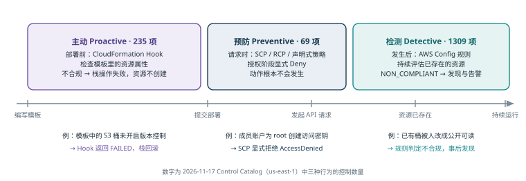

::: formula
主动：在部署前拦住模板 → 预防：在请求时拒绝动作 → 检测：在发生后发现状态
:::

还有两个容易被忽略的事实。第一，**预防性控制全球生效**，而检测与主动控制只在 Control Tower 支持且受治理的区域工作——没有纳入治理的区域里，资源照样能建，只是没人检查。第二，控制按“指导级别”分为强制（mandatory）、强烈建议与可选；强制控制随 Landing Zone 自动启用，Terraform 的 `aws_controltower_control` 只能管理后两类（以及 Region deny）。

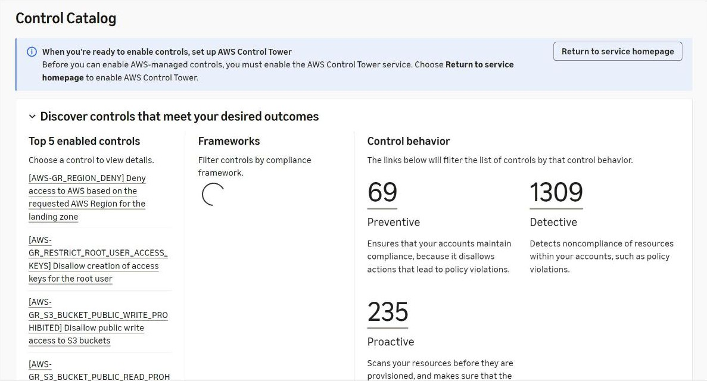{.shot}

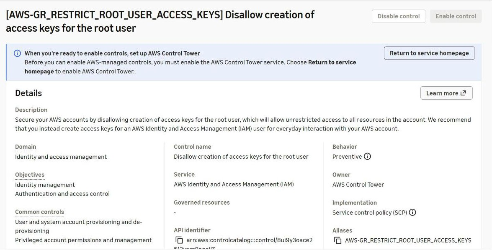{.shot}

::: think
既然预防性控制最“硬”，为什么不把所有规则都写成 SCP？提示：(1) 一条 SCP 最长 5,120 个字符，一个 OU 最多直接挂 5 条 SCP；(2) SCP 只能在请求时依据请求上下文做判断，看不到“现存资源已经处于什么状态”；(3) 规则写错时，预防性控制会直接阻断生产变更，检测性控制只会告警；(4) 主动控制能在 CI 阶段就给出反馈，修复成本最低。
:::

:::: {.example title="例题 1-1｜给四条规则选择控制行为与实现"}
安全团队提出四条要求：(a) 任何成员账户都不能停止或删除组织 CloudTrail；(b) 发现所有未加密的 EBS 卷；(c) 用 CloudFormation 部署 RDS 时，未开启存储加密就不允许创建；(d) 即使某个桶策略写错，组织外的主体也不能访问本组织的 S3 对象。分别应选择哪种行为、哪种实现？

::: steps
1. **找“介入时刻”。** (a) 是阻止一个动作；(b) 是评估已经存在的资源；(c) 是在部署之前检查模板；(d) 是阻止一类访问，而且不能依赖每个桶策略都写对。
2. **由时刻定行为。** (a) 预防；(b) 检测；(c) 主动；(d) 预防。
3. **由对象定实现。** (a) 约束的是**主体**能做什么 → SCP（Control Tower 的强制控制里已包含保护 CloudTrail 的 SCP）；(b) → Config 规则；(c) → CloudFormation Hook；(d) 约束的是**资源**能被谁访问 → RCP（资源控制策略），它与桶策略叠加生效，可以兜住桶策略的错误。
4. **检查覆盖面。** (b)(c) 只在受治理区域工作；(c) 只拦截经 CloudFormation 的部署，控制台或 CLI 直接创建要靠 (b) 补位。
:::

::: answer
四条依次为：(a) 预防 · SCP；(b) 检测 · Config 规则；(c) 主动 · CloudFormation Hook；(d) 预防 · RCP。规律：**约束“谁能做”用 SCP，约束“资源能被谁用”用 RCP，评估“现在是什么状态”用 Config 规则，拦截“将要部署什么”用 Hook。**
:::
::::

::: {.opener}
[四 · 部署决策]{.kicker}

# 部署前，先把“已知量”写清楚

[像解物理题先列已知量：Home Region、受治理区域、账户与集成。有些选择落地后就不能再改。]{.subtitle}
:::

## Home Region 与受治理区域

创建 Landing Zone 时，你在控制台所处的区域就成为 **Home Region**，Control Tower 的部分资源部署在这里。**一旦选定，Home Region 不能更改**——它不像 EC2 那样切换一下区域就行，所以要选业务长期所在、且 Control Tower 支持的区域。

**受治理区域**是 Control Tower 部署检测与主动控制、并纳入审计的区域。未纳入治理的区域并不会被禁止使用，只是那里的资源处于“无人看管”状态；之后新增受治理区域，还要**重新注册（Re-register）OU**，已有账户才会在新区域获得基线。

**Region deny 控制**（AWS-GR_REGION_DENY）走得更远：它用 SCP 拒绝对未受治理区域的访问（全球性服务等少数操作除外）。开启前必须确认那些区域里没有正在运行的资源，否则业务会立即收到 AccessDenied。

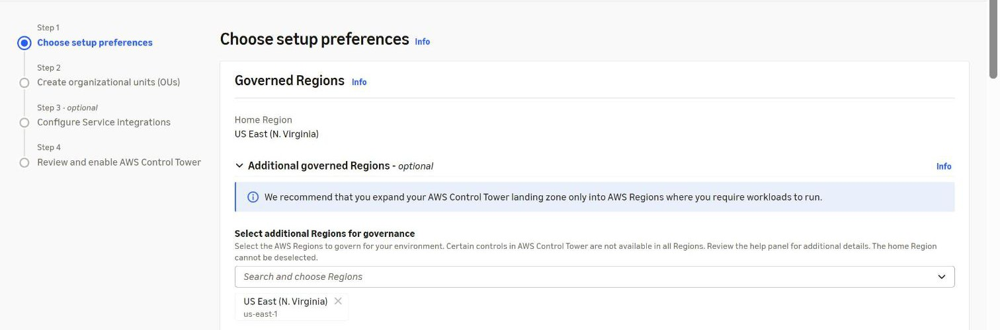{.shot}

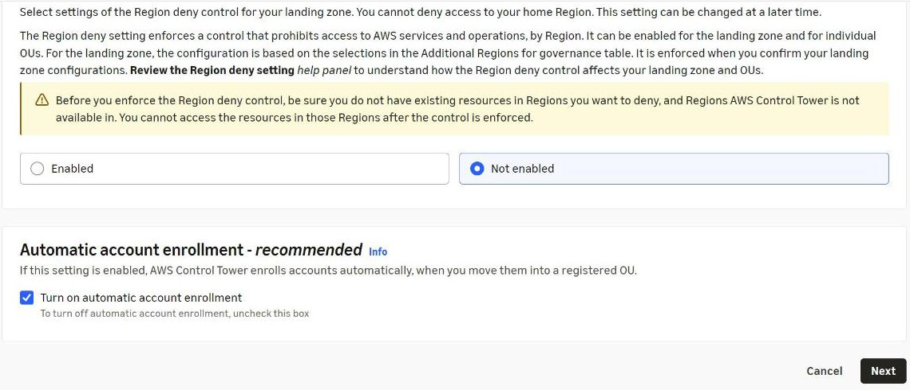{.shot}

图 1-7 下方的**自动账户注册（Automatic account enrollment）**对应 API 中的 `remediationTypes = ["INHERITANCE_DRIFT"]`：账户被移入一个已注册的 OU 时，Control Tower 自动为它应用目标 OU 的基线和控制，并移除原 OU 遗留的控制。建议保持开启。

## 账户与 OU 规划

| 账户 | 作用 | 谁能进入 | 设计要点 |
|---|---|---|---|
| 管理账户 | 组织、Control Tower、Identity Center | 极少数平台管理员 | 不跑业务；SCP 对它无效 |
| Log Archive | 组织 CloudTrail 与集中日志桶 | 安全团队只读 | 日志桶开启版本控制与保留策略 |
| Audit（SecurityRoles） | 安全团队的跨账户审计 / 应急角色 | 安全团队 | 4.0 中可与 Config 集成共用一个账户，也可分开 |
| Config 账户 | 服务关联聚合器与 Config 数据桶 | 安全 / 合规团队 | 4.0 起 Config 与 CloudTrail 使用各自专用的桶 |
| 业务账户 | 应用工作负载 | 对应团队（经权限集） | 按环境、合规级别放入不同 OU |

每个新账户都需要一个**未被任何 AWS 账户使用过**的邮箱地址。建议为每个账户申请公司邮件组地址，而不是某位员工的个人邮箱——员工离职后，账户的根用户找回邮件仍要有人能收到。

:::: {.example title="例题 1-2｜把业务需求翻译成 manifest"}
已知：(1) 业务主要在 us-east-1，灾备在 us-west-2；(2) 安全团队要审计所有账户的管理 API 调用；(3) 资源改成不合规时要能被发现；(4) 开发者用公司身份单点登录；(5) 暂不集中备份。集成账户：Log Archive 222222222222，Audit 333333333333，Config 444444444444。求 manifest。

::: steps
1. **列已知量 → 区域。** Home Region = us-east-1；`governedRegions` = ["us-east-1", "us-west-2"]，且必须包含 Home Region。
2. **逐条映射需求。** (2) → `centralizedLogging`；(3) → `config`（成员账户还需 OU 基线）；(4) → `accessManagement`；(5) → `backup.enabled = false`。
3. **沿依赖链补齐。** accessManagement 需要 securityRoles，securityRoles 需要 config——所以 `securityRoles` 也必须开启，即使需求里没有直接提到。
4. **检查约束。** 已启用的集成都给出 12 位账户 ID；三个集成账户必须位于同一个根级 OU 下。
:::

下面的 manifest 不是手写的，而是由实验 1-3 的 Terraform 代码根据同一组输入生成、再用 `terraform console` 输出的：

```{.json title="manifest（由 02-landing-zone 模块生成）"}
{
  "governedRegions": ["us-east-1", "us-west-2"],
  "config": {
    "enabled": true,
    "accountId": "444444444444",
    "configurations": {
      "loggingBucket": { "retentionDays": 365 },
      "accessLoggingBucket": { "retentionDays": 3650 }
    }
  },
  "centralizedLogging": {
    "enabled": true,
    "accountId": "222222222222",
    "configurations": {
      "loggingBucket": { "retentionDays": 365 },
      "accessLoggingBucket": { "retentionDays": 3650 }
    }
  },
  "securityRoles": { "enabled": true, "accountId": "333333333333" },
  "accessManagement": { "enabled": true },
  "backup": { "enabled": false }
}
```

::: answer
四个集成开启（config、centralizedLogging、securityRoles、accessManagement），backup 关闭。最容易漏掉的是 securityRoles——它不是业务需求，而是依赖链的要求。
:::
::::

::: {.opener}
[五 · 实操：只读侦察]{.kicker}

# 第一次操作：这个账户适合部署吗？

[先在终端确认身份与现状。所有命令都是只读的，不会创建任何资源。]{.subtitle}
:::

:::: {.lab title="实验 1-1｜只读预检：身份、组织、Landing Zone、基线与控制"}
::: labmeta
- **目标**：判断账户能否、以及应以哪种方式部署 Control Tower
- **时长**：15 分钟
- **费用**：0 元（全部为只读 API）
- **权限**：sts、organizations、controltower、controlcatalog 的只读权限
:::

1. 进入 `labs/01-preflight/`，执行 `bash preflight.sh us-east-1`（Windows 可用 `pwsh ./preflight.ps1`）。
2. 对照图 1-8 的决策树，逐项解读输出。
3. 记录 Home Region 下可用的基线 ARN，实验 1-4 要用。

```{.console title="preflight.sh 实际输出（2026-11-17，本书实验账户；账户 ID 已替换为文档示例值）"}
== 1. 当前身份
|    Account    |                    Arn                     |
|  111122223333 |  arn:aws:iam::111122223333:user/terraform  |

== 2. 组织状态
→ 不属于任何组织：控制台向导第 2 步会新建组织，本账户将成为管理账户（之后不能更换）。

== 3. Landing Zone（Home Region = us-east-1）
→ 该区域没有 Landing Zone。若组织已存在，仍需在其他区域确认（LZ 只存在于其 Home Region）。

== 5. Control Catalog：按行为统计控制数量
   1309 DETECTIVE
     69 PREVENTIVE
    235 PROACTIVE
```
::::

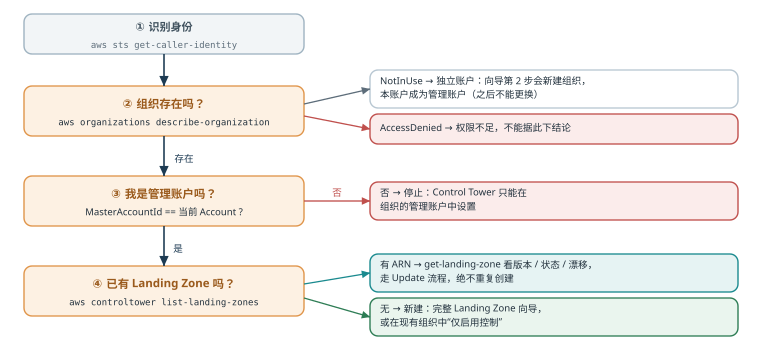

| 观察到的结果 | 说明什么 | 下一步 |
|---|---|---|
| `AWSOrganizationsNotInUseException` | 独立账户，不属于任何组织 | 确认它适合当管理账户（无业务、无遗留资源）后再走向导 |
| `AccessDenied` | 当前身份没有读权限 | 换身份；**不能**推断“组织不存在” |
| 有组织，但我不是管理账户 | 成员账户无法设置 Control Tower | 停止，联系组织管理员 |
| `landingZones` 为空 | 该区域没有 LZ | 新建；同时确认其他区域也没有 |
| 返回 LZ ARN | 已有 Landing Zone | 用 `get-landing-zone` 看版本与漂移，走 Update，绝不重复创建 |

本书的实验账户属于第一行：它不在任何组织中，Control Tower 首页因此只显示“Enable AWS Control Tower”入口（图 1-9）。

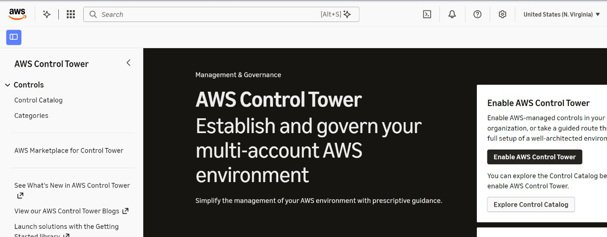{.shot}

::: {.opener}
[六 · 实操：控制台走查]{.kicker}

# 控制台向导的每一步在决定什么？

[我们在真实控制台中走到“第一个会改变账户的按钮”为止。哪一步不可逆，比哪一步怎么填更重要。]{.subtitle}
:::

## 四个步骤与不可逆点

控制台向导共四步：**① 设置偏好**（Home Region、附加受治理区域、Region deny、自动账户注册）→ **② 创建 OU** → **③ 配置服务集成（可选）** → **④ 审阅并启用**。第 1 步的界面已在图 1-6、图 1-7 中展示，这里看第 2 步。

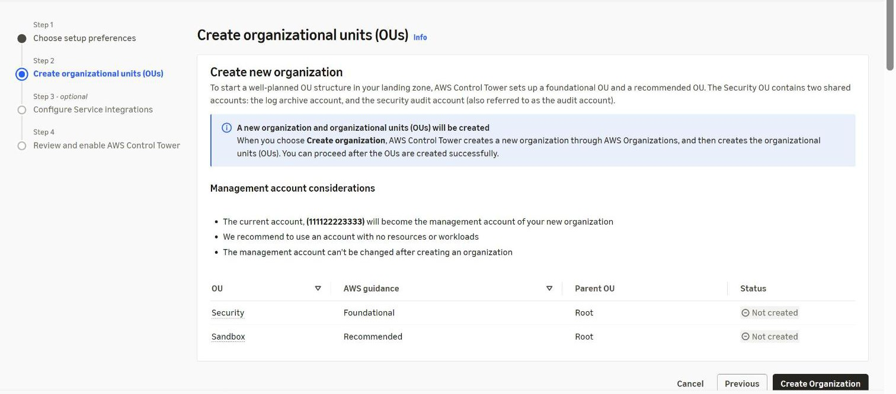{.shot}

::: safety
第 2 步右下角的 **Create Organization** 会**立即**调用 AWS Organizations 创建组织和 OU，而不是等到第 4 步才统一提交。对独立账户来说，这一步之后它就成了管理账户，而且管理账户不能更换。本书的走查到此为止，没有点击该按钮——这也是为什么第 3、4 步没有实拍截图。
:::

第 3 步（可选）对应 manifest 中的各个集成：为 Config、CloudTrail 集中日志、安全角色选择账户（可新建或使用现有账户），决定是否启用 IAM Identity Center 与 AWS Backup，设置日志保留期和可选的 KMS 密钥。第 4 步汇总全部选择，确认服务权限后才开始部署，部署通常需要数十分钟。

| 向导中的选择 | 能否事后修改 | 修改方式 |
|---|---|---|
| Home Region | 不能 | 只能退役后重建 |
| 管理账户 | 不能 | —— |
| 附加受治理区域 | 能 | 更新 Landing Zone，然后 Re-register OU |
| Region deny | 能 | 更新 Landing Zone 设置 |
| 服务集成开关 | 能（受依赖链约束） | 更新 Landing Zone；关闭 centralizedLogging 会删除资源 |
| 日志保留期 / KMS 密钥 | 能 | 更新 Landing Zone |

::: {.opener}
[七 · 实操：基础设施即代码]{.kicker}

# 用 Terraform 描述 Landing Zone

[把依赖链写成代码里的前置条件，让错误在 `plan` 阶段就暴露，而不是在部署了 40 分钟之后。]{.subtitle}
:::

## API 方式落地的前置条件

控制台向导会替你创建组织、账户和角色；**用 API 或 Terraform 落地时，这些都要提前准备**：

1. 用 Organizations 创建组织（启用全部功能），本账户为管理账户；
2. 为每个启用的集成准备账户，并移入同一个根级 OU（指定的 Security OU）；
3. 在 `/service-role/` 路径下创建三个服务角色（4.0 不再需要 `AWSControlTowerConfigAggregatorRoleForOrganizations`）：

| 服务角色 | 信任的服务主体 | 权限 |
|---|---|---|
| `AWSControlTowerAdmin` | controltower.amazonaws.com | 托管策略 `AWSControlTowerServiceRolePolicy`，加一条允许 `ec2:DescribeAvailabilityZones` 的内联策略 |
| `AWSControlTowerCloudTrailRole` | cloudtrail.amazonaws.com | 托管策略 `AWSControlTowerCloudTrailRolePolicy`（4.0 起替代旧内联策略） |
| `AWSControlTowerStackSetRole` | cloudformation.amazonaws.com | 内联策略：允许扮演各账户的 `AWSControlTowerExecution` |

## 资源模型

| Terraform 资源 | 对应 API | 说明 |
|---|---|---|
| `aws_controltower_landing_zone` | CreateLandingZone / UpdateLandingZone | `version`、`manifest_json`、`remediation_types` |
| `aws_organizations_organizational_unit` | CreateOrganizationalUnit | 业务 OU（Workloads / NonProd …） |
| `aws_controltower_baseline` | EnableBaseline | 只能指向 OU；参数如 `IdentityCenterEnabledBaselineArn` |
| `aws_controltower_control` | EnableControl | 控制标识可用 Control Catalog ARN |
| `aws_iam_role` 等 | IAM | 上节的三个服务角色 |

## 把依赖链写成前置条件

manifest 不手写 JSON，而是由变量生成：每个集成先写成“字段齐全、未用字段为 `null`”的对象，再统一去掉 `null`。这样条件表达式两侧类型一致，生成的 JSON 里也不会出现 `"accountId": null` 这类会被 API 拒绝的字段。

```{.hcl title="labs/02-landing-zone/main.tf（节选）"}
locals {
  blocks = {
    config = {
      enabled        = local.sw.config
      accountId      = local.sw.config ? local.acct.config : null
      configurations = local.sw.config ? local.bucket_cfg : null
    }
    securityRoles = {
      enabled   = local.sw.security_roles
      accountId = local.sw.security_roles ? local.acct.security_roles : null
    }
    accessManagement = { enabled = local.sw.access_management }
    # centralizedLogging、backup 写法相同，略
  }
  manifest = merge(
    { governedRegions = var.governed_regions },
    { for name, blk in local.blocks : name => { for k, v in blk : k => v if v != null } }
  )
}

resource "aws_controltower_landing_zone" "this" {
  version           = "4.0"
  manifest_json     = jsonencode(local.manifest)
  remediation_types = var.auto_enrollment ? ["INHERITANCE_DRIFT"] : null

  lifecycle {
    prevent_destroy = true # 退役 Landing Zone 是有计划的流程，不能被一次 destroy 误触发
    precondition {
      condition     = !local.sw.security_roles || local.sw.config
      error_message = "security_roles 依赖 config 集成。"
    }
    precondition {
      condition     = !local.sw.access_management || local.sw.security_roles
      error_message = "access_management（IAM Identity Center）依赖 security_roles 集成。"
    }
    precondition {
      condition     = length(local.missing_accounts) == 0
      error_message = "以下已启用的集成缺少有效的 12 位账户 ID：${join(", ", local.missing_accounts)}。"
    }
  }
}
```

:::: {.lab title="实验 1-2｜用 mock provider 在本地测试 manifest（零费用）"}
::: labmeta
- **目标**：不连 AWS，验证 manifest 生成逻辑与依赖检查
- **时长**：20 分钟
- **费用**：0 元
- **工具**：Terraform ≥ 1.9（本书用 1.15.5）
:::

`tests/manifest.tftest.hcl` 用 `mock_provider "aws"` 替代真实 provider，包含五个用例：完整治理配置的字段检查、两条依赖链违规（应当失败）、缺少账户 ID（应当失败）、最小 Landing Zone。mock 会为 `aws_iam_policy_document.json` 生成随机字符串，而 IAM 角色要校验 JSON，所以测试里给它一个合法的默认值。

```{.console title="在 labs/02-landing-zone 中执行（本书实测输出）"}
$ terraform init -backend=false
$ terraform fmt -check -recursive && terraform validate
Success! The configuration is valid.
$ terraform test
tests\manifest.tftest.hcl... in progress
  run "full_governance_manifest"... pass
  run "identity_center_requires_security_roles"... pass
  run "security_roles_requires_config"... pass
  run "enabled_integration_needs_account_id"... pass
  run "minimal_landing_zone"... pass
tests\manifest.tftest.hcl... pass

Success! 5 passed, 0 failed.
```

`expect_failures` 是这组测试的关键：它断言“这种错误配置**必须**被 precondition 拦下”。如果有人删掉了某条 precondition，对应用例会从 pass 变成 fail——依赖链规则因此成了可回归的代码。
::::

## 把业务 OU 纳入治理

Landing Zone 就绪后，用第二个模块 `labs/03-ou-governance` 创建 Workloads / NonProd OU，在 NonProd 上启用 AWSControlTowerBaseline 5.0（这一步就是“注册 OU”），再挂上控制：

```{.hcl title="labs/03-ou-governance/main.tf（节选）"}
# 注册 OU：AWSControlTowerBaseline 的 ARN 来自 list-baselines，LZ 4.0 对应 5.0 版
resource "aws_controltower_baseline" "nonprod" {
  baseline_identifier = var.baseline_arn
  baseline_version    = "5.0"
  target_identifier   = aws_organizations_organizational_unit.nonprod.arn

  # 仅当 Landing Zone 启用了 accessManagement 时才需要这个参数
  dynamic "parameters" {
    for_each = var.idc_baseline_arn == null ? [] : [var.idc_baseline_arn]
    content {
      key   = "IdentityCenterEnabledBaselineArn"
      value = parameters.value
    }
  }
}

# 默认控制：AWS-GR_RESTRICT_ROOT_USER_ACCESS_KEYS
# arn:aws:controlcatalog:::control/8ui9y3oace2513xarz8aqojl7
resource "aws_controltower_control" "nonprod" {
  for_each           = var.controls
  control_identifier = each.value
  target_identifier  = aws_organizations_organizational_unit.nonprod.arn
  depends_on         = [aws_controltower_baseline.nonprod]
}
```

::: note
为什么拆成两个模块？Landing Zone 的生命周期以“年”计，带 `prevent_destroy`；业务 OU、基线和控制会频繁调整。分开存放状态，调整 OU 时就不会把 Landing Zone 带进同一次计划。`IdentityCenterEnabledBaselineArn` 只有在 Landing Zone 部署完成后才能查到（`list-enabled-baselines` 中 IdentityCenterBaseline 的 ARN），这也是第二个模块必须后置的原因。
:::

::: {.opener}
[八 · 验收：证据链]{.kicker}

# 怎样证明账户真的受治理？

[“部署成功”只证明流程跑完了。要证明受治理，需要一条从 Landing Zone 到真实数据的证据链。]{.subtitle}
:::

## 五类证据，各自能证明什么

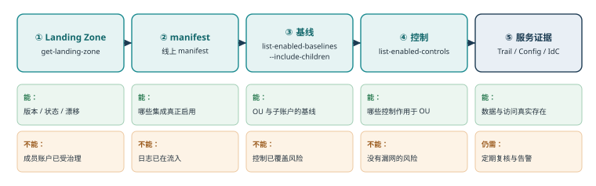

`labs/05-verify/verify.sh` 把五类证据收集成一份报告（需要一个已部署的 Landing Zone）。最常用的几条命令如下：

```{.bash title="验收命令（只读）"}
LZ=$(aws controltower list-landing-zones --query 'landingZones[0].arn' --output text)

# 证据 1：版本、状态、漂移，以及是否开启自动注册
aws controltower get-landing-zone --landing-zone-identifier "$LZ" \
  --query 'landingZone.{version:version,status:status,drift:driftStatus.status,remediation:remediationTypes}'

# 证据 3：OU 及其子账户继承的基线（includeChildren）
aws controltower list-enabled-baselines --include-children \
  --query 'enabledBaselines[].{target:targetIdentifier,version:baselineVersion,status:statusSummary.status,drift:driftStatusSummary.driftStatus}'

# 证据 4：作用于 NonProd OU 的控制
aws controltower list-enabled-controls --target-identifier "$OU_ARN"
```

## 收到漂移，才算闭环

验收不是一次性的。4.0 起漂移事件只发往管理账户的 EventBridge，`labs/04-drift-alerts` 创建规则 → SNS 主题 →（可选）邮件订阅：

```{.hcl title="labs/04-drift-alerts/main.tf（节选）"}
resource "aws_cloudwatch_event_rule" "drift" {
  name = "controltower-drift-detected"
  event_pattern = jsonencode({
    source        = ["aws.controltower"]
    "detail-type" = ["Drift Detected"]
  })
}

resource "aws_cloudwatch_event_target" "sns" {
  rule = aws_cloudwatch_event_rule.drift.name
  arn  = aws_sns_topic.drift.arn
  input_transformer {
    input_paths    = { type = "$.detail.driftType", msg = "$.detail.message" }
    input_template = "\"[Control Tower 漂移] <type>：<msg>\""
  }
}
```

::: warn
不要用 AWS 托管密钥 `alias/aws/sns` 加密这个主题：该密钥的策略不允许 `events.amazonaws.com` 使用，EventBridge 会投递失败，而规则本身看起来一切正常。需要加密时，使用客户托管密钥并在密钥策略中授权 EventBridge。主题策略中用 `aws:SourceArn` 条件限定只有这条规则能发布。
:::

::: {.opener}
[九 · 故障分析]{.kicker}

# 看起来都正常，为什么不对？

[像物理题一样：列已知 → 排除错误推论 → 找到机制差异 → 给出可验证的修复。]{.subtitle}
:::

:::: {.example title="例题 1-3｜Landing Zone 是 ACTIVE，为什么没有组织日志？"}
控制台显示 LZ 4.0 为 ACTIVE，payments-nonprod 也创建成功。管理员以为所有管理事件都会自动进入中央 S3，但在 Log Archive 账户里找不到这个账户的日志。

::: steps
1. **列已知量。** LZ 状态 ACTIVE；账户创建成功。还不知道：manifest 中各集成的实际开关。
2. **排除错误推论。** ACTIVE 只说明 Landing Zone 自身部署完成（证据 1），不能推出“集中日志已部署”（那是证据 2 的内容）。
3. **取证。** `get-landing-zone` 查看线上 manifest，发现 `centralizedLogging.enabled = false`；再用 `aws cloudtrail describe-trails` 确认组织里没有其他人单独建的组织 Trail，避免误判为“完全没有日志”。
4. **定位机制。** 4.0 中集成是可选的；关闭 centralizedLogging，就不会有 Control Tower 管理的组织 Trail。这与 OU、账户都无关。
5. **修复并验证。** 准备 Log Archive 账户与保留策略、评估存储费用，通过“更新 Landing Zone”启用该集成；然后在 payments-nonprod 中执行一次只读 API 调用，在约 15 分钟内到集中日志桶中按账户 ID 和时间窗查找对应事件。
:::

::: answer
根因是**集成未启用**，而不是 OU 或账户配置错误。把账户换到别的 OU、重新注册 OU 都不会产生组织日志。
:::
::::

::: {.fault title="故障 1｜Account Factory 中选不到目标 OU，或创建账户失败"}
现象
:   在 Account Factory 中为 payments-nonprod 选择 NonProd OU，下拉列表里没有它，或提交后报错。

根因
:   单账户的创建、更新与定制，目标 OU 必须启用 **AWSControlTowerBaseline**。NonProd 只启用了 ConfigBaseline，或者根本没有注册。

验证
:   `aws controltower list-enabled-baselines --query "enabledBaselines[?targetIdentifier=='<NonProd OU ARN>']"`

修复
:   在 NonProd 上启用 AWSControlTowerBaseline（若已有 ConfigBaseline，先禁用它——二者互斥）。
:::

::: {.fault title="故障 2｜开启 Region deny 后，某个区域的业务全部 AccessDenied"}
现象
:   更新 Landing Zone 开启 Region deny 后，ap-southeast-1 中的批处理任务全部失败，错误信息为显式拒绝（explicit deny）。

根因
:   ap-southeast-1 不在受治理区域列表中，Region deny 的 SCP 拒绝了对该区域的访问。

修复
:   短期：把该区域加入受治理区域并更新 Landing Zone，然后 Re-register 相关 OU；长期：开启 Region deny 之前先做资源盘点（如用 Resource Explorer 或 Config 聚合器查询各区域资源）。
:::

::: {.fault title="故障 3｜升级到 4.0 后，再也收不到漂移通知"}
现象
:   3.3 时代订阅的 SNS 漂移邮件，升级后一封都没有了，但控制台里能看到漂移。

根因
:   4.0 起漂移通知改为发往管理账户的 EventBridge，不再推送到 SNS 主题。

修复
:   在管理账户的 Home Region 创建匹配 `source = aws.controltower`、`detail-type = Drift Detected` 的规则（实验 1-5）。用一次可控的漂移（例如在测试 OU 中把账户移到别的 OU）验证告警链路。
:::

::: {.fault title="故障 4｜把账户移进 Security OU 后，OU 上的控制显示漂移"}
现象
:   为了“方便审计”，有人把一个业务账户移进了存放集成账户的 OU，随后该 OU 上启用的控制全部显示 Drifted。

根因
:   4.0 文档明确：成员账户移入集成账户所在的 OU，无论是否开启自动注册，该 OU 上已启用的控制都会漂移；而且 AWSControlTowerBaseline 与 ConfigBaseline 不适用于这个 OU。

修复
:   把账户移回受治理的业务 OU；安全团队需要的访问通过 Audit 账户的跨账户角色获得，而不是改变账户位置。
:::

::: {.opener}
[课堂巩固 · 自测]{.kicker}

# 练一练：能否判断真正的治理状态？

[先独立完成，再看后面的答案与解析。每道题都对应一个明确的 AWS 机制边界。]{.subtitle}
:::

## 随堂练习

::: {.exercise title="练习 1｜概念辨析"}
某 Landing Zone 4.0 的 manifest 中 `config.enabled = false`。同事说：“没关系，我们在 NonProd OU 上启用 ConfigBaseline 就能用检测控制了。”这个说法对吗？
:::

::: {.exercise title="练习 2｜依赖推理"}
团队只想要两样东西：IAM Identity Center 单点登录、集中备份。请写出 manifest 中最少需要设为 `enabled = true` 的集成，并说明理由。
:::

::: {.exercise title="练习 3｜生命周期"}
同事把 Home Region 误选成了 eu-west-1。他打算“在设置里改回 us-east-1”。可行吗？如果不可行，代价最小的补救是什么？
:::

::: {.exercise title="练习 4｜读代码"}
实验 1-2 中，若有人把 `security_roles` 的 precondition 删掉，并提交 `config = false, security_roles = true`。`terraform test` 的哪个用例会失败？失败信息说明了什么？
:::

::: {.exercise title="练习 5｜选择实现"}
要求：“任何账户都不能创建公网可访问的 RDS 快照；已经公开的快照要能被发现。”请给出两条控制，分别说明行为与实现。
:::

::: {.exercise title="练习 6｜验收设计"}
`terraform apply` 成功、`get-landing-zone` 显示 ACTIVE。请列出还需要的三条证据，证明 payments-nonprod “真的受治理”。
:::

## 参考答案与解析

::: {.solution title="1"}
不对。ConfigBaseline 的前提就是 Landing Zone 已启用 config 集成；没有 config 集成，ConfigBaseline 与 AWSControlTowerBaseline 都无法启用，基于 Config 的检测控制也就无从谈起。
:::

::: {.solution title="2"}
至少四个：`accessManagement`、`backup`、`securityRoles`、`config`。accessManagement 与 backup 都依赖 securityRoles，securityRoles 又依赖 config。（`centralizedLogging` 不是硬性依赖，但审计通常也会要求它。）
:::

::: {.solution title="3"}
不可行：Home Region 一旦选定就不能更改。补救只有退役（decommission）当前 Landing Zone 后重新设置——涉及共享账户、日志与基线的重建，所以越早发现代价越小。这也是本讲把 Home Region 列为“部署前必须写清的已知量”的原因。
:::

::: {.solution title="4"}
`security_roles_requires_config` 用例会失败：它用 `expect_failures` 断言这种配置必须被拒绝，precondition 被删除后 plan 反而成功了，测试因此报告“期望的失败没有发生”。这说明依赖规则已经从代码中丢失。
:::

::: {.solution title="5"}
① 预防：用 SCP 拒绝 `rds:ModifyDBSnapshotAttribute`、`rds:ModifyDBClusterSnapshotAttribute` 等共享快照的 API，只放行经审批的发布角色；② 检测：用 Config 托管规则 `rds-snapshots-public-prohibited` 评估已存在快照是否公开。前者阻止新增风险，后者发现存量风险，二者互补。
:::

::: {.solution title="6"}
例如：(1) 线上 manifest 中 centralizedLogging、config 为启用；(2) `list-enabled-baselines --include-children` 显示该账户继承的 AWSControlTowerBaseline 为 SUCCEEDED 且未漂移；(3) 在集中日志桶中查到该账户的管理事件。另可加：`list-enabled-controls` 显示控制作用于 NonProd OU；开发者能经 Identity Center 以预期权限集登录。
:::

## 这一讲，你应该记住 {.nonum}

:::: summary
::: {.card tag="核心模型"}
**受治理 = 账户 + 基线 + 控制 + 身份 + 证据**

缺一项就只是“名义上受治理”。
:::
::: {.card tag="4.0 依赖链"}
**config → securityRoles → IdC / Backup**

可选不等于独立；关闭顺序相反。
:::
::: {.card tag="控制时刻"}
**主动在前，预防在中，检测在后**

谁能做用 SCP，资源能被谁用用 RCP。
:::
::: {.card tag="验收习惯"}
**ACTIVE 不是结论，证据链才是**

漂移事件进 EventBridge，要自建告警。
:::
::::

::: refs
## 参考资料 {.nonum}

[截图说明：图 1-4～图 1-7、图 1-9、图 1-10 摄于 2026-11-17，AWS 管理控制台 us-east-1；账户 ID 与账户别名在截图前已替换为文档示例值 111122223333 / cloudops-lab。全部操作只读，未创建任何资源。]{.small}

1. Landing zone v4.0 migration guide / Key changes. <https://docs.aws.amazon.com/controltower/latest/userguide/landing-zone-v4-migration-guide.html>
2. Landing zone manifest 字段说明. <https://docs.aws.amazon.com/controltower/latest/userguide/lz-manifest-file.html>
3. Types of baselines. <https://docs.aws.amazon.com/controltower/latest/userguide/types-of-baselines.html>
4. Compatibility of OU baselines and landing zone versions. <https://docs.aws.amazon.com/controltower/latest/userguide/table-of-baselines.html>
5. How AWS Regions work with AWS Control Tower. <https://docs.aws.amazon.com/controltower/latest/userguide/region-how.html>
6. Launch your landing zone with the APIs（前置条件与服务角色）. <https://docs.aws.amazon.com/controltower/latest/userguide/lz-api-prereques.html>
7. Using identity-based policies for AWS Control Tower（服务角色与托管策略）. <https://docs.aws.amazon.com/controltower/latest/userguide/access-control-managing-permissions.html>
8. Types of governance drift / EventBridge creation. <https://docs.aws.amazon.com/controltower/latest/userguide/governance-drift.html>
9. Provision and manage accounts with Account Factory. <https://docs.aws.amazon.com/controltower/latest/userguide/account-factory.html>
10. CreateLandingZone API（remediationTypes）. <https://docs.aws.amazon.com/controltower/latest/APIReference/API_CreateLandingZone.html>
11. Terraform AWS Provider：aws_controltower_landing_zone / aws_controltower_baseline / aws_controltower_control（provider 6.73.0）. <https://registry.terraform.io/providers/hashicorp/aws/latest/docs>
12. Terraform 测试与 mock provider. <https://developer.hashicorp.com/terraform/language/tests/mocking>
:::
