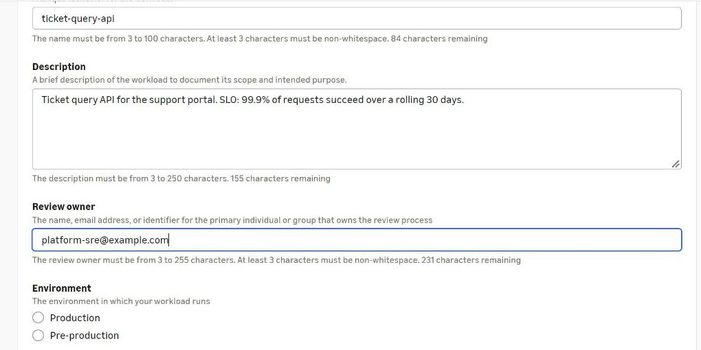
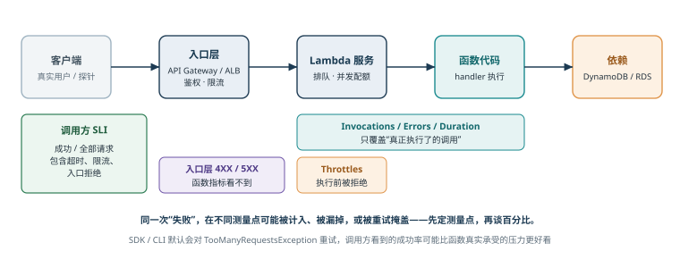
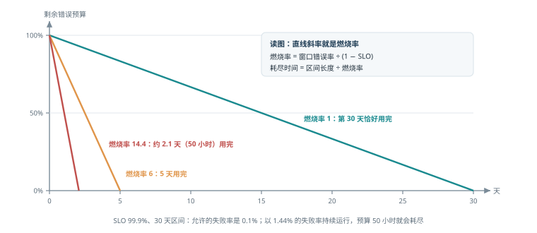
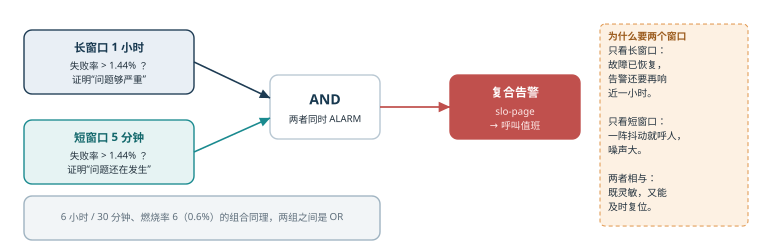
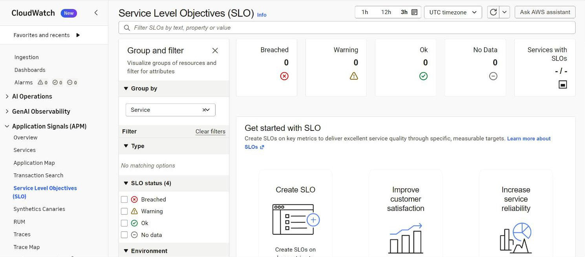
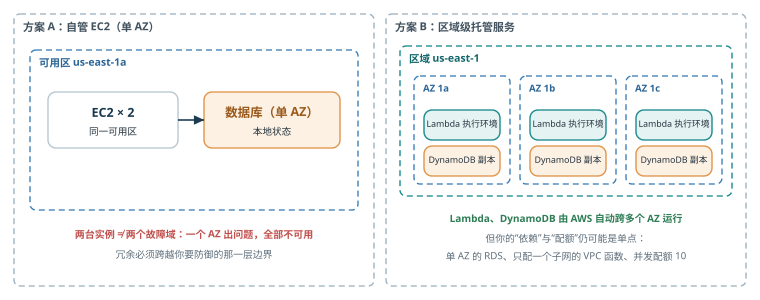
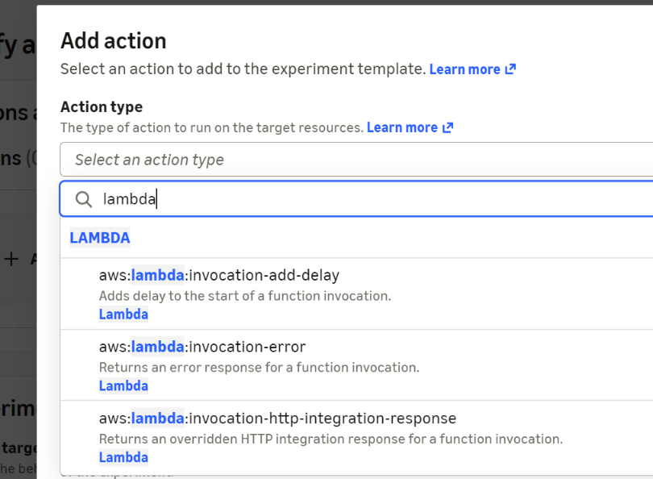
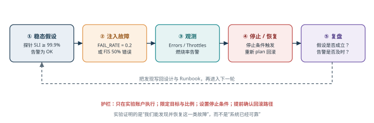

::::: cover
[第 02 讲 · Well-Architected 与可靠性]{.kicker}

# 可靠性：怎样证明一个 API“足够可靠”？

[“部署到了多个可用区”不是答案。先定义什么算成功，再用数字衡量，最后用可控的故障去验证——这就是本讲的三步法。]{.subtitle}

::: cover-meta
- **讲次**：02 / 19
- **建议学时**：4 课时（讲授 2 + 实验 2）
- **实验费用**：本地实验 0 元；云上实验约 0.01 美元/小时
- **适用版本**：WA Framework 2025-02-25 · Lambda Python 3.14
:::

::: scenario
工单查询接口的业务目标是“30 天内至少 99.9% 的请求成功”。一次测试中函数被调用 1000 次，有 2 次抛出异常，另有 3 次请求在进入函数前就被限流。架构师说：“我们已经是多可用区架构了。”**这能证明业务目标达标吗？如果不能，缺的是什么？**
:::

## 学习目标 {.nonum}

:::: cards
::: {.card title="理解"}
- 六大支柱是“评审视角”，不是采购清单
- 可靠性支柱的五条设计原则
- 故障域：冗余必须跨越要防御的边界
:::
::: {.card title="计算"}
- 请求型 / 时间型 SLI 与错误预算
- 燃烧率与多窗口告警阈值
- 从不同测量点得到的“成功率”为何不同
:::
::: {.card title="实操"}
- Terraform 部署可注入故障的最小负载
- 用指标数学 + 复合告警实现 SLO 告警
- 用调用方探针计算真实 SLI
:::
::: {.card title="验证与排障"}
- “故障注入了，告警却没响”
- StatusCode 200 却是失败
- 用 FIS 停止条件给实验加护栏
:::
::::

| 本讲结构 | 要回答的问题 | 产出 |
|---|---|---|
| 一、框架 | Well-Architected 怎样作用于一个具体负载？ | 支柱 × 设计决策表 |
| 二、指标 | “99.9%”到底在数什么？ | SLI / SLO / 错误预算公式 |
| 三、告警 | 什么时候该叫醒值班的人？ | 燃烧率与多窗口告警 |
| 四、故障域 | 多 AZ 到底防住了什么？ | 故障域图、配额检查 |
| 五、实操 | 怎样低成本地注入故障并观测？ | Terraform、探针、FIS 模板 |
| 六～七、排障与练习 | 告警为什么没响？ | 故障卡、练习与答案 |
:::::

::: {.opener .nobreak}
[一 · 框架]{.kicker}

# Well-Architected 怎样作用于一个具体负载？

[框架给出的是一组“评审问题”。真正的产出，是针对某个负载、带取舍理由的设计决策。]{.subtitle}
:::

## 六大支柱是六个评审视角

AWS Well-Architected Framework 用六个支柱组织评审问题：卓越运营、安全、可靠性、性能效率、成本优化、可持续性。它们不是六张需要“各拿 100 分”的考卷，而是六个**看同一个负载的角度**——同一个设计选择，往往在一个支柱上得分、在另一个支柱上付出代价。下表把它们落到本讲的实验负载 ticket-query 上：

| 支柱 | 本讲的设计选择 | 用什么证据观察 | 付出的代价 |
|---|---|---|---|
| 卓越运营 | 故障开关是 Terraform 变量，变更经 plan 审阅 | plan 输出、实验记录 | 每次注入都要走一遍 plan / apply |
| 安全 | 不建函数 URL；执行角色只能写自己的日志组 | IAM 策略、无公网入口 | 只能用 IAM 身份调用 |
| 可靠性 | 定义 SLO；燃烧率告警；可控故障注入 | 探针 SLI、告警状态变化 | 需要维护探针与告警 |
| 性能效率 | 按需执行，观察 Duration 与 Throttles | Lambda 指标 | 冷启动不可完全避免 |
| 成本优化 | arm64、128 MB、日志保留 1 天、用完即 destroy | 账单、残留资源检查 | 日志短期即过期 |
| 可持续性 | 无常驻实例与负载均衡器 | 资源清单 | —— |

可靠性支柱给出了五条设计原则，本讲的每个实验都对应其中一条：

:::: cards
::: {.card title="自动从故障中恢复"}
用指标判断“是否健康”，用自动化触发恢复，而不是等用户报障。→ 燃烧率告警
:::
::: {.card title="测试恢复流程"}
在可控条件下制造故障，验证检测与恢复是否像设计的那样工作。→ 故障注入 / FIS
:::
::: {.card title="水平扩展、提高总体可用性"}
用多个小资源代替一个大资源，减少单点。→ 故障域分析
:::
::: {.card title="停止猜测容量 · 通过自动化管理变更"}
按需求伸缩、关注配额；所有变更走代码与审阅。→ 并发配额检查、Terraform
:::
::::

## Well-Architected Tool：把评审变成可追踪的记录

Well-Architected Tool 是控制台里的免费服务。一次评审的流程是：**定义负载**（名称、负责人、环境、区域）→ **选择镜头（lens）**（默认是 AWS Well-Architected Framework，本书实验账户中其版本为 2025-02-25；还有 Serverless、Generative AI 等专用镜头）→ **逐题回答** → 工具标出**高风险（HRI）与中风险（MRI）**问题 → 生成**改进计划** → 用**里程碑**保存某一时刻的快照，便于对比。

{.shot}

::: tip
评审的价值在于“让风险被说出来并有人负责”。把 SLO 写进负载描述（如图 2-1），后面每一道可靠性问题都可以拿它当标尺：这个设计能否守住 99.9%？证据在哪？
:::

::: {.opener}
[二 · 指标]{.kicker}

# “99.9%”到底在数什么？

[没有测量口径，99.9% 只是一个装饰性的数字。先定 SLI，再谈 SLO 和错误预算。]{.subtitle}
:::

## SLI、SLO 与错误预算

三个概念层层递进，可以用一组公式说清楚：

::: formula
SLI（请求型）＝ 好请求数 ÷ 总请求数

SLO：在区间 T 内，SLI ≥ 目标值（如 99.9%）

错误预算 ＝ 总请求数 ×（1 − SLO）
:::

- **SLI（服务水平指标）**是测量方法：数什么、在哪里数、什么算“好”。
- **SLO（服务水平目标）**是给 SLI 定的阈值和统计区间，例如“滚动 30 天，请求成功率 ≥ 99.9%”。
- **错误预算**是 SLO 允许的失败量。预算没用完，团队可以放心发布新功能；预算快用完，就该放慢变更、优先修复可靠性问题。

同一个 99.9%，按“请求”和按“时间”计算，含义完全不同：

:::: cards
::: {.card title="请求型：数请求"}
100 万个请求、SLO 99.9% → 最多允许 **1000** 个失败请求。要事先约定：重试算几次？超时算不算失败？
:::
::: {.card title="时间型：数时间片"}
30 天 = 43 200 分钟，SLO 99.9% → 最多允许约 **43.2 分钟**不达标。某一分钟只要不健康，就整分钟计入预算。
:::
::::

:::: {.example title="例题 2-1｜1000 次调用、2 次异常、3 次限流：达标了吗？"}
同一时间窗口内的监控样本：Invocations = 1000，Errors = 2，Throttles = 3。假设没有重试、每个请求唯一，入口层也没有其他失败。求：(1) 函数层成功率；(2) 调用方视角的请求成功率；(3) 与 99.9% 目标比较。

::: steps
1. **写出已知量，并弄清每个指标数的是什么。** Invocations 只统计**真正执行了**的调用（成功的与函数出错的）；被限流的请求根本没有执行，不计入 Invocations，也不计入 Errors，只计入 Throttles。
2. **函数层成功率**：(1000 − 2) ÷ 1000 = 99.8%。注意它的分母不含 Throttles。
3. **换成调用方视角**：总请求 = 1000 + 3 = 1003；成功 = 1000 − 2 = 998；成功率 = 998 ÷ 1003 ≈ 99.50%。
4. **与目标比较**：两个口径都低于 99.9%。按调用方口径，1003 个请求的错误预算只有约 1 个，实际失败 5 个，预算超支约 5 倍。
:::

::: answer
函数层 99.8%，调用方 99.50%，都不达标。“多可用区”回答的是“架构能否扛住 AZ 故障”，而这道题里的失败来自代码异常和并发限流——两者不在同一个层面上。
:::
::::

用实验 2-1 的计算器可以复核这道题：

```{.console title="python slo.py request --total 1003 --bad 5 --slo 99.9（本书实测输出）"}
SLI = (1003 - 5) / 1003 = 99.5015%
SLO = 99.900% → 未达标
错误预算 = 1003 × 0.0010 = 1.00 个请求；已用 5 个（499%）
```

## 测量点决定了你看到的“成功率”



| Lambda 指标 | 统计的是什么 | 不包含什么 |
|---|---|---|
| `Invocations` | 函数代码被调用的次数，含成功与函数错误 | 被限流的请求、其他调用错误 |
| `Errors` | 产生函数错误的调用（代码抛出的异常、运行时异常） | 被限流的请求 |
| `Throttles` | 因并发不足被限流的调用请求 | 已执行的调用 |
| `Duration` | 处理事件所花的时间（毫秒） | 排队与入口层耗时 |

除了指标口径，还有三个常见的“看不见”：

::: pitfalls
1. **StatusCode 200 不等于成功。** 同步调用时，函数抛出未捕获的异常，`Invoke` 照样返回 `StatusCode: 200`，失败信息在响应的 `FunctionError: Unhandled` 字段和返回载荷里。探针如果只看状态码，就会把失败数成成功。
2. **重试会掩盖限流。** AWS CLI v2 与多数 SDK 默认采用 standard 重试模式（最多 3 次尝试），会自动重试 `TooManyRequestsException`。调用方最终“成功”了，但函数侧的 Throttles 已经发生，延迟也被拉长。测量 SLI 的探针应关闭自动重试，或把重试次数单独记录。
3. **入口层的拒绝在函数指标里不存在。** 鉴权失败、API Gateway 限流、客户端超时，都要在入口层或调用方测量。
:::

::: {.opener}
[三 · 告警]{.kicker}

# 什么时候该叫醒值班的人？

[“有错就响”的告警太吵，“错误率超过 0.1%”的告警又太迟钝。燃烧率把告警和 SLO 直接挂钩。]{.subtitle}
:::

## 从“有错就响”到燃烧率

最朴素的告警是“1 分钟内 Errors 之和 > 0 就 ALARM”。它很灵敏，但对一个每天处理百万请求的服务，偶发的一两个错误本来就在错误预算之内——这样的告警每天响几十次，值班的人很快就不再看它。

更好的问题是：**照现在的失败速度，错误预算还能撑多久？**这就是燃烧率：

::: formula
燃烧率 ＝ 回看窗口内的错误率 ÷（1 − SLO）

燃烧率阈值 ＝ 允许在窗口内消耗的预算比例 × 区间长度 ÷ 窗口长度
:::

燃烧率为 1，意味着按这个速度，区间结束时预算刚好用完；燃烧率为 14.4，意味着预算会在 30 天 ÷ 14.4 ≈ 50 小时内耗尽。把它画成“剩余预算—时间”图像，燃烧率就是直线的斜率：



:::: {.example title="例题 2-2｜6 小时内烧掉 5% 的预算，阈值是多少？"}
SLO 为 99.9%，区间为滚动 30 天。希望“6 小时内消耗了 5% 的错误预算”时告警。求燃烧率阈值和对应的错误率阈值。

::: steps
1. **区间长度**：30 天 = 720 小时。
2. **燃烧率阈值**：5% × 720 ÷ 6 = 6。
3. **错误率阈值**：6 ×（1 − 99.9%）= 6 × 0.1% = 0.6%。
4. **校验**：以 0.6% 的错误率持续 6 小时，消耗的预算 = 0.6% × 6 ÷（0.1% × 720）= 5%。✓
:::

::: answer
燃烧率阈值 6，错误率阈值 0.6%。同理，“1 小时内烧掉 2%”对应燃烧率 14.4、错误率 1.44%。AWS 文档中的例子“1 小时内烧掉 5%”对应燃烧率 36。
:::
::::

实验 2-1 的计算器可以一次给出常用的三档阈值：

```{.console title="python slo.py table --slo 99.9 --interval-days 30（本书实测输出）"}
SLO 99.900%，区间 30 天（多窗口、多燃烧率）
级别          预算%   长窗口   短窗口   燃烧率   错误率阈值
紧急 page        2      1h      5m    14.4      1.440%
紧急 page        5      6h     30m     6.0      0.600%
工单 ticket     10     72h    360m     1.0      0.100%
```

## 为什么要“长窗口 AND 短窗口”

只看 1 小时窗口，故障修好之后告警还要再响将近一小时；只看 5 分钟窗口，一阵抖动就会把人叫醒。把两者用 AND 连起来：**长窗口证明问题足够严重，短窗口证明问题仍在发生**。



在 CloudWatch 中，这套逻辑可以用**指标数学告警 + 复合告警**实现（实验 2-2）；也可以使用 CloudWatch Application Signals 的托管 SLO 功能：它支持请求型与时间型 SLO、日历或滚动区间，可以直接以任意 CloudWatch 指标或指标表达式作为 SLI，并能按燃烧率创建告警。

{.shot}

::: {.opener}
[四 · 故障域]{.kicker}

# 多可用区到底防住了什么？

[冗余只有跨越你要防御的那一层边界才有意义。还要记住：配额和依赖也是故障域。]{.subtitle}
:::

## 冗余要跨越边界



“多 AZ”不是一个布尔开关，要说清三件事：**冗余在哪一层**（计算、数据、入口）、**谁负责切换**（负载均衡器健康检查、数据库自动故障转移，还是人工）、**状态放在哪里**（无状态计算可以随意替换，有状态数据需要复制与备份）。

Lambda 是区域级服务，AWS 会在多个可用区运行函数，单个 AZ 中断时仍能处理事件。但这并不意味着整个调用链都是多 AZ 的：如果函数挂在 VPC 里却只配置了一个子网，或者依赖的是单 AZ 的数据库，故障域就退化成了那一个 AZ。

::: warn
**多 AZ 防不住的故障**：同一版本的代码缺陷会同时出现在所有 AZ；错误配置的推送会同时生效；区域级依赖故障需要多区域设计（第 13 讲）。这也是为什么本讲把“发布与变更”看成可靠性的一部分。
:::

## 配额也是故障域

可靠性支柱的第一组问题就是“如何管理服务配额与约束”。下面是在本书实验账户里读到的真实值：

```{.console title="aws lambda get-account-settings（2026-11-17，us-east-1 实测）"}
{
    "ConcurrentExecutions": 10,
    "Unreserved": 10
}
```

这个账户整个区域的 Lambda 并发上限只有 **10**（新账户的配额通常较低，会随使用情况自动提高；成熟账户默认一般为 1000）。如果对 ticket-query 做一次 20 并发的压测，超出的请求会直接被限流，计入 `Throttles`——这正是例题 2-1 中那 3 次失败可能的来源。上线前检查配额、必要时申请提额，本身就是可靠性工作。

## RTO 与 RPO：两个独立的目标

- **RTO（恢复时间目标）**：业务能容忍的最长中断时间。
- **RPO（恢复点目标）**：业务能容忍丢失多长时间的数据。

二者互相独立：一个系统可以几分钟就恢复（RTO 小），却丢失了最近 24 小时的数据（RPO 大）。本讲的 Lambda 负载没有持久数据，所以无法测量 RPO；备份、恢复与灾备在第 13 讲专门展开。

::: {.opener}
[五 · 实操]{.kicker}

# 低成本地注入故障，并看清它

[一个函数、一个角色、一组短期日志、几条告警。故障开关就是一个 Terraform 变量。]{.subtitle}
:::

:::: {.lab title="实验 2-1｜SLO 计算器（纯本地）"}
::: labmeta
- **目标**：用代码复现本讲全部公式
- **时长**：15 分钟
- **费用**：0 元
- **工具**：Python 3.11+
:::

`labs/01-slo-calculator/slo.py` 提供 `request`、`period`、`burn`、`table` 四个子命令，`test_slo.py` 用 8 个单元测试锁定公式（包括 AWS 文档中“5% / 1 小时 → 36”的例子）。

```{.console title="在 labs/01-slo-calculator 中执行（本书实测输出）"}
$ python -m unittest
........
Ran 8 tests in 0.000s
OK
$ python slo.py period --days 30 --slo 99.9
30 天 × 1440 分钟 × 0.0010 = 43.2 分钟可不达标
```
::::

:::: {.lab title="实验 2-2｜Terraform：可注入故障、可观测的最小负载"}
::: labmeta
- **目标**：部署 ticket-query 与 SLO 燃烧率告警
- **时长**：30 分钟（含销毁）
- **费用**：Lambda 在免费额度内；告警约 2 美元/月，按小时折算
- **权限**：IAM、Lambda、CloudWatch 的创建与删除
:::

`labs/02-lambda-reliability` 创建 10 个资源：执行角色与其内联策略、日志组（保留 1 天）、函数（Python 3.14、arm64、128 MB、超时 3 秒）、1 条对照告警、4 条燃烧率告警和 1 条复合告警。几个值得读懂的设计：

- **日志组由 Terraform 预先创建**，所以执行角色只需要 `logs:CreateLogStream` 与 `logs:PutLogEvents`，并且只作用于这一个日志组——比托管策略 `AWSLambdaBasicExecutionRole`（允许在任意位置创建日志组）更小。
- **`source_code_hash`** 让 Terraform 在 handler 改动时识别出部署包变化。
- **`FAIL_RATE`** 是 0～1 之间的小数而不是开关，可以注入“20% 失败”这类部分故障，更接近真实事故。
- **`reserved_concurrency = 0`** 会拒绝全部调用，用来专门观察 `Throttles`。

燃烧率告警用指标数学计算调用方失败率。注意分子和分母都把 Throttles 加了回来——这正是例题 2-1 的口径：

```{.hcl title="labs/02-lambda-reliability/alarms.tf（节选）"}
resource "aws_cloudwatch_metric_alarm" "burn" {
  for_each            = local.burn_specs          # fast-long / fast-short / slow-long / slow-short
  alarm_name          = "${var.name}-burn-${each.key}"
  comparison_operator = "GreaterThanThreshold"
  evaluation_periods  = 1
  threshold           = each.value.threshold      # 0.0144 或 0.006
  treat_missing_data  = "notBreaching"

  metric_query {
    id          = "ratio"
    expression  = "IF((inv + thr) > 0, (err + thr) / (inv + thr), 0)"
    return_data = true
  }
  dynamic "metric_query" {                        # err / inv / thr 三个原始指标
    for_each = { err = "Errors", inv = "Invocations", thr = "Throttles" }
    content {
      id = metric_query.key
      metric {
        namespace   = "AWS/Lambda"
        metric_name = metric_query.value
        period      = each.value.period           # 3600 / 300 / 21600 / 1800 秒
        stat        = "Sum"
        dimensions  = { FunctionName = aws_lambda_function.fn.function_name }
      }
    }
  }
}

# 引用资源属性（而不是拼接名字），Terraform 才知道要先建好 4 条子告警
resource "aws_cloudwatch_composite_alarm" "page" {
  alarm_name = "${var.name}-slo-page"
  alarm_rule = join(" OR ", [
    for k in keys(local.burn_windows) :
    "(ALARM(\"${aws_cloudwatch_metric_alarm.burn["${k}-long"].alarm_name}\") AND ALARM(\"${aws_cloudwatch_metric_alarm.burn["${k}-short"].alarm_name}\"))"
  ])
}
```

在 apply 之前，先在本地验证，再对真实账户做一次只读的 plan：

```{.console title="在 labs/02-lambda-reliability 中执行（本书实测输出，节选）"}
$ terraform test
  run "baseline_is_least_cost_and_observable"... pass
  run "burn_rate_thresholds_match_formula"... pass
  run "fault_injection_is_a_variable_change"... pass
  run "reject_invalid_fail_rate"... pass
  run "fis_extension_wires_layer_and_env"... pass
  run "fis_extension_requires_bucket"... pass
Success! 6 passed, 0 failed.
$ terraform plan
Plan: 10 to add, 0 to change, 0 to destroy.
  + burn_rate_thresholds = {
      + fast-long  = { burn_rate = 14.4, error_ratio_threshold = 0.0144, window_seconds = 3600 }
      + slow-long  = { burn_rate = 6,    error_ratio_threshold = 0.006,  window_seconds = 21600 }
      ...
```
::::

::: note
阈值用 `tonumber(format("%.6f", …))` 保留 6 位小数。原因是 Terraform 用高精度数值计算 14.4 × (1 − 0.999)，plan 中会显示成 0.01439999…896 这样的长串；数值本身没错，但不利于评审。
:::

{.shot}

:::: {.lab title="实验 2-3｜注入故障：正常 → 失败 → 恢复"}
::: labmeta
- **目标**：用同一个探针观察三个状态
- **时长**：40 分钟（告警评估需要等待）
- **费用**：几百次调用，免费额度内
- **前提**：实验 2-2 已部署
:::

1. **基线**：`python probe.py --function-name ticket-query --count 200`，期望调用方 SLI 为 100%，各告警为 OK 或 INSUFFICIENT_DATA（还没有数据时的正常状态）。
2. **注入**：`terraform apply -var="fail_rate=0.2"`，再执行 `aws lambda wait function-updated --function-name ticket-query`，确认配置已生效后再探测。
3. **观测**：再次运行探针，失败率应接近 20%。约 1～3 分钟后，`errors-any` 与 5 分钟窗口告警进入 ALARM；1 小时窗口的失败率也会超过 1.44%，复合告警随之 ALARM。
4. **恢复**：重新 `terraform plan` 并 apply 默认值（不要复用旧的计划文件），等待函数更新完成后再探测；短窗口告警会先复位，复合告警随之恢复为 OK。
5. **清理**：`terraform destroy`，再用 `aws lambda list-functions` 与 `aws cloudwatch describe-alarms --alarm-name-prefix ticket-query` 确认没有残留。

不连 AWS 也能先体验探针的计算逻辑（随机模拟 0.2% 函数错误、0.3% 限流）：

```{.console title="python probe.py --simulate --count 1000 --error-rate 0.002 --throttle-rate 0.003 --seed 7（本书实测输出）"}
请求总数 1000：成功 989，函数错误 6，限流 5，其他 0
函数层 (Invocations-Errors)/Invocations = 989/995 = 99.397%
调用方 SLI = 成功 / 全部请求 = 989/1000 = 98.900%  （SLO 99.9%：未达标）
```
::::

::: warn
V1.0 中上面第 3、4 步只是“应当观察到什么”的预期。V1.1 已在实验账户中真实跑完一轮，记录见下一节；其中第 4 步“复合告警随之恢复为 OK”与实测不符，原因见下文第 2 点。
:::

## V1.1 实测：一轮真实的“注入 → 告警 → 恢复 → 销毁”

::: note
证据级别：**LIVE APPLY → LIVE VERIFIED → RECOVERED → DESTROYED**。2026-11-18 23:56 至 11-19 00:27（UTC）在 us-east-1
由 IAM 用户（非 root）执行，资源存续约 28 分钟，费用估算 < 0.01 美元。原始日志（账户号已替换）：`labs/02-lambda-reliability/live-2026-11-19.txt`。
:::

```{.console title="实验 2-2 / 2-3 关键输出（本书实测，节选；时间为 UTC）"}
23:56:50  terraform apply                  Apply complete! Resources: 10 added
23:57:23  probe 200 次（FAIL_RATE=0）      成功 200，函数错误 0   调用方 SLI 100.000%
00:00:03  apply -var fail_rate=0.2         ~ "FAIL_RATE" = "0" -> "0.2"   （1 changed）
00:00:40  probe 200 次（FAIL_RATE=0.2）    成功 161，函数错误 39  调用方 SLI 80.500%
00:01:42  burn-slow-long    OK -> ALARM
00:01:51  burn-slow-short   OK -> ALARM    slo-page（复合）OK -> ALARM
00:01:53  burn-fast-short   OK -> ALARM
00:01:55  errors-any        OK -> ALARM
00:02:17  burn-fast-long    OK -> ALARM
00:04:02  apply（恢复默认 0）              ~ "FAIL_RATE" = "0.2" -> "0"
00:04:39  probe 200 次                     成功 200，函数错误 0
00:04:55  errors-any        ALARM -> OK
00:08:53  burn-fast-short   ALARM -> OK
00:23:39  slo-page 仍为 ALARM（burn-slow-short / burn-slow-long 仍为 ALARM）
00:24:26  terraform destroy                Destroy complete! Resources: 10 destroyed
00:27:18  残留复核：函数 0、同名告警 0、日志组 0、IAM 角色 NoSuchEntity、状态 0 个资源
```

**读实测记录，有三点值得记住：**

1. **告警比“注入即告警”慢，但比想象的快。** 第一条注入错误写入日志是 00:00:43，最早的告警在 00:01:42 变为 ALARM，约 1 分钟。
   1 小时窗口的 burn-fast-long 也只用了约 1.5 分钟：它比较的是窗口内的错误比值，而故障期的实测错误率约 20%（39/200），
   远超 1.44% 的阈值，不需要等满 1 小时。
2. **修好之后，复合告警仍在呼叫。** 修复后约 1 分钟 errors-any 复位，00:08:53 burn-fast-short 复位，于是“快速”那一对的 AND 为假；
   但“慢速”那一对（6 小时与 30 分钟窗口）仍然包含故障期的错误，复合告警的 OR 仍为真。
   到 00:23:39 销毁前，slo-page 一直是 ALARM。按 30 分钟短窗口推算，它最早要到故障后约 30 分钟才会复位；为控制时间与费用，本轮没有等到。
   值班手册因此应写明：**修复是否见效，先看短窗口告警是否复位，不要等复合告警。**
3. **销毁要复核，不要只看 Destroy complete。** 本轮逐项确认函数、告警、日志组、IAM 角色都已不存在；
   CloudWatch 中 AWS/Lambda 指标数据无法删除，但不收费，15 个月后自动过期。

| 实验 | V1.1 证据级别 |
|---|---|
| 2-1 SLO 计算器 | MOCK TEST（unittest 8/8） |
| 2-2 Terraform 负载 | MOCK TEST（terraform test 6/6）→ READ-ONLY PLAN（10 to add）→ LIVE APPLY（10 added）→ DESTROYED（10 destroyed，残留 0） |
| 2-3 注入与恢复 | LIVE VERIFIED（39/200 失败，6 条告警全部 ALARM）→ RECOVERED（200/200 成功，errors-any 与 burn-fast-short 复位） |
| 2-4 FIS | 未执行：需要 FIS Lambda 扩展与按动作分钟计费的实验，V1.1 保留为可选步骤 |

## 进阶：用 AWS FIS 做受控的故障实验

修改环境变量来制造故障，需要一次部署，也无法精确控制“影响多少比例的请求、持续多久”。AWS Fault Injection Service（FIS）为 Lambda 提供了三种故障动作：

{.shot width=60%}

| 动作 | 作用 | 关键参数 |
|---|---|---|
| `aws:lambda:invocation-add-delay` | 在执行前增加延迟（可用来制造超时） | `duration`、`invocationPercentage`、`startupDelayMilliseconds` |
| `aws:lambda:invocation-error` | 把调用标记为失败 | `duration`、`invocationPercentage`、`preventExecution` |
| `aws:lambda:invocation-http-integration-response` | 覆盖返回给 HTTP 集成的响应 | `duration`、`invocationPercentage` 等 |

这些动作依赖 FIS 的 Lambda 扩展：函数要挂上扩展层（层 ARN 从 SSM 公共参数 `/aws/service/fis/lambda-extension/AWS-FIS-extension-arm64/1.x.x` 读取，本书查询时为版本 436），并设置 `AWS_LAMBDA_EXEC_WRAPPER=/opt/aws-fis/bootstrap` 和指向 S3 配置目录的 `AWS_FIS_CONFIGURATION_LOCATION`。实验 2-2 的 `enable_fis_extension = true` 会完成这些配置，实验 2-4（`labs/03-fis-experiment`）创建实验模板：

```{.hcl title="labs/03-fis-experiment/main.tf（节选）"}
resource "aws_fis_experiment_template" "lambda_errors" {
  description = "Inject 50% invocation errors into ticket-query for 2 minutes"
  role_arn    = aws_iam_role.fis.arn

  stop_condition {                       # 护栏：SLO 复合告警一旦 ALARM，实验立即停止
    source = "aws:cloudwatch:alarm"
    value  = var.stop_alarm_arn
  }
  action {
    name      = "inject-invocation-errors"
    action_id = "aws:lambda:invocation-error"
    parameter {
      key   = "duration"             # ISO 8601：持续 2 分钟
      value = "PT2M"
    }
    parameter {
      key   = "invocationPercentage" # 只影响一半的调用
      value = "50"
    }
    parameter {
      key   = "preventExecution"     # 不执行函数代码，直接返回错误
      value = "true"
    }
    target {
      key   = "Functions"
      value = "ticket-query"
    }
  }
  target {
    name           = "ticket-query"
    resource_type  = "aws:lambda:function"
    resource_arns  = [var.function_arn]
    selection_mode = "ALL"
  }
}
```



::: cost
FIS 按“动作分钟”计费，本实验约 2 个动作分钟；指标数学告警按表达式引用的指标数计费，复合告警单独计费。实验结束后立即 `terraform destroy`，残留的告警才是长期费用的主要来源。
:::

::: {.opener}
[六 · 故障分析]{.kicker}

# 故障注入了，告警为什么没响？

[按“请求是否执行 → 指标是否增长 → 告警是否评估 → 恢复是否成立”的顺序排查。]{.subtitle}
:::

:::: {.example title="例题 2-3｜FAIL_RATE 改成了 0.2，告警一直是 OK"}
学员 apply 了 `fail_rate = 0.2`，马上用 `aws lambda invoke` 连续调用了 50 次，然后打开 CloudWatch，发现 `errors-any` 仍是 OK。可能的原因有哪些？怎样逐一排除？

::: steps
1. **调用真的失败了吗？** 查看 invoke 的响应：`StatusCode` 为 200 并不说明成功，要看是否有 `FunctionError: Unhandled`。如果全部没有 FunctionError，说明新配置可能还没生效。
2. **配置生效了吗？** 更新函数配置是异步的。apply 之后应先执行 `aws lambda wait function-updated`，再用 `get-function-configuration` 确认 `FAIL_RATE` 为 0.2。在更新完成前发出的调用仍由旧配置处理。
3. **指标看对了吗？** 核对区域、命名空间 `AWS/Lambda`、维度 `FunctionName`（不是别名或版本维度）、统计方式 Sum、时间范围。
4. **告警评估了吗？** 指标发布有延迟，告警按周期评估；`treat_missing_data = notBreaching` 时，没有数据的周期被当作“未越界”。等待 1～3 分钟再看状态历史。
5. **用证据收尾。** 状态历史出现 OK → ALARM 的转换，且原因中引用的数据点与探针统计一致，才算验证成功。
:::

::: answer
最常见的原因是第 2 步：在函数更新完成之前就开始调用，失败根本没有发生。排查顺序应当从“请求是否真的失败”开始，而不是从“告警是否配置错了”开始。
:::
::::

::: {.fault title="故障 1｜探针显示 100% 成功，CloudWatch 却有 Errors"}
现象
:   自写的探针脚本统计成功率 100%，同一时间段 `Errors` 的和为 12。

根因
:   探针只判断了 HTTP 状态码 200。函数抛出的未捕获异常在同步调用中仍返回 200，错误在 `FunctionError` 字段里。

修复
:   按响应中是否存在 `FunctionError` 计数（`probe.py` 的写法），并把载荷中的错误类型记入日志。
:::

::: {.fault title="故障 2｜压测时成功率很高，但 Throttles 很多"}
现象
:   20 并发压测，调用方几乎全部成功，但 `Throttles` 有上百次，P99 延迟翻倍。

根因
:   账户并发配额只有 10；SDK 的 standard 重试模式自动重试了 `TooManyRequestsException`，掩盖了限流。

修复
:   探针关闭自动重试以测得真实 SLI；在 Service Quotas 中申请提高并发配额；对关键函数考虑预留并发。
:::

::: {.fault title="故障 3｜FIS 实验运行了，函数却没有出错"}
现象
:   实验状态为 completed，但这 2 分钟里函数的 Errors 没有任何变化。

根因
:   常见三种：没有挂扩展层或没设置 `AWS_LAMBDA_EXEC_WRAPPER`；函数角色没有读取 S3 配置目录的权限；扩展默认每 60 秒轮询一次配置，实验时间太短、调用太稀疏，故障还没被拉取就结束了。

修复
:   检查层与两个环境变量；查看函数日志中 `AWS FIS EXTENSION` 开头的行；延长实验时长，或调小 `AWS_FIS_SLOW_POLL_INTERVAL_SECONDS`、设置 `AWS_FIS_POLL_MAX_WAIT_MILLISECONDS`。
:::

::: {.fault title="故障 4｜复合告警从来不会进入 ALARM"}
现象
:   故障期间 1 小时窗口告警早已 ALARM，复合告警始终 OK。

根因
:   流量太稀疏：5 分钟窗口里常常没有任何请求，`treat_missing_data = notBreaching` 让这些窗口被视为健康，AND 条件始终无法同时满足。

修复
:   低流量服务应加大短窗口，或用合成探针（如 CloudWatch Synthetics）补足基础流量；另一种方案是改用时间型 SLO。
:::

::: {.opener .newpage}
[课堂巩固 · 自测]{.kicker}

# 练一练：你能给“可靠”下定义吗？

[先独立完成，再看后面的答案与解析。]{.subtitle}
:::

## 随堂练习

::: {.exercise title="练习 1｜请求成功率"}
2000 个唯一请求中有 3 次失败，SLO 为 99.9%。是否达标？错误预算用掉了多少？
:::

::: {.exercise title="练习 2｜时间型预算"}
SLO 为 99.95%，区间为 28 天的时间型 SLO（1 分钟一个时间片）。总共允许多少分钟不达标？
:::

::: {.exercise title="练习 3｜燃烧率"}
SLO 99.9%、30 天区间。过去 1 小时的失败率为 0.5%。燃烧率是多少？若一直保持，多久耗尽全部预算？
:::

::: {.exercise title="练习 4｜指标口径"}
某 1 分钟内 `Errors = 0`、`Invocations = 0`、`Throttles = 5`。能否说“这一分钟的成功率是 100%”？
:::

::: {.exercise title="练习 5｜故障域"}
两台 EC2 实例分别在 us-east-1a 与 us-east-1b，但都连接同一个单 AZ 的 RDS 实例（位于 1a）。us-east-1a 故障时，服务还可用吗？
:::

::: {.exercise title="练习 6｜实验护栏"}
为什么实验 2-4 把 SLO 复合告警设为 FIS 的停止条件？如果设成 `errors-any`，会发生什么？
:::

## 参考答案与解析

::: {.solution title="1"}
成功率 (2000 − 3) ÷ 2000 = 99.85%，未达标。错误预算 = 2000 × 0.1% = 2 个请求，实际失败 3 个，用掉了 150%。
:::

::: {.solution title="2"}
28 × 1440 = 40 320 分钟；40 320 × 0.05% ≈ 20.2 分钟。
:::

::: {.solution title="3"}
燃烧率 = 0.5% ÷ 0.1% = 5；耗尽时间 = 720 小时 ÷ 5 = 144 小时（6 天）。它低于 14.4 和 6 两档阈值，不会触发呼叫，但已经明显快于“刚好用完”的速度，值得开工单跟进。
:::

::: {.solution title="4"}
不能。分母为 0 时成功率没有定义（0/0），而这 5 个被限流的请求对调用方来说都失败了——按调用方口径，这一分钟的成功率是 0/5 = 0%。
:::

::: {.solution title="5"}
不可用（至少写操作不可用）。计算层跨了两个 AZ，但数据层只在 1a，整条调用链的故障域仍然是 1a。需要多 AZ 部署的数据库（如 RDS Multi-AZ）才能消除这个单点。
:::

::: {.solution title="6"}
停止条件是实验的“保险丝”，应该对应“对用户造成了不可接受的影响”。`errors-any` 在注入第一个错误时就会 ALARM，实验刚开始就会被停止，什么也验证不了；SLO 复合告警则在影响超过预算承受能力时才触发，既允许实验发生，又能在真正伤害 SLO 前及时止损。
:::

## 这一讲，你应该记住 {.nonum}

:::: summary
::: {.card tag="核心公式"}
**SLI = 好请求 ÷ 总请求**

错误预算 = 总量 ×（1 − SLO）。
:::
::: {.card tag="告警"}
**燃烧率 = 错误率 ÷（1 − SLO）**

长窗口 AND 短窗口，才既灵敏又能复位。
:::
::: {.card tag="口径"}
**先定测量点，再谈百分比**

Throttles 不在 Invocations 里；200 不等于成功。
:::
::: {.card tag="故障域"}
**冗余要跨越防御的边界**

依赖与配额也是故障域。
:::
::::

::: refs
## 参考资料 {.nonum}

[截图说明：图 2-1、2-5、2-7、2-8 摄于 2026-11-17，AWS 管理控制台 us-east-1；账户 ID 与别名已替换为文档示例值；表单中的值为示例且未提交，全部操作只读。]{.small}

1. AWS Well-Architected Framework / Reliability Pillar（设计原则、REL 问题）. <https://docs.aws.amazon.com/wellarchitected/latest/reliability-pillar/welcome.html>
2. AWS Well-Architected Tool 用户指南. <https://docs.aws.amazon.com/wellarchitected/latest/userguide/intro.html>
3. Types of metrics for Lambda functions（Invocations / Errors / Throttles）. <https://docs.aws.amazon.com/lambda/latest/dg/monitoring-metrics-types.html>
4. Synchronous invocation（FunctionError 与 StatusCode）. <https://docs.aws.amazon.com/lambda/latest/dg/invocation-sync.html>
5. Lambda runtimes（Python 3.14 / 3.13 支持期限）. <https://docs.aws.amazon.com/lambda/latest/dg/lambda-runtimes.html>
6. CloudWatch Application Signals：Service level objectives（错误预算、燃烧率公式）. <https://docs.aws.amazon.com/AmazonCloudWatch/latest/monitoring/CloudWatch-ServiceLevelObjectives.html>
7. Using metric math / Composite alarms. <https://docs.aws.amazon.com/AmazonCloudWatch/latest/monitoring/Create_Composite_Alarm.html>
8. AWS CLI retries（standard 模式）. <https://docs.aws.amazon.com/cli/latest/userguide/cli-configure-retries.html>
9. AWS FIS：Use the aws:lambda:function actions / Actions reference. <https://docs.aws.amazon.com/fis/latest/userguide/use-lambda-actions.html>
10. Disaster recovery objectives（RTO / RPO）. <https://docs.aws.amazon.com/wellarchitected/latest/reliability-pillar/disaster-recovery-dr-objectives.html>
11. Terraform AWS Provider：aws_lambda_function、aws_cloudwatch_metric_alarm、aws_cloudwatch_composite_alarm、aws_fis_experiment_template（6.73.0）. <https://registry.terraform.io/providers/hashicorp/aws/latest/docs>
:::
