::::: cover
[第 03 讲 · 网络基础 ①]{.kicker}

# VPC 路由与 NACL：同一个 VPC，为什么仍然连不通？

[跟着一个 TCP 请求走完往返全程：路由表决定去哪里，NACL 在子网边界无状态地检查两次，安全组在网卡上有状态地放行，最后还得有进程在监听。]{.subtitle}

::: cover-meta
- **讲次**：03 / 19
- **建议学时**：4 课时（讲授 2 + 实验 2）
- **实验费用**：本地与只读实验 0 元；可选实例约 0.01 美元/小时
- **适用版本**：VPC（含 Block Public Access）· AWS Provider 6.x
:::

::: scenario
Client 在 10.20.1.0/24，Server 在 10.20.2.0/24，两台机器在同一个 VPC 里。昨天 `curl http://10.20.2.20:8080` 还能返回 `A02_OK`，今天变成了超时；与此同时，Server 想从外部软件仓库下载更新，也一直失败。**“都在一个 VPC 里”为什么不等于“一定能通”？两个故障是同一个原因吗？**
:::

## 学习目标 {.nonum}

:::: cards
::: {.card title="理解"}
- 路由表只看目的地址：最长前缀匹配
- NACL 无状态、按编号顺序、第一条匹配即停
- 安全组有状态：回包为什么不用写规则
:::
::: {.card title="推理"}
- 写出请求与响应两个方向的四元组
- 判断回包会被哪条 NACL 规则拦下
- 说清“出公网”需要同时满足的四个条件
:::
::: {.card title="实操"}
- 离线逐跳分析一条流（pathcheck）
- Terraform 搭建可注入故障的 VPC
- 用 EC2 Instance Connect Endpoint 免公网 IP 登录
:::
::: {.card title="排障"}
- 超时、拒绝连接、HTTP 错误分属哪一层
- Reachability Analyzer 与流日志取证
- Block Public Access 导致的“有 IGW 却不通”
:::
::::

| 本讲结构 | 要回答的问题 | 产出 |
|---|---|---|
| 一、全景 | 一个包要过几道关？ | 实验拓扑、检查顺序 |
| 二、路由表 | 下一跳是怎么选出来的？ | 最长前缀匹配、默认 VPC 实拍 |
| 三、NACL | 为什么请求能进、回包却出不去？ | 规则顺序、临时端口、往返图 |
| 四、出公网 | 有了 IGW 为什么还上不了网？ | 四道门、NAT 与终端节点 |
| 五、实操 | 怎样零成本地验证这些判断？ | pathcheck、Terraform、只读检查 |
| 六～七、排障与练习 | 超时了先查什么？ | 分流图、故障卡、练习 |
:::::

::: {.opener .nobreak}
[一 · 全景]{.kicker}

# 一个包要过几道关？

[同一个 VPC 只说明“地址在同一个网络里”。能不能通，要看四类检查是否全部放行，而且往返两个方向都要放行。]{.subtitle}
:::

## 四类检查，各管一件事

本讲用一个最小拓扑贯穿始终（图 3-1）：VPC 10.20.0.0/16，公有子网放 Client，私有子网放监听 8080 的 Server。

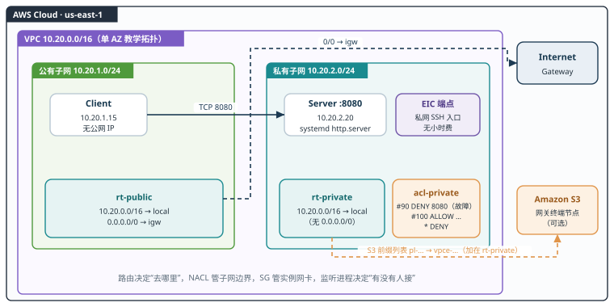

| 检查 | 作用对象 | 依据什么判断 | 有无状态 | 能否显式拒绝 |
|---|---|---|---|---|
| 路由表 | 子网 | 只看目的 IP（最长前缀匹配） | —— | 没有匹配路由即“无路可走” |
| 网络 ACL（NACL） | 子网边界 | 协议、对端 CIDR、端口；按编号顺序 | **无状态** | 能（ALLOW / DENY） |
| 安全组（SG） | 网卡（ENI） | 协议、对端 CIDR 或 SG、端口 | **有状态** | 不能，只有允许规则 |
| 应用 | 进程 | 是否在该地址和端口上监听 | —— | 没有监听 → 拒绝连接 |

::: formula
连通 ＝ 有路由 × 请求方向全部放行 × 响应方向全部放行 × 有进程监听 [四项是“乘法”：任何一项为 0，结果就是 0]{.unit}
:::

::: pitfalls
1. **同一个 VPC ≠ 一定能通。** VPC 内部有 `local` 路由，所以“路由”这一关几乎总是通的；但 NACL、SG、监听进程任何一关不放行，请求都到不了应用。
2. **有 Internet Gateway ≠ 子网能上网。** 还要看这个子网的路由表、实例有没有公网 IP、回包能否返回，以及账户是否开启了 VPC Block Public Access。
3. **“请求能到”≠“能连上”。** TCP 需要回包。NACL 不记得刚刚放行过什么，回包要按另一个方向的规则重新检查一次。
:::

::: {.opener}
[二 · 路由表]{.kicker}

# 下一跳是怎么选出来的？

[路由表只回答一个问题：去往这个目的地址的包，交给谁？它不看端口，也不判断允不允许。]{.subtitle}
:::

## 最长前缀匹配

::: formula
下一跳 ＝ 所有“包含目的 IP”的路由中，前缀最长（最具体）的那一条
:::

每个子网都恰好关联一张路由表。没有显式关联的子网，会自动使用 VPC 的**主路由表**——这是很多“意外通了”或“意外不通”的来源。每张路由表都有一条覆盖整个 VPC CIDR 的 `local` 路由，由 VPC 自动维护、不能删除，所以 VPC 内任意两个子网之间天然“有路”。

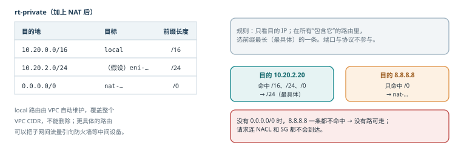

“公有子网”和“私有子网”并不是子网的属性开关，而是**由它关联的路由表定义的**：路由表里有 `0.0.0.0/0 → igw-…` 的子网才是公有子网。

## 实拍：默认 VPC 为什么“开箱即上网”

本书实验账户里只有一个默认 VPC。它的资源图（图 3-3）把关系画得很清楚：6 个子网都没有显式关联，全部落到唯一一张主路由表上，而这张表把 `0.0.0.0/0` 指向了 Internet Gateway。

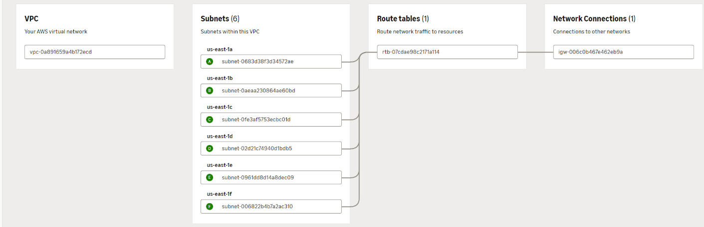{.shot}

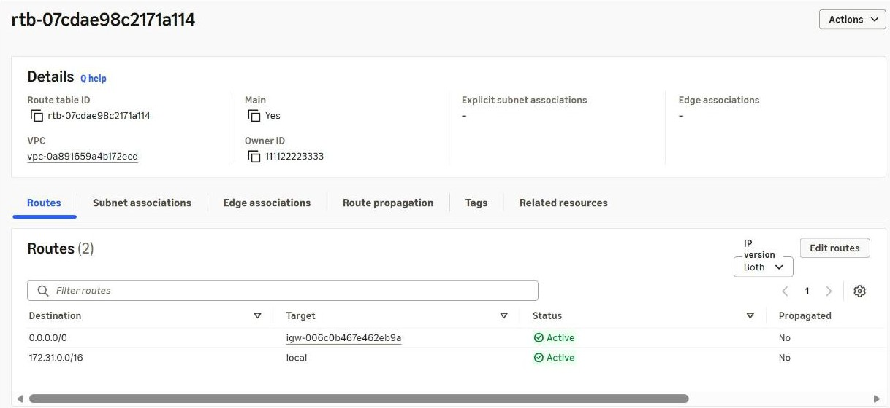{.shot}

同样的信息也可以用 CLI 读出来。注意 `Origin` 字段：`CreateRouteTable` 表示创建路由表时自动生成的 local 路由，`CreateRoute` 表示后来添加的路由。

```{.console title="aws ec2 describe-route-tables / describe-subnets（默认 VPC，2026-11-17 实测，节选）"}
"Routes": [
    ["172.31.0.0/16", "local",                 "active", "CreateRouteTable"],
    ["0.0.0.0/0",     "igw-006c0b467e462eb9a", "active", "CreateRoute"]
]
us-east-1a  172.31.16.0/20  MapPublicIpOnLaunch=True  AvailableIpAddressCount=4091
us-east-1b  172.31.32.0/20  MapPublicIpOnLaunch=True  AvailableIpAddressCount=4091
...（共 6 个 /20 子网）
```

一个 /20 有 4096 个地址，为什么只剩 4091 个可用？因为 AWS 在每个子网中保留 5 个地址：网络地址、VPC 路由器（+1）、DNS（+2）、保留备用（+3）和广播地址（最后一个）。规划小子网时别忘了这 5 个。

:::: {.example title="例题 3-1｜三个目的地址，各走哪条路？"}
私有子网路由表为：`10.20.0.0/16 → local`、`0.0.0.0/0 → nat-0abc`。Server（10.20.2.20）分别访问 10.20.1.15、8.8.8.8 和 10.30.0.5（另一个 VPC，没有对等连接）。下一跳分别是什么？

::: steps
1. **10.20.1.15**：同时落在 /16 与 /0 中，/16 更长 → `local`。是否放行要再看 NACL 与 SG。
2. **8.8.8.8**：只落在 /0 中 → `nat-0abc`。由 NAT 网关替它做地址转换后经 IGW 出去。
3. **10.30.0.5**：只落在 /0 中 → 也被送往 NAT！它会被当成公网地址发往互联网，自然到不了另一个 VPC。
:::

::: answer
local、NAT、NAT。第三问是常见陷阱：路由表只做“最长匹配”，不会因为你“想去另一个 VPC”就自动找到对等连接——必须显式添加 `10.30.0.0/16 → pcx-…` 或经 Transit Gateway 的路由（第 17 讲）。
:::
::::

::: {.opener}
[三 · NACL]{.kicker}

# 为什么请求能进、回包却出不去？

[NACL 在子网边界检查进出的每一个包，而且不记得刚刚放行过什么——这就是“无状态”的全部含义。]{.subtitle}
:::

## 规则怎样被评估

::: formula
NACL：按规则号从小到大逐条比对，第一条匹配即生效；都不匹配 → 默认拒绝（*）
:::

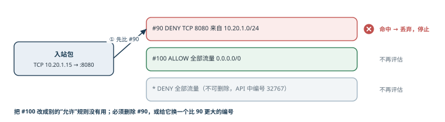

每个 NACL 都带有一条不可删除的 `*` 规则兜底拒绝；在 API 中它的编号是 32767。默认 VPC 的默认 NACL 在 #100 放行了全部流量（图 3-6），而**新建的自定义 NACL 只有 `*` 规则，默认拒绝一切**——把子网换到一个新建的 NACL 上，所有流量会立刻中断。

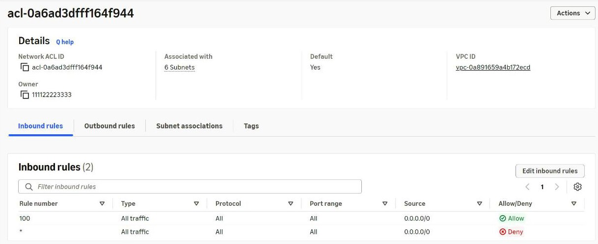{.shot}

```{.console title="aws ec2 describe-network-acls（同一张 NACL，2026-11-17 实测）"}
Egress  RuleNumber  Protocol  CidrBlock   RuleAction
True    100         -1        0.0.0.0/0   allow
True    32767       -1        0.0.0.0/0   deny      ← 控制台中显示为 *
False   100         -1        0.0.0.0/0   allow
False   32767       -1        0.0.0.0/0   deny
```

每张 NACL 每个方向默认最多 20 条规则（可申请提高）。规则编号之间留出间隔（如 100、110、120），以后才有地方插入更高优先级的规则——本讲的 #90 正是这样插进来的。

## 往返两次检查与临时端口

TCP 连接由四元组标识。请求是 `10.20.1.15:49152 → 10.20.2.20:8080`；响应把源和目的调换：`10.20.2.20:8080 → 10.20.1.15:49152`。其中 49152 是客户端操作系统挑选的**临时端口**。

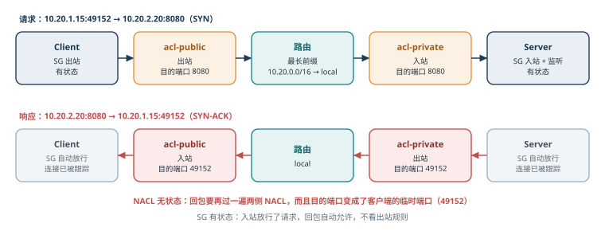

临时端口的范围由发起连接的一方决定，AWS 文档列出的典型值如下：

| 发起方 | 临时端口范围 |
|---|---|
| 多数 Linux 内核（含 Amazon Linux） | 32768–61000 |
| Windows Server 2008 及以后 | 49152–65535 |
| Elastic Load Balancing、NAT 网关、AWS Lambda | 1024–65535 |

因此实践中常在 NACL 中放行 1024–65535 作为回包端口；如需屏蔽其中的某些危险端口，就把 DENY 规则放在这条 ALLOW 之前（编号更小）。

| 对比项 | NACL | 安全组 |
|---|---|---|
| 作用位置 | 子网边界（同一子网内的流量不经过） | 网卡 |
| 规则类型 | ALLOW 与 DENY | 只有 ALLOW |
| 评估方式 | 按编号顺序，第一条匹配即停 | 所有规则一起评估，任一允许即可 |
| 状态 | 无状态：回包要单独放行 | 有状态：已跟踪连接的回包自动放行 |
| 典型用途 | 粗粒度的子网级拦截（如封禁某网段） | 精细的“谁能访问我” |

:::: {.example title="例题 3-2｜“严格”的 NACL 为什么让 8080 超时？"}
为了“最小权限”，运维把私有子网 NACL 改成：入站 #100 允许 TCP 8080（来自 10.20.1.0/24），出站 #100 也只允许 TCP 8080（去往 10.20.1.0/24）。Server 的 SG 允许 8080，服务也在监听。Client 访问 8080 却超时。为什么？

::: steps
1. **写出两个方向的四元组。** 请求：10.20.1.15:49152 → 10.20.2.20:8080；响应：10.20.2.20:8080 → 10.20.1.15:49152。
2. **请求方向。** 私有子网 NACL 入站检查目的端口 8080 → 命中 #100，放行；SG 入站放行；进程收到 SYN。
3. **响应方向。** 私有子网 NACL **出站**检查目的端口 **49152** → #100 只允许 8080，不匹配 → 落到 `*`，丢弃。
4. **为什么不是“拒绝连接”。** NACL 丢包是静默的，客户端收不到任何响应，只能等到超时。
:::

::: answer
回包的目的端口是客户端临时端口，出站规则必须允许 1024–65535（去往 10.20.1.0/24）。把“入站 8080”照抄成“出站 8080”是最常见的错误。实验 3-1 的 pathcheck 能逐跳复现这一点（见实验部分的输出）。
:::
::::

::: {.opener}
[四 · 出公网]{.kicker}

# 有了 Internet Gateway，为什么还上不了网？

[IGW 只是一扇门。要从门走出去，还需要路、需要公网身份，回包要能进来，区域级的开关也不能关着。]{.subtitle}
:::

## 四道门同时打开

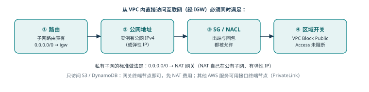

第四道门是较新的功能：**VPC Block Public Access（BPA）**是区域级、账户级的开关，开启后可以按“双向”或“仅入站”阻断经 Internet Gateway 和仅出口 Internet Gateway 的流量，只有加入例外列表的 VPC 或子网不受影响。它的优先级高于路由表和安全组——路由、公网 IP、SG 全部正确，流量照样被挡。

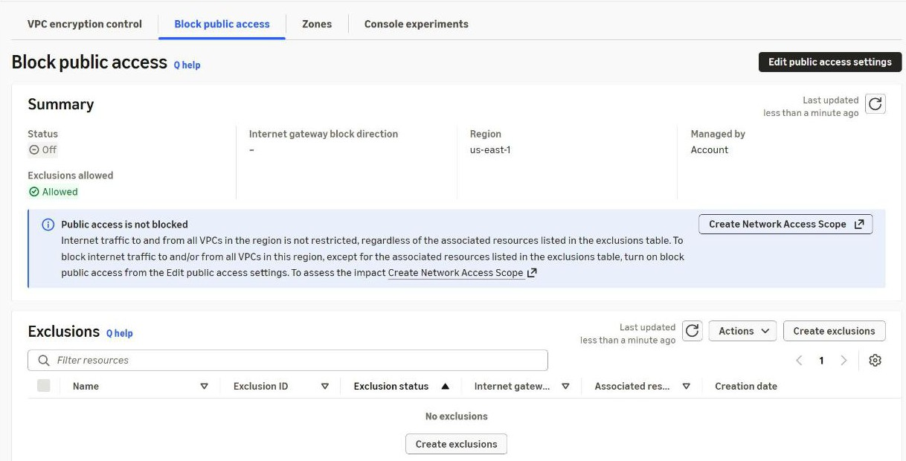{.shot}

```{.console title="aws ec2 describe-vpc-block-public-access-options（2026-11-17 实测）"}
"State": "default-state",
"InternetGatewayBlockMode": "off",
"ManagedBy": "account",
"ExclusionsAllowed": "allowed"
```

## 私有子网的出口选择

| 需求 | 路径 | 费用要点（us-east-1） |
|---|---|---|
| 访问同 VPC 资源 | `local` 路由 | 无 |
| 访问 S3 / DynamoDB | 网关终端节点（路由表中增加前缀列表路由） | 无小时费、无数据处理费 |
| 访问其他 AWS 服务（SSM、ECR…） | 接口终端节点（PrivateLink） | 按终端节点小时与流量计费 |
| 访问互联网 | NAT 网关（放在公有子网，有弹性 IP） | 按小时与处理流量计费；公网 IPv4 另计 |

::: cost
自 2024 年起，所有公网 IPv4 地址（包括实例自动分配的公网 IP 和弹性 IP）都按小时计费。本讲的实验实例全部不分配公网 IP，而是用 EC2 Instance Connect Endpoint 在私网内登录——它本身没有小时费。
:::

::: warn
网关终端节点**不是**通用的互联网出口。它只在路由表里加了一条“S3 前缀列表 → vpce”的路由，Server 依然下载不了外部软件仓库。要让 Server 访问外部仓库，需要 NAT 网关；要降低成本，可以把仓库镜像到 S3 或使用 AWS 的软件包镜像服务。
:::

::: {.opener}
[五 · 实操]{.kicker}

# 零成本地验证这些判断

[先在本地把规则“算”一遍，再用 Terraform 部署，最后才（可选地）用真实实例发包。]{.subtitle}
:::

:::: {.lab title="实验 3-1｜pathcheck：离线逐跳分析一条流"}
::: labmeta
- **目标**：用代码复现路由、NACL、SG 的判断顺序
- **时长**：20 分钟
- **费用**：0 元
- **工具**：Python 3.11+（只用标准库）
:::

`labs/01-pathcheck/pathcheck.py` 读入一个 JSON 场景（子网、路由表、NACL、SG、主机、流），按“路由 → 源 SG → 源 NACL 出 → 目的 NACL 入 → 目的 SG → 监听 → 回包两次 NACL”的顺序逐跳判断。`scenarios/` 中准备了 7 个场景，`test_pathcheck.py` 用 9 个单元测试锁定判断逻辑。

```{.console title="python pathcheck.py scenarios/no-ephemeral-out.json（例题 3-2，本书实测输出）"}
流：client → server tcp/8080
  ✓ 路由：10.20.2.20 最长匹配 10.20.0.0/16 → local
  ✓ 源 SG 出站：all/0-65535 0.0.0.0/0
  ✓ 源子网 NACL 出站（目的端口 8080）：规则 #100 ALLOW all/0-65535 0.0.0.0/0
  ✓ 目的子网 NACL 入站（目的端口 8080）：规则 #100 ALLOW tcp/8080-8080 10.20.1.0/24
  ✓ 目的 SG 入站：tcp/8080-8080 10.20.1.0/24
  · 响应：10.20.2.20:8080 → 10.20.1.15:49152（SG 连接跟踪自动放行）
  ✗ 目的子网 NACL 出站（目的端口 49152）：规则 *（默认 DENY）
结论：不可达（BLOCKED）
```

```{.console title="python pathcheck.py scenarios/private-to-internet.json（本书实测输出）"}
流：server → 8.8.8.8 tcp/443
  ✗ 路由：rt-private 中没有覆盖 8.8.8.8 的路由 → 无路可走
结论：不可达（BLOCKED）
```

情境导入中的两个故障，原因完全不同：一个是 NACL 的回包规则，另一个是私有子网根本没有去往互联网的路由。
::::

:::: {.lab title="实验 3-2｜Terraform：可注入故障的 VPC"}
::: labmeta
- **目标**：部署图 3-1 的网络骨架，用变量切换故障
- **时长**：30 分钟
- **费用**：VPC、子网、路由表、NACL、IGW 本身不收费
- **权限**：EC2/VPC 的创建与删除
:::

`labs/02-vpc-lab` 默认只创建 12 个网络资源，不创建任何实例。几个关键写法：

- 默认路由用独立的 `aws_route` 资源；两个子网都**显式关联**自己的路由表，避免落到主路由表上。
- 公有子网设置 `map_public_ip_on_launch = false`：“公有”是路由的属性，是否分配公网 IP 是另一回事。
- NACL 规则全部用 `aws_network_acl_rule` 管理，不在 `aws_network_acl` 中写内联规则——两种写法混用会互相覆盖。规则集合由变量组装：

```{.hcl title="labs/02-vpc-lab/nacl.tf（节选）"}
locals {
  strict_rules = merge(
    {
      "in-100-app"       = { egress = false, num = 100, proto = "tcp", cidr = var.public_cidr, from = 8080, to = 8080, action = "allow" }
      "in-120-ephemeral" = { egress = false, num = 120, proto = "tcp", cidr = "0.0.0.0/0", from = 1024, to = 65535, action = "allow" }
      "out-110-ssh"      = { egress = true, num = 110, proto = "tcp", cidr = var.public_cidr, from = 22, to = 22, action = "allow" }
      "out-120-https"    = { egress = true, num = 120, proto = "tcp", cidr = "0.0.0.0/0", from = 443, to = 443, action = "allow" }
    },
    var.drop_ephemeral_out ? {} : {   # 故障 2：删掉它，回包就出不去
      "out-100-ephemeral" = { egress = true, num = 100, proto = "tcp", cidr = var.public_cidr, from = 1024, to = 65535, action = "allow" }
    }
  )
  fault_rules = var.block_app_port ? {   # 故障 1：编号 90 < 100，先被评估
    "in-090-deny-app" = { egress = false, num = 90, proto = "tcp", cidr = var.public_cidr, from = 8080, to = 8080, action = "deny" }
  } : {}
  nacl_rules = merge(var.nacl_mode == "open" ? local.open_rules : local.strict_rules, local.fault_rules)
}

resource "aws_network_acl_rule" "private" {
  for_each       = local.nacl_rules
  network_acl_id = aws_network_acl.private.id
  egress         = each.value.egress
  rule_number    = each.value.num
  protocol       = each.value.proto
  rule_action    = each.value.action
  cidr_block     = each.value.cidr
  from_port      = each.value.from
  to_port        = each.value.to
}
```

```{.console title="在 labs/02-vpc-lab 中执行（本书实测输出，节选）"}
$ terraform test
  run "baseline_has_no_compute_and_no_private_default_route"... pass
  run "fault_rule_90_is_evaluated_first"... pass
  run "strict_mode_allows_ephemeral_responses"... pass
  run "drop_ephemeral_out_removes_return_path"... pass
  run "instances_are_private_and_imdsv2_only"... pass
  run "reject_unknown_nacl_mode"... pass
Success! 6 passed, 0 failed.
$ terraform plan                                     # 默认配置，只读
Plan: 12 to add, 0 to change, 0 to destroy.
$ terraform plan -var nacl_mode=strict -var block_app_port=true -var enable_instances=true
Plan: 28 to add, 0 to change, 0 to destroy.
  + private_nacl_rules = {
      + in-090-deny-app   = "IN #90 deny tcp 8080-8080 10.20.1.0/24"
      + in-100-app        = "IN #100 allow tcp 8080-8080 10.20.1.0/24"
      + in-120-ephemeral  = "IN #120 allow tcp 1024-65535 0.0.0.0/0"
      + out-100-ephemeral = "OUT #100 allow tcp 1024-65535 10.20.1.0/24"
      + out-110-ssh       = "OUT #110 allow tcp 22-22 10.20.1.0/24"
      + out-120-https     = "OUT #120 allow tcp 443-443 0.0.0.0/0"
    }
```
::::

:::: {.lab title="实验 3-3（可选）｜真实发包：注入与修复"}
::: labmeta
- **目标**：用真实 TCP 请求验证判断
- **时长**：40 分钟
- **费用**：两台 t4g.nano 与 8 GB 卷，约 0.01 美元/小时
- **前提**：实验 3-2 以 `enable_instances = true` 部署
:::

1. 两台实例都**没有公网 IP**。登录 Client：`aws ec2-instance-connect ssh --instance-id <client-id> --os-user ec2-user --connection-type eice`。
2. 基线：在 Client 上执行 `curl --connect-timeout 3 http://10.20.2.20:8080`，预期返回 `A02_OK`（等待 user data 完成，约 1～2 分钟）。
3. 故障 1：`terraform apply -var block_app_port=true` 后重试，预期 3 秒超时；控制台中私有 NACL 入站规则出现 #90。
4. 故障 2：`terraform apply -var nacl_mode=strict -var drop_ephemeral_out=true` 后重试，预期同样超时——但这次请求其实到达了 Server。
5. 修复后各重试一次；最后 `terraform destroy`，再用 `aws ec2 describe-vpcs --filters Name=tag:Name,Values=a02-vpc` 确认清理干净。
::::

::: warn
第 2～5 步给出的是**预期现象**，供你对照；本书全程只读，没有在实验账户中创建这些实例。“超时”的判断请以 `curl` 退出码 28（操作超时）为准，而不是凭感觉。
:::

## 用 Reachability Analyzer 代替“猜”

pathcheck 是教学模型；生产中对应的工具是 **VPC Reachability Analyzer**。它是**静态配置分析**：不发送任何数据包，而是根据路由表、NACL、SG 等配置推导两个资源之间的路径，可达时给出逐跳组件，不可达时指出拦截的组件（例如“缺少某条 NACL 规则”）。每次分析单独计费。

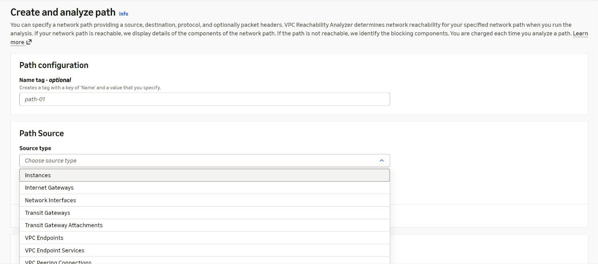{.shot}

另一类证据来自**VPC 流日志**：它记录网卡上被接受（ACCEPT）或拒绝（REJECT）的流。被 NACL 或 SG 丢弃的包会留下 REJECT 记录，配合四元组可以定位是哪个方向出了问题（第 9 讲会用 Logs Insights 查询流日志）。

::: {.opener}
[六 · 故障分析]{.kicker}

# 超时了，先查什么？

[先用现象把问题分到正确的层，再按“路由 → NACL（双向）→ SG → 进程”的顺序取证。]{.subtitle}
:::

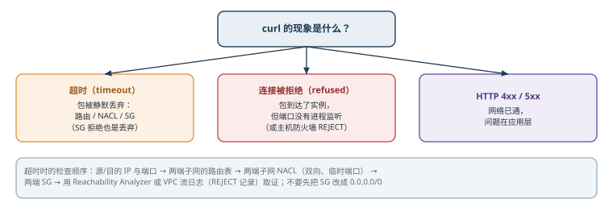

:::: {.example title="例题 3-3｜昨天能通，今天 8080 超时"}
基线 `curl` 返回 `A02_OK`。今天同一个 Client 访问同一个地址超时。已知：路由表没有变化，Server 的 SG 与服务进程都正常。变更记录显示私有子网 NACL 新增了一条入站规则。

::: steps
1. **定性。** 超时而不是“拒绝连接”，说明包被静默丢弃，问题在网络层，不在应用。
2. **排除路由。** 10.20.2.20 命中 `local`；路由表没变，且 local 路由不能被删除。
3. **查 NACL 顺序。** 私有子网入站规则：#90 DENY TCP 8080（来自 10.20.1.0/24）、#100 ALLOW。按编号从小到大，#90 先命中，#100 根本不会被评估。
4. **最小修复。** 删除 #90（或改用比 100 更大的编号并重新评审其用途），**不要**顺手修改 SG——SG 与此无关。
5. **复验。** 新建连接再次返回 `A02_OK`；如有 Reachability Analyzer，对同一路径复跑分析作为证据。
:::

::: answer
根因是 #90 的显式拒绝优先于 #100 的允许。修复的对象应当是“那一条规则”，修复后用同样的探针复验，并把规则编号写进变更记录。
:::
::::

::: {.fault title="故障 1｜新子网里的实例访问不了任何东西"}
现象
:   新建子网后启动实例，访问 VPC 内其他子网和互联网全部超时。

根因
:   子网被关联到了一个**新建的自定义 NACL**——它只有 `*` 规则，默认拒绝所有入站和出站流量。

修复
:   为该 NACL 添加所需的入站、出站与临时端口规则，或改回默认 NACL；变更前用 Reachability Analyzer 预检。
:::

::: {.fault title="故障 2｜“私有”子网的实例意外能上网"}
现象
:   安全审计发现，按设计应为私有的子网里，实例可以直接访问互联网。

根因
:   子网没有显式关联私有路由表，落到了**主路由表**上，而主路由表恰好有 `0.0.0.0/0 → igw`；实例又被自动分配了公网 IP。

修复
:   显式关联私有路由表；关闭子网的自动分配公网 IP；保持主路由表“干净”（不含默认路由），让“忘记关联”的子网默认无法出网。
:::

::: {.fault title="故障 3｜NAT 网关建好了，私有实例还是上不了网"}
现象
:   私有路由表有 `0.0.0.0/0 → nat-…`，实例访问互联网仍然超时。

根因
:   NAT 网关被放在了**私有子网**里：NAT 自己也需要通过 IGW 出去，它所在子网的路由表必须有 `0.0.0.0/0 → igw`。

修复
:   在公有子网中重建 NAT 网关（带弹性 IP），私有路由表指向它；检查私有子网 NACL 是否放行了回包的临时端口。
:::

::: {.fault title="故障 4｜一切配置都对，公有子网的实例仍然出不了网"}
现象
:   路由表有 `0.0.0.0/0 → igw`，实例有公网 IP，SG 与 NACL 全放行，但访问互联网仍然失败。

根因
:   账户在该区域开启了 **VPC Block Public Access**（双向阻断），且该 VPC 不在例外列表中。

修复
:   在 VPC 设置的 Block public access 页面确认状态；如确需访问，为该子网或 VPC 添加例外——这是安全团队的决策，不应由应用团队绕过。
:::

::: {.opener}
[课堂巩固 · 自测]{.kicker}

# 练一练：你能逐跳说清一条流吗？

[每题都只有一个确定的条件变化，按“路由 → NACL（双向）→ SG → 进程”推导即可。]{.subtitle}
:::

## 随堂练习

::: {.exercise title="练习 1｜最长前缀"}
私有路由表：`10.20.0.0/16 → local`、`10.20.2.0/24 → eni-firewall`、`0.0.0.0/0 → nat-1`。从公有子网发往 10.20.2.20 的包，在**公有子网路由表**（`10.20.0.0/16 → local`、`0.0.0.0/0 → igw`）中的下一跳是什么？
:::

::: {.exercise title="练习 2｜回包规则"}
Windows Server 2022 客户端（在公有子网）访问私有子网 Linux 服务器的 443。私有子网 NACL 出站至少要放行哪个端口范围？
:::

::: {.exercise title="练习 3｜规则编号"}
入站规则：#100 ALLOW TCP 1024–65535 来自 0.0.0.0/0；#110 DENY TCP 3389 来自 0.0.0.0/0。来自互联网的 3389 连接会被拒绝吗？如何修正？
:::

::: {.exercise title="练习 4｜同子网流量"}
两台实例在同一个子网，子网 NACL 入站只有 `*`（拒绝一切）。它们之间能通信吗？
:::

::: {.exercise title="练习 5｜终端节点"}
私有子网没有 `0.0.0.0/0`，但关联了同区域 S3 网关终端节点。实例能否 `pip install` 一个 Python 包？能否从同区域 S3 桶下载对象？还缺什么条件？
:::

::: {.exercise title="练习 6｜证据边界"}
`terraform validate` 与 `terraform plan` 都成功了，但没有创建实例。能否在报告里写“8080 端到端已验证”？
:::

## 参考答案与解析

::: {.solution title="1"}
`local`。包从公有子网发出时只看**源子网**的路由表：10.20.2.20 在公有路由表中最长匹配 /16 → local。私有路由表中那条 /24 只影响从私有子网发出的流量。（若要让进入私有子网的流量经过防火墙，要在公有路由表里加更具体的路由。）
:::

::: {.solution title="2"}
49152–65535（Windows Server 2008 及以后的临时端口范围），目的地为客户端所在网段。实践中常直接放行 1024–65535。
:::

::: {.solution title="3"}
不会被拒绝：3389 落在 #100 的 1024–65535 范围内，#100 先命中并放行，#110 永远不会被评估。修正方法是把 DENY 改为更小的编号，例如 #90。
:::

::: {.solution title="4"}
能（只要 SG 放行）。NACL 只检查进出**子网边界**的流量，同一子网内的通信不经过 NACL。
:::

::: {.solution title="5"}
`pip install` 不行：PyPI 在互联网上，网关终端节点不是互联网出口。下载 S3 对象可以，但还需要：实例角色有 `s3:GetObject` 权限、桶策略与终端节点策略允许、NACL 放行到 S3 的 443 及其回包。
:::

::: {.solution title="6"}
不能。validate 只检查语法与类型，plan 只说明“将要创建什么”，二者都没有部署资源，更没有发出 TCP 请求。报告应写“配置级验证通过”，端到端结论需要实验 3-3 的真实探针。
:::

## 这一讲，你应该记住 {.nonum}

:::: summary
::: {.card tag="路由"}
**只看目的 IP，最长前缀匹配**

公有 / 私有由子网的路由表决定。
:::
::: {.card tag="NACL"}
**无状态，按编号，第一条匹配即停**

回包的目的端口是客户端临时端口。
:::
::: {.card tag="安全组"}
**有状态，只有允许规则**

已放行连接的回包自动允许。
:::
::: {.card tag="出公网"}
**路由 + 公网 IP + 双向放行 + BPA 未阻断**

四道门缺一不可。
:::
::::

::: refs
## 参考资料 {.nonum}

[截图说明：图 3-3、3-4、3-6、3-9、3-10 摄于 2026-11-17，us-east-1 默认 VPC 与 VPC 设置页面；账户 ID 已替换为 111122223333；全部操作只读，未运行任何付费分析。]{.small}

1. Configure route tables / Route priority. <https://docs.aws.amazon.com/vpc/latest/userguide/VPC_Route_Tables.html>
2. Subnet CIDR blocks（每个子网保留 5 个地址）. <https://docs.aws.amazon.com/vpc/latest/userguide/subnet-sizing.html>
3. Control subnet traffic with network ACLs / Custom network ACLs（规则评估、临时端口）. <https://docs.aws.amazon.com/vpc/latest/userguide/custom-network-acl.html>
4. Security group connection tracking. <https://docs.aws.amazon.com/AWSEC2/latest/UserGuide/security-group-connection-tracking.html>
5. Block public access to VPCs and subnets. <https://docs.aws.amazon.com/vpc/latest/userguide/security-vpc-bpa.html>
6. Gateway endpoints for Amazon S3. <https://docs.aws.amazon.com/vpc/latest/privatelink/vpc-endpoints-s3.html>
7. NAT gateways（放置位置与计费）. <https://docs.aws.amazon.com/vpc/latest/userguide/vpc-nat-gateway.html>
8. EC2 Instance Connect Endpoint（配额：每个 VPC 1 个、每个端点 20 个并发连接）. <https://docs.aws.amazon.com/AWSEC2/latest/UserGuide/connect-using-eice.html>
9. VPC Reachability Analyzer. <https://docs.aws.amazon.com/vpc/latest/reachability/what-is-reachability-analyzer.html>
10. Amazon VPC quotas（每个 NACL 每方向 20 条规则、每张路由表 500 条路由）. <https://docs.aws.amazon.com/vpc/latest/userguide/amazon-vpc-limits.html>
11. Terraform：aws_network_acl_rule、aws_route、aws_ec2_instance_connect_endpoint（provider 6.73.0）. <https://registry.terraform.io/providers/hashicorp/aws/latest/docs>
:::
