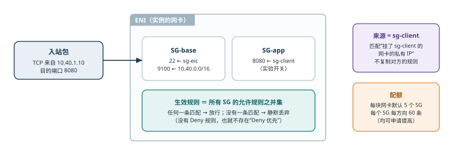
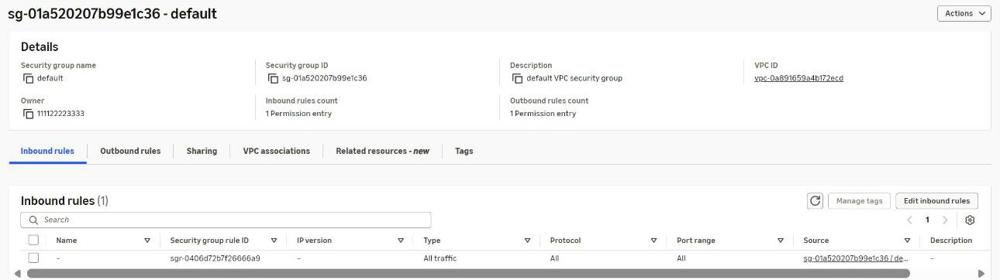
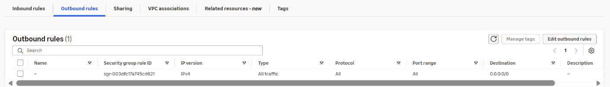
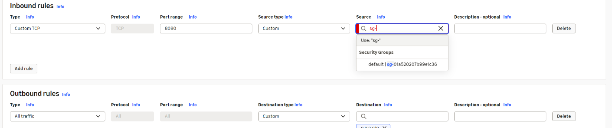
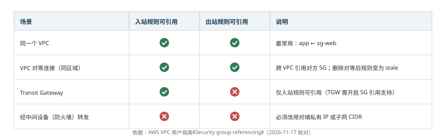
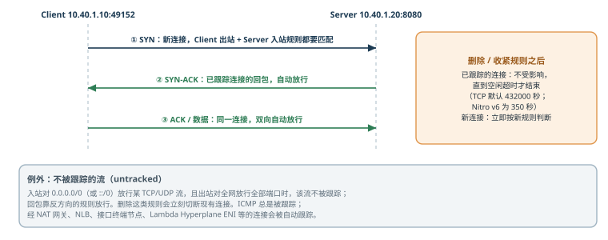
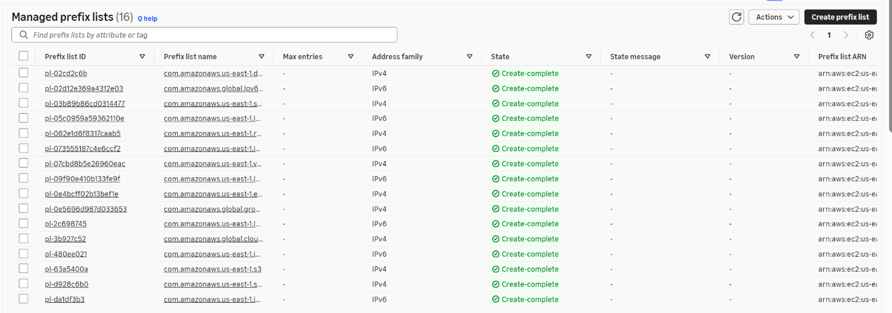
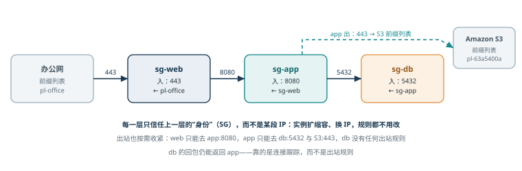
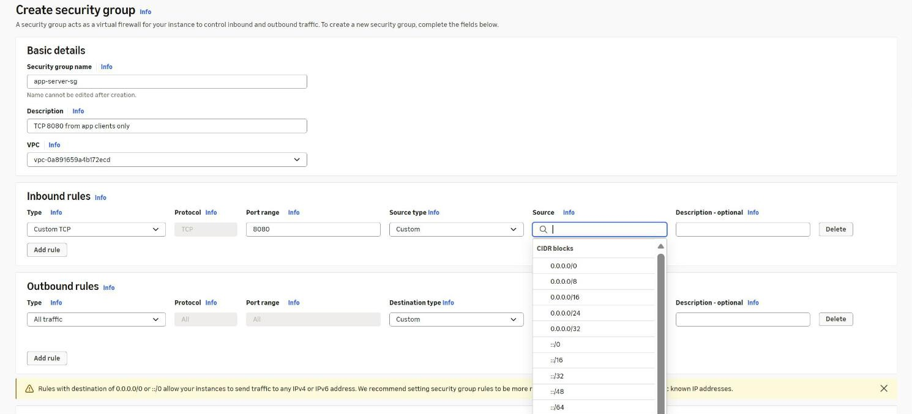

::::: cover
[第 04 讲 · 网络基础 ②]{.kicker}

# 安全组：规则写对了，为什么不通？

[安全组只有“允许”，多个安全组取并集，引用安全组匹配的是成员网卡，回包靠连接跟踪——把这四条机制讲透，排障就有了方向。]{.subtitle}

::: cover-meta
- **讲次**：04 / 19
- **建议学时**：4 课时（讲授 2 + 实验 2）
- **实验费用**：审计与本地测试 0 元；可选实例约 0.01 美元/小时
- **适用版本**：VPC SG（含 VPC 关联）· AWS Provider 6.x
:::

::: scenario
Client（10.40.1.10）访问同一子网里的 Server（10.40.1.20:8080）超时。两台机器在同一个子网，所以 NACL 不参与；Server 进程正在监听。运维说：“Server 的安全组明明有一条 `TCP 8080 ← sg-client` 的规则。”**规则在、进程在、网络在，问题出在哪？**
:::

## 学习目标 {.nonum}

:::: cards
::: {.card title="理解"}
- 安全组作用在网卡上，只有允许规则
- 多个安全组如何合并成“有效规则”
- 引用安全组到底匹配什么
:::
::: {.card title="推理"}
- 有状态：哪些回包不用写规则
- 哪些流不被跟踪，改规则会立即断连
- 规则配额怎样计算（前缀列表的“权重”）
:::
::: {.card title="实操"}
- 只读审计账户中的安全组
- Terraform 实现 web → app → db 安全组链
- 用控制变量法做一次“只改一条规则”的实验
:::
::: {.card title="排障"}
- 超时与拒绝连接的分流
- “规则在，但网卡没挂这个 SG”
- 跨 VPC 引用与中间设备的限制
:::
::::

| 本讲结构 | 要回答的问题 | 产出 |
|---|---|---|
| 一、模型 | 安全组在哪里、按什么判断？ | 并集模型、默认安全组实拍 |
| 二、引用 | “来源 = sg-xxx”到底放行了谁？ | 引用语义与适用范围 |
| 三、状态 | 回包为什么能回来？什么时候不能？ | 连接跟踪与超时 |
| 四、规模 | 规则会不会写满？ | 配额与前缀列表 |
| 五、实操 | 怎样审计、怎样用代码管理？ | sgaudit、Terraform 安全组链 |
| 六～七、排障与练习 | 规则在却不通，怎么查？ | 故障卡、练习 |
:::::

::: {.opener .nobreak}
[一 · 模型]{.kicker}

# 安全组在哪里、按什么判断？

[安全组是挂在网卡（ENI）上的“只允许”名单。理解了“网卡”和“并集”，一半的故障就能自己解开。]{.subtitle}
:::

## 四条基本规则

::: formula
放行 ⟺ 该网卡上所有安全组的允许规则之并集中，存在一条匹配（协议、端口、来源/目的）
:::

1. **只有允许规则，没有拒绝规则。** 没有任何规则匹配，包就被静默丢弃——客户端看到的是超时。
2. **作用在网卡上，不是作用在子网或实例上。** 一台实例可以有多块网卡，每块网卡有自己的安全组；规则是否生效，要看**这块网卡**挂了哪些安全组。
3. **多个安全组取并集。** 一块网卡默认最多挂 5 个安全组，规则合并后一起评估；不存在“某个安全组拒绝、另一个允许”的冲突。
4. **新建安全组的默认值：** 没有入站规则（拒绝一切入站），有一条“全部出站”规则。注意：用 Terraform 的 `aws_security_group` 创建时，Terraform 会**删除**这条默认出站规则，出站同样要显式声明。



## 实拍：默认安全组为什么“自己人全通”

每个 VPC 都有一个不能删除的默认安全组。本书账户的默认 VPC 中，它的入站规则只有一条：**全部流量，来源是它自己**；出站是全部流量到 0.0.0.0/0。

{.shot}

{.shot}

“自引用”的含义是：任何两块挂着这个安全组的网卡之间，所有协议、所有端口全部放行。启动实例时如果不指定安全组，实例就会挂上默认安全组——它和同 VPC 里所有同样“偷懒”的实例自动互通。生产账户通常用 AWS Config 规则检查默认安全组是否为空，并要求每个工作负载使用自己的安全组。

::: note
新的“VPC 关联”功能允许把一个安全组关联到同账户、同区域的其他 VPC 上复用（本账户配额显示每个安全组最多 100 个 VPC 关联）；但默认安全组不能关联到其他 VPC。
:::

::: {.opener}
[二 · 引用]{.kicker}

# “来源 = sg-xxx”到底放行了谁？

[引用安全组不是“复制对方的规则”，而是“信任挂了对方安全组的那些网卡”。]{.subtitle}
:::

## 引用的语义

在 Server 的安全组里写一条入站规则“TCP 8080 ← sg-client”，意思是：**任何挂了 sg-client 的网卡，用它的私有 IP 访问 8080，都放行。**三个推论：

- 不论 Client 扩容到多少台、换了什么 IP，规则都不用改——这是引用比写 CIDR 更好的原因。
- sg-client 自己的规则**不会**被“加”到 Server 的安全组里，二者毫无关系。
- 只匹配**私有 IP**。Client 如果经过 NAT 或公网地址来访问，引用规则不会匹配。

{.shot}

## 引用的适用范围



最后一行最容易踩坑：如果路由把两台实例之间的流量引向防火墙等中间设备，安全组必须写对端的**私有 IP 或子网 CIDR**，写安全组引用不会放行这部分流量。

:::: {.example title="例题 4-1｜情境导入中的 8080 为什么超时？"}
已知：Client 与 Server 在同一子网；Server 进程监听 0.0.0.0:8080；Server **所在网卡**挂的是 sg-server；sg-server 有入站规则“TCP 8080 ← sg-client”；Client 网卡挂的是 **sg-default**（启动时忘了选），sg-client 没有挂在任何网卡上。

::: steps
1. **排除无关层。** 同一子网 → NACL 不参与；进程在监听 → 不是应用问题；超时 → 包被静默丢弃。
2. **看请求方向的出站。** Client 网卡挂 sg-default，出站全部放行 → 通过。
3. **看 Server 入站。** 唯一相关规则是“← sg-client”，它匹配的是“挂了 sg-client 的网卡”。Client 网卡没有挂 sg-client，于是没有任何规则匹配 → 丢弃。
4. **最小修复。** 给 Client 网卡加挂 sg-client（或把它替换为 sg-client）；不要把 Server 规则放宽成 10.40.0.0/16。
5. **复验。** 新建连接返回 `ok`；用 `aws ec2 describe-network-interfaces` 确认 Client 网卡的 `Groups` 中已有 sg-client。
:::

::: answer
规则本身没错，错的是**规则所信任的身份没有出现在来源网卡上**。排查安全组问题，第一步不是看规则，而是看“这块网卡到底挂了哪些安全组”。
:::
::::

::: {.opener}
[三 · 状态]{.kicker}

# 回包为什么能回来？什么时候不能？

[安全组会记住已放行的连接，所以回包不需要规则。但“记住”有例外，也有期限。]{.subtitle}
:::

## 连接跟踪



几条值得记住的细节（均来自 AWS EC2 用户指南）：

- **改规则不会打断已跟踪的连接。** 删除或收紧规则后，已有连接继续传输，直到空闲超时；要立即切断，需要用 NACL（它无状态，下一个包就会被检查）。
- **空闲超时可以配置。** TCP 已建立连接默认 432 000 秒（5 天），Nitro v6 实例默认 350 秒；可在网卡上设置为 60～432 000 秒。UDP 默认 30 秒，UDP 流（多次往返）默认 180 秒。长连接应用应配置小于 5 分钟的 TCP keepalive。
- **跟踪表是有容量的。** 每种实例类型能跟踪的连接数有上限，超出后新连接的包被丢弃；ENA 驱动的 `conntrack_allowance_exceeded` 指标可以发现这种“灰色故障”。
- **安全组管不了 Route 53 Resolver 的 DNS。** 发往 VPC+2 地址的 DNS 查询不受安全组影响；要过滤 DNS，用 Route 53 Resolver DNS Firewall（第 5 讲）。

:::: {.example title="例题 4-2｜删掉一条规则，为什么有的 SSH 会话立刻断了，有的没断？"}
两台实例的安全组都有“出站全部 → 0.0.0.0/0”。实例 A 的入站规则是“SSH 22 ← 0.0.0.0/0”，实例 B 的入站规则是“SSH 22 ← 203.0.113.7/32”。运维同时删除了两条 SSH 规则。A 上的会话立刻断开，B 上的会话仍在。为什么？

::: steps
1. **判断 A 的流是否被跟踪。** A 的入站对 0.0.0.0/0 放行 TCP 22，出站又对全网放行全部端口——满足“不被跟踪”的条件。
2. **推出 A 的结果。** 未跟踪流的回包靠规则放行；规则一删，下一个包就被丢弃，会话立即中断。
3. **判断 B。** B 的入站只允许一个 /32，这个流是被跟踪的；删除规则只影响新连接，已有会话继续，直到空闲超时。
:::

::: answer
差别在于流是否被跟踪：对全网开放（双向）的流不被跟踪，规则即时生效；窄规则下的流被跟踪，旧连接“豁免”到超时。若必须立即踢掉 B 的会话，在子网 NACL 上加一条针对该来源的 DENY。
:::
::::

::: {.opener}
[四 · 规模]{.kicker}

# 规则会不会写满？

[每个安全组每个方向默认 60 条规则，每块网卡默认 5 个安全组。真正容易“意外写满”的，是前缀列表。]{.subtitle}
:::

## 配额与计数方式

本书账户中读到的默认配额（`service-quotas list-aws-default-service-quotas`，均可申请提高）：每个安全组每个方向 60 条规则；每块网卡 5 个安全组；每个区域 2 500 个安全组；每个安全组最多关联 100 个 VPC。

| 规则的来源 / 目的 | 计入规则配额的条数 |
|---|---|
| 一个 CIDR | 1 |
| 一个安全组引用 | 1（不论对方有多少成员） |
| 客户托管前缀列表 | 前缀列表的**最大条目数**（max entries） |
| AWS 托管前缀列表 | 前缀列表的**权重**（weight） |

前缀列表把一组 CIDR 打包成一个对象（`pl-…`），改一处、所有引用它的规则自动生效，非常适合“办公网出口”“合作方地址”这类会变化的名单。但要注意：一个 `max_entries = 20` 的前缀列表即使只写了 2 条，被安全组引用时也按 20 条计数。

{.shot}

```{.console title="aws ec2 describe-managed-prefix-lists（AWS 托管，2026-11-17 实测，节选）"}
pl-3b927c52   com.amazonaws.global.cloudfront.origin-facing   IPv4
pl-0e4bcff02b13bef1e  com.amazonaws.us-east-1.ec2-instance-connect  IPv4
pl-062e1d6f8317caab5  com.amazonaws.us-east-1.route53-healthchecks  IPv4
pl-63a5400a   com.amazonaws.us-east-1.s3                      IPv4
pl-02cd2c6b   com.amazonaws.us-east-1.dynamodb                IPv4
```

一个典型用法：源站只允许 CloudFront 访问时，把入站来源设为 `com.amazonaws.global.cloudfront.origin-facing`，而不是维护一长串 CloudFront 地址段——AWS 会自动更新列表内容。

::: {.opener}
[五 · 实操]{.kicker}

# 审计现状，再用代码管理

[先只读地看清账户里有什么，再用 Terraform 把“谁能访问谁”写成可评审、可测试的代码。]{.subtitle}
:::

:::: {.lab title="实验 4-1｜sgaudit：只读审计 + 有效权限计算"}
::: labmeta
- **目标**：找出高风险规则；计算多 SG 叠加后的有效权限
- **时长**：20 分钟
- **费用**：0 元（只读）
- **权限**：`ec2:DescribeSecurityGroups`
:::

`labs/01-sgaudit/sgaudit.py` 读取 `describe-security-groups` 的 JSON，检查：对全网开放的管理端口（SSH、RDP、数据库等）、全部流量开放、≥1000 个端口的大范围、引用不存在的安全组（stale）、自引用，以及“入站与出站都对全网开放”导致的不跟踪流。`allow` 子命令按“并集 + 引用匹配成员”的规则计算有效权限。5 个单元测试覆盖这些判断。

```{.console title="python sgaudit.py audit --file sgs.json（本书账户 us-east-1 实测，只读）"}
共 1 个安全组，2 条发现
  INFO  sg-01a520207b99e1c36(default) 自引用：挂了本 SG 的网卡彼此之间全部放行
  INFO  sg-01a520207b99e1c36(default) 出站允许全部流量到 0.0.0.0/0（AWS 新建 SG 的默认值）
```

```{.console title="python sgaudit.py audit --file fixtures/risky.json（教学样例，节选）"}
共 2 个安全组，20 条发现
  HIGH  sg-bad(legacy-admin) 入站对 0.0.0.0/0 开放 SSH tcp/22
  MED   sg-bad(legacy-admin) 入站对 0.0.0.0/0 开放大端口段 tcp/3000-9000
  MED   sg-bad(legacy-admin) 引用了不存在或其他账户的 SG sg-deleted（可能已失效 / stale）
  MED   sg-open(wide-open) 入站与出站都对全网开放 TCP/UDP 全端口：这类流不被连接跟踪，删除规则会立即中断现有连接
```

```{.console title="有效权限：一块网卡同时挂 sg-extra 与 sg-app（本书实测输出）"}
$ python sgaudit.py allow --file fixtures/three-tier.json --sg sg-extra --sg sg-app --port 8080 --source-sg sg-web
允许  sg-app 的规则 tcp/8080-8080 来自 sg-web（按网卡私有 IP 匹配）
$ python sgaudit.py allow --file fixtures/three-tier.json --sg sg-db --port 5432 --source-ip 10.20.2.30
拒绝  所有已挂载 SG 的规则并集中都没有匹配的允许规则 → 丢弃（SG 没有显式拒绝）
```
::::

:::: {.lab title="实验 4-2｜Terraform：安全组链 + 只改一条规则的对照实验"}
::: labmeta
- **目标**：web → app → db 安全组链；8080 开关实验
- **时长**：30 分钟
- **费用**：安全组、前缀列表、VPC 本身不收费
- **权限**：EC2/VPC 的创建与删除
:::



规则全部用独立的 `aws_vpc_security_group_ingress_rule` / `egress_rule` 资源声明（这是 AWS Provider 推荐的新写法：每条规则一个资源、带规则 ID，不再与 `aws_security_group` 的内联 `ingress {}` 块混用）。规则表写成数据，再用 `for_each` 展开：

```{.hcl title="labs/02-sg-lab/main.tf（节选）"}
locals {
  tier_rules = {
    web_in_443_office = { sg = "web", dir = "in",  port = 443,  pl  = aws_ec2_managed_prefix_list.office.id }
    web_out_8080_app  = { sg = "web", dir = "out", port = 8080, ref = "app" }
    app_in_8080_web   = { sg = "app", dir = "in",  port = 8080, ref = "web" }
    app_out_5432_db   = { sg = "app", dir = "out", port = 5432, ref = "db" }
    app_out_443_s3    = { sg = "app", dir = "out", port = 443,  pl  = data.aws_ec2_managed_prefix_list.s3.id }
    db_in_5432_app    = { sg = "db",  dir = "in",  port = 5432, ref = "app" }
  }
}

resource "aws_vpc_security_group_ingress_rule" "tier" {
  for_each                     = { for k, r in local.tier_rules : k => r if r.dir == "in" }
  security_group_id            = local.sg[each.value.sg]
  ip_protocol                  = "tcp"
  from_port                    = each.value.port
  to_port                      = each.value.port
  referenced_security_group_id = try(local.sg[each.value.ref], null)
  prefix_list_id               = try(each.value.pl, null)
  description                  = each.key
}

# 对照实验的唯一变量：Server 是否接受来自 sg-client 的 8080
resource "aws_vpc_security_group_ingress_rule" "server_8080" {
  count                        = var.allow_8080 ? 1 : 0
  security_group_id            = aws_security_group.server.id
  referenced_security_group_id = aws_security_group.client.id
  ip_protocol                  = "tcp"
  from_port                    = 8080
  to_port                      = 8080
}
```

这个实验借用了物理课的**控制变量法**：Client 与 Server 放在同一个子网（NACL 不参与），路由是 local，进程固定监听——唯一变化的就是 `allow_8080` 这一条规则。

```{.console title="在 labs/02-sg-lab 中执行（本书实测输出）"}
$ terraform test
  run "no_rule_is_open_to_the_world"... pass
  run "db_only_reachable_from_app"... pass
  run "lab_switch_off_means_no_8080"... pass
  run "lab_switch_on_adds_exactly_one_rule"... pass
  run "prefix_list_weight"... pass
  run "instances_share_one_subnet"... pass
Success! 6 passed, 0 failed.
$ terraform plan
Plan: 15 to add, 0 to change, 0 to destroy.
```

可选的真实验证（`enable_instances = true`）与第 03 讲相同：经 EC2 Instance Connect Endpoint 登录 Client，执行 `curl --connect-timeout 3 http://10.40.1.20:8080/health`。预期：`allow_8080 = false` 时超时，改为 `true` 并 apply 后返回 `ok`，再改回 `false`，**新**连接再次超时。
::::

::: note
测试里用到了 `override_during = plan`：mock provider 默认在 plan 阶段把资源 ID 这类“计算属性”留作未知值，断言就无法求值；打开这个选项并为前缀列表、子网提供 mock 默认值后，plan 阶段即可完成判断。
:::

{.shot}

::: {.opener}
[六 · 故障分析]{.kicker}

# 规则在，却不通，怎么查？

[先确认“包到了哪块网卡、那块网卡挂了什么”，再看规则；最后才怀疑 AWS。]{.subtitle}
:::

| 现象 | 最有区分力的检查 | 不要先做的事 |
|---|---|---|
| 超时 | 目标网卡挂了哪些 SG；流日志里是否有 REJECT | 把 SG 改成 0.0.0.0/0 |
| 连接被拒绝 | 进程是否监听、绑定地址是否 0.0.0.0、主机防火墙 | 修改 SG（SG 拒绝不会回 RST） |
| 删规则后旧连接还在 | 流是否被跟踪；需要立即切断时加 NACL DENY | 反复删改 SG |
| 间歇性丢包、并发高时出现 | `conntrack_allowance_exceeded` 指标 | 只扩大规则 |

::: {.fault title="故障 1｜跨 VPC 访问，引用规则写了却不生效"}
现象
:   两个 VPC 通过 Transit Gateway 互通。Server 入站写了“← sg-client（对端 VPC）”，Client 的出站写了“→ sg-server”，Client 访问超时。

根因
:   经 Transit Gateway 时，安全组引用**只能用在入站规则**（且 TGW 与 VPC 挂载需开启安全组引用支持）；Client 出站规则引用对端安全组不被支持，等于没有匹配的出站规则。

修复
:   Client 出站改用对端子网 CIDR（或前缀列表）；Server 入站可保留引用规则。
:::

::: {.fault title="故障 2｜加了防火墙之后，同 VPC 的两个子网不通了"}
现象
:   为了检查东西向流量，路由把子网 A 与 B 之间的流量引到了防火墙终端节点，随后双方安全组里的引用规则全部“失效”。

根因
:   经中间设备转发的流量，安全组引用不会放行；必须写对端的私有 IP 或子网 CIDR。

修复
:   把相关规则改为 CIDR 或前缀列表；变更前用 Reachability Analyzer 验证路径。
:::

::: {.fault title="故障 3｜Terraform 一 apply，手工加的规则就消失了"}
现象
:   有人在控制台给安全组临时加了一条规则，下一次 `terraform apply` 后规则不见了；或者反过来，Terraform 每次都提示要修改同一个安全组。

根因
:   同一个安全组同时用了内联 `ingress {}` 块和独立的规则资源，或者手工修改与代码不一致（漂移）。内联块代表“全部规则”，Terraform 会把它没声明的规则删掉。

修复
:   统一改用独立的 `aws_vpc_security_group_ingress_rule` / `egress_rule`；控制台变更必须回写到代码；用 `terraform plan` 在 CI 中检测漂移（第 16 讲）。
:::

::: {.opener}
[课堂巩固 · 自测]{.kicker}

# 练一练：能否判断“放行的到底是谁”？

[先独立完成，再看答案。每题都对应本讲的一条机制。]{.subtitle}
:::

## 随堂练习

::: {.exercise title="练习 1｜并集"}
Server 网卡挂了 SG-X（没有 8080 规则）和 SG-Y（允许来自 sg-client 的 8080）。挂着 sg-client 的 Client 访问 8080，会被拒绝吗？
:::

::: {.exercise title="练习 2｜引用的含义"}
sg-server 入站：“TCP 8080 ← sg-client”。一台**没有**挂 sg-client、但 IP 与 Client 在同一子网的实例来访问，能否通过？
:::

::: {.exercise title="练习 3｜有状态"}
Client 的安全组没有任何入站规则。它访问 Server 8080 建立连接后，Server 的响应会被 Client 的安全组拒绝吗？
:::

::: {.exercise title="练习 4｜立即生效"}
安全事件中需要**立刻**切断某个外部地址到一台实例的现有 SSH 会话，该实例 SSH 规则只允许这个 /32。只删除安全组规则够吗？
:::

::: {.exercise title="练习 5｜配额"}
一个安全组有 50 条普通 CIDR 规则，现在要再加一条引用 `max_entries = 20` 的客户托管前缀列表的规则。会超出每方向 60 条的默认配额吗？
:::

::: {.exercise title="练习 6｜Terraform"}
用 `aws_security_group` 新建了一个安全组，只声明了一条入站规则。实例启动后无法访问 S3。可能的原因是什么？
:::

## 参考答案与解析

::: {.solution title="1"}
不会。多个安全组的允许规则取并集，SG-Y 的规则匹配即放行；SG-X 没有“拒绝”能力。
:::

::: {.solution title="2"}
不能。引用规则匹配的是“挂了 sg-client 的网卡的私有 IP”，与 IP 是否在同一子网无关。
:::

::: {.solution title="3"}
不会。安全组有状态，这是已跟踪连接的响应，自动放行，不看入站规则。
:::

::: {.solution title="4"}
不够。窄规则下的连接是被跟踪的，删除规则只影响新连接；要立即切断，在该子网 NACL 上加一条针对这个 /32 的 DENY（编号小于放行规则）。
:::

::: {.solution title="5"}
会。前缀列表规则按 max_entries 计为 20 条，50 + 20 = 70 > 60。可以缩小前缀列表的 max_entries、合并 CIDR，或申请提高配额。
:::

::: {.solution title="6"}
Terraform 在创建安全组时删除了 AWS 默认的“全部出站”规则，而代码没有声明任何出站规则，所以实例无法发起到 S3 的 443 连接。按需添加出站规则（如目的为 S3 前缀列表的 443）。
:::

## 这一讲，你应该记住 {.nonum}

:::: summary
::: {.card tag="判断"}
**只有允许，取并集，没匹配就丢弃**

超时 ≠ 拒绝连接。
:::
::: {.card tag="引用"}
**引用 = 信任挂了该 SG 的网卡**

不复制规则；经中间设备时失效。
:::
::: {.card tag="状态"}
**已跟踪连接的回包自动放行**

全网双向开放的流不被跟踪。
:::
::: {.card tag="排障第一步"}
**先看网卡挂了哪些 SG**

再看规则，最后看应用。
:::
::::

::: refs
## 参考资料 {.nonum}

[截图说明：图 4-2、4-3、4-4、4-7、4-9 摄于 2026-11-17，us-east-1 默认 VPC；账户 ID 已替换为 111122223333；表单为示例值且未提交，全部操作只读。]{.small}

1. Security groups / Security group rules（并集、引用、规则计数、stale 规则）. <https://docs.aws.amazon.com/vpc/latest/userguide/security-group-rules.html>
2. Amazon EC2 security group connection tracking（不跟踪的流、自动跟踪、超时、conntrack 指标）. <https://docs.aws.amazon.com/AWSEC2/latest/UserGuide/security-group-connection-tracking.html>
3. Default security groups for your VPCs. <https://docs.aws.amazon.com/vpc/latest/userguide/default-security-group.html>
4. Managed prefix lists / AWS-managed prefix lists. <https://docs.aws.amazon.com/vpc/latest/userguide/managed-prefix-lists.html>
5. Associate security groups with multiple VPCs. <https://docs.aws.amazon.com/vpc/latest/userguide/security-group-assoc.html>
6. Amazon VPC quotas（规则数、每网卡 SG 数、VPC 关联数）. <https://docs.aws.amazon.com/vpc/latest/userguide/amazon-vpc-limits.html>
7. Terraform：安全组规则资源与前缀列表（provider 6.73.0）<https://registry.terraform.io/providers/hashicorp/aws/latest/docs>；测试中的 mock 与 override_during <https://developer.hashicorp.com/terraform/language/tests/mocking>
:::
