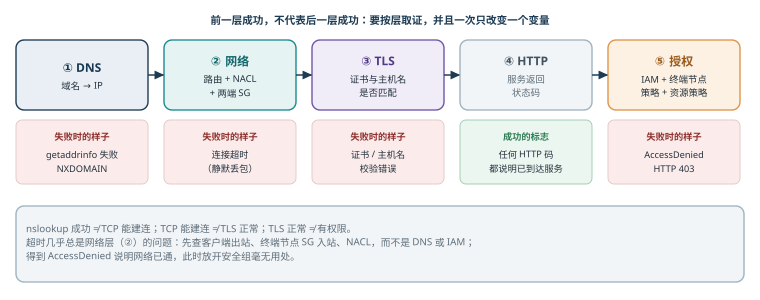
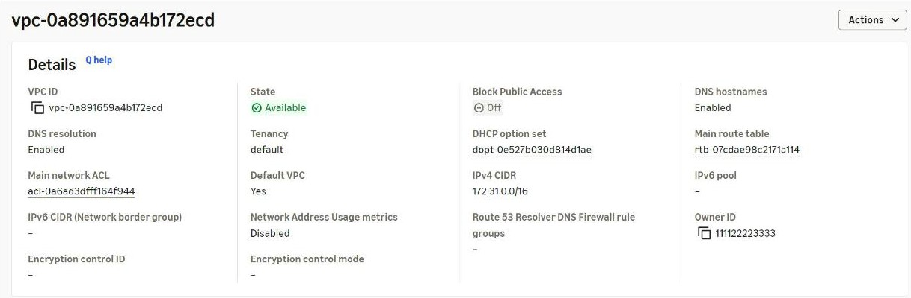
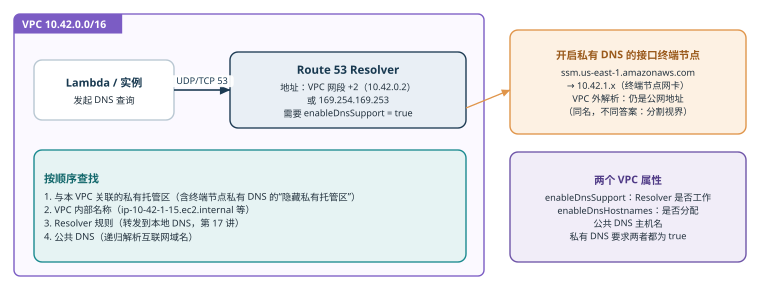
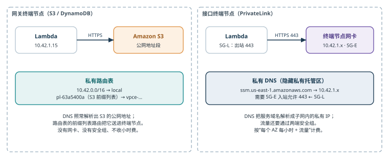
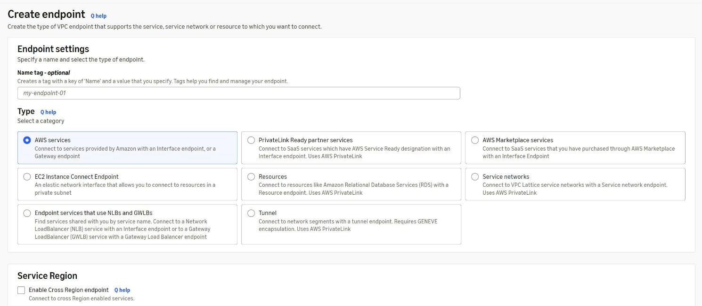
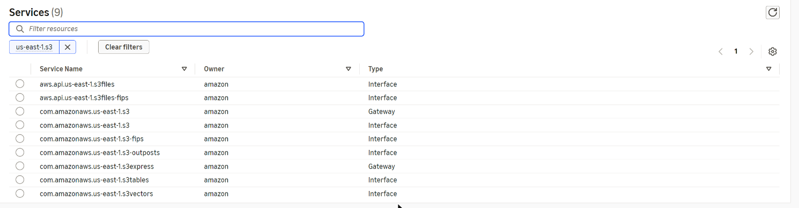
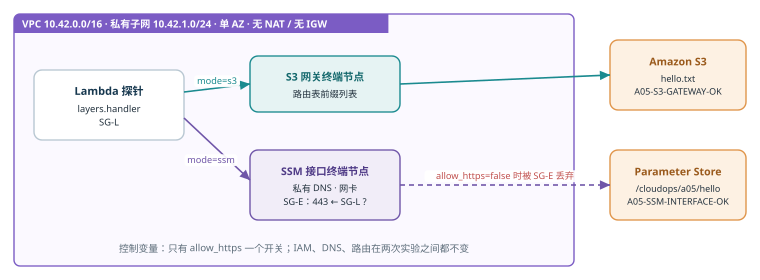

::::: cover
[第 05 讲 · 网络基础 ③]{.kicker}

# DNS 与终端节点：解析成功，为何仍超时？

[从 VPC 内置的 Route 53 Resolver 讲到网关终端节点与接口终端节点，把“解析、连通、加密、授权”拆成可以逐层取证的五道门。]{.subtitle}

::: cover-meta
- **讲次**：05 / 19
- **建议学时**：4 课时（讲授 2 + 实验 2）
- **实验费用**：本地探针 0 元；云上实验约 0.02 美元/小时（接口终端节点）
- **适用版本**：Route 53 Resolver · PrivateLink · AWS Provider 6.x
:::

::: scenario
一个私有子网里的 Lambda 没有 NAT 网关。它读取 S3 对象一切正常；调用 Parameter Store（SSM）的 `GetParameter` 却每次都超时。奇怪的是，在同一个子网里解析 `ssm.us-east-1.amazonaws.com`，得到的是一个 10.42.1.x 的私有地址。**DNS 都解析到私网了，为什么还连不上？S3 能用，又说明了什么？**
:::

## 学习目标 {.nonum}

:::: cards
::: {.card title="理解"}
- VPC 内 DNS 由谁回答、按什么顺序查找
- 网关终端节点为什么“不改 DNS、只改路由”
- 接口终端节点的私有 DNS 是怎样实现的
:::
::: {.card title="推理"}
- 用“五道门”模型给任何 API 故障分层
- 由错误类型反推出问题所在的层
- 判断该用网关、接口，还是 NAT
:::
::: {.card title="实操"}
- 本地逐层探测一个 AWS 端点（零费用）
- Terraform 搭建无 NAT 的终端节点实验
- 用一条安全组规则制造并修复故障
:::
::: {.card title="排障"}
- 私有 DNS 不生效：DNS 属性与 DHCP 选项
- 网络修好后出现 AccessDenied
- 桶策略中的 aws:SourceIp 陷阱
:::
::::

| 本讲结构 | 要回答的问题 | 产出 |
|---|---|---|
| 一、五道门 | 一次 AWS API 调用要过几关？ | 分层模型与故障特征 |
| 二、VPC 里的 DNS | 谁在回答 DNS？同一个名字为何有两个答案？ | Resolver 模型、实拍与实测 |
| 三、两类终端节点 | 网关和接口有什么本质区别？ | 机制对比、选型与费用 |
| 四、实操 | 怎样逐层取证？怎样只改一个变量？ | layers 探针、Terraform 实验 |
| 五～六、排障与练习 | 超时、拒绝、403 各查什么？ | 故障卡、练习 |
:::::

::: {.opener .nobreak}
[一 · 分层模型]{.kicker}

# 一次 AWS API 调用要过几道门？

[调用 AWS API 本质上是一次 HTTPS 请求。把它拆成五层，每一层都有自己的“失败长相”。]{.subtitle}
:::

## 五道门与它们的失败特征

::: formula
API 调用成功 ＝ DNS 解析 × 网络可达 × TLS 握手 × 服务响应 × 授权通过
:::



这个模型最大的用处是**用现象定位层次**：

- 解析失败（`getaddrinfo failed`、NXDOMAIN）→ 第①层：DNS 设置、DHCP 选项、域名拼写。
- **超时** → 第②层：路由、NACL、客户端出站规则、终端节点网卡的入站规则。DNS 和 IAM 都不会导致“超时”。
- 证书错误 → 第③层：用 IP 直连、主机名不匹配、中间人设备。
- 得到任何 HTTP 状态码 → 前三层已经打通。
- AccessDenied / 403 → 第⑤层：IAM、终端节点策略、资源策略（如桶策略）。

::: pitfalls
1. **nslookup 成功 ≠ 能连上。** DNS 只回答“地址是什么”，不保证这个地址的 443 端口放行。
2. **S3 正常 ≠ 其他 AWS 服务正常。** S3 常走网关终端节点（路由层面），SSM 走接口终端节点（网卡 + 安全组），两条路径毫不相干。
3. **AccessDenied 不是网络问题。** 能收到 AccessDenied，说明网络、TLS 都通了；此时放宽安全组只会扩大风险。
:::

::: {.opener}
[二 · VPC 里的 DNS]{.kicker}

# 谁在回答 DNS？同一个名字为何有两个答案？

[每个 VPC 都自带一台 DNS 服务器：Route 53 Resolver。它按固定顺序查找，所以同一个域名在 VPC 内外可以得到不同的答案。]{.subtitle}
:::

## Route 53 Resolver 与两个 VPC 属性

VPC 内的实例默认把 DNS 查询发给 **Route 53 Resolver**，地址是 VPC 主网段的基地址 +2（例如 10.42.0.2），也可以用固定地址 169.254.169.253。它是否工作、给不给实例分配公共 DNS 主机名，由两个 VPC 属性控制：

| 属性 | 作用 | 默认值 |
|---|---|---|
| `enableDnsSupport` | Resolver 是否为该 VPC 提供解析 | 默认 VPC 与新建 VPC 均为 true |
| `enableDnsHostnames` | 是否为有公网 IP 的实例分配公共 DNS 主机名 | 默认 VPC 为 true；新建 VPC 为 false |

接口终端节点的**私有 DNS 要求这两个属性同时为 true**——这是最常被遗漏的前提。本书账户的默认 VPC 两者都已开启：

{.shot}

```{.console title="aws ec2 describe-vpc-attribute（默认 VPC，2026-11-17 实测）"}
ENABLEDNSSUPPORT    True
ENABLEDNSHOSTNAMES  True
```



关于 Resolver，还有三点在排障时很有用：

- **安全组管不到发往 Resolver 的 DNS。** 要过滤 DNS 查询，用 Route 53 Resolver DNS Firewall；要记录查询，用 Resolver 查询日志。
- **有速率上限。** 每块网卡发往 Resolver 的 DNS 查询有每秒包数上限（1024 个），高并发且不缓存的应用可能被限速，表现为间歇性解析失败。
- **自定义 DHCP 选项会绕开它。** 如果 VPC 的 DHCP 选项集把 `domain-name-servers` 改成了自建 DNS，实例就不再询问 Resolver，私有托管区和终端节点私有 DNS 都可能“失效”——除非自建 DNS 把相应域名转发回 Resolver。

:::: {.example title="例题 5-1｜同一个域名，为什么在笔记本和 VPC 里解析结果不同？"}
在笔记本上解析 `ssm.us-east-1.amazonaws.com` 得到公网地址；在实验 VPC 的 Lambda 中解析同一个名字，得到 10.42.1.x。哪个是“对”的？

::: steps
1. **找出谁在回答。** 笔记本问的是运营商或公司的 DNS，最终由公共 DNS 回答；Lambda 问的是本 VPC 的 Route 53 Resolver。
2. **按 Resolver 的顺序查找。** 实验 VPC 中有一个开启了私有 DNS 的 SSM 接口终端节点，AWS 为它创建了一个**隐藏的、AWS 托管的私有托管区**，其中 `ssm.us-east-1.amazonaws.com` 指向终端节点网卡的私有 IP。私有托管区优先，于是返回 10.42.1.x。
3. **结论。** 两个答案都“对”：这就是分割视界（split-horizon）DNS。应用代码不用改域名，流量就自动走终端节点。
:::

::: answer
同名不同答，取决于谁在回答。判断“流量会走哪里”时，一定要在**发起请求的那台机器上**解析，而不是在自己的电脑上解析。
:::
::::

::: {.opener}
[三 · 两类终端节点]{.kicker}

# 网关终端节点和接口终端节点有什么本质区别？

[网关终端节点改的是路由表；接口终端节点在子网里放了一块网卡，再用 DNS 把流量引过去。]{.subtitle}
:::

## 两种机制



| 对比项 | 网关终端节点 | 接口终端节点（PrivateLink） |
|---|---|---|
| 支持的服务 | 只有 S3 与 DynamoDB | 数百种 AWS 服务（本书账户 us-east-1 中共 641 个终端节点服务） |
| 在 VPC 里的形态 | 路由表里的一条前缀列表路由 | 每个 AZ 一块网卡（ENI），有私有 IP |
| DNS | 不变，仍解析为公网地址 | 可开启私有 DNS，服务域名解析为网卡私有 IP |
| 安全组 | 没有（客户端出站规则仍要放行） | 网卡上有安全组，入站需放行 443 |
| 从本地数据中心访问 | 不能 | 可以（经 VPN / Direct Connect） |
| 费用 | 不收终端节点费 | 每个 AZ 每小时 + 每 GB 处理费 |

S3 同时提供两种终端节点：同一个服务名 `com.amazonaws.us-east-1.s3`，在控制台里出现两次（图 5-6）。VPC 内的访问优先用免费的网关终端节点；需要从本地数据中心、经 VPN 或 Direct Connect 私网访问 S3 时，才使用 S3 接口终端节点。

{.shot}

{.shot}

```{.console title="aws ec2 describe-vpc-endpoint-services（us-east-1，2026-11-17 实测）"}
641                                                         ← 可用的终端节点服务总数
com.amazonaws.us-east-1.s3   Gateway    PrivateDns=None                          AZ=6
com.amazonaws.us-east-1.s3   Interface  PrivateDns=*.s3.us-east-1.amazonaws.com  AZ=6
com.amazonaws.us-east-1.ssm  Interface  PrivateDns=ssm.us-east-1.amazonaws.com   AZ=6
```

## 终端节点策略：额外的一道“上限”

两类终端节点都可以附加**终端节点策略**。它像一张“通行证上限”：请求同时满足身份策略、资源策略**和**终端节点策略时才被允许。默认策略允许全部操作；它**不会授予**身份原本没有的权限。实验中的 `restrict_endpoint_policy = true` 会把 SSM 终端节点限制为只能 `GetParameter` 本实验路径下的参数。

## 生产中的放置与费用

一个接口终端节点只在一个 AZ 有网卡时，其他 AZ 的客户端也会被解析到这块网卡上——一旦这个 AZ 出问题，所有 AZ 的客户端都失去对该服务的访问。AWS 建议生产环境至少放在两个 AZ，并通过区域 DNS 名访问。代价是费用随“终端节点数 × AZ 数”线性增长：一个 VPC 若为 SSM、SSM Messages、EC2 Messages、Logs、ECR、STS 等十来个服务各建双 AZ 终端节点，每月固定费用就相当可观。常见的折中是在共享网络账户中集中部署终端节点，再通过 Transit Gateway 与 Resolver 规则供多个 VPC 使用（第 17 讲）。

::: {.opener}
[四 · 实操]{.kicker}

# 逐层取证，一次只改一个变量

[先在本地把五道门走一遍，再到一个没有 NAT 的 VPC 里，用一条安全组规则制造并修复故障。]{.subtitle}
:::

:::: {.lab title="实验 5-1｜layers：本地逐层探测 AWS 端点（零费用）"}
::: labmeta
- **目标**：亲眼看到五道门逐层通过（或在哪一层停下）
- **时长**：15 分钟
- **费用**：0 元（一个对不存在参数的只读请求）
- **工具**：Python 3.11+；API 层用 boto3，缺失时回退到 AWS CLI
:::

`labs/01-layers/layers.py` 依次执行：DNS 解析 → TCP 443 建连 → TLS 握手（校验证书主机名）→ 一个**未签名**的 HTTPS 请求 → 一个签名的 API 调用。任何一层失败立即停止。下面是本书在笔记本上运行的真实输出：

```{.console title="python layers.py ssm.us-east-1.amazonaws.com --api ssm（2026-11-17 实测）"}
  ✓ DNS  ssm.us-east-1.amazonaws.com → 100.55.128.217（公网地址，138 ms）
  ✓ TCP  100.55.128.217:443 建连成功（241 ms）
  ✓ TLS  TLSv1.3，证书 SAN 含 ['ssm.us-east-1.amazonaws.com', '*.ssm.us-east-1.api.aws']（517 ms）
  ✓ HTTP 未签名请求得到 HTTP 400 Bad Request（799 ms）——服务已响应
  ✓ API  ParameterNotFound（已到达服务并通过授权，AWS CLI）（8714 ms）
```

```{.console title="另外两次运行（实测）"}
$ python layers.py s3.us-east-1.amazonaws.com
  ✓ DNS  s3.us-east-1.amazonaws.com → 16.15.161.102, 16.15.212.249, 16.15.236.128, 16.15.246.145（公网地址，142 ms）
  ✓ TCP  16.15.161.102:443 建连成功（230 ms）
  ✓ TLS  TLSv1.3，证书 SAN 含 ['s3.amazonaws.com', '*.s3.amazonaws.com']（507 ms）
  ✓ HTTP 未签名请求得到 HTTP 307 Temporary Redirect（696 ms）——服务已响应
$ python layers.py ssm.us-east-1.amazonaws.local
  ✗ DNS  解析失败：[Errno 11001] getaddrinfo failed
```

读这些输出时注意两点：HTTP 400 和 307 都是“好消息”——服务已经回应，说明前三层全部打通；`ParameterNotFound` 也是好消息——签名通过、授权通过，只是参数不存在。
::::

:::: {.lab title="实验 5-2｜Terraform：没有 NAT 的终端节点实验"}
::: labmeta
- **目标**：部署图 5-7 的拓扑，默认处于故障态
- **时长**：30 分钟
- **费用**：接口终端节点约 0.01 美元/小时/AZ + 流量；其余可忽略
- **权限**：VPC、Lambda、IAM、S3、SSM 的创建与删除
:::



`labs/02-endpoint-lab` 共创建 19 个资源。Lambda 的部署包就是实验 5-1 的 `layers.py`，所以它在 VPC 内报告的五层结果，和你在笔记本上看到的格式完全一致。关键代码：

```{.hcl title="labs/02-endpoint-lab/main.tf（节选）"}
resource "aws_vpc_endpoint" "s3" {                 # 网关：只改路由表
  vpc_id            = aws_vpc.lab.id
  service_name      = "com.amazonaws.${var.region}.s3"
  vpc_endpoint_type = "Gateway"
  route_table_ids   = [aws_route_table.private.id]
}

resource "aws_vpc_endpoint" "ssm" {                # 接口：网卡 + 安全组 + 私有 DNS
  vpc_id              = aws_vpc.lab.id
  service_name        = "com.amazonaws.${var.region}.ssm"
  vpc_endpoint_type   = "Interface"
  subnet_ids          = [aws_subnet.private.id]
  security_group_ids  = [aws_security_group.endpoint.id]
  private_dns_enabled = true
}

# Lambda 出站：到终端节点 SG 的 443，以及到 S3 前缀列表的 443
resource "aws_vpc_security_group_egress_rule" "lambda_to_s3" {
  security_group_id = aws_security_group.lambda.id
  prefix_list_id    = aws_vpc_endpoint.s3.prefix_list_id
  ip_protocol       = "tcp"
  from_port         = 443
  to_port           = 443
}

# 唯一的实验变量：终端节点网卡是否接受来自 Lambda SG 的 443
resource "aws_vpc_security_group_ingress_rule" "endpoint_from_lambda" {
  count                        = var.allow_https ? 1 : 0
  security_group_id            = aws_security_group.endpoint.id
  referenced_security_group_id = aws_security_group.lambda.id
  ip_protocol                  = "tcp"
  from_port                    = 443
  to_port                      = 443
}
```

```{.console title="在 labs/02-endpoint-lab 中执行（本书实测输出）"}
$ terraform test
  run "fault_state_by_default"... pass
  run "repair_adds_exactly_one_rule"... pass
  run "lambda_is_private_and_least_privilege"... pass
  run "endpoint_policy_is_optional"... pass
Success! 4 passed, 0 failed.
$ terraform plan
Plan: 19 to add, 0 to change, 0 to destroy.
```
::::

:::: {.lab title="实验 5-3｜故障与修复：同一个探针，前后对照"}
::: labmeta
- **目标**：观察 DNS 通而 TCP 不通，再修复
- **时长**：30 分钟
- **费用**：同实验 5-2
- **前提**：实验 5-2 已 apply（allow_https = false）
:::

1. `aws lambda invoke --function-name a05-endpoint-probe --cli-binary-format raw-in-base64-out --payload '{"mode":"dns"}' dns.json`，再分别用 `"s3"`、`"ssm"` 调用。注意：invoke 命令成功只代表调用被受理，结果要打开 JSON 看 `ok` 与 `steps`。
2. `terraform apply -var allow_https=true`，plan 中应**只有一条**入站规则被新增。
3. 再次用 `"ssm"` 调用，比较前后两次的 `steps`。
4. `terraform destroy`，再确认终端节点、Lambda、桶与参数都已删除。

| 探针 | 修复前（预期） | 修复后（预期） | 能说明什么 |
|---|---|---|---|
| dns | ✓ 解析为 10.42.1.x | 同左 | 私有 DNS 正常；不说明 443 放行 |
| s3 | ✓ 五层通过，读到 A05-S3-GATEWAY-OK | 同左 | 前缀列表路由与 IAM 都正确 |
| ssm | ✓ DNS，✗ TCP 超时 | ✓ 五层通过，读到 A05-SSM-INTERFACE-OK | 唯一差异就是终端节点 SG 的 443 |
::::

::: warn
表中“预期”是按机制推导的结果，供实验时对照；本书全程只读，没有在实验账户中部署这些资源。如果你的结果与预期不同，先看 Lambda 日志里 `steps` 停在哪一层，再按图 5-1 的对应关系排查，不要直接写成“通过”。
:::

::: {.opener}
[五 · 故障分析]{.kicker}

# 超时、拒绝、403，各查什么？

[按错误类型定位层次，再在该层里找唯一的变化。]{.subtitle}
:::

:::: {.example title="例题 5-2｜情境导入：DNS 已是私网地址，SSM 为什么超时？"}
已知：私有子网，无 NAT；`ssm.us-east-1.amazonaws.com` 解析为 10.42.1.x；S3 读取成功；SSM 调用超时。只允许做一处最小修改。

::: steps
1. **定层。** 超时 → 第②层（网络）。DNS 已经给出私网地址，第①层通过；IAM 不会导致超时，第⑤层暂不考虑。
2. **缩小范围。** 目标地址 10.42.1.x 在 VPC 内，路由是 local，没有问题；同一子网内也不经过 NACL。剩下两端安全组：Lambda 的出站和终端节点网卡的入站。
3. **逐一核对。** Lambda SG 出站允许 443 → 终端节点 SG；终端节点 SG **没有任何入站规则**。
4. **最小修复。** 在终端节点 SG 上增加一条入站规则：TCP 443，来源为 Lambda SG。不要开放 0.0.0.0/0。
5. **复验。** 用同一个探针、同一个 payload 再调用一次，五层全部通过。
:::

::: answer
根因是终端节点网卡的安全组没有放行 443。S3 正常不能用来排除这个问题，因为 S3 走的是网关终端节点（路由层面，没有安全组可言）。
:::
::::

::: {.fault title="故障 1｜开了私有 DNS，解析出来却还是公网地址"}
现象
:   接口终端节点显示 `private_dns_enabled = true`，但子网内解析服务域名得到公网地址，调用超时（没有 NAT）。

根因
:   VPC 的 `enableDnsHostnames` 或 `enableDnsSupport` 为 false；或者 DHCP 选项集把 DNS 指向了自建服务器，查询根本没有到达 Route 53 Resolver。

修复
:   开启两个 DNS 属性；自建 DNS 场景下把 `amazonaws.com` 相关域名条件转发给 Resolver（第 17 讲的 Resolver 入站终端节点）。
:::

::: {.fault title="故障 2｜网络修好了，又出现 AccessDeniedException"}
现象
:   终端节点 SG 放行 443 后，调用不再超时，但返回 AccessDeniedException。

根因
:   已经到达第⑤层：执行角色缺少 `ssm:GetParameter`，或终端节点策略没有放行该参数路径。

修复
:   检查身份策略与终端节点策略的交集；**不要**为了“试试看”放开安全组或改成 `*` 权限。
:::

::: {.fault title="故障 3｜S3 走网关终端节点后，桶策略把自己人挡在了门外"}
现象
:   桶策略用 `aws:SourceIp` 只允许公司公网出口地址访问。业务迁到私有子网、改走网关终端节点后，读取全部 403。

根因
:   经终端节点到达 S3 的请求，源地址是 VPC 私有 IP，`aws:SourceIp` 条件不再匹配。

修复
:   改用 `aws:SourceVpce`（指定终端节点）或 `aws:SourceVpc` 条件；同时保留对必要公网来源的放行。
:::

::: {.fault title="故障 4｜某个 AZ 故障时，所有 AZ 的函数都调不通 SSM"}
现象
:   us-east-1a 出现故障期间，部署在 1b、1c 的函数调用 SSM 也全部超时。

根因
:   SSM 接口终端节点只在 1a 有网卡；私有 DNS 把所有 AZ 的请求都解析到这块网卡上。

修复
:   在至少两个 AZ 部署终端节点网卡，并让工作负载与之同 AZ 分布；把这类“依赖的单 AZ 资源”纳入第 02 讲的故障域检查。
:::

::: {.opener}
[课堂巩固 · 自测]{.kicker}

# 练一练：你能先判断“哪一层”吗？

[每道题先写出你认为失败的层次，再看解析。]{.subtitle}
:::

## 随堂练习

::: {.exercise title="练习 1｜路由与 IAM"}
私有路由表只有 `local`，没有任何终端节点。执行角色有 `s3:GetObject` 权限。Lambda 能读取 S3 对象吗？会出现什么现象？
:::

::: {.exercise title="练习 2｜DNS 证明了什么"}
在子网内 `nslookup ssm.us-east-1.amazonaws.com` 返回 10.42.1.25。能否据此说明 SSM 调用一定成功？
:::

::: {.exercise title="练习 3｜最小修复"}
Lambda SG 出站允许 443 → 终端节点 SG；终端节点 SG 没有入站规则。你只改一处，改哪里、来源写什么？
:::

::: {.exercise title="练习 4｜错误类型"}
修复后调用返回 `AccessDeniedException`。下一步应该检查什么？是否应该把终端节点 SG 改成允许所有端口？
:::

::: {.exercise title="练习 5｜选型"}
一个 VPC 只需要访问 S3 和 DynamoDB，团队计划为二者各建一个接口终端节点。你会给出什么建议？为什么？
:::

::: {.exercise title="练习 6｜证据边界"}
`terraform apply` 成功、终端节点状态为 available。能否写“SSM 私网访问已验证”？
:::

## 参考答案与解析

::: {.solution title="1"}
不能。没有到 S3 的路由（无 NAT、无网关终端节点），请求在第②层就无路可走，表现为超时。IAM 允许不等于网络可达。
:::

::: {.solution title="2"}
不能。DNS 只证明第①层；第②层还要看客户端出站、终端节点 SG 入站与 NACL，第⑤层还要看身份策略和终端节点策略。
:::

::: {.solution title="3"}
只改终端节点 SG：入站 TCP 443，来源为 Lambda 的安全组。不需要、也不应该开放 0.0.0.0/0。
:::

::: {.solution title="4"}
检查执行角色的身份策略、终端节点策略以及（如有）资源策略。AccessDenied 说明网络已经通了，放开安全组只会扩大攻击面而无济于事。
:::

::: {.solution title="5"}
改用网关终端节点：S3 与 DynamoDB 都支持，且不收终端节点费，也没有需要维护的网卡与安全组。只有需要从本地数据中心私网访问时才考虑接口终端节点。
:::

::: {.solution title="6"}
不能。apply 成功只说明资源被创建；必须在 VPC 内用探针实际调用并看到 API 层通过，才能写“已验证”。
:::

## 这一讲，你应该记住 {.nonum}

:::: summary
::: {.card tag="分层"}
**DNS → 网络 → TLS → HTTP → 授权**

超时查网络，403 查权限。
:::
::: {.card tag="DNS"}
**Resolver 在 VPC+2；私有托管区优先**

私有 DNS 需要两个 DNS 属性都为 true。
:::
::: {.card tag="网关终端节点"}
**改路由，不改 DNS；只有 S3 / DynamoDB**

免费、无网卡、无安全组。
:::
::: {.card tag="接口终端节点"}
**网卡 + 私有 DNS + 安全组 443**

按 AZ 计费；生产至少两个 AZ。
:::
::::

::: refs
## 参考资料 {.nonum}

[截图说明：图 5-2、5-5、5-6 摄于 2026-11-17，us-east-1；账户 ID 已替换为 111122223333；全部操作只读，未创建终端节点。]{.small}

1. What is Route 53 Resolver?（VPC+2、169.254.169.253、查找顺序）. <https://docs.aws.amazon.com/Route53/latest/DeveloperGuide/resolver.html>
2. DNS attributes for your VPC. <https://docs.aws.amazon.com/vpc/latest/userguide/vpc-dns.html>
3. Access AWS services through AWS PrivateLink（私有 DNS、隐藏私有托管区、多 AZ 建议）. <https://docs.aws.amazon.com/vpc/latest/privatelink/privatelink-access-aws-services.html>
4. Gateway endpoints for Amazon S3（前缀列表路由、aws:SourceVpce）. <https://docs.aws.amazon.com/vpc/latest/privatelink/vpc-endpoints-s3.html>
5. Control access to VPC endpoints using endpoint policies. <https://docs.aws.amazon.com/vpc/latest/privatelink/vpc-endpoints-access.html>
6. AWS PrivateLink pricing. <https://aws.amazon.com/privatelink/pricing/>
7. Connecting Lambda functions to your VPC. <https://docs.aws.amazon.com/lambda/latest/dg/configuration-vpc.html>
8. Terraform：aws_vpc_endpoint、aws_lambda_function、aws_vpc_security_group_ingress_rule（provider 6.73.0）. <https://registry.terraform.io/providers/hashicorp/aws/latest/docs>
:::
