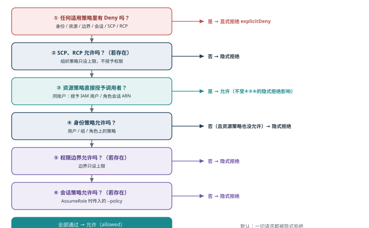
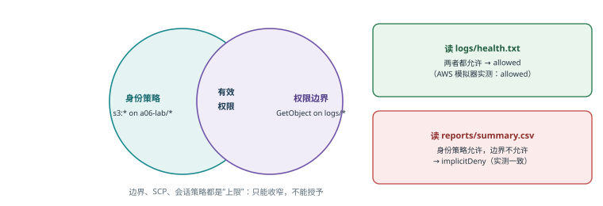
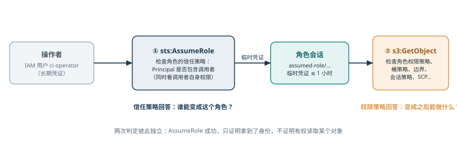
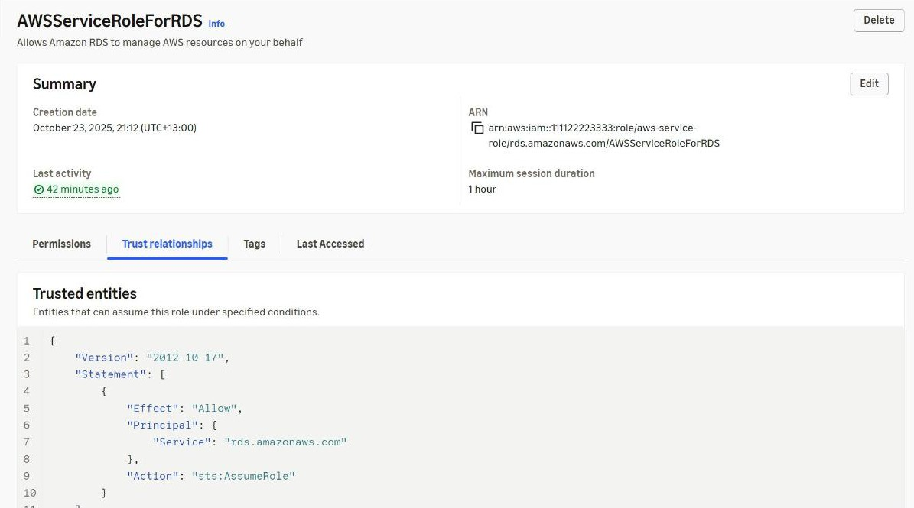
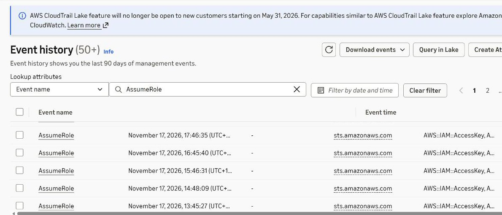

::::: cover
[第 06 讲 · 身份与访问 ①]{.kicker}

# IAM 与 STS：有 Allow，为何仍被拒？

[一个请求由四个字段描述，被六类策略共同评估；换身份（STS）与做事情（权限）是两次独立的授权。本讲的每一个判断，都用 AWS 官方策略模拟器复核。]{.subtitle}

::: cover-meta
- **讲次**：06 / 19
- **建议学时**：4 课时（讲授 2 + 实验 2）
- **实验费用**：模拟器与校验 0 元；云上实验几乎为 0
- **适用版本**：IAM 评估逻辑（含 RCP）· AWS Provider 6.x
:::

::: scenario
CI 操作者成功执行了 `sts:AssumeRole`，变成了角色 a06-sts-reader。这个角色能读取 `logs/health.txt`，却在读取 `reports/summary.csv` 时得到 AccessDenied。网络没有问题，对象也确实存在。有人建议：“把权限改成 `s3:*` 加 `Resource: *` 就好了。”**真正缺的是哪一个条件？这个“快修”错在哪里？**
:::

## 学习目标 {.nonum}

:::: cards
::: {.card title="理解"}
- 请求上下文的四个字段
- 显式拒绝、隐式拒绝与“上限”类策略
- 信任策略与权限策略的分工
:::
::: {.card title="推理"}
- 按 AWS 官方顺序手算一个请求的结果
- 同账户资源策略什么时候能“单独放行”
- 边界、SCP、会话策略为何只能收窄
:::
::: {.card title="实操"}
- 本地评估器 + AWS 官方模拟器对照
- 用 Access Analyzer 校验策略
- Terraform 构建角色、桶与精确授权
:::
::: {.card title="排障"}
- 从 AccessDenied 反推缺失的条件
- SSE-KMS 对象需要 kms:Decrypt
- 为什么 Event History 里找不到 GetObject
:::
::::

| 本讲结构 | 要回答的问题 | 产出 |
|---|---|---|
| 一、请求 | AWS 判断的对象到底是什么？ | 四字段模型 |
| 二、评估 | 多类策略按什么顺序作用？ | 官方评估流程、交集图 |
| 三、STS | 换身份和做事情为什么是两回事？ | 信任策略实拍、会话与日志 |
| 四、实操 | 怎样不靠猜来验证一个判断？ | iameval + AWS 模拟器、Terraform |
| 五～六、排障与练习 | AccessDenied 从哪里查起？ | 故障卡、练习 |
:::::

::: {.opener .nobreak}
[一 · 请求]{.kicker}

# AWS 判断的对象到底是什么？

[每一次 API 调用都被整理成一个“请求上下文”。授权就是拿这个上下文去和所有适用的策略逐条比对。]{.subtitle}
:::

## 请求上下文的四个字段

::: formula
请求 ＝ 谁（Principal）＋ 做什么（Action）＋ 对什么（Resource）＋ 在什么条件下（Context）
:::

| 字段 | 情境中的取值 | 最容易犯的错 |
|---|---|---|
| Principal | `arn:aws:sts::111122223333:assumed-role/a06-sts-reader/<会话名>` | 以为操作者原来的管理员权限会“带进”角色会话 |
| Action | `s3:GetObject` | 把 `s3:ListBucket` 与 `s3:GetObject` 混为一谈 |
| Resource | `arn:aws:s3:::a06-lab/reports/summary.csv` | GetObject 要写**对象** ARN（桶 ARN 加路径），ListBucket 才写桶 ARN |
| Context | 来源 IP、是否 HTTPS（`aws:SecureTransport`）、MFA、标签、时间…… | 条件键名大小写、类型（Bool / String）写错 |

一条策略语句只有在 Action、Resource、Principal（如有）**和** Condition 全部匹配时才“适用”。Action 名不区分大小写，Resource ARN 区分大小写——`logs/` 与 `Logs/` 是两个不同的对象前缀。

::: {.opener}
[二 · 评估]{.kicker}

# 多类策略按什么顺序作用？

[默认一切请求都被拒绝。显式拒绝一票否决；“上限”类策略只能收窄；真正授予权限的只有身份策略和资源策略。]{.subtitle}
:::

## 单账户请求的评估顺序



三个概念必须分清：

- **隐式拒绝（implicitDeny）**：没有任何适用的 Allow。这是默认状态，不需要写任何东西。情境中的 report 就是这种情况。
- **显式拒绝（explicitDeny）**：某条适用的语句写了 `Deny`。它优先于一切 Allow，无论 Allow 写在哪里。
- **上限类策略**：SCP、RCP、权限边界、会话策略本身**不授予**任何权限，只决定“最多能有多少”。它们不允许的操作，即使身份策略允许，也会被隐式拒绝。



## 同账户资源策略的特殊规则

在**同一个账户**内，资源策略（如桶策略）如果**直接把权限授予发起请求的 IAM 用户或角色会话 ARN**，那么即使身份策略里什么都没有，请求也会被允许——身份策略与权限边界的隐式拒绝不影响结果。但有几点限制：

- 如果资源策略授予的是**角色 ARN**（而不是会话 ARN），结果仍受权限边界和会话策略的隐式拒绝限制；
- IAM 角色的**信任策略**和 KMS 的**密钥策略**例外：它们必须显式允许相应主体；
- 跨账户请求则需要**双方**都允许：调用方账户的身份策略，加上资源所在账户的资源策略。

::: warn
“所有策略取交集”是一个流传很广但不准确的说法。身份策略与资源策略在同账户内是“任一允许即可”（并集）；上限类策略才是交集；显式拒绝则凌驾一切。把三者混成一句“取交集”，就解释不了实验场景 S5。
:::

:::: {.example title="例题 6-1｜情境中的 report 为什么被拒绝？"}
已知：角色会话成功建立；角色唯一的权限策略是 `Allow s3:GetObject on arn:aws:s3:::a06-lab/logs/health.txt`；桶没有授予该角色权限的桶策略；对象存在。请求为 `s3:GetObject` 读取 `reports/summary.csv`。

::: steps
1. **写出请求的四个字段。** Principal 为角色会话；Action 为 `s3:GetObject`；Resource 为 `arn:aws:s3:::a06-lab/reports/summary.csv`；Context 为 HTTPS。
2. **找显式拒绝。** 没有任何适用的 Deny。
3. **找 Allow。** 唯一的 Allow 的 Resource 是 `…/logs/health.txt`，与请求的 Resource 不匹配；桶策略也没有授予。
4. **得出结论。** 没有适用的 Allow → 隐式拒绝。根因是 **Resource 不匹配**，与网络、信任策略都无关。
5. **最小修复。** 增加一条 `Allow s3:GetObject`，Resource 精确到 `…/reports/summary.csv`；不要放宽成 `s3:*` 或 `Resource: *`。
:::

::: answer
隐式拒绝，缺的是一条 Resource 匹配的 Allow。实验 6-1 用 AWS 官方模拟器验证了这一判断：health.txt 为 allowed，summary.csv 为 implicitDeny。
:::
::::

::: {.opener}
[三 · STS]{.kicker}

# 换身份和做事情，为什么是两回事？

[AssumeRole 只回答“你能不能变成这个角色”；变成之后能做什么，由角色的权限决定，与你原来是谁无关。]{.subtitle}
:::

## 两次独立的授权



角色有两种策略，挂在不同位置、回答不同问题：

| | 信任策略（trust policy） | 权限策略（permissions policy） |
|---|---|---|
| 本质 | 角色上的**资源策略** | 角色的**身份策略** |
| 回答 | 谁能扮演这个角色？ | 扮演之后能做什么？ |
| 关键元素 | `Principal`、`sts:AssumeRole`、条件（MFA、外部 ID、来源等） | `Action`、`Resource`、`Condition` |
| 常见 Principal | IAM 用户/角色 ARN、账户、AWS 服务、OIDC/SAML 身份提供商 | ——（没有 Principal 元素） |

同账户内，如果信任策略**直接写出**操作者的 IAM 用户 ARN，操作者不需要再在自己的身份策略里允许 `sts:AssumeRole`；如果信任策略只写了账户（`arn:aws:iam::111122223333:root`），则由操作者的身份策略决定。跨账户时两边都要允许。

本书账户里有一个现成的例子：RDS 的服务关联角色，它的信任策略只允许 RDS 服务来扮演。

{.shot}

## 角色会话与审计

扮演成功后，STS 返回一组临时凭证（访问密钥 ID 以 `ASIA` 开头）和会话 ARN `arn:aws:sts::<账户>:assumed-role/<角色名>/<会话名>`。几个要点：

- **有效期**：默认 1 小时；角色的 `max_session_duration` 可设为 1～12 小时；用一个角色会话再去扮演另一个角色（角色链）时，最长 1 小时。
- **权限不叠加**：会话的权限只来自角色（及会话策略），原来的 IAM 用户权限不会带进来。
- **会话策略**：扮演时可以用 `--policy` 再传一个策略，进一步收窄这次会话的权限（实验场景 S7）。
- **审计**：`AssumeRole` 是 CloudTrail **管理事件**，Event History 中可以直接查到；而 `s3:GetObject` 是**数据事件**，默认不记录，Event History 里永远查不到它。

{.shot}

```{.console title="aws cloudtrail lookup-events --lookup-attributes AttributeKey=EventName,AttributeValue=AssumeRole（2026-11-17 实测，解析后）"}
2026-11-17T07:44:51Z AssumeRole AWSService rds.amazonaws.com AWSServiceRoleForRDS 会话名=CRUM readOnly=True managementEvent=True
2026-11-17T06:44:14Z AssumeRole AWSService rds.amazonaws.com AWSServiceRoleForRDS 会话名=CRUM readOnly=True managementEvent=True
```

::: {.opener}
[四 · 实操]{.kicker}

# 不靠猜，用官方引擎验证每一个判断

[先在本地按评估顺序“手算”，再把同一组策略交给 AWS 的策略模拟器复核；部署之前，用 Access Analyzer 校验策略。]{.subtitle}
:::

:::: {.lab title="实验 6-1｜iameval：本地评估器 × AWS 官方模拟器"}
::: labmeta
- **目标**：用代码实现评估顺序，并与官方引擎逐项对照
- **时长**：30 分钟
- **费用**：0 元（`iam:SimulateCustomPolicy` 为只读、免费 API）
- **权限**：`iam:SimulateCustomPolicy`
:::

`labs/01-iameval/iameval.py` 按图 6-1 的顺序实现评估，`scenarios.json` 准备了 8 个场景（基线、修复、桶策略显式拒绝、权限边界、同账户资源策略直接授予、HTTPS 条件、会话策略、资源策略与边界并存）。加上 `--aws` 参数时，脚本把每个场景的策略原样交给 `aws iam simulate-custom-policy`，再逐个资源比较两边的判定。下面是本书的实测输出（节选）：

```{.console title="python iameval.py scenarios.json --aws（2026-11-17 实测，节选）"}
[S1] 基线：角色只允许读 health
  a06-lab/logs/health.txt      本地=allowed       AWS=allowed       一致  ✓预期
  a06-lab/reports/summary.csv  本地=implicitDeny  AWS=implicitDeny  一致  ✓预期
      ↳ 身份策略与资源策略都没有匹配的 Allow
[S3] 桶策略对 reports/* 显式拒绝
  a06-lab/reports/summary.csv  本地=explicitDeny  AWS=explicitDeny  一致  ✓预期
      ↳ 显式拒绝：resource#DenyReports
[S4] 权限边界只允许 logs/*，身份策略给了 s3:*
  a06-lab/reports/summary.csv  本地=implicitDeny  AWS=implicitDeny  一致  ✓预期
      ↳ 权限边界不允许（边界只设上限，不授予权限）
[S5] 同账户：桶策略直接授予 IAM 用户，身份策略没有 S3 权限
  a06-lab/reports/summary.csv  本地=allowed       AWS=allowed       一致  ✓预期
      ↳ 资源策略直接授予调用者：resource#GrantUser
[S6] 条件：桶策略拒绝非 HTTPS 请求（aws:SecureTransport=false）
  a06-lab/logs/health.txt      本地=explicitDeny  AWS=explicitDeny  一致  ✓预期
[S7] 会话策略只允许 logs/*（只在本地评估：模拟器不支持该策略类型）
  a06-lab/reports/summary.csv  本地=implicitDeny   ✓预期

与 AWS 模拟器不一致的判定：0 处
```

7 个可对照场景、12 个判定，本地评估器与 AWS 官方模拟器完全一致；4 个单元测试另外覆盖了“显式拒绝优先”“Action 不区分大小写而 Resource 区分”“SCP 无 Allow 即拒绝”等规则。
::::

::: note
模拟器的边界：`simulate-custom-policy` 可以输入身份策略、权限边界、资源策略和上下文键，但不能输入会话策略，所以 S7 只在本地评估。模拟器也不会真正调用服务——它回答“策略怎么判”，回答不了“对象是否存在”“KMS 密钥是否允许解密”。
:::

:::: {.lab title="实验 6-2｜Access Analyzer 校验：拦住“快修”"}
::: labmeta
- **目标**：在部署前发现危险或无效的策略
- **时长**：10 分钟
- **费用**：0 元（`validate-policy` 免费）
- **权限**：`access-analyzer:ValidatePolicy`
:::

情境中有人提议的“快修”被写成 `policies/bad-fix.json`（`s3:*` on `*`、`iam:PassRole` on `*`，外加一个拼错的动作），精确修复写成 `good-fix.json`。用 Access Analyzer 的策略校验检查两者：

```{.console title="aws accessanalyzer validate-policy --policy-type IDENTITY_POLICY（2026-11-17 实测）"}
== bad-fix
SECURITY_WARNING  PASS_ROLE_WITH_STAR_IN_RESOURCE
ERROR             INVALID_ACTION              ← s3:GetObjects 并不存在
== good-fix
（没有任何发现）
```

值得注意的是：`s3:*` on `*` 本身并没有被报告为错误——校验器检查的是语法、无效值和若干已知的危险模式，并不判断“权限是否过大”。最小权限仍然要靠设计与评审（以及 Access Analyzer 的未使用访问分析等功能）。
::::

:::: {.lab title="实验 6-3｜Terraform：角色、信任、精确授权与边界"}
::: labmeta
- **目标**：用代码复现情境，并用两个开关切换修复与边界
- **时长**：30 分钟
- **费用**：S3 存储与请求可忽略；IAM、STS 不收费
- **权限**：IAM 角色与策略、S3 的创建与删除
:::

`labs/02-sts-lab` 创建私有桶、两个对象、拒绝非 HTTPS 的桶策略和角色。策略全部用 `jsonencode` 生成，所以测试可以直接断言策略内容：

```{.hcl title="labs/02-sts-lab/main.tf（节选）"}
variable "operator_arn" {
  type = string
  validation {   # 信任主体必须是长期身份，不能是会话 ARN
    condition     = can(regex("^arn:aws:iam::[0-9]{12}:(user|role)/.+$", var.operator_arn))
    error_message = "operator_arn 必须是 IAM 用户或角色的 ARN，不能是临时会话 ARN。"
  }
}

resource "aws_iam_role" "reader" {
  name                 = "a06-sts-reader"
  max_session_duration = 3600
  assume_role_policy = jsonencode({
    Version = "2012-10-17"
    Statement = [{
      Sid       = "OnlyApprovedOperator"
      Effect    = "Allow"
      Principal = { AWS = var.operator_arn }          # 不写 "*"，也不写整个账户
      Action    = ["sts:AssumeRole", "sts:TagSession"]
    }]
  })
  permissions_boundary = var.enable_boundary ? aws_iam_policy.boundary[0].arn : null
}

locals {
  reader_statements = concat(
    [{ Sid = "ReadHealthOnly", Effect = "Allow", Action = "s3:GetObject",
       Resource = "${aws_s3_bucket.lab.arn}/logs/health.txt" }],
    var.allow_report ? [{ Sid = "ReadReportAfterFix", Effect = "Allow", Action = "s3:GetObject",
       Resource = "${aws_s3_bucket.lab.arn}/reports/summary.csv" }] : []
  )
}
```

```{.console title="在 labs/02-sts-lab 中执行（本书实测输出）"}
$ terraform test
  run "trust_names_exactly_one_operator"... pass
  run "baseline_reads_health_only"... pass
  run "fix_adds_one_exact_statement"... pass
  run "boundary_caps_the_role"... pass
  run "reject_session_arn_as_operator"... pass
  run "bucket_denies_plain_http"... pass
Success! 6 passed, 0 failed.
$ terraform plan -var operator_arn=<当前 IAM 用户 ARN>
Plan: 7 to add, 0 to change, 0 to destroy.
$ terraform plan ... -var allow_report=true -var enable_boundary=true
Plan: 8 to add, 0 to change, 0 to destroy.
```

部署后用 `probe.sh <角色 ARN> <桶名>`（或 `Test-A06Access.ps1`）验证：脚本扮演角色、打印会话 ARN，再读取两个对象并报告退出码；临时凭证只存在于子进程的环境变量里。预期：基线时 health 成功、report 被拒；`allow_report=true` 后两者都成功；再加 `enable_boundary=true`，report 又被拒——边界生效了；传入 `session-logs-only.json` 作为会话策略时同样只能读 logs。
::::

::: warn
实验 6-3 的部署与探针结果为按机制推导的预期，本书没有在实验账户中创建角色和桶；实验 6-1、6-2 的输出则是对 AWS API 的真实调用。
:::

::: {.opener}
[五 · 故障分析]{.kicker}

# AccessDenied，从哪里查起？

[先确认“是谁在请求”，再核对四个字段，最后逐类排除拒绝来源。不要用扩大权限来“试”。]{.subtitle}
:::

| 步骤 | 做什么 | 能排除什么 |
|---|---|---|
| 1 确认主体 | `aws sts get-caller-identity` | 用错 profile、没有切换到角色 |
| 2 读错误信息 | 许多服务的 AccessDenied 会说明拒绝来自哪类策略（如 “with an explicit deny in a service control policy”） | 一大半的猜测 |
| 3 核对四字段 | 对象 ARN、动作名、条件键 | Resource 写成桶 ARN、动作写错 |
| 4 逐类排除 | 显式拒绝 → SCP/RCP → 资源策略 → 身份策略 → 边界 → 会话策略 → KMS | 层层定位 |
| 5 复现与验证 | 用模拟器复核策略，用同一个探针复测 | “改了就好了”的错觉 |

::: {.fault title="故障 1｜身份策略、桶策略都允许，读取 SSE-KMS 对象仍然 AccessDenied"}
现象
:   对象用客户托管 KMS 密钥加密（SSE-KMS），角色有 `s3:GetObject`，读取仍被拒。

根因
:   S3 需要代表调用者解密数据密钥，调用者还必须有该 KMS 密钥的 `kms:Decrypt` 权限，而且密钥策略必须允许（第 07 讲）。

修复
:   在角色策略中授予该密钥 ARN 的 `kms:Decrypt`，并确认密钥策略允许本账户的 IAM 策略生效。
:::

::: {.fault title="故障 2｜AssumeRole 本身返回 AccessDenied"}
现象
:   `aws sts assume-role` 报 “is not authorized to perform: sts:AssumeRole”。

根因
:   信任策略的 Principal 不包含调用者（常见：写成了会话 ARN，或会话名/路径不符），或者跨账户时调用方身份策略没有允许，或者 SCP 禁止。

修复
:   核对信任策略的 Principal 是否为调用者的**长期身份 ARN**；跨账户补齐调用方身份策略；检查 SCP。实验 6-3 的变量校验专门拦截“把会话 ARN 写进信任策略”。
:::

::: {.fault title="故障 3｜能下载对象，却列不出桶里的文件"}
现象
:   `aws s3 cp s3://a06-lab/logs/health.txt .` 成功，`aws s3 ls s3://a06-lab/logs/` 被拒。

根因
:   列出对象是 `s3:ListBucket`，作用在**桶 ARN**（`arn:aws:s3:::a06-lab`）上，可用条件键 `s3:prefix` 限定前缀；读取对象是 `s3:GetObject`，作用在对象 ARN 上。

修复
:   按需单独授予 `s3:ListBucket`，Resource 写桶 ARN，并用 `s3:prefix` 限制为 `logs/*`。
:::

::: {.fault title="故障 4｜在 Event History 里找不到某次 GetObject"}
现象
:   安全团队想确认某个对象是否被读取过，在 CloudTrail Event History 里搜不到任何 GetObject。

根因
:   GetObject 是**数据事件**。Event History 只保存最近 90 天的管理事件；数据事件需要在 Trail 或事件数据存储中单独开启，且按事件量计费。

修复
:   对需要审计的桶开启数据事件（可用高级事件选择器只记录特定前缀）；在开启之前发生的读取无法追溯（第 11 讲）。
:::

::: {.opener}
[课堂巩固 · 自测]{.kicker}

# 练一练：你能手算出授权结果吗？

[先写出四个字段，再按评估顺序推导。]{.subtitle}
:::

## 随堂练习

::: {.exercise title="练习 1｜Resource 匹配"}
角色允许 `s3:GetObject` on `arn:aws:s3:::lab/logs/*`，没有其他策略。读取 `arn:aws:s3:::lab/reports/summary.csv` 的结果是什么？是哪种拒绝？
:::

::: {.exercise title="练习 2｜信任与权限"}
操作者能成功扮演角色。能否由此断定该角色可以读取同账户的所有 S3 对象？
:::

::: {.exercise title="练习 3｜显式拒绝"}
角色的身份策略允许读取 report，但桶策略对所有主体显式拒绝读取 `reports/*`。最终结果如何？
:::

::: {.exercise title="练习 4｜权限边界"}
用户的身份策略为 `Allow *:*`，权限边界只允许 `s3:*` 与 `cloudwatch:*`。该用户能否创建 IAM 角色？为什么？
:::

::: {.exercise title="练习 5｜同账户资源策略"}
同账户内，桶策略把 `s3:GetObject` 直接授予 IAM 用户 alice，alice 没有任何身份策略。alice 能读取吗？如果 alice 设置了一个不含 S3 的权限边界呢？
:::

::: {.exercise title="练习 6｜会话权限"}
管理员 IAM 用户扮演了一个只有只读权限的角色。在这个会话里，管理员原有的写权限还能用吗？
:::

## 参考答案与解析

::: {.solution title="1"}
隐式拒绝（implicitDeny）：Action 匹配，但 Resource 路径不匹配，没有任何适用的 Allow。
:::

::: {.solution title="2"}
不能。AssumeRole 只检查信任策略（及调用者权限），会话能做什么取决于角色的权限策略和各类上限策略。
:::

::: {.solution title="3"}
拒绝（explicitDeny）。任何适用的显式拒绝都优先于 Allow（实验场景 S3 的实测结果）。
:::

::: {.solution title="4"}
不能。权限边界是上限，`iam:CreateRole` 不在边界允许的范围内，即使身份策略允许 `*:*`，结果也是隐式拒绝。
:::

::: {.solution title="5"}
没有边界时可以：同账户资源策略直接授予 IAM 用户，不受身份策略隐式拒绝的影响（场景 S5，模拟器实测 allowed）。设置了边界后仍然可以——同账户内直接授予 IAM 用户 ARN 的资源策略不受权限边界隐式拒绝的限制（场景 S8，模拟器实测 allowed）；但如果授予的是角色 ARN，就会受到边界限制。
:::

::: {.solution title="6"}
不能。会话的权限只来自角色（以及会话策略），原 IAM 用户的权限不会叠加进来。
:::

## 这一讲，你应该记住 {.nonum}

:::: summary
::: {.card tag="请求"}
**Principal · Action · Resource · Context**

先写出四个字段，再谈“为什么拒绝”。
:::
::: {.card tag="评估"}
**显式拒绝优先；上限只能收窄**

身份与资源策略才授予权限。
:::
::: {.card tag="STS"}
**信任策略 ≠ 权限策略**

会话权限只来自角色，不叠加。
:::
::: {.card tag="方法"}
**模拟器复核，Analyzer 把关**

不用 `s3:*` 去“试”。
:::
::::

::: refs
## 参考资料 {.nonum}

[截图说明：图 6-4、6-5 摄于 2026-11-17；账户 ID 已替换为 111122223333；全部操作只读。实验 6-1、6-2 的输出为对 AWS API 的真实调用（模拟器与校验均不创建资源）。]{.small}

1. Policy evaluation logic（含 SCP、RCP、同账户资源策略规则）<https://docs.aws.amazon.com/IAM/latest/UserGuide/reference_policies_evaluation-logic_policy-eval-denyallow.html>；跨账户评估 <https://docs.aws.amazon.com/IAM/latest/UserGuide/reference_policies_evaluation-logic-cross-account.html>
2. IAM roles 与信任策略 <https://docs.aws.amazon.com/IAM/latest/UserGuide/id_roles.html>；权限边界 <https://docs.aws.amazon.com/IAM/latest/UserGuide/access_policies_boundaries.html>
3. AssumeRole（会话策略、有效期）<https://docs.aws.amazon.com/STS/latest/APIReference/API_AssumeRole.html>；SimulateCustomPolicy <https://docs.aws.amazon.com/IAM/latest/APIReference/API_SimulateCustomPolicy.html>
4. Access Analyzer 策略校验检查项 <https://docs.aws.amazon.com/IAM/latest/UserGuide/access-analyzer-reference-policy-checks.html>；S3 动作、资源与条件键 <https://docs.aws.amazon.com/service-authorization/latest/reference/list_amazons3.html>
5. CloudTrail 数据事件 <https://docs.aws.amazon.com/awscloudtrail/latest/userguide/logging-data-events-with-cloudtrail.html>；Terraform AWS Provider 6.73.0 <https://registry.terraform.io/providers/hashicorp/aws/latest/docs>
:::
