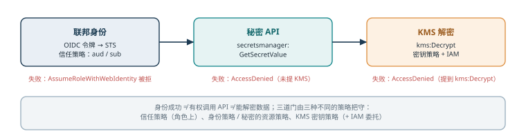
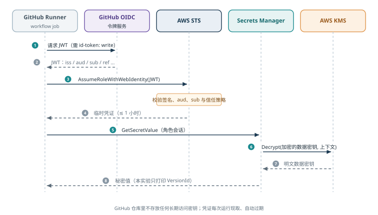
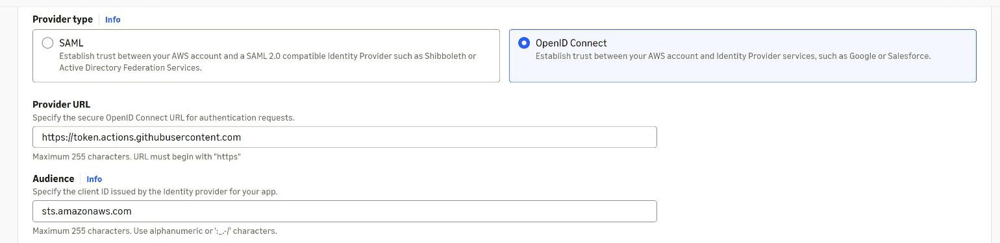
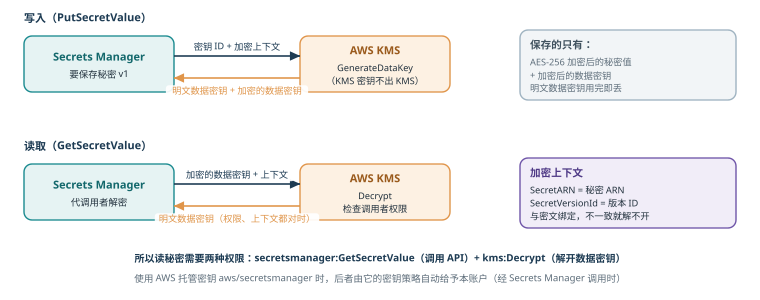
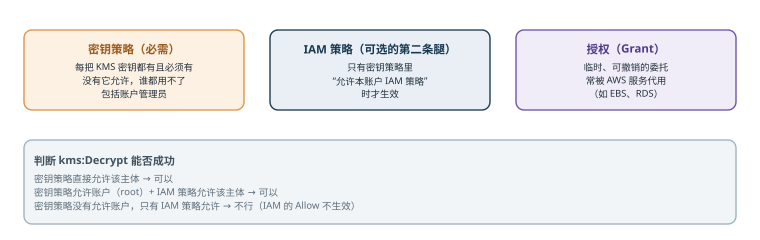
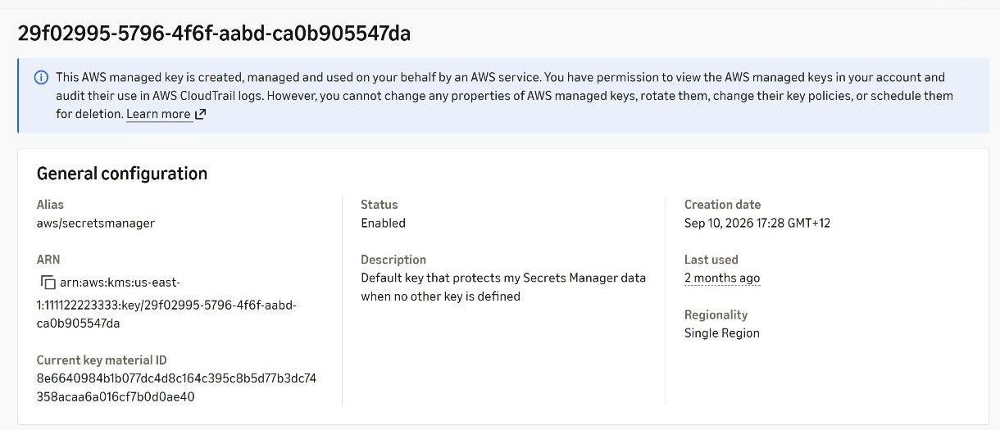
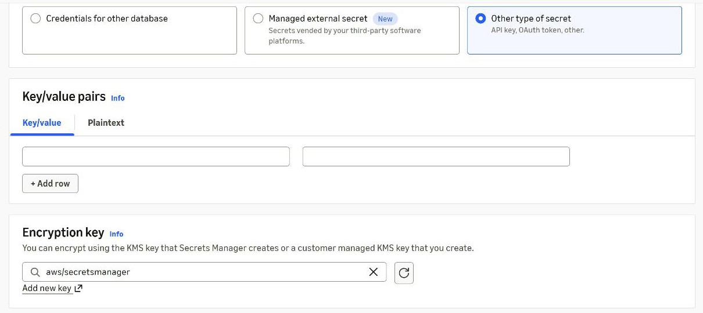

::::: cover
[第 07 讲 · 身份与访问 ②]{.kicker}

# 联邦身份与 KMS：为何读不到秘密？

[用 GitHub Actions 的 OIDC 联邦登录换取临时凭证，再读取一个由客户托管 KMS 密钥保护的秘密——三道门、三种策略，一次只改一个条件。]{.subtitle}

::: cover-meta
- **讲次**：07 / 19
- **建议学时**：4 课时（讲授 2 + 实验 2）
- **实验费用**：本地实验 0 元；云上约 1.4 美元/月（按小时折算）
- **适用版本**：IAM 共享 OIDC 控制 · GitHub 不可变 sub · Terraform 1.11+
:::

::: scenario
CI 流水线通过 GitHub 的 OIDC 换到了 AWS 临时凭证，`aws sts get-caller-identity` 显示的正是预期的角色。但读取一个用客户托管 KMS 密钥加密的秘密时，`GetSecretValue` 返回 AccessDenied。角色的策略里明明写着 `secretsmanager:GetSecretValue`。**是哪一道门没过？最小的修复是什么？**
:::

## 学习目标 {.nonum}

:::: cards
::: {.card title="理解"}
- OIDC 联邦：令牌、信任策略与临时凭证
- 信封加密：KMS 只保护数据密钥
- KMS 授权的两条腿：密钥策略与 IAM
:::
::: {.card title="判断"}
- 某个 GitHub 令牌能否扮演某个角色
- 读取秘密需要哪几种权限
- AWS 托管密钥与客户托管密钥怎么选
:::
::: {.card title="实操"}
- 令牌 × 信任策略匹配矩阵（含 Access Analyzer）
- 本地复现信封加密与加密上下文
- Terraform：OIDC、KMS、秘密，值不进 state
:::
::: {.card title="2026 新变化"}
- IAM 拒绝没有 sub 条件的 GitHub 信任策略
- GitHub 不可变 sub：含数字 ID 的新格式
- 只写参数 secret_string_wo
:::
::::

| 本讲结构 | 要回答的问题 | 产出 |
|---|---|---|
| 一、三道门 | 一次 CI 读秘密要过几关？ | 三道门模型 |
| 二、OIDC 联邦 | 谁能扮演这个角色？sub 怎么写才安全？ | 时序图、匹配矩阵、2026 新规则 |
| 三、KMS 与信封加密 | 为什么还要 kms:Decrypt？ | 信封加密图、真实密钥策略 |
| 四、实操 | 怎样零费用验证？怎样不把秘密写进 state？ | 三个本地 / 云上实验 |
| 五～六、排障与练习 | 拒绝发生在哪一道门？ | 故障卡、练习 |
:::::

::: {.opener .nobreak}
[一 · 三道门]{.kicker}

# 一次 CI 读秘密，要过几道门？

[身份认证成功只是第一步。调用 API、解密数据，各有各的守门人。]{.subtitle}
:::



::: formula
读到秘密 ＝ 能扮演角色（信任策略）× 能调用 GetSecretValue（身份 / 资源策略）× 能解开数据密钥（KMS 密钥策略 + IAM）
:::

情境中 `get-caller-identity` 成功，说明第①道门已过；`GetSecretValue` 的 Allow 也在，第②道门通常没问题；剩下的嫌疑就是第③道门——KMS。本讲先把三道门逐一讲透，再用实验证实这个推断。

::: {.opener}
[二 · OIDC 联邦]{.kicker}

# 谁能扮演这个角色？sub 怎么写才安全？

[GitHub 每次运行都签发一张短期身份令牌（JWT），AWS 用信任策略里的条件检查它，合格才换给临时凭证。仓库里不再需要长期访问密钥。]{.subtitle}
:::

## 联邦登录的时序

在 AWS 一侧需要两样东西：一个 **IAM OIDC 身份提供商**（`token.actions.githubusercontent.com`，受众 `sts.amazonaws.com`），以及一个信任该提供商的**角色**。对 GitHub 这类知名提供商，IAM 使用自己内置的受信任根 CA 校验令牌签名，不再需要配置证书指纹（thumbprint）。



{.shot}

## 令牌里有什么，信任策略比什么

GitHub 令牌中与授权有关的声明主要是：`aud`（受众，应为 `sts.amazonaws.com`）、`sub`（主题，标识“哪个仓库的什么触发”）、`ref`、`environment`、`job_workflow_ref` 等。`sub` 的形态取决于触发方式：

| 触发方式 | sub 示例（旧格式） |
|---|---|
| 推送到 main | `repo:example-org/cloudops-lab:ref:refs/heads/main` |
| 拉取请求 | `repo:example-org/cloudops-lab:pull_request` |
| 部署到环境 | `repo:example-org/cloudops-lab:environment:production` |

::: key
**2026 年的两个变化，直接影响信任策略怎么写：**

1. **IAM 的“共享提供商控制”**：对 GitHub 这类被许多客户共用的 OIDC 提供商，IAM 在创建或修改角色时会检查信任策略是否评估了 `token.actions.githubusercontent.com:sub`（或 `job_workflow_ref`），且不能只是通配符；不满足就报 `MalformedPolicyDocument`。
2. **GitHub 不可变 sub**：2026-07-15 之后创建、改名或转移的仓库，sub 默认改为带数字 ID 的格式 `repo:<owner>@<ownerId>/<repo>@<repoId>:ref:refs/heads/main`；旧仓库可以在 OIDC 设置中选择启用。名字可以被别人重新注册，数字 ID 不会——新格式能挡住“同名仓库重建”攻击，但也意味着按旧格式写的信任条件**对新仓库不再匹配**。
:::

::: warn
本书配套仓库创建于 2026-10-31，晚于 GitHub 的切换日期，因此它的令牌使用新格式。原版讲义里按 `repo:<owner>/<repo>:ref:refs/heads/main` 写的信任条件，对这样的仓库会一直拒绝——症状与“权限问题”一模一样。用 `gh api repos/<owner>/<repo> --jq '.owner.id, .id'` 查出数字 ID 再写条件。
:::

:::: {.lab title="实验 7-1｜令牌 × 信任策略匹配矩阵（含 Access Analyzer 实测）"}
::: labmeta
- **目标**：看清每种信任条件放行了哪些令牌
- **时长**：20 分钟
- **费用**：0 元（`validate-policy` 免费）
- **工具**：Python 3.11+、AWS CLI
:::

`labs/01-oidc-trust/oidc_trust.py` 准备了 7 种令牌（main、feature、PR、环境、新格式、同名重建、他人仓库）和 6 份信任策略，先按 IAM 的共享提供商控制规则判断策略能否被接受，再逐个判断令牌能否扮演角色；`--aws` 时还把每份策略交给 IAM Access Analyzer 校验。本书实测输出（节选）：

```{.console title="python oidc_trust.py --aws（2026-11-17 实测，节选）"}
P1 精确：旧格式 main  ——  IAM 提供商控制：通过
   ✓ T1 main 推送（旧格式）          · T2 feature 分支      · T5 main（新格式，含数字 ID）
P2 精确：新格式 main  ——  IAM 提供商控制：通过
   ✓ T5 main（新格式，含数字 ID）    · T6 同名仓库被他人重建（新格式）
P4 仓库内任意引用  ——  IAM 提供商控制：通过
   Access Analyzer：WARNING:SPECIFIC_GITHUB_REPO_AND_BRANCH_RECOMMENDED
   ✓ T1  ✓ T2  ✓ T3  ✓ T4            （PR 和任意分支都能扮演！）
P5 通配 repo:*（危险）  ——  IAM 提供商控制：拒绝（sub 只有通配符）
   Access Analyzer：WARNING:SPECIFIC_GITHUB_REPO_AND_BRANCH_RECOMMENDED, ERROR:WILDCARD_USAGE_TOO_PERMISSIVE
P6 没有 sub 条件（会被 IAM 拒绝）  ——  IAM 提供商控制：拒绝
   Access Analyzer：SECURITY_WARNING:MISSING_GITHUB_REPO_CONDITION_KEY
```

三个结论：P1 与 P2 的精确条件只放行 main；P4 的 `repo:…:*` 看似限定了仓库，实际上让 PR 与任意分支都能拿到同样的权限；P5、P6 在 IAM 层面就会被拒绝创建，Access Analyzer 也给出了明确的错误与安全警告。4 个单元测试锁定了这些判断。
::::

::: {.opener}
[三 · KMS 与信封加密]{.kicker}

# 已经允许 GetSecretValue，为什么还要 kms:Decrypt？

[Secrets Manager 不用 KMS 密钥直接加密秘密，而是用它保护“数据密钥”。读秘密时，KMS 要替调用者解开这把数据密钥——这一步单独授权。]{.subtitle}
:::

## 信封加密



几个来自官方文档的细节，排障时很有用：

- 每次秘密值变化，Secrets Manager 都调用 `GenerateDataKey` 要一把新的数据密钥；读取时调用 `Decrypt`。这两次 KMS 调用都以**发起请求的用户身份**进行（CloudTrail 中 `invokedBy` 为 secretsmanager.amazonaws.com）。
- 加密上下文固定包含 `SecretARN` 与 `SecretVersionId` 两个键。可以在策略中用 `kms:EncryptionContext:SecretARN` 限定“这次解密只能用于这个秘密”。
- 关联或更换 KMS 密钥时，Secrets Manager 会用 `SecretVersionId = RequestToValidateKeyAccess` 做一次验证调用，确认调用者有权使用新密钥。
- 秘密的**名称、描述、轮换设置、标签**不加密，不要把敏感信息写进去。

## KMS 授权的两条腿



**AWS 托管密钥**（如 `aws/secretsmanager`）与**客户托管密钥**的差别，在密钥策略上看得最清楚。下面是本书账户中 `aws/secretsmanager` 的真实密钥策略（节选）：

```{.console title="aws kms get-key-policy --key-id <aws/secretsmanager 的 KeyId>（2026-11-17 实测，节选）"}
"Principal": { "AWS": "*" },
"Action": ["kms:Encrypt", "kms:Decrypt", "kms:ReEncrypt*", "kms:CreateGrant", "kms:DescribeKey"],
"Condition": {
  "StringEquals": {
    "kms:CallerAccount": "111122223333",
    "kms:ViaService": "secretsmanager.us-east-1.amazonaws.com"
  }
}
```

它允许“本账户的任何主体、但只能经由 Secrets Manager”使用这把密钥——所以使用 AWS 托管密钥时，有 `GetSecretValue` 权限就够了，不必单独授予 `kms:Decrypt`。代价是：这个策略不能修改，**不能跨账户**使用，也无法按秘密细分谁能解密。

{.shot}

客户托管密钥则把控制权交给你：密钥策略可以只允许特定角色、限定 `kms:ViaService` 与加密上下文，可以跨账户共享，可以单独审计。情境中的秘密用的正是客户托管密钥，而它的密钥策略只做了“允许本账户 IAM 策略”这一件事——于是角色必须在 IAM 策略里**显式**拿到 `kms:Decrypt`。

{.shot}

:::: {.lab title="实验 7-2｜在本地复现信封加密（零费用）"}
::: labmeta
- **目标**：亲手跑一遍 GenerateDataKey / Decrypt 与加密上下文
- **时长**：15 分钟
- **费用**：0 元
- **工具**：Python 3.11+、cryptography
:::

`labs/02-envelope/envelope.py` 用一个永不导出的“根密钥”模拟 KMS，用 AES-256-GCM 实现数据密钥的生成与加密，并把加密上下文作为附加认证数据（AAD）绑定到密文上。4 个单元测试检查：两种权限缺一不可、上下文被篡改即解密失败、存储中没有明文、每个版本使用不同的数据密钥。

```{.console title="python envelope.py（本书实测输出）"}
存储内容：密文 47 字节 + 加密后的数据密钥 60 字节（没有明文、没有明文数据密钥）
① 有 GetSecretValue、没有 kms:Decrypt：失败 → assumed-role/a07-gh-reader 没有 kms:Decrypt
② 补上 kms:Decrypt：读取成功 → DEMO-NOT-A-PASSWORD
③ 加密上下文被篡改：失败 → InvalidCiphertextException：加密上下文不匹配
```
::::

::: {.opener}
[四 · 实操]{.kicker}

# 用 Terraform 搭起来，而且不把秘密写进 state

[信任条件精确到分支；kms:Decrypt 用开关控制并带条件；秘密值用只写参数传入，plan 与 state 都看不到它。]{.subtitle}
:::

:::: {.lab title="实验 7-3｜Terraform：OIDC 提供商、角色、KMS 密钥与秘密"}
::: labmeta
- **目标**：复现情境中的故障，并做最小修复
- **时长**：40 分钟
- **费用**：KMS 密钥 1 美元/月、秘密 0.40 美元/月，均按小时折算
- **权限**：IAM、KMS、Secrets Manager 的创建与删除
:::

```{.hcl title="labs/03-oidc-kms-secret/main.tf（节选）"}
variable "github_sub_prefix" {   # 旧：repo:owner/repo；新：repo:owner@123/repo@456
  type    = string
  default = "repo:example-org/cloudops-lab"
  validation {                   # 禁止通配符，与 IAM 的共享提供商控制一致
    condition     = can(regex("^repo:[A-Za-z0-9_.-]+(@[0-9]+)?/[A-Za-z0-9_.-]+(@[0-9]+)?$", var.github_sub_prefix))
    error_message = "github_sub_prefix 形如 repo:owner/repo 或 repo:owner@123/repo@456，不能含通配符。"
  }
}

resource "aws_iam_role" "gh_reader" {
  name = "a07-gh-secret-reader"
  assume_role_policy = jsonencode({
    Version = "2012-10-17"
    Statement = [{
      Effect    = "Allow"
      Principal = { Federated = local.provider_arn }
      Action    = "sts:AssumeRoleWithWebIdentity"
      Condition = { StringEquals = {
        "token.actions.githubusercontent.com:aud" = "sts.amazonaws.com"
        "token.actions.githubusercontent.com:sub" = "${var.github_sub_prefix}:ref:refs/heads/${var.github_branch}"
      } }
    }]
  })
}

resource "aws_secretsmanager_secret_version" "demo" {
  secret_id                = aws_secretsmanager_secret.demo.id
  secret_string_wo         = var.demo_secret_value   # 只写参数：不进 plan、不进 state
  secret_string_wo_version = 1                       # 要更新值时把它加 1
}

# 修复开关：只加一条 kms:Decrypt，限定经由 Secrets Manager、且只用于这个秘密
var.allow_kms_decrypt ? [{
  Effect   = "Allow"
  Action   = "kms:Decrypt"
  Resource = aws_kms_key.secrets.arn
  Condition = { StringEquals = {
    "kms:ViaService"                  = "secretsmanager.${var.region}.amazonaws.com"
    "kms:EncryptionContext:SecretARN" = aws_secretsmanager_secret.demo.arn
  } }
}] : []
```

```{.console title="在 labs/03-oidc-kms-secret 中执行（本书实测输出，节选）"}
$ terraform test
  run "trust_pins_repo_and_branch"... pass
  run "new_immutable_sub_format"... pass
  run "reject_wildcard_subject"... pass
  run "fault_state_has_no_decrypt"... pass
  run "fix_adds_scoped_decrypt"... pass
  run "secret_value_is_write_only"... pass
  run "key_rotation_and_deletion_window"... pass
Success! 7 passed, 0 failed.
$ terraform plan
      + secret_string_wo         = (write-only attribute)
      + secret_string_wo_version = 1
Plan: 7 to add, 0 to change, 0 to destroy.
```

注意 plan 中秘密值显示为 `(write-only attribute)`：只写参数（Terraform 1.11+）的值只在 apply 时传给 AWS，从不写入 plan 文件和 state。旧写法 `secret_string` 即使标记为 `sensitive`，值也会以明文存在 state 里——`sensitive` 只影响屏幕显示。
::::

:::: {.lab title="实验 7-4｜GitHub Actions：先失败，再修复"}
::: labmeta
- **目标**：用同一个工作流观察故障与修复
- **时长**：20 分钟
- **费用**：几次 API 调用，可忽略
- **前提**：实验 7-3 已 apply；仓库变量 A07_ROLE_ARN、A07_SECRET_ARN
:::

工作流 `.github/workflows/a07-oidc-secret-probe.yml` 申请 `id-token: write` 权限，用 `aws-actions/configure-aws-credentials@v6`（本书核对时最新为 v6.3.0；生产中请固定到提交 SHA）扮演角色，先打印会话 ARN，再调用 `GetSecretValue` 但只输出 `VersionId`——永远不打印秘密值。

1. `allow_kms_decrypt = false` 时运行：第 1 步成功（门①通过），第 2 步失败，错误信息提到 `kms:Decrypt`（门③）。
2. `terraform apply -var allow_kms_decrypt=true`，plan 中只应出现角色内联策略的一处更新。
3. 再次运行同一工作流：第 2 步成功。若仍失败，按门①→②→③的顺序重新取证，而不是放宽权限。
4. 清理：删除仓库变量与工作流，`terraform destroy`。KMS 密钥进入 7 天的“待删除”状态（此期间不计费，也可取消），秘密进入 7 天恢复期；若使用了已有的共享 OIDC 提供商（`create_oidc_provider = false`），它不属于本实验，不会被删除。
::::

::: warn
实验 7-3、7-4 的部署与运行结果为按机制推导的预期；本书没有在实验账户中创建这些资源。实验 7-1、7-2 的输出与上文的密钥策略为真实运行结果。
:::

::: {.opener}
[五 · 故障分析]{.kicker}

# 拒绝发生在哪一道门？

[看错误发生在哪个 API、错误信息提到了什么，就能把故障锁定在一道门上。]{.subtitle}
:::

:::: {.example title="例题 7-1｜情境：身份正确，GetSecretValue 却被拒"}
已知：`get-caller-identity` 返回预期的角色会话 ARN；秘密有 AWSCURRENT 版本；角色策略允许该秘密的 `GetSecretValue`；KMS 密钥是客户托管密钥，密钥策略只允许“本账户 IAM 策略”；角色策略里没有 `kms:Decrypt`。

::: steps
1. **门①。** 会话 ARN 正确，说明令牌的 aud、sub 与信任策略匹配，临时凭证有效。
2. **门②。** 角色允许对该秘密 ARN 的 `GetSecretValue`；没有显式拒绝。
3. **门③。** Secrets Manager 要以调用者身份请求 `kms:Decrypt`。密钥策略把决定权交给 IAM，而角色的 IAM 策略没有 `kms:Decrypt` → 拒绝。错误信息中会提到 KMS。
4. **最小修复。** 在角色策略中加一条 `kms:Decrypt`，Resource 为这把密钥，条件限定 `kms:ViaService` 与 `kms:EncryptionContext:SecretARN`。不要授予 `kms:*`，也不要改用 `Resource: *`。
5. **验证。** 重跑同一工作流，只看会话 ARN、成败与 VersionId，不输出明文。
:::

::: answer
故障在门③：缺少有效的 `kms:Decrypt`。如果当初使用的是 AWS 托管密钥 `aws/secretsmanager`，它的密钥策略会自动放行本账户经 Secrets Manager 的解密，就不会出现这个故障——这也正是客户托管密钥“更可控、也更需要配置”的体现。
:::
::::

::: {.fault title="故障 1｜AssumeRoleWithWebIdentity 被拒：Not authorized to perform sts:AssumeRoleWithWebIdentity"}
现象
:   工作流在 configure-aws-credentials 一步就失败，后续步骤没有执行。

根因
:   门①：最常见的是 sub 不匹配——从 feature 分支或 PR 运行、使用了 environment、或者仓库使用新的数字 ID 格式而信任条件仍是旧格式；其次是工作流缺少 `id-token: write`，或者 aud 不是 `sts.amazonaws.com`。

修复
:   在工作流中临时打印令牌的 sub（GitHub 文档提供了调试方法），与信任条件逐字比较；不要把条件放宽成 `repo:*`。
:::

::: {.fault title="故障 2｜修改信任策略时报 MalformedPolicyDocument"}
现象
:   给一个老角色加条件时，IAM 拒绝保存，提示信任策略格式错误。

根因
:   IAM 的共享提供商控制：对 GitHub 提供商的信任策略，修改时必须评估 sub（或 job_workflow_ref），且不能只有通配符。老角色在规则生效前创建时没有被检查，一旦修改就会触发。

修复
:   补上精确的 sub 条件后再保存；顺便用 Access Analyzer 校验（实验 7-1）。
:::

::: {.fault title="故障 3｜换了 KMS 密钥之后，旧系统突然读不到秘密"}
现象
:   安全团队把秘密改用新的客户托管密钥加密，部分应用开始报 AccessDenied。

根因
:   更换密钥时，Secrets Manager 会用新密钥重新加密 AWSCURRENT、AWSPENDING、AWSPREVIOUS 三个版本；应用角色没有新密钥的 `kms:Decrypt`。

修复
:   先给所有读取者授予新密钥的解密权限，再更换密钥；变更前用 CloudTrail 中 KMS Decrypt 事件梳理真实的读取者。
:::

::: {.fault title="故障 4｜terraform destroy 成功了，密钥和秘密却“还在”"}
现象
:   销毁后在控制台仍能看到 KMS 密钥和秘密。

根因
:   KMS 密钥有 7～30 天的删除等待期（Pending deletion，期间不计费、可以取消）；秘密有 7～30 天的恢复期。这是防止误删导致数据永久无法解密的保护机制。

修复
:   这是预期行为；确认状态为 PendingDeletion / 已计划删除即可。若必须立即释放同名资源，秘密可用 `--force-delete-without-recovery`（不可恢复，务必谨慎）。
:::

::: {.opener}
[课堂巩固 · 自测]{.kicker}

# 练一练：你能判断是哪一道门吗？

[每题先写出门①②③中哪一道受影响，再给出理由。]{.subtitle}
:::

## 随堂练习

::: {.exercise title="练习 1｜分支"}
信任条件为 `repo:example-org/cloudops-lab:ref:refs/heads/main`（旧格式仓库）。从 feature/x 分支运行工作流，能扮演角色吗？
:::

::: {.exercise title="练习 2｜新格式"}
一个 2026 年 10 月新建的仓库，信任条件写的是 `repo:org/repo:ref:refs/heads/main`。main 分支的运行能扮演角色吗？为什么？
:::

::: {.exercise title="练习 3｜两种权限"}
角色有 `GetSecretValue`，秘密使用客户托管密钥，密钥策略只允许账户 IAM 策略，角色没有 `kms:Decrypt`。能读到秘密吗？如果秘密改用 `aws/secretsmanager` 呢？
:::

::: {.exercise title="练习 4｜密钥策略"}
角色策略里有 `kms:Decrypt`，但密钥策略只允许密钥管理员角色、没有“允许本账户 IAM 策略”的语句。角色能解密吗？
:::

::: {.exercise title="练习 5｜Terraform state"}
用 `secret_string` 写入秘密并把相关输出标记为 `sensitive = true`。state 里还会有明文吗？应该怎么改？
:::

::: {.exercise title="练习 6｜跨账户"}
另一个账户的应用需要读取这个秘密。为什么不能使用 `aws/secretsmanager` 加密？
:::

## 参考答案与解析

::: {.solution title="1"}
不能。feature 分支令牌的 sub 是 `…:ref:refs/heads/feature/x`，与 StringEquals 条件不相等（门①）。
:::

::: {.solution title="2"}
不能。该仓库的令牌默认使用新格式 `repo:org@<ownerId>/repo@<repoId>:ref:refs/heads/main`，与旧格式条件不相等（门①）。需要把数字 ID 写进条件。
:::

::: {.solution title="3"}
客户托管密钥：读不到，缺少 `kms:Decrypt`（门③）。改用 `aws/secretsmanager`：可以读到，因为它的密钥策略允许本账户主体经由 Secrets Manager 解密。
:::

::: {.solution title="4"}
不能。密钥策略是 KMS 授权的必要条件；它没有允许本账户的 IAM 策略生效，角色策略里的 Allow 就不起作用（门③）。
:::

::: {.solution title="5"}
会。`sensitive` 只影响 CLI 与界面的显示，值仍以明文存在 state 中。改用 Terraform 1.11+ 的 `secret_string_wo` 与 `secret_string_wo_version`，或在 Terraform 之外写入秘密值；同时对远端 state 加密并收紧访问权限（第 16 讲）。
:::

::: {.solution title="6"}
AWS 托管密钥的密钥策略不能修改，只允许本账户（`kms:CallerAccount`）使用，不支持跨账户访问；跨账户读取或复制秘密必须使用客户托管密钥，并在其密钥策略中授权对方账户。
:::

## 这一讲，你应该记住 {.nonum}

:::: summary
::: {.card tag="三道门"}
**信任 → API → KMS**

看错误发生在哪个 API、提到了什么。
:::
::: {.card tag="OIDC"}
**sub 精确到仓库与分支**

新仓库用含数字 ID 的格式；禁止通配。
:::
::: {.card tag="KMS"}
**密钥策略必需，IAM 是第二条腿**

托管密钥省事，客户托管密钥可控。
:::
::: {.card tag="State"}
**秘密值用只写参数**

sensitive 不等于不在 state 里。
:::
::::

::: refs
## 参考资料 {.nonum}

[截图说明：图 7-3、7-6、7-7 摄于 2026-11-17；账户 ID 已替换为 111122223333；表单为示例值且未提交。实验 7-1、7-2 输出与 aws/secretsmanager 密钥策略为真实结果。]{.small}

1. Identity-provider controls for shared OIDC providers（GitHub 必须评估 sub / job_workflow_ref）<https://docs.aws.amazon.com/IAM/latest/UserGuide/id_roles_providers_oidc_secure-by-default.html>；创建 OIDC 联邦角色 <https://docs.aws.amazon.com/IAM/latest/UserGuide/id_roles_create_for-idp_oidc.html>
2. GitHub Changelog：Immutable subject claims for GitHub Actions OIDC tokens（2026-04-23）<https://github.blog/changelog/2026-04-23-immutable-subject-claims-for-github-actions-oidc-tokens/>；GitHub OIDC 参考 <https://docs.github.com/en/actions/reference/security/oidc>
3. Secret encryption and decryption in AWS Secrets Manager（信封加密、加密上下文、aws/secretsmanager 密钥策略）<https://docs.aws.amazon.com/secretsmanager/latest/userguide/security-encryption.html>
4. AWS KMS key policies <https://docs.aws.amazon.com/kms/latest/developerguide/key-policies.html>；Deleting AWS KMS keys <https://docs.aws.amazon.com/kms/latest/developerguide/deleting-keys.html>；KMS 定价（待删除期间不计费）<https://aws.amazon.com/kms/pricing/>
5. IAM Access Analyzer 策略校验检查项 <https://docs.aws.amazon.com/IAM/latest/UserGuide/access-analyzer-reference-policy-checks.html>
6. Terraform：write-only arguments <https://developer.hashicorp.com/terraform/language/resources/ephemeral#write-only-arguments>；aws_secretsmanager_secret_version、aws_iam_openid_connect_provider（provider 6.73.0）<https://registry.terraform.io/providers/hashicorp/aws/latest/docs>
7. aws-actions/configure-aws-credentials <https://github.com/aws-actions/configure-aws-credentials>
:::
