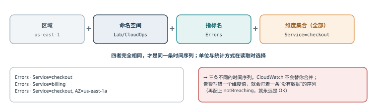
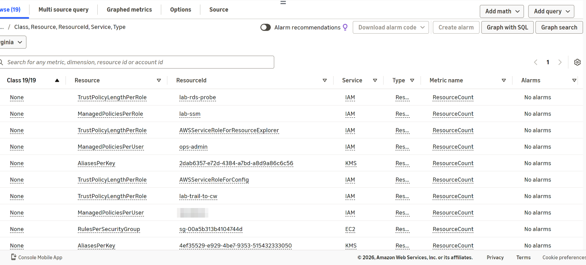
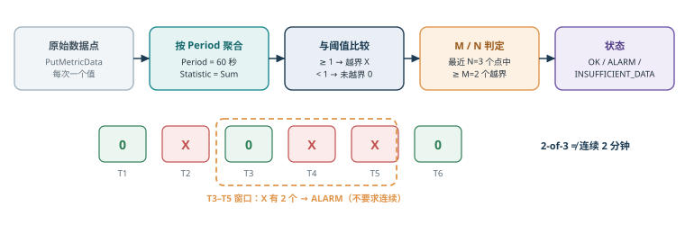
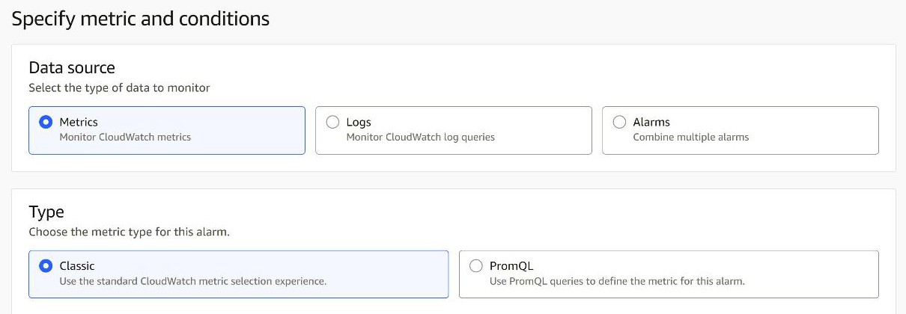
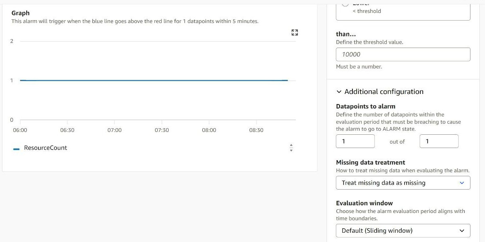
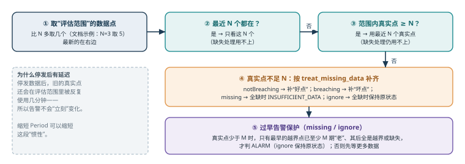
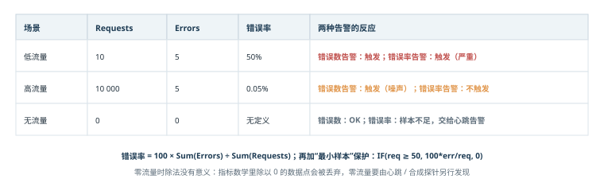

::::: cover
[第 08 讲 · 可观测性 ①]{.kicker}

# CloudWatch：指标升了，为何不告警？

[一条时间序列由四样东西唯一确定；一条告警是“聚合 → 比较 → M/N 判定”的计算链；缺失数据有明确的补齐规则。本讲用一个能复现 AWS 官方判定表的模拟器把这些讲透。]{.subtitle}

::: cover-meta
- **讲次**：08 / 19
- **建议学时**：4 课时（讲授 2 + 实验 2）
- **实验费用**：模拟器 0 元；云上实验在免费额度内通常为 0
- **适用版本**：CloudWatch 告警（含评估窗口、PromQL 类型）
:::

::: scenario
checkout 服务每分钟 100 个请求，其中有两分钟各出现 2 个 5xx。监控图上看得清清楚楚，告警却一直是 OK。夜里业务停了，没有任何请求，另一个“心跳丢失”告警却响了。**两件事矛盾吗？哪些是指标的事实，哪些是告警规则的选择？**
:::

## 学习目标 {.nonum}

:::: cards
::: {.card title="理解"}
- 时间序列的“身份证”：区域、命名空间、指标名、维度
- 告警的计算链：Period、Statistic、阈值、M/N
- 四种缺失数据处理与“评估范围”
:::
::: {.card title="推理"}
- 手算任意序列的告警状态
- 判断停发数据后告警何时变化
- 错误数与错误率告警的取舍
:::
::: {.card title="实操"}
- 模拟器复现官方判定表（40/40）
- Terraform：两类告警 + 错误率 + 复合告警
- 可选：真实上报指标并观察状态历史
:::
::: {.card title="排障"}
- 维度写错导致“永远 OK”
- 刚建好的告警为何是 INSUFFICIENT_DATA
- 停发后告警的“惯性”
:::
::::

| 本讲结构 | 要回答的问题 | 产出 |
|---|---|---|
| 一、指标 | 一条时间序列由什么确定？ | 身份模型、维度实拍 |
| 二、告警计算 | 2-of-3 到底怎么算？ | 计算链、控制台配置项实拍 |
| 三、缺失数据 | 没有数据算健康还是故障？ | 官方规则与判定表 |
| 四、实操 | 怎样不花钱地验证判断？ | alarmsim、Terraform、上报脚本 |
| 五～六、设计与排障 | 错误数还是错误率？告警为何不响？ | 对比表、故障卡、练习 |
:::::

::: {.opener .nobreak}
[一 · 指标]{.kicker}

# 一条时间序列由什么确定？

[CloudWatch 里查不到数据，十有八九是“身份”没对上，而不是 CloudWatch 出了问题。]{.subtitle}
:::

## 时间序列的“身份证”



| 概念 | 含义 | 情境中的取值 |
|---|---|---|
| 命名空间 | 指标的容器，AWS 服务用 `AWS/` 前缀 | `Lab/CloudOps` |
| 指标名 | 测量的量 | `Requests`、`Errors`、`Heartbeat` |
| 维度 | 名称/值对，最多 30 个；是身份的一部分 | `Service=checkout` |
| 统计 | 读取时对一个 Period 内的数据点做的聚合 | Sum、Minimum、Average、p99 … |
| Period | 聚合的时间粒度 | 60 秒 |

本书账户里有一个现成的例子：命名空间 `AWS/Usage` 下，同一个指标名 `ResourceCount` 存在 19 条不同的时间序列，彼此只靠维度值区分——有的统计某个 IAM 角色的信任策略长度，有的统计某个安全组的规则数。

{.shot}

```{.console title="aws cloudwatch list-metrics --namespace AWS/Usage（2026-11-17 实测，节选；list-metrics 免费）"}
ResourceCount  Type=Resource | ResourceId=lab-rds-probe | Resource=TrustPolicyLengthPerRole | Service=IAM | Class=None
ResourceCount  Type=Resource | ResourceId=AWSServiceRoleForConfig | Resource=TrustPolicyLengthPerRole | Service=IAM | Class=None
ResourceCount  Type=Resource | ResourceId=2dab6357-…-a8d9a86c6c56 | Resource=AliasesPerKey | Service=KMS | Class=None
```

::: pitfalls
1. **“没有数据”不等于“值为 0”。** `Errors=0` 表示上报了“这分钟没有错误”；没有上报，CloudWatch 里这一分钟就是缺失。两者在告警评估中的处理完全不同。
2. **维度不会自动合并。** 上报时带了 `Service=checkout, AZ=us-east-1a`，告警只写 `Service=checkout`，就是两条不同的序列。
3. **统计方式是告警的一部分。** 心跳用 Minimum（这分钟有没有收到 1），错误用 Sum（这分钟一共多少），延迟用百分位数——选错统计方式，阈值就失去意义。
:::

::: {.opener}
[二 · 告警计算]{.kicker}

# 2-of-3 到底怎么算？

[告警不是“看到错误就响”，而是一条确定的计算链：先按 Period 聚合，再与阈值比较，最后看最近 N 个点里有没有 M 个越界。]{.subtitle}
:::

## 告警的计算链



::: formula
ALARM ⟺ 最近 N 个 Period 中，越界的数据点数 ≥ M [N = EvaluationPeriods，M = DatapointsToAlarm]{.unit}
:::

| 参数 | 作用 | 情境中错误告警的取值 |
|---|---|---|
| Period | 每个数据点覆盖多长时间 | 60 秒 |
| Statistic | 一个 Period 内如何聚合 | Sum |
| Threshold + 比较符 | 什么算“越界” | ≥ 1 |
| EvaluationPeriods（N） | 看最近几个点 | 3 |
| DatapointsToAlarm（M） | 其中几个越界才告警 | 2 |
| TreatMissingData | 缺失点怎么处理 | notBreaching |
| EvaluationWindow | 窗口如何对齐时间 | 滑动窗口（默认） |

控制台的创建告警向导把这些参数分散在几个区域。注意 2026 年的新变化：数据源可以是指标、日志查询或其他告警（复合），指标类型可以选经典 CloudWatch 指标或 PromQL 查询；在“其他配置”里新增了**评估窗口**——默认是随时间滑动的窗口，也可以选择按整点、整天、整周对齐的“挂钟窗口”（适合“每天必须有一次备份”这类按日历判断的告警，但会在整个周期结束后才反映数据，不适合驱动自动扩缩容）。

{.shot}

{.shot}

:::: {.example title="例题 8-1｜四组序列，哪组会告警？"}
错误告警：Sum(Errors) ≥ 1，N=3，M=2，数据完整无缺失。最近三分钟分别为：(a) 0, 0, 2；(b) 0, 2, 2；(c) 2, 0, 2；(d) 0, 0, 0。

::: steps
1. **先把数值变成越界标记。** ≥1 为 X，否则为 0：(a) 0 0 X；(b) 0 X X；(c) X 0 X；(d) 0 0 0。
2. **数越界点。** (a) 1 个；(b) 2 个；(c) 2 个；(d) 0 个。
3. **与 M=2 比较。** (b)、(c) 达到 2 → ALARM；(a)、(d) → OK。
:::

::: answer
(b)、(c) 告警。(c) 说明 M/N 不要求连续：只要窗口内凑够 M 个即可。这正是 2-of-3 比“连续 2 次”更能抓住间歇性错误的原因。
:::
::::

::: {.opener}
[三 · 缺失数据]{.kicker}

# 没有数据，算健康还是故障？

[缺失数据怎么处理是业务决策：稀疏指标的缺失往往是好消息，心跳的缺失却是坏消息。CloudWatch 只在“真实数据不够用”时才动用这条规则。]{.subtitle}
:::

## 四种处理方式

| treat_missing_data | 缺失点被当作 | 适合的指标 |
|---|---|---|
| `notBreaching` | 未越界的“好点” | 只在出错时才上报的稀疏指标（如错误数、DynamoDB 限流） |
| `breaching` | 越界的“坏点” | 必须持续上报的指标（心跳、合成探针结果） |
| `ignore` | 不参与，保持当前状态 | 间歇上报、又不希望状态来回跳的指标 |
| `missing`（默认） | 评估范围内全部缺失时转 INSUFFICIENT_DATA | 需要明确暴露“信息不足”的场景 |

## 评估范围：真实数据优先



AWS 文档用两张表说明这套规则，下面是其中第二张（Period 5 分钟，M=2，N=3，评估范围 5；0 为未越界，X 为越界，- 为缺失，最新的点在右边）：

| 数据点 | 需补齐数 | missing | ignore | breaching | notBreaching |
|---|---|---|---|---|---|
| `0 - X - X` | 0 | ALARM | ALARM | ALARM | ALARM |
| `0 0 X 0 X` | 0 | ALARM | ALARM | ALARM | ALARM |
| `0 - X - -` | 1 | OK | OK | ALARM | OK |
| `- - - - 0` | 2 | OK | OK | ALARM | OK |
| `- - - X -` | 2 | ALARM | 保持原状态 | ALARM | OK |

最后一行是“过早告警”保护的反面：只有一个越界点、但它已经足够“老”（至少 M 期），其后全是缺失——CloudWatch 认为问题仍在持续，所以即使按 missing 处理也判 ALARM。反过来，`- - - - X` 这样“刚出现一个越界点”的序列不会立即告警，以免下一个点恢复正常时造成误报。

:::: {.lab title="实验 8-1｜alarmsim：复现 AWS 官方判定表（零费用）"}
::: labmeta
- **目标**：把规则写成代码，并用官方判定表验证
- **时长**：20 分钟
- **费用**：0 元
- **工具**：Python 3.11+
:::

`labs/01-alarmsim/alarmsim.py` 实现了图 8-6 的五步规则。`table` 子命令把官方两张表的 10 种序列 × 4 种处理方式逐一计算，并与文档结果比对：

```{.console title="python alarmsim.py table（本书实测输出，节选）"}
序列        M/N   missing             ignore     breaching   notBreaching
- - - - -   3/3   INSUFFICIENT_DATA   (原状态)    ALARM       OK
- - X - -   3/3   ALARM               (原状态)    ALARM       OK
0 - X - -   2/3   OK                  OK          ALARM       OK
- - - X -   2/3   ALARM               (原状态)    ALARM       OK

与 AWS 文档一致：40 / 40
```

`timeline` 子命令把情境中的两条告警放在同一条时间线上：基线 3 分钟、故障 2 分钟、恢复 3 分钟，然后停止上报：

```{.console title="python alarmsim.py timeline（本书实测输出）"}
分钟  阶段  Errors(Sum)  Heartbeat(Min)  错误告警 2/3 notBreaching  心跳告警 3/3 breaching
T3    基线  0            1               OK                          OK
T4    故障  2            1               OK                          OK
T5    故障  2            1               ALARM                       OK
T6    恢复  0            1               ALARM                       OK
T7    恢复  0            1               OK                          OK
T9    停发  —            —               OK                          OK
T13   停发  —            —               OK                          ALARM
```

两个细节值得注意：T6 已经恢复，错误告警却仍是 ALARM——因为最近 3 点（2, 2, 0）里仍有 2 个越界；停发数据后，心跳告警要到 T13 才 ALARM——评估范围里的旧真实点还会被继续使用，直到它们被挤出范围。真实环境中，指标入库与评估还有额外延迟，评估范围也随 Period 而不同，但方向与此一致。3 个单元测试锁定了全部 40 个官方结果。
::::

::: {.opener}
[四 · 实操]{.kicker}

# 用 Terraform 定义告警，并用真实数据验证

[同一份代码定义两种语义完全不同的告警，再加一条带低流量保护的错误率告警和一条复合告警。]{.subtitle}
:::

:::: {.lab title="实验 8-2｜Terraform：四条告警"}
::: labmeta
- **目标**：把图 8-3、8-6 的参数一一写成代码
- **时长**：20 分钟
- **费用**：告警与自定义指标在免费额度内通常为 0
- **权限**：`cloudwatch:PutMetricAlarm` 等
:::

```{.hcl title="labs/02-alarms/main.tf（节选）"}
resource "aws_cloudwatch_metric_alarm" "errors" {          # 稀疏指标：没有错误就不上报
  alarm_name          = "a08-checkout-errors"
  namespace           = "Lab/CloudOps"
  metric_name         = "Errors"
  dimensions          = { Service = "checkout" }
  statistic           = "Sum"
  period              = 60
  evaluation_periods  = 3
  datapoints_to_alarm = 2
  threshold           = 1
  comparison_operator = "GreaterThanOrEqualToThreshold"
  treat_missing_data  = "notBreaching"
}

resource "aws_cloudwatch_metric_alarm" "heartbeat" {       # 必须持续上报：沉默就是故障
  alarm_name          = "a08-checkout-heartbeat-missing"
  namespace           = "Lab/CloudOps"
  metric_name         = "Heartbeat"
  dimensions          = { Service = "checkout" }
  statistic           = "Minimum"
  period              = 60
  evaluation_periods  = 3
  datapoints_to_alarm = 3
  threshold           = 1
  comparison_operator = "LessThanThreshold"
  treat_missing_data  = "breaching"
}

resource "aws_cloudwatch_metric_alarm" "error_rate" {      # 错误率 + 最小样本保护
  alarm_name          = "a08-checkout-error-rate"
  comparison_operator = "GreaterThanOrEqualToThreshold"
  threshold           = 5
  evaluation_periods  = 3
  datapoints_to_alarm = 2
  metric_query {
    id          = "rate"
    expression  = "IF(req >= ${var.min_requests}, 100 * err / req, 0)"
    return_data = true
  }
  # req、err 两个 metric_query 分别引用 Requests、Errors（Sum，60 秒），略
}
```

```{.console title="在 labs/02-alarms 中执行（本书实测输出）"}
$ terraform test
  run "errors_is_sparse_2_of_3"... pass
  run "heartbeat_treats_silence_as_failure"... pass
  run "same_dimensions_everywhere"... pass
  run "error_rate_has_min_traffic_guard"... pass
  run "no_actions_without_topic"... pass
Success! 5 passed, 0 failed.
$ terraform plan
Plan: 4 to add, 0 to change, 0 to destroy.
```
::::

:::: {.lab title="实验 8-3（可选）｜真实上报指标，观察状态历史"}
::: labmeta
- **目标**：在 AWS 上走一遍基线 → 故障 → 恢复 → 停发
- **时长**：40 分钟
- **费用**：3 个自定义指标、4 条告警；免费额度内通常为 0
- **前提**：实验 8-2 已 apply
:::

1. `./publish.sh baseline`：每 65 秒上报一组（Requests=100、Errors=0、Heartbeat=1），共 3 组，保证落在 3 个不同的分钟。
2. `./inspect.sh`：查看告警状态、`describe-alarm-history` 中的状态变化，以及最近 20 分钟的 `Errors(Sum)`。刚创建的告警处于 INSUFFICIENT_DATA 是正常的。
3. `./publish.sh fault`（Errors=2），再 `./inspect.sh`：期望错误告警进入 ALARM。以状态历史中的 `StateUpdate` 记录为准，而不是“上报后马上看”。
4. `./publish.sh recovery`，然后停止上报，持续观察 10 分钟：错误告警回到 OK，心跳告警在若干分钟后进入 ALARM，复合告警随之 ALARM。
5. `terraform destroy`。自定义指标无法删除，停止上报后它们不再计费，15 个月后自动过期。
::::

::: warn
实验 8-3 的结果为按机制（与实验 8-1 的模拟）推导的预期，本书没有在实验账户中创建告警或上报自定义指标。上报脚本不使用 `set-alarm-state` 之类的手段“伪造”告警状态。
:::

::: {.opener}
[五 · 设计与排障]{.kicker}

# 错误数还是错误率？告警为什么不响？

[同样 5 个错误，在每分钟 10 个和 10 000 个请求下，影响相差 1 000 倍。告警设计要回答“值不值得叫醒人”。]{.subtitle}
:::



生产级的告警通常是组合：用**错误率**（带最小样本）判断用户受影响的程度，用**心跳或合成探针**发现“完全没有流量”，用**复合告警**把多个信号合并成一次呼叫，再按第 02 讲的**燃烧率**把告警与 SLO 挂钩。每个 5xx 都叫醒值班，是告警疲劳的开始。

:::: {.example title="例题 8-2｜指标明明有错误，告警却一直 OK"}
指标 `Lab/CloudOps · Errors · Service=checkout` 最近三分钟为 0、2、2。告警配置：Sum ≥ 1、2-of-3、Period 60 秒、notBreaching，但维度写成了 `Service=payments`。当前状态 OK。

::: steps
1. **核对身份。** 告警盯的是 `Service=payments`，与上报的 `Service=checkout` 是两条不同的序列。
2. **推演告警看到的数据。** `payments` 序列没有任何数据点——全部缺失。
3. **套用缺失规则。** 真实点为 0，按 notBreaching 补齐为“好点” → OK。这就是“永远 OK”的由来。
4. **最小修复。** 只把维度改为 `checkout`，`terraform plan` 中应只有这一处变化。
5. **复验。** 重新上报故障数据，检查状态历史中出现 OK → ALARM。
:::

::: answer
根因是维度不匹配，叠加 notBreaching 把“没有数据”当成健康。把阈值改成 0、把 Period 拉长都无济于事。实践中可以为关键告警额外配置一条“数据缺失”的检测（例如用 missing 处理并监控 INSUFFICIENT_DATA），让这类配置错误暴露出来。
:::
::::

::: {.fault title="故障 1｜新告警一直是 INSUFFICIENT_DATA"}
现象
:   告警创建后长时间显示 INSUFFICIENT_DATA。

根因
:   告警所指的序列没有数据：命名空间、指标名、维度或区域有一处不一致；或者服务确实还没有上报；或者 Period 比指标的上报频率还短（如 EC2 基础监控 5 分钟一次，告警 Period 设为 1 分钟）。

修复
:   用 `list-metrics` 精确查出序列的维度并与告警逐项比对；Period 至少等于上报间隔。
:::

::: {.fault title="故障 2｜故障已经恢复，告警还在 ALARM"}
现象
:   错误已经停止好几分钟，告警仍未恢复。

根因
:   M/N 窗口里仍有足够多的越界点（实验 8-1 的 T6）；或指标停止上报后，评估范围内的旧越界点被反复使用。

修复
:   这是规则使然，不是故障；确实需要更快复位时，缩短 Period 或减小 N，并评估误报风险。
:::

::: {.fault title="故障 3｜服务挂了，错误告警却一片祥和"}
现象
:   进程崩溃后不再处理请求，也不再上报任何指标，错误告警始终 OK。

根因
:   错误告警使用 notBreaching：没有数据被当作“没有错误”。这条告警本来就回答不了“服务还活着吗”。

修复
:   增加心跳（或合成探针、`Requests` 过低）告警，缺失数据按 breaching 处理；用复合告警把两类信号合并。
:::

::: {.opener}
[课堂巩固 · 自测]{.kicker}

# 练一练：你能手算告警状态吗？

[每题都只需要 M、N、阈值和缺失处理四个条件。]{.subtitle}
:::

## 随堂练习

::: {.exercise title="练习 1｜M/N"}
N=3，M=2，阈值 ≥1，最近三点为 2, 0, 3（无缺失）。状态是什么？
:::

::: {.exercise title="练习 2｜缺失处理"}
N=3，M=3，最近五点为 `- - - - -`。分别按 missing、ignore、breaching、notBreaching 处理，状态是什么？
:::

::: {.exercise title="练习 3｜统计方式"}
心跳指标每分钟上报一次值 1。告警用 Average < 1 还是 Minimum < 1 更合适？如果某分钟意外上报了一个 0 和一个 1 呢？
:::

::: {.exercise title="练习 4｜维度"}
上报时维度为 `Service=checkout, Stage=prod`，告警只写了 `Service=checkout`。告警能看到这些数据吗？
:::

::: {.exercise title="练习 5｜错误率"}
某分钟 Requests=0、Errors=0。用 `100*err/req` 计算错误率会怎样？为什么要另加最小样本条件？
:::

::: {.exercise title="练习 6｜评估窗口"}
“每天 0 点前必须完成一次备份”的告警，应该用滑动窗口还是挂钟窗口？为什么？
:::

## 参考答案与解析

::: {.solution title="1"}
ALARM。越界点 2 和 3，共 2 个 ≥ M=2，且不要求连续。
:::

::: {.solution title="2"}
missing → INSUFFICIENT_DATA；ignore → 保持原状态；breaching → ALARM；notBreaching → OK（官方表第一张第 3 行，实验 8-1 实测一致）。
:::

::: {.solution title="3"}
Minimum < 1。Minimum 会把“这分钟有一个 0”暴露出来；Average 是 0.5，同样小于 1，但如果有十个 1、一个 0，平均值仍接近 1，就可能掩盖问题。心跳的语义是“这分钟有没有失败”，最小值最贴切。
:::

::: {.solution title="4"}
看不到。维度集合不同就是不同的序列，`Service=checkout` 这条序列没有任何数据。
:::

::: {.solution title="5"}
除数为 0 的数据点会被指标数学丢弃，相当于缺失；即便流量很小（如 2 个请求错 1 个），算出的 50% 也会引发误报。最小样本条件让低流量时间段不按错误率判断，零流量则交给心跳或合成探针。
:::

::: {.solution title="6"}
挂钟窗口（1 天 Period，对齐本地时区午夜）。滑动窗口下，两次备份间隔超过 24 小时就会告警，即使每个日历日都有备份；挂钟窗口按日历日独立评估，正符合“每天一次”的业务语义。
:::

## 这一讲，你应该记住 {.nonum}

:::: summary
::: {.card tag="身份"}
**区域 + 命名空间 + 指标名 + 全部维度**

错一个，告警就盯着空序列。
:::
::: {.card tag="计算链"}
**聚合 → 比较 → M/N → 状态**

M/N 不要求连续。
:::
::: {.card tag="缺失数据"}
**真实数据优先，不够才补**

稀疏指标 notBreaching，心跳 breaching。
:::
::: {.card tag="设计"}
**错误率 + 最小样本 + 心跳**

复合告警合并，燃烧率对齐 SLO。
:::
::::

::: refs
## 参考资料 {.nonum}

[截图说明：图 8-2、8-4、8-5 摄于 2026-11-17，us-east-1；账户 ID 已替换为 111122223333，部分资源名已脱敏；告警向导未提交。实验 8-1 输出为真实运行结果。]{.small}

1. CloudWatch 概念 <https://docs.aws.amazon.com/AmazonCloudWatch/latest/monitoring/cloudwatch_concepts.html>；缺失数据与评估范围 <https://docs.aws.amazon.com/AmazonCloudWatch/latest/monitoring/alarms-and-missing-data.html>
2. 告警评估窗口 <https://docs.aws.amazon.com/AmazonCloudWatch/latest/monitoring/alarm-evaluation-window.html>；指标数学 <https://docs.aws.amazon.com/AmazonCloudWatch/latest/monitoring/using-metric-math.html>
3. PutMetricData <https://docs.aws.amazon.com/AmazonCloudWatch/latest/APIReference/API_PutMetricData.html>；定价 <https://aws.amazon.com/cloudwatch/pricing/>；Terraform AWS Provider 6.73.0 <https://registry.terraform.io/providers/hashicorp/aws/latest/docs>
:::
