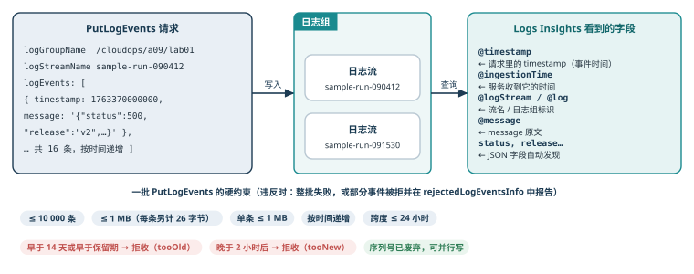
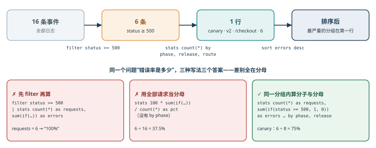
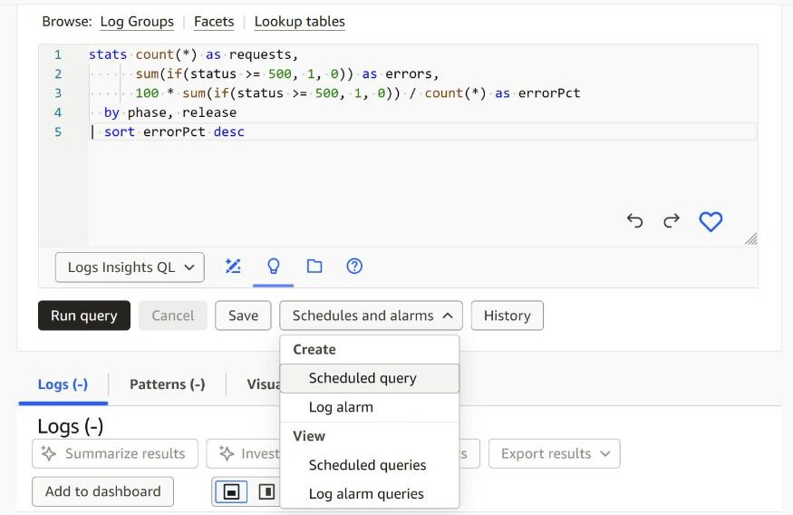
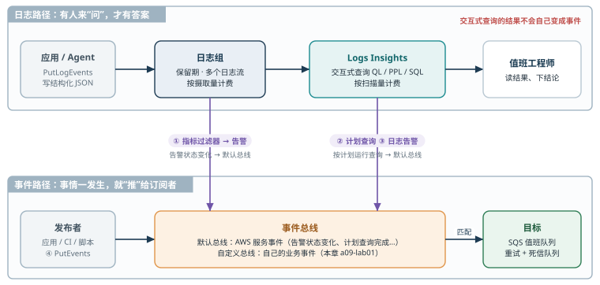
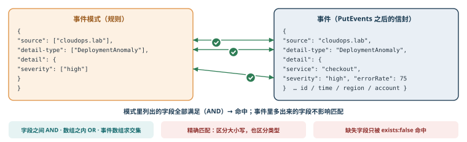
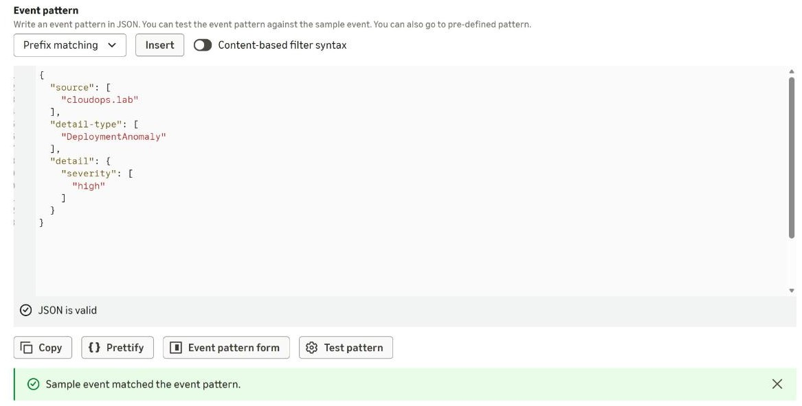
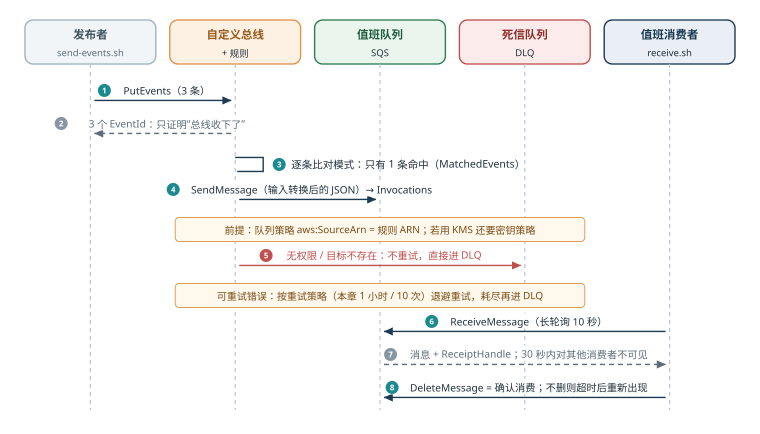
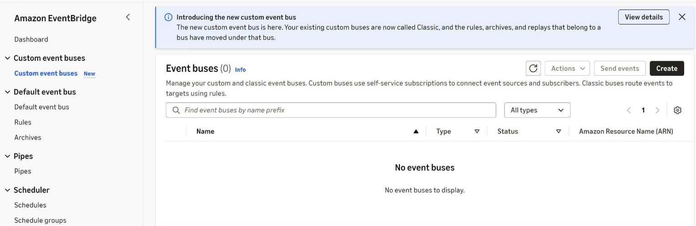

::::: cover
[第 09 讲 · 可观测性 ②]{.kicker}

<h1>Logs Insights × EventBridge：<br>从“查到”到“送达”</h1>

[日志回答“发生了什么”，事件负责“告诉谁”。本讲把一次金丝雀发布的 16 条日志算成可复核的结论，再把结论变成一条能被证明送达的事件。]{.subtitle}

::: cover-meta
- **讲次**：09 / 19
- **建议学时**：4 课时（讲授 2 + 实验 2）
- **实验费用**：本地实验 0 元；云上一轮按量费用 < 0.01 美元
- **适用版本**：Logs Insights QL（2026，含 `if()`、多 stats）；EventBridge Classic 总线；AWS Provider 6.x
:::

::: scenario
checkout 服务做金丝雀发布：v1 基线 4 个请求，v2 金丝雀 8 个请求，随后回滚到 v1 又 4 个请求。金丝雀期间 /checkout 开始报 500。值班群里有人说“错误率 100%”，有人说“37.5%”；发布系统说“已经发出告警事件了”，值班队列里却什么也没有。**哪个数字对？事件到底有没有送到？分别用什么证据回答？**
:::

## 学习目标 {.nonum}

:::: cards
::: {.card title="理解"}
- 日志事件、日志流、日志组与系统字段
- 查询管道：前一段的输出是后一段的输入
- 事件信封、事件模式与规则
:::
::: {.card title="推理"}
- 选对分母，算出可复核的错误率
- 判断一条事件会不会命中规则
- 从“查到”到“通知”该走哪座桥
:::
::: {.card title="实操"}
- 本地查询引擎跑通 6 条保存的查询
- 20 个用例对照真实 TestEventPattern
- Terraform：日志组 → 规则 → SQS + DLQ
:::
::: {.card title="排障"}
- 查询没结果、日志被拒收
- 有 EventId 却没有消息
- 消息重复出现、DLQ 里的错误码
:::
::::

| 本讲结构 | 要回答的问题 | 产出 |
|---|---|---|
| 一～二、日志与查询 | 75%、100%、37.5%，哪个对？ | 字段设计、查询管道、本地引擎 |
| 三、从查到到通知 | 查询结果会自己变成事件吗？ | 四座桥的选型表 |
| 四～五、事件 | 事件怎样命中规则？怎样证明送达？ | 匹配规则实测、投递链与证据 |
| 六、实操 | 怎样用最少的钱完整走一遍？ | Terraform、脚本、成本表 |
| 七～八、综合与练习 | 结论能写到什么程度？ | 综合例题、故障卡、练习 |
:::::

::: {.opener .nobreak}
[一 · 日志]{.kicker}

# 一条日志怎样变成可查询的字段？

[事故中能否快速回答“哪个请求、哪个版本、哪条路径出了问题”，在写日志的那一刻就决定了。]{.subtitle}
:::

## 从 PutLogEvents 到字段

应用（或 CloudWatch Agent）调用 **PutLogEvents**，把一批日志事件写进某个**日志组**下的某个**日志流**。每个事件只有两样东西：`timestamp`（事件发生的时间，毫秒）和 `message`（原文）。Logs Insights 查询时再把它们展开成字段：



两个常被忽略的事实：

- **@timestamp 来自请求里的 timestamp，而不是 JSON 里的某个时间字段。** 回放历史日志时如果仍用“当前时间”写入，查询的时间范围就会对不上；反过来，用很旧的时间戳写入，会撞上下面的拒收规则。
- **拒收规则与保留期有关。** 早于 14 天、或早于日志组保留期的事件会被拒收（`tooOldLogEventEndIndex`）；晚于 2 小时之后的会被拒收（`tooNewLogEventStartIndex`）。本章日志组只保留 1 天，所以实验脚本会把样本的时间平移到“最近 4 分钟”。序列号（sequence token）已经废弃，同一日志流可以并行写入。

## 字段要能回答排障问题

本章 16 条样本日志（`labs/data/requests.jsonl`）每条都是一行 JSON：

```{.json title="labs/data/requests.jsonl（第 5 行）"}
{"ts":"2026-11-17T09:01:00.000Z","runId":"lab01","requestId":"req-04","phase":"canary",
 "release":"v2","route":"/checkout","status":500,"latencyMs":850}
```

| 字段 | 回答的问题 | 设计要点 |
|---|---|---|
| `runId` | 这是哪一轮实验？ | 重复实验时用它隔离数据，否则计数会成倍增加 |
| `requestId` | 能否串起同一个请求？ | 跨服务传播，才能和追踪、上下游日志关联 |
| `phase` + `release` | 错误集中在哪次发布？ | 只证明“同时出现”，不能单独证明因果 |
| `route` | 是整个版本坏了，还是一条路径坏了？ | 粒度决定定位的精度 |
| `status` / `latencyMs` | 失败了吗？变慢了吗？ | 数值写成数字而不是字符串，单位写进字段名 |

::: pitfalls
1. **不要把机密写进日志。** 密码、访问密钥、完整卡号、个人敏感信息一旦进入日志，就会被保留、被查询、被导出。需要时用数据保护策略做掩码。
2. **数字就写成数字。** `"status":"500"` 和 `"status":500` 在过滤器、指标过滤器和事件模式里的行为都不一样（第四节会实测）。
3. **日志类决定能力。** Infrequent Access 日志类摄取价格减半（0.25 对 0.50 美元/GB），但不支持指标过滤器等功能；要据此告警的日志组用 Standard。
:::

::: {.opener}
[二 · 查询]{.kicker}

# 为什么是 75%，而不是 100% 或 37.5%？

[把一条查询看成管道：每一段只处理上一段的输出。分母在哪一段被删掉，答案就在哪一段被算错。]{.subtitle}
:::

## 查询管道：16 → 6 → 1



```{.text title="labs/queries/02-errors-by-group.cwli · Logs Insights QL"}
filter status >= 500
| stats count(*) as errors by phase, release, route
| sort errors desc
```

这条查询回答“错误集中在哪里”：6 个 5xx 全部落在 `canary · v2 · /checkout`。但它**回答不了**“错误率是多少”——因为 `filter` 已经把 10 个成功请求删掉了，后面的 `stats` 再也看不到分母。

::: formula
错误率 = 同一分组内的 5xx 数 ÷ 同一分组内的请求数 [同一个 stats、同一个 by]{.unit}
:::

:::: {.example title="例题 9-1｜三种写法，三个错误率"}
已知 16 条样本：基线 v1 4 条（0 个 5xx），金丝雀 v2 8 条（6 个 5xx），回滚 v1 4 条（0 个 5xx）。比较三种写法的结果，指出哪一种能写进事故报告。

::: steps
1. **写法 A：先 filter 再算。** `filter status >= 500 | stats count(*) as requests, sum(if(status >= 500, 1, 0)) as errors by phase` → requests=6、errors=6，“100%”。分母在第一段就只剩错误请求。
2. **写法 B：不分组。** `stats 100 * sum(if(status >= 500, 1, 0)) / count(*) as pct` → 6 ÷ 16 = 37.5%。分母混进了基线和回滚的请求，稀释了金丝雀的问题。
3. **写法 C：同一分组内算分子与分母。** 见下方 Q3 → canary 6 ÷ 8 = 75%，baseline 与 rollback 为 0%。
4. **检查量纲与边界。** 分子分母都是“请求数”，比例无量纲；样本只有 8 个请求，75% 的置信区间很宽，结论要写明样本量。
:::

::: answer
写法 C：**金丝雀 v2 在 8 个请求中有 6 个 5xx（75%），且全部集中在 /checkout；同版本的 /cart 2 个请求均成功。**写法 A 的“100%”和写法 B 的“37.5%”都是分母选错的结果。
:::
::::

```{.text title="labs/queries/03-error-rate.cwli · Logs Insights QL"}
stats count(*) as requests,
      sum(if(status >= 500, 1, 0)) as errors,
      100 * sum(if(status >= 500, 1, 0)) / count(*) as errorPct
  by phase, release
| sort errorPct desc
```

2026 年的 Logs Insights QL 已经内置 `if()` 与 `case()`，聚合函数的结果也可以继续做算术；一条查询最多 10 个 `stats`，后一个 `stats` 只能引用前一个的输出列，`sort` 和 `limit` 必须写在最后一个 `stats` 之后。扫描费用按**扫描量**计（us-east-1 为 0.005 美元/GB），所以缩小时间范围、少选日志组、对常用过滤字段建**字段索引**，都会直接降低成本。

{.shot width=60%}

:::: {.lab title="实验 9-1｜本地 Logs Insights 引擎：用同一份查询文件算出教材中的数字"}
::: labmeta
- **目标**：理解管道语义；在不花钱的前提下验证本讲所有数字
- **时长**：20 分钟
- **费用**：0 元
- **工具**：Python 3.11+
:::

`labs/01-insights/insights.py` 实现了本讲用到的 QL 子集（fields、filter、stats、sort、limit，`if()`、`bin()`、`pct()` 等）。教材中的 6 条查询都存放在 `labs/queries/*.cwli`——同一份文件既被本地引擎执行，也被实验 9-3 的 Terraform 部署为控制台里的“保存的查询”，保证书上、本地、云上三处一致。

```{.console title="python insights.py ../data/requests.jsonl --all ../queries（本书实测输出，节选）"}
== 03-error-rate.cwli
  phase     release  requests  errors  errorPct
  canary    v2       8         6       75.0
  baseline  v1       4         0       0.0
  rollback  v1       4         0       0.0

== 05-errors-per-minute.cwli
  minute                   errors  requests
  2026-11-17 09:00:00.000  0       4
  2026-11-17 09:01:00.000  3       4
  2026-11-17 09:02:00.000  3       4
  2026-11-17 09:03:00.000  0       4

== 06-canary-routes.cwli
  route      requests  errors
  /checkout  6         6
  /cart      2         0
```

14 个单元测试锁定了这些数字，也锁定了两条官方语法规则（`sort` 写在 `stats` 前会报错；第二个 `stats` 引用原始字段会报错）。Q4 的延迟查询给出 v2 平均 708.1 ms、p95 930 ms，而 v1 平均 129.8 ms——平均值被 6 个慢失败请求拉高，p95 更能说明“最慢的那批用户”的体验。本地引擎的 `pct` 用最近秩法，CloudWatch 用近似算法，大数据量下两者可能略有差异。
::::

::: {.opener}
[三 · 从查到到通知]{.kicker}

# 查询结果会自己变成事件吗？

[不会。交互式查询是“拉”：有人来问才有答案。想让值班队列自动收到通知，必须显式搭一座从日志到事件的桥。]{.subtitle}
:::

## 两条路径与四座桥

日志和事件是两条方向相反的路径：日志路径上，数据先存起来，等人带着问题来查；事件路径上，事情一发生就被推给订阅者。值班队列属于后者，所以“查到 6 个错误”和“值班收到通知”之间，必须有一座把日志变成事件的桥。AWS 提供了三座（①～③），第四座由你自己的系统来搭：



| 桥 | 怎样触发 | 事件去哪里、带什么 | 适合的问题 |
|---|---|---|---|
| ① 指标过滤器 + 指标告警 | 日志**写入时**逐条匹配，生成指标（不回溯已有日志） | 告警状态变化 → **默认总线**（`aws.cloudwatch` / `CloudWatch Alarm State Change`） | 可以计数的条件：每分钟 5xx 次数 |
| ② 计划查询（2025-11 起） | 按 cron 或日历计划运行一条 Insights 查询 | 查询完成事件 → **默认总线**（`aws.logs` / `Scheduled Query Completed`），**只含元数据与统计**；结果行要用 `queryId` 调 GetQueryResults 取（30 天内） | 周期性报告、需要复杂聚合 |
| ③ 日志告警（2026） | 服务托管的计划查询 + 聚合表达式 + 阈值 + M/N | 与其他告警相同的状态与动作；SNS 通知可附最多 50 行日志 | 必须用查询语言才能表达的告警条件 |
| ④ 显式 PutEvents | 发布系统、CI 或应用自己判断后发布 | 任意总线，内容完全自定义（service、release、errorRate…） | 业务语义清晰的事件：“金丝雀异常” |

桥 ③ 在控制台里就是“创建告警 → 数据源 Logs”：一条带 `SOURCE` 与时间窗的查询，加一个聚合表达式，再加阈值与 M/N——与指标告警共用同一套状态与动作。

{.shot width=80%}

:::: {.example title="例题 9-2｜给三个需求各选一座桥"}
三个需求：(a) 任何一分钟出现 5xx 就进值班队列；(b) 每天 9:00 把前一天各版本的错误率汇总存档；(c) 发布系统判定金丝雀异常后，立即通知值班并附上版本号与错误率。

::: steps
1. **(a) 是可计数的阈值条件。** 指标过滤器 `{ $.status >= 500 }` 把日志变成每分钟的计数，告警 2-of-3 判定，状态变化事件经默认总线上的规则送进队列——实验 9-3 中 `enable_alarm_path = true` 打开的正是这条路径。
2. **(b) 是周期报告，要的是结果行。** 计划查询把结果写入 S3；如果还想触发后续处理，可以订阅 `Scheduled Query Completed` 事件——但要记住事件里没有结果行。
3. **(c) 的判断发生在发布系统里。** 由它直接 PutEvents 到自定义总线，事件里带齐 release、errorRate 等字段，规则按 severity 路由。
:::

::: answer
依次为：(a) ① 指标过滤器 + 告警（条件更复杂时可用 ③ 日志告警）；(b) ② 计划查询 → S3；(c) ④ 显式 PutEvents。原稿把“Logs Insights 查到 6 个错误”和“事件进入队列”画成一条流水线是错的：交互式查询没有任何输出端，自动化必须走这四座桥之一。
:::
::::

::: {.opener}
[四 · 事件匹配]{.kicker}

# 一条事件怎样“命中”一条规则？

[规则不理解业务，它只做一件事：拿事件模式和事件 JSON 逐字段比对。比对规则精确到大小写和数据类型。]{.subtitle}
:::

## 事件信封与事件模式

PutEvents 收到的每条事件都会被包进统一的**信封**：`version`、`id`、`detail-type`、`source`、`account`、`time`、`region`、`resources`、`detail`。规则里的**事件模式**是一棵同形状的树，叶子是“允许的值”数组：



| 写法 | 含义 | 示例 |
|---|---|---|
| `["high"]` | 精确相等（区分大小写、区分类型） | `"severity": ["high"]` |
| `{"equals-ignore-case": "high"}` | 忽略大小写 | 命中 `"HIGH"` |
| `{"prefix": "v2"}` / `{"suffix": ".png"}` | 前缀 / 后缀 | `"release": [{"prefix": "v2"}]` |
| `{"anything-but": [...]}` | 除这些值之外（字段必须存在） | `"phase": [{"anything-but": ["baseline"]}]` |
| `{"numeric": [">=", 50]}` | 数值范围（只对数字生效） | `"errorRate": [{"numeric": [">=", 50]}]` |
| `{"exists": false}` | 字段不存在 | `"ticket": [{"exists": false}]` |
| `{"cidr": "10.0.0.0/24"}`、`{"wildcard": "/check*"}` | 网段、通配符 | `"clientIp": [{"cidr": "10.0.0.0/24"}]` |
| `"$or": [ {...}, {...} ]` | 跨字段的“或” | severity=high 或 errorRate≥50 |

:::: {.lab title="实验 9-2｜20 个用例：本地匹配器 vs 真实 TestEventPattern"}
::: labmeta
- **目标**：把匹配规则写成代码，并用 AWS 的判定逐条核对
- **时长**：20 分钟
- **费用**：0 元（TestEventPattern 只做计算，不创建资源、不产生事件）
- **权限**：`events:TestEventPattern`
:::

`labs/02-patterns/cases.json` 定义了 20 个“模式 + 事件”用例；`patterns.py --live` 逐条调用 `aws events test-event-pattern`，把 AWS 的判定录制到 `aws_results.json`，再与本地匹配器比对：

```{.console title="python patterns.py --live（本书实测输出，2026-11-17，us-east-1，节选）"}
C01  True   AWS=True   ✓  完整命中本章规则
C03  False  AWS=False  ✓  大小写不同：HIGH ≠ high
C05  False  AWS=False  ✓  类型不同：字符串 "500" ≠ 数字 500
C07  False  AWS=False  ✓  numeric 不匹配字符串形式的数字
C08  True   AWS=True   ✓  数组求交集：routes 含 /checkout
C11  False  AWS=False  ✓  anything-but 遇到缺失字段
C13  False  AWS=False  ✓  exists 用在对象（非叶子）上
C17  False  AWS=False  ✓  null 只匹配显式 null
C19  True   AWS=True   ✓  数字写法不同：500 与 500.0
C20  False  AWS=False  ✓  规则写在 detail 外层：severity 不在顶层

20 个用例，本地与 AWS 不一致：0
```

离线运行 `python -m unittest` 时，测试会用录制下来的 AWS 结果校验本地匹配器（4 个测试，含 20 个子用例）。几条最容易踩的规则都由真实 API 给出了答案：大小写与类型严格区分（C03、C05、C07），但数值 500 与 500.0 视为相等（C19）；`anything-but` 不会命中缺失字段（C11）；`exists` 只能用在叶子上（C13）；字段写错层级就永远不会命中（C20）。
::::

控制台的 EventBridge Sandbox 调用的也是同一个计算接口：贴入本章的样例事件与规则模式，点 Test pattern 即可得到同样的判定（图 9-7），不创建规则、不发送事件。

{.shot width=66%}

::: {.opener}
[五 · 投递]{.kicker}

# PutEvents 成功了，消息为什么没到？

[“发布成功”“规则命中”“目标收到”“消费完成”是四件事，各有各的证据。只拿到第一件的证据，就宣布第四件完成，是事件驱动系统里最常见的误判。]{.subtitle}
:::

## 投递链与每一环的证据

以实验 9-4 发布的三条事件为例：三条都拿到了 EventId，但只有一条命中规则；命中之后，EventBridge 还要以规则的身份把消息写进队列，失败时按重试策略重试或转入死信队列；消息进了队列，也要等消费者读取并删除，才算真正处理完。图 9-8 按时间顺序画出这条链，下表列出每一环能拿到的证据。



| 你看到的信号 | 它能证明什么 | 它不能证明什么 |
|---|---|---|
| PutEvents 返回 `FailedEntryCount: 0` 与 EventId | 总线接收了这些事件 | 有规则命中、目标收到 |
| `MatchedEvents`（按 EventBusName + RuleName） | 有事件命中了这条规则 | 目标调用成功 |
| `Invocations` 增加、`FailedInvocations` 无数据 | 目标调用最终成功 | 消费者处理成功 |
| `InvocationsSentToDlq` 增加 | 投递失败且进了 DLQ（看消息属性 `ERROR_CODE`） | — |
| 从 SQS 读到消息并 DeleteMessage | 本条消息送达并被确认消费 | 下游业务处理正确 |

决定“目标能不能收到”的四个条件：

1. **权限。** SQS 目标可以用队列的资源策略授权（本章做法），也可以给目标配置 IAM 执行角色（`RoleArn`）。资源策略里用 `aws:SourceArn` 精确限定规则 ARN；**自定义总线上的规则 ARN 带总线名**：`arn:aws:events:us-east-1:111122223333:rule/a09-lab01/a09-lab01-anomaly`。
2. **加密。** 本章队列用 SSE-SQS。若改用 KMS 加密，密钥策略必须允许 `events.amazonaws.com` 使用 `kms:GenerateDataKey` 与 `kms:Decrypt`——AWS 托管密钥 `alias/aws/sqs` 的策略不能修改，因此不能用；官方文档还明确不支持用 AWS 拥有的密钥加密的队列（包括 DLQ）。
3. **重试与死信。** 默认重试 24 小时、最多 185 次；无权限、目标不存在这类错误**不重试**，直接进 DLQ。本章把重试收紧到 1 小时 / 10 次——过时的值班通知没有意义。DLQ 只能是**同区域的标准队列**，而且它自己也需要授权，否则失败事件连 DLQ 都进不去（`InvocationsFailedToBeSentToDlq`）。
4. **语义。** 投递是**至少一次**：同一事件可能送达多次，消费者要按事件 `id` 去重；SQS 消息读取后在可见性超时（本章 30 秒）内对其他消费者不可见，**不删除就会重新出现**。

::: note
**2026 年的新选择：Custom Event Bus。** EventBridge 现在有两种自定义总线：本章使用的 **Custom Event Bus - Classic**（规则 + 最多 5 个目标，默认总线也属于这一类），以及新的 **Custom Event Bus**（CLI 为 `aws eventsv2`）：总线自带 1–365 天保留、订阅者（subscriber）一对一投递、按事件组 FIFO、5 分钟内去重、可从过去的位置重放，计费改为按 GB（us-east-1 摄取 0.18 美元/GB 起、保留 0.08 美元/GB·月）。两点迁移陷阱：订阅者的默认重试只有 **300 秒 / 5 次**（Classic 是 24 小时 / 185 次）；过滤语法沿用事件模式但**不支持通配符**。截至 AWS Provider 6.73.0 还没有对应的 Terraform 资源（CloudFormation 为 `AWS::EventsV2::*`），所以本章实验仍用 Classic 总线。
:::

{.shot}

::: {.opener}
[六 · 实操]{.kicker}

# 用最少的钱，把整条链路走一遍

[Terraform 只搭“管道”，不产生任何业务数据；数据要靠脚本显式写入和发布。每一步都有一个独立的检查点。]{.subtitle}
:::

:::: {.lab title="实验 9-3｜Terraform：日志组 → 规则 → SQS（含 DLQ）"}
::: labmeta
- **目标**：用代码固定本讲的全部设计决策，并用测试锁住
- **时长**：25 分钟
- **费用**：`plan` 与 `test` 为 0；`apply` 后资源本身几乎不收费
- **权限**：logs、events、sqs 的创建权限（apply 时）
:::

`labs/03-terraform/main.tf` 创建 15 个资源：保留 1 天的日志组、指标过滤器、6 条保存的查询、自定义总线、规则、值班队列与 DLQ 及其队列策略、带输入转换的目标。关键片段：

```{.hcl title="labs/03-terraform/main.tf（节选）"}
resource "aws_cloudwatch_log_metric_filter" "http_5xx" {
  pattern = "{ $.status >= 500 }"         # JSON 数值比较，不是字符串匹配
  metric_transformation {
    namespace     = local.namespace        # CloudOps/A09/<suffix>
    name          = "Http5xx"
    value         = "1"
    default_value = "0"                    # 有日志但无 5xx 的分钟报 0；无日志的分钟不报
  }
  # …
}

resource "aws_cloudwatch_event_rule" "anomaly" {
  event_bus_name = aws_cloudwatch_event_bus.lab.name
  event_pattern = jsonencode({
    source        = ["cloudops.lab"]
    "detail-type" = ["DeploymentAnomaly"]
    detail        = { severity = ["high"] }
  })
}

resource "aws_cloudwatch_event_target" "anomaly_to_queue" {
  # …
  input_transformer {                      # 只把值班需要的字段送进队列
    input_paths = {
      id        = "$.id"
      release   = "$.detail.release"
      errorRate = "$.detail.errorRate"         # 另有 source、type、service、severity
    }
    input_template = <<-EOT
      {"eventId": <id>, "source": <source>, "type": <type>, "service": <service>,
       "release": <release>, "severity": <severity>, "errorRate": <errorRate>,
       "rule": <aws.events.rule-name>}
    EOT
  }
  retry_policy {
    maximum_event_age_in_seconds = 3600    # 默认 24 小时 / 185 次
    maximum_retry_attempts       = 10
  }
  dead_letter_config { arn = aws_sqs_queue.dlq.arn }
}
```

队列策略用 `jsonencode` 生成，`aws:SourceArn` 只列出允许的规则；`enable_alarm_path = true` 时再加 3 个资源（指标告警、默认总线上匹配 `CloudWatch Alarm State Change` 的规则、目标），队列策略自动同时放行两条规则。输入模板中的字符串变量会被自动加引号、数字原样放入；若事件里缺少某个路径，对应变量不会生成，所以发布方要带齐字段。

```{.console title="terraform test 与只读 plan（本书实测输出，2026-11-17）"}
$ terraform test
  run "logs_are_short_lived_and_metered"... pass
  run "saved_queries_come_from_the_shared_files"... pass
  run "rule_matches_exactly_three_fields"... pass
  run "queue_accepts_only_this_rule"... pass
  run "target_has_transformer_retry_and_dlq"... pass
  …（另有 3 个：告警路径默认关闭、开启后共用队列、suffix 校验）
Success! 8 passed, 0 failed.

$ terraform plan                       # 连接真实账户，只读
Plan: 15 to add, 0 to change, 0 to destroy.
$ terraform plan -var enable_alarm_path=true
Plan: 18 to add, 0 to change, 0 to destroy.
```
::::

:::: {.lab title="实验 9-4｜在实验账户中跑通：写日志 → 查询 → 发事件 → 收消息"}
::: labmeta
- **目标**：为投递链的每一环拿到独立证据
- **时长**：30 分钟（含等待）
- **费用**：一轮 < 0.01 美元（见下方成本表）
- **前提**：独立实验账户；`terraform apply` 已完成
:::

```{.bash title="在 labs/03-terraform 目录中依次执行（Git Bash 或 AWS CloudShell）"}
./scripts/seed-logs.sh                              # ① 写入 16 条（时间平移到最近 4 分钟）
./scripts/query.sh ../queries/03-error-rate.cwli    # ② 用 API 跑查询，打印结果与 bytesScanned
./scripts/send-events.sh                            # ③ 两条负例 + 一条正例
./scripts/receive.sh                                # ④ 只读不删：30 秒后再读，同一条会重新出现
./scripts/receive.sh --delete                       #    确认消费
./scripts/check.sh                                  # ⑤ MatchedEvents / Invocations / Http5xx
terraform destroy                                   # ⑥ 清理：日志流、队列中的消息随资源一起删除
```

| 步骤 | 预期证据 | 若不符合，先查 |
|---|---|---|
| ① 写日志 | `rejectedLogEventsInfo` 为 null | 时间戳是否早于保留期；批次是否按时间递增 |
| ② 查询 | 与实验 9-1 相同的 75%；`recordsScanned` = 16 | 区域、日志组、时间范围；多轮实验加 `filter runId = …` |
| ③ 发布 | `FailedEntryCount: 0`，3 个 EventId | 调用者是否有 `events:PutEvents`；总线名 |
| ④ 收消息 | 只有 1 条，Body 含 `"severity": "high"`、`"rule": "a09-lab01-anomaly"` | 规则所在总线、模式、队列策略中的规则 ARN |
| ⑤ 指标 | MatchedEvents=1、Invocations=1、FailedInvocations 无数据 | 有失败就读 DLQ：`./scripts/receive.sh --dlq` 看 `ERROR_CODE` |

按 AWS Price List API 查到的单价（us-east-1，2026-11-17）估算一轮实验的按量费用：

| 计费项 | 单价 | 一轮实验用量 | 费用 |
|---|---|---|---|
| 日志摄取（Standard） | 0.50 美元/GB | 约 3 KB | ≈ 0 |
| Logs Insights 扫描 | 0.005 美元/GB | 每次约 3 KB | ≈ 0 |
| EventBridge 自定义事件 | 1.00 美元/百万条 | 3 条 | 0.000003 美元 |
| SQS 标准队列请求 | 0.40 美元/百万次（免费额度后） | 十余次 | ≈ 0 |
| 自定义指标 Http5xx | 0.30 美元/指标·月，按小时分摊 | 1 个指标、约 1 小时 | ≈ 0.0004 美元 |
| 告警（仅 enable_alarm_path） | 0.10 美元/告警指标·月，按小时分摊 | 约 1 小时 | ≈ 0.0001 美元 |
::::

::: warn
实验 9-4 的“预期证据”由机制和实验 9-1～9-3 的实测结果推导得出；本书遵循只读原则，没有在账户中执行 apply、写入日志或发布事件。不要为了让实验“看起来通过”而放宽队列策略（例如去掉 `aws:SourceArn` 条件）或给目标角色加 `sqs:*`。
:::

::: {.opener}
[七 · 综合与排障]{.kicker}

# 结论能写到什么程度？

[数据层的结论和投递层的结论要分开写，各自附上证据；因果关系要比相关性多一层证据。]{.subtitle}
:::

:::: {.example title="例题 9-3｜写一段可以被审核的事故结论"}
已知：16 条样本如前；发布记录显示 v2 是这段时间唯一的变更；发布系统发出了 3 条 DeploymentAnomaly 事件（2 条负例、1 条正例），值班队列读到 1 条消息。请写出事故结论的三个部分：数据、因果、通知。

::: steps
1. **列已知量。** 金丝雀 v2：8 个请求、6 个 5xx；基线与回滚均 0 个 5xx。
2. **代入公式。** 错误率 = 6 ÷ 8 = 75%（Q3）；按路由：/checkout 6/6，/cart 0/2（Q6）。
3. **界定因果。** 错误只出现在 v2，并随回滚消失，v2 是唯一变更——这是很强的相关证据，但仍需复核 v2 在 /checkout 路径上的代码与依赖调用、同一 requestId 的链路追踪，才能把“相关”写成“根因”。
4. **核对投递。** 3 个 EventId 只说明总线收下；MatchedEvents=1 说明只有正例命中；队列读到 1 条、Body 中 severity=high，说明送达；DeleteMessage 后才算消费完成。
:::

::: answer
**数据：**v2 金丝雀期间 /checkout 错误率 100%（6/6），整体 75%（6/8），样本量小；**因果：**v2 高度可疑，待代码与追踪复核后定性；**通知：**正例事件已送达值班队列并被确认消费，两条负例按设计未命中。三句话各自对应一份可复核的证据。
:::
::::

::: {.fault title="故障 1｜Logs Insights 一条结果都没有"}
现象
:   seed-logs.sh 显示写入成功，查询却返回 0 条。

根因
:   最常见的是范围没对上：区域不同、选错日志组、时间范围没有覆盖事件的 @timestamp（例如回放了旧时间戳的日志）；刚写入的数据也有短暂延迟。

修复
:   先跑 Q1（`fields @timestamp … | sort @timestamp asc`）看数据是否在范围内，再加过滤条件。
:::

::: {.fault title="故障 2｜PutLogEvents 成功返回，部分日志却不见了"}
现象
:   响应里 `rejectedLogEventsInfo.tooOldLogEventEndIndex` = 15。

根因
:   直接用样本里 2026-11-17 09:00 的时间戳写入保留期 1 天的日志组，第二天再做实验时这些事件早于保留期，被逐条拒收；HTTP 状态仍是 200。

修复
:   写入前把时间戳平移到最近几分钟（seed-logs.sh 的做法），并始终检查 `rejectedLogEventsInfo`。
:::

::: {.fault title="故障 3｜指标过滤器的图表一直是空的"}
现象
:   日志里明明有 5xx，`Http5xx` 指标没有数据点。

根因
:   指标过滤器不回溯：只统计它创建之后写入的日志；另一种情况是模式写成了 `{ $.status = "500" }`，与数字 500 不匹配；日志组若是 Infrequent Access 类也不支持指标过滤器。

修复
:   先创建过滤器再写日志；用 `aws logs test-metric-filter` 拿样本行验证模式。
:::

::: {.fault title="故障 4｜三个 EventId 都有，队列却是空的"}
现象
:   PutEvents 返回 `FailedEntryCount: 0`，receive.sh 收到 0 条；check.sh 显示 MatchedEvents 无数据。

根因
:   没有规则命中：规则建在默认总线，事件却发到了自定义总线（或相反）；或者模式与事件不一致，例如 `"HIGH"` 与 `["high"]`、`"errorRate": "75"` 与 numeric 条件。

修复
:   把真实事件和规则模式交给 `aws events test-event-pattern`（或控制台 Sandbox），先在不花钱的地方确认能命中。
:::

::: {.fault title="故障 5｜MatchedEvents 有了，消息却进了 DLQ"}
现象
:   `InvocationsSentToDlq` = 1，DLQ 消息属性 `ERROR_CODE = NO_PERMISSIONS`。

根因
:   队列策略的 `aws:SourceArn` 写成了 `rule/a09-lab01-anomaly`，漏掉了总线名这一段；或者队列改成了 `alias/aws/sqs` 加密。权限类错误不重试，直接进 DLQ。

修复
:   在 Terraform 中直接引用 `aws_cloudwatch_event_rule.anomaly.arn`，不手写 ARN；需要 KMS 时改用带 EventBridge 授权语句的客户托管密钥。
:::

::: {.fault title="故障 6｜同一条告警消息被处理了两次"}
现象
:   值班机器人对同一次异常发了两条通知。

根因
:   消费者读取后没有在可见性超时内删除消息，消息重新出现；或者事件本身被至少一次投递了两次。

修复
:   处理完成后再 DeleteMessage；按消息体里的 `eventId` 做幂等去重；处理时间较长时调大可见性超时。
:::

::: {.opener}
[八 · 练习]{.kicker}

# 练一练：你能判断是哪一层出的问题吗？

[先独立作答，再对照解析。每道题都对应本讲某个可以实测的现象。]{.subtitle}
:::

## 随堂练习

::: {.exercise title="练习 1｜分母"}
回滚阶段又来了 4 个请求，其中 1 个 5xx。重新计算各阶段错误率。若用 `filter status >= 500` 开头的查询，rollback 一行的“错误率”会显示多少？
:::

::: {.exercise title="练习 2｜管道顺序"}
`stats count(*) as n by phase | sort n desc | stats max(n) as maxN` 能运行吗？为什么？
:::

::: {.exercise title="练习 3｜匹配"}
规则模式为 `{"detail": {"errorRate": [{"numeric": [">=", 50]}]}}`。事件 detail 分别为 (a) `{"errorRate": 75}`；(b) `{"errorRate": "75"}`；(c) `{"errorRate": 50.0}`；(d) `{}`。哪些命中？
:::

::: {.exercise title="练习 4｜anything-but"}
想表达“phase 不是 baseline 的事件都要”，写成 `{"detail": {"phase": [{"anything-but": "baseline"}]}}`。没有 phase 字段的事件会被送达吗？如果也要它们，怎么改？
:::

::: {.exercise title="练习 5｜证据"}
PutEvents 返回 EventId，MatchedEvents=1，Invocations=1，但值班机器人没有发通知。下一步查哪里？
:::

::: {.exercise title="练习 6｜选桥"}
需求：“过去 15 分钟里，任何一个 release 的错误率超过 20% 就告警”。用指标过滤器方便吗？还有什么更合适的选择？
:::

## 参考答案与解析

::: {.solution title="1"}
baseline 0%、canary 75%、rollback 1/8 = 12.5%（回滚阶段共 8 个请求）。先 filter 再算时，rollback 一行 requests 只剩 1、errors 也是 1，显示成“100%”——分母又被删掉了。
:::

::: {.solution title="2"}
不能。`sort` 必须写在最后一个 `stats` 之后（实验 9-1 的测试锁定了这条规则）。把 `sort` 移到末尾，或者去掉它（求最大值不需要排序）。
:::

::: {.solution title="3"}
命中的是 (a) 和 (c)。(a) 命中；(b) 不命中——numeric 只对 JSON 数字生效（实验 9-2 的 C07）；(c) 命中，50.0 ≥ 50；(d) 不命中，缺失字段只能被 `exists: false` 命中。
:::

::: {.solution title="4"}
不会。`anything-but` 要求字段存在（C11）。用 `$or` 把两种情况并起来：`{"detail": {"$or": [{"phase": [{"anything-but": "baseline"}]}, {"phase": [{"exists": false}]}]}}`。
:::

::: {.solution title="5"}
投递层已经有成功证据，问题在消费层：消息是否被别的消费者先读走（看 ApproximateReceiveCount）、机器人是否在处理中报错、是否删了消息却没发出通知。这时去查消费者自己的日志，而不是再调 EventBridge。
:::

::: {.solution title="6"}
不方便：错误率需要分子分母按 release 分组，指标过滤器做维度会遇到高基数与“维度不能带默认值”的限制。更合适的是 ③ 日志告警：用 `stats … by release` 的查询配合聚合表达式和阈值；或者在服务侧直接上报 Requests/Errors 两个指标，按第 08 讲用指标数学算错误率。
:::

## 这一讲，你应该记住 {.nonum}

:::: summary
::: {.card tag="日志"}
**@timestamp 来自写入请求**

早于保留期的事件会被静默拒收。
:::
::: {.card tag="查询"}
**分子分母，同一 stats、同一 by**

先 filter 就丢了分母。
:::
::: {.card tag="桥"}
**查询不会自己发事件**

过滤器、计划查询、日志告警、PutEvents。
:::
::: {.card tag="投递"}
**接收 ≠ 命中 ≠ 送达 ≠ 消费**

每一环各有证据；消费者要幂等。
:::
::::

::: refs
## 参考资料 {.nonum}

[实测说明：实验 9-1、9-2 为真实运行结果（TestEventPattern，us-east-1，2026-11-17）；价格来自 Price List API；Terraform 只执行 test 与只读 plan；图 9-3、9-5、9-7、9-9 为 2026-11-18 控制台实拍（账户号已替换，未提交任何表单）。]{.small}

1. 查询语法 <https://docs.aws.amazon.com/AmazonCloudWatch/latest/logs/CWL_QuerySyntax.html>；计划查询 <https://docs.aws.amazon.com/AmazonCloudWatch/latest/logs/ScheduledQueries.html>；日志告警 <https://docs.aws.amazon.com/AmazonCloudWatch/latest/monitoring/Alarm-On-Logs.html>
2. 事件模式 <https://docs.aws.amazon.com/eventbridge/latest/userguide/eb-create-pattern-operators.html>；重试与 DLQ <https://docs.aws.amazon.com/eventbridge/latest/userguide/eb-rule-dlq.html>；Custom Event Bus <https://docs.aws.amazon.com/eventbridge/latest/userguide/eb-custom-bus.html>
:::
