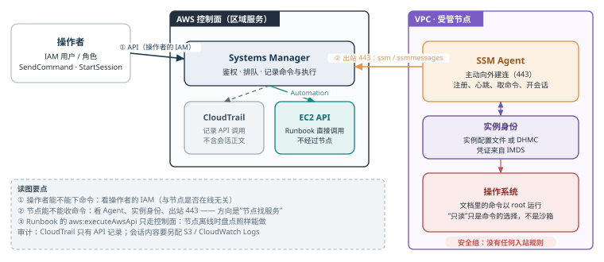
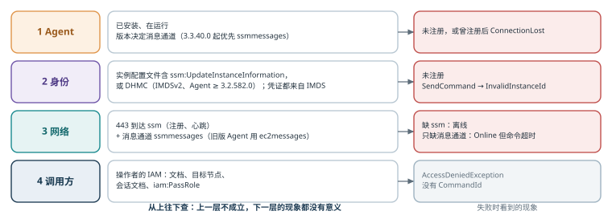
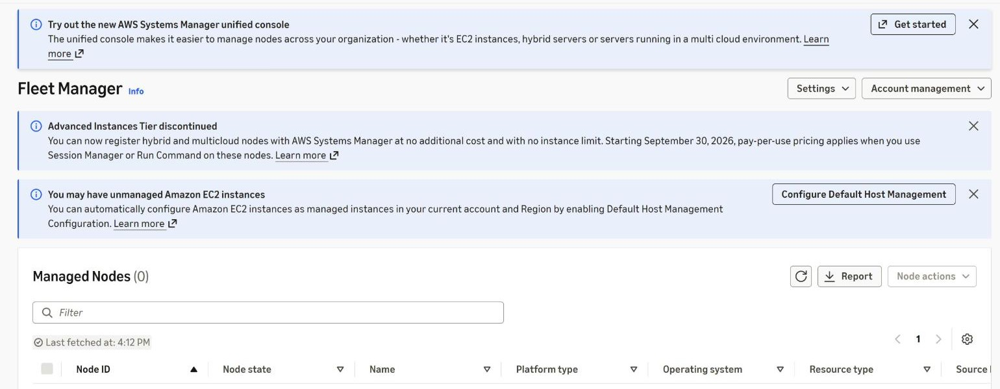
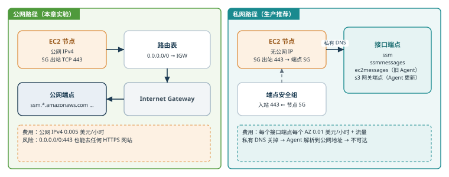
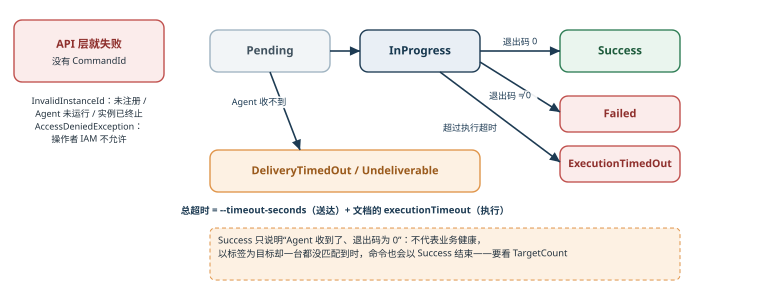
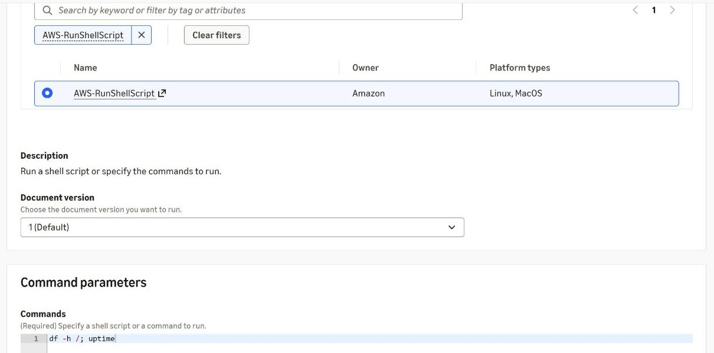
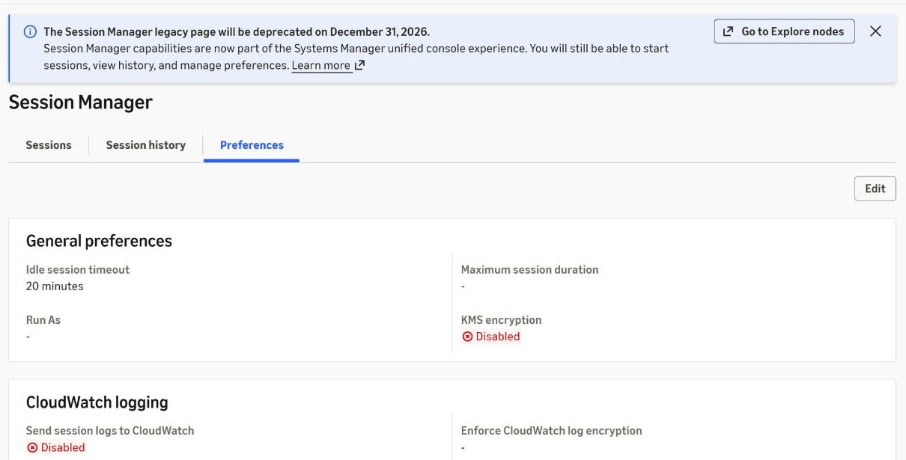
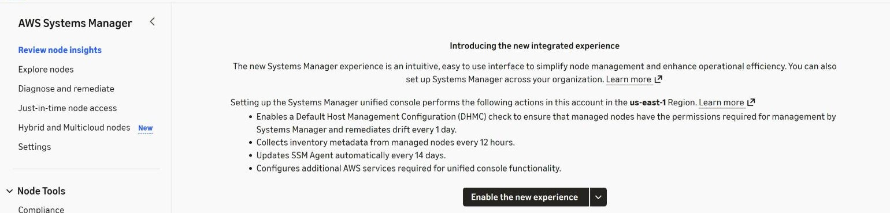
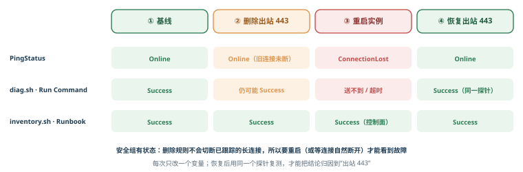

::::: cover
[第 10 讲 · 运维自动化 ①]{.kicker}

<h1>Systems Manager：<br>没有 SSH，怎样安全地运维？</h1>

[一台没有任何入站端口的实例照样能被诊断——前提是四层同时成立：Agent、身份、出站网络、调用者权限。本讲用推理模型、IAM 模拟器和可开关的故障把它们逐层拆开。]{.subtitle}

::: cover-meta
- **讲次**：10 / 19
- **建议学时**：4 课时（讲授 2 + 实验 2）
- **实验费用**：默认模式 0 元；实例模式约 0.01 美元/小时
- **适用版本**：SSM Agent 3.3.x；AL2023 arm64；AWS Provider 6.x
:::

::: scenario
某银行沙箱里的 Linux 实例需要做磁盘、负载和系统版本盘点。网络组禁止开放 22 端口，也不允许堡垒机。运维同事用 Session Manager 连上去看了一眼——第二天，同一台机器在控制台里显示“Running”，Systems Manager 里却显示离线。**命令是怎样到达一台不开端口的机器的？“Running 但离线”又该从哪一层查起？**
:::

## 学习目标 {.nonum}

:::: cards
::: {.card title="理解"}
- 控制面、节点、操作系统三个平面
- 受管节点的四层前提
- Run Command、Session、Runbook 的边界
:::
::: {.card title="推理"}
- 由现象反推失败的那一层
- 读懂命令状态与 API 错误
- 公网路径与端点路径的取舍
:::
::: {.card title="实操"}
- ssmdiag 推理 12 个场景
- 操作者策略经 IAM 模拟器 10/10 验证
- Terraform：零入站实例 + 故障开关
:::
::: {.card title="排障"}
- Online 却收不到命令
- 删了出站规则节点仍在线
- InvalidInstanceId 与 AccessDenied
:::
::::

| 本讲结构 | 要回答的问题 | 产出 |
|---|---|---|
| 一、机制 | 命令怎样到达不开端口的机器？ | 三个平面、Agent 的真实权限 |
| 二～三、前提与网络 | Running 为什么不等于在线？ | 四层模型、两种网络路径 |
| 四～五、命令与权限 | Success 说明了什么？谁能对哪台机器做什么？ | 命令生命周期、最小权限策略 |
| 六、实操 | 怎样用最少的钱做一次控制变量实验？ | Terraform、脚本、故障时间线 |
| 七～八、综合与练习 | 结论怎样写才站得住？ | 例题、故障卡、练习 |
:::::

::: {.opener .nobreak}
[一 · 机制]{.kicker}

# 命令是怎样到达一台不开端口的机器的？

[不是 AWS “连进”了你的实例，而是实例上的 Agent 一直在“往外”找 Systems Manager 要活干。方向一反，排障思路就全对了。]{.subtitle}
:::

## 三个平面



| 平面 | 谁在用谁的权限 | 能证明“这一段通了”的信号 |
|---|---|---|
| 操作者 → Systems Manager | 操作者自己的 IAM（`ssm:SendCommand`、`ssm:StartSession`…） | API 返回 CommandId / SessionId |
| Agent → Systems Manager | 节点的实例身份（实例配置文件或 DHMC） | `describe-instance-information` 中 PingStatus = Online |
| 文档 → 操作系统 | Agent 以 root 运行文档中的命令 | 该节点调用的 Status、退出码与标准输出 |
| Runbook → AWS API | Runbook 的执行角色（或启动者本人） | Automation 执行的 Status 与 Outputs |

Agent 的权限就是 AWS 托管策略 **AmazonSSMManagedInstanceCore**。它只允许 Agent 做“受管节点”分内的事——注册与心跳、取文档、收发消息，没有任何 EC2、S3 读写权限：

```{.console title="aws iam get-policy-version …/AmazonSSMManagedInstanceCore（本书实测，默认版本 v2，按前缀归类）"}
ssm:*          15 个：UpdateInstanceInformation（注册与心跳）、ListInstanceAssociations、
               GetDocument、DescribeDocument、PutInventory、GetParameter(s)、UpdateAssociationStatus …
ssmmessages:*   4 个：CreateControlChannel、OpenControlChannel、CreateDataChannel、OpenDataChannel
ec2messages:*   6 个：GetMessages、AcknowledgeMessage、SendReply、DeleteMessage、FailMessage、GetEndpoint
```

::: pitfalls
1. **“只读”是命令的选择，不是沙箱。** `aws:runShellScript` 以 root 执行；文档叫 readonly 并不能阻止它改文件。真正的约束来自“允许执行哪些文档”和“文档有没有可注入的参数”。
2. **节点的权限不是操作者的权限。** 给实例挂 AmazonSSMManagedInstanceCore，只解决“节点能不能被管理”；工程师能不能下命令，要看工程师自己的 IAM。
3. **CloudTrail 只记 API，不记会话内容。** 会话里敲了什么、输出了什么，要另外配置会话日志（S3 / CloudWatch Logs），而且 SSH 与端口转发会话的内容无法记录。
:::

::: {.opener}
[二 · 前提]{.kicker}

# 实例 Running，为什么节点不在线？

[“EC2 Running”只说明虚拟机在跑；“SSM Online”要求四层同时成立。把四层按顺序排好，排障就从猜测变成了逐项核对。]{.subtitle}
:::

## 四层前提



两个 2023 年之后的变化值得单独记住：

- **身份可以不靠实例配置文件。** 默认主机管理配置（DHMC）按区域开启后，Systems Manager 用一个默认角色管理本区域所有 EC2 实例；前提是 IMDSv2 与 Agent ≥ 3.2.582.0。注意优先级：实例配置文件里只要允许 `ssm:UpdateInstanceInformation`，Agent 就用它而不用 DHMC。两种方式的临时凭证都来自 IMDS——把实例的元数据服务整个关掉（`http_endpoint = disabled`），两条路都会断。
- **消息通道在迁移。** Agent 3.3.40.0 起，只要 `ssmmessages` 可用就用它收发命令，不再依赖 `ec2messages`；更老的 Agent 仍然用 `ec2messages` 收命令、用 `ssmmessages` 开会话。

本书实验账户（us-east-1）的现状可以用几条只读命令确认，后面的推理都以它为起点：

```{.console title="只读查询（本书实测，2026-11-18，us-east-1）"}
$ aws ssm get-parameter --name /aws/service/ami-amazon-linux-latest/al2023-ami-kernel-default-arm64
ami-04bde3808fe5f70cf          # AL2023 arm64 最新 AMI，2026-11-13 更新
$ aws ssm describe-instance-information --query 'length(InstanceInformationList)'
0                              # 当前没有任何受管节点
$ aws ssm get-service-setting --setting-id /ssm/managed-instance/default-ec2-instance-management-role
$None    Default    System     # 未启用 DHMC：本区域的实例必须靠实例配置文件
$ aws ec2 describe-vpc-endpoint-services --service-names com.amazonaws.us-east-1.{ssm,ssmmessages,ec2messages}
com.amazonaws.us-east-1.ec2messages    Interface    6 个 AZ
com.amazonaws.us-east-1.ssm            Interface    6 个 AZ
com.amazonaws.us-east-1.ssmmessages    Interface    6 个 AZ
```

控制台给出的是同一个结论（图 10-3）：Fleet Manager 里受管节点为 0，横幅提示“可以启用 DHMC 自动纳管 EC2 实例”。另一条横幅是 2026 年的计费变化：高级实例层已经取消，混合 / 多云节点注册不再收费、不限数量，但自 2026-09-30 起对这些节点使用 Session Manager 或 Run Command 按次计费（EC2 实例不受影响）。

{.shot width=88%}

:::: {.lab title="实验 10-1｜ssmdiag：把四层前提写成可推理的模型"}
::: labmeta
- **目标**：给定节点的配置，推出第一个失败层和三种操作的结果
- **时长**：20 分钟
- **费用**：0 元
- **工具**：Python 3.11+
:::

`labs/01-ssmdiag/ssmdiag.py` 把图 10-2 的规则写成代码，`scenarios.json` 准备了 12 个场景（基线、拔网、缺身份、DHMC、私网端点、旧 Agent、私有 DNS、IMDS 关闭、调用者无权限……）。最有教学价值的是下面两个“Online 却不能用”的场景：

```{.console title="python ssmdiag.py scenarios.json（本书实测输出，节选）"}
S6 私有子网只建了 ssm 端点
  [✓]Agent  [✓]身份  [✗]网络  [✓]调用方 → 第一个失败层：网络
    网络：可达：ssm；缺：ssmmessages
  PingStatus：Online
  Run Command：节点 Online 但收不到命令：缺 ssmmessages，Pending → DeliveryTimedOut
  Session：会话建立失败：数据通道需要 ssmmessages；Runbook：Success：控制面 API，不经过节点

S8 同 S7，但 Agent 是 3.2.x（命令走 ec2messages）
  [✓]Agent  [✓]身份  [✗]网络  [✓]调用方 → 第一个失败层：网络
    网络：可达：ssm, ssmmessages；缺：ec2messages
  PingStatus：Online
  Run Command：节点 Online 但收不到命令：缺 ec2messages，Pending → DeliveryTimedOut
  Session：可以建立会话；Runbook：Success：控制面 API，不经过节点
```

PingStatus 来自 Agent 对 `ssm` 端点的 `UpdateInstanceInformation` 心跳，所以只要 `ssm` 可达，节点就显示 Online；命令和会话走的是另一条消息通道。8 个单元测试锁定了全部 12 个场景的结论。模型是教学用的简化，规则出处见参考资料；它不能代替真实排障，但能帮你在动手之前先写下“我预期看到什么”。
::::

:::: {.example title="例题 10-1｜Online 的节点，命令为什么一直 Pending？"}
已知：私有子网内的实例，Agent 3.3.x，实例配置文件正确；VPC 里只建了 `com.amazonaws.us-east-1.ssm` 一个接口端点，私有 DNS 已开启。Fleet Manager 显示该节点 Online；`send-command` 返回了 CommandId，但调用状态一直是 Pending，最终变成 DeliveryTimedOut。求：失败在哪一层？最小修复是什么？

::: steps
1. **先排除不相关的层。** 有 CommandId → 调用者 IAM 没问题；节点 Online → Agent 在运行、身份有效、`ssm` 可达。
2. **把剩下的层与现象对齐。** 能心跳却收不到命令，说明消息通道不通：新版 Agent 收命令用 `ssmmessages`，而 VPC 里没有这个端点，私有子网又没有出公网的路由。
3. **最小修复。** 只新增 `ssmmessages` 接口端点（同样开启私有 DNS，端点安全组放行来自节点的 443）；不动 IAM、不重装 Agent。
4. **独立复测。** 用同一份诊断文档再发一次命令，期望 Success；再试一次 Session Manager，验证数据通道也通了。
:::

::: answer
失败在第 3 层“网络”，具体是消息通道 `ssmmessages` 不可达。若 Agent 是 3.3.40.0 之前的版本，还要再加 `ec2messages` 端点。Online 只证明心跳通，不证明命令通道通。
:::
::::

::: {.opener}
[三 · 网络]{.kicker}

# 走公网，还是走端点？

[两条路都能让 Agent 找到 Systems Manager；区别在于花多少钱、暴露多少出口，以及 DNS 指向哪里。]{.subtitle}
:::



| 比较项 | 公网路径（IGW + 公网 IPv4） | 私网路径（接口端点） |
|---|---|---|
| 必需组件 | 默认路由指向 IGW（或 NAT）、公网 IP、出站 443 | `ssm`、`ssmmessages`（旧 Agent 再加 `ec2messages`）端点，私有 DNS，端点安全组入站 443 |
| 附带需求 | — | Agent 更新与部分功能要访问 S3：加 S3 网关端点；会话日志、KMS 加密要再加 `logs`、`kms` 端点 |
| 费用（us-east-1） | 公网 IPv4 0.005 美元/小时 | 每个接口端点每个 AZ 0.01 美元/小时，外加流量 |
| 风险 | 0.0.0.0/0:443 也能访问任何 HTTPS 网站 | 自定义 DNS 必须把 `amazonaws.com` 条件转发给 VPC 解析器，否则私有 DNS 失效 |

本章实验选择公网路径，只是因为它最便宜（一台实例一个公网 IP，每小时 0.005 美元，而三个接口端点在一个 AZ 就是 0.03 美元/小时）；它不是生产推荐。安全组、NACL 与路由的细节分别在第 03、04 讲讲过：安全组只需出站 443；若子网 NACL 收紧了，出站 443 与返回流量的临时端口都要放行。

::: {.opener}
[四 · 命令与 Runbook]{.kicker}

# 命令返回 Success，说明了什么？

[Success 的含义比你想的窄：Agent 收到了，脚本退出码为 0。业务是否健康，要看输出；有没有发错机器，要看目标数。]{.subtitle}
:::



| 现象 | 说明 | 下一步 |
|---|---|---|
| API 报 `InvalidInstanceId` | 节点未注册、Agent 未运行，或实例已终止 | 回到第 1～3 层查节点 |
| API 报 `AccessDeniedException` | 调用者无权对该文档或该节点执行 | 查操作者的 IAM，节点本身没问题 |
| `Pending` → `DeliveryTimedOut` | Agent 在总超时内没有收到命令 | 查消息通道（`ssmmessages` / `ec2messages`） |
| `Undeliverable` | 节点不存在或不响应 | 查 PingStatus 是否 ConnectionLost |
| `Success` | Agent 收到，退出码为 0 | 读 StandardOutputContent，核对 TargetCount |

AWS 自带的 `AWS-RunShellScript` 接受一个 `commands` 参数——任何能运行它的人都能执行任意命令（本书实测：文档版本 1，模式 1.2，平台 Linux/MacOS，参数 commands、workingDirectory、executionTimeout=3600）。本章的诊断文档反其道而行：**命令写死在文档里，没有参数**，调用者只能决定“对哪台机器运行”，不能决定“运行什么”。

{.shot width=64%}

```{.hcl title="labs/03-terraform/main.tf（节选）· 不可注入的诊断文档"}
resource "aws_ssm_document" "diagnostics" {
  name          = "${local.name}-diagnostics"
  document_type = "Command"
  content = jsonencode({
    schemaVersion = "2.2"
    mainSteps = [{
      action       = "aws:runShellScript"
      name         = "ReadOnlyDiagnostics"
      precondition = { StringEquals = ["platformType", "Linux"] }
      inputs = {
        timeoutSeconds = "60"
        runCommand = ["echo '== disk'; df -h /", "echo '== load'; uptime",
                      "echo '== os'; grep -E '^(NAME|VERSION)=' /etc/os-release",
                      "echo '== agent'; rpm -q amazon-ssm-agent || true"]
      }
    }]
  })
}
```

Runbook（Automation 文档）则完全不同：`aws:executeAwsApi` 在 AWS 控制面调用 API，每一步最多运行 25 秒，**不经过节点上的 Agent**——节点离线时，它照样能查到实例状态和 PingStatus。本章 Runbook 只调用 `ec2:DescribeInstances` 与 `ssm:DescribeInstanceInformation`，并指定了专门的执行角色（`assumeRole`）。不指定执行角色时，Runbook 以启动者本人的权限运行——操作者就得自己拥有这些 API 的权限，权限边界也就不清楚了。

| 能力 | 在哪里执行 | 依赖 Agent | 适合 |
|---|---|---|---|
| Run Command | 节点的操作系统（root） | 是 | 批量、可审计、预先审定的命令 |
| Session Manager | 节点的交互式 Shell | 是（`ssmmessages` 数据通道） | 临时排查，配合会话日志 |
| Automation（executeAwsApi） | AWS 控制面 | 否 | 盘点、编排、修复 AWS 资源 |

::: {.opener}
[五 · 权限]{.kicker}

# 谁可以对哪台机器做什么？

[最小权限要同时约束三件事：能用哪些文档、能对哪些节点、能把哪个角色交给 Systems Manager。约束写好之后，要用模拟器证明它真的生效。]{.subtitle}
:::

:::: {.lab title="实验 10-2｜操作者最小权限策略：10 个判定交给 IAM 策略模拟器"}
::: labmeta
- **目标**：让“只能对 Env=lab 的节点运行批准的文档”成为可验证的事实
- **时长**：20 分钟
- **费用**：0 元（simulate-custom-policy 只做计算）
- **权限**：`iam:SimulateCustomPolicy`
:::

`labs/02-operator-iam/operator-policy.json` 的要点：`ssm:SendCommand` 必须同时对**节点**（带 `ssm:resourceTag/Env = lab` 条件）和**文档**（只允许 `a10-*`）授权；显式拒绝 `AWS-RunShellScript`；会话只能开到 Env=lab 的节点；Runbook 的执行角色只能传给 `ssm.amazonaws.com`。`opsim.py --live` 把 10 个手推结论逐条交给真实的模拟器：

```{.console title="python opsim.py --live（本书实测输出，2026-11-18）"}
P1   ssm:SendCommand              预期=allowed      AWS=allowed      ✓  lab 节点（实例资源）
P2   ssm:SendCommand              预期=allowed      AWS=allowed      ✓  批准的文档 a10-*（文档资源）
P3   ssm:SendCommand              预期=explicitDeny AWS=explicitDeny ✓  AWS-RunShellScript
P4   ssm:SendCommand              预期=implicitDeny AWS=implicitDeny ✓  prod 节点
P5   ssm:StartSession             预期=allowed      AWS=allowed      ✓  会话：lab 节点
P6   ssm:StartSession             预期=implicitDeny AWS=implicitDeny ✓  会话：prod 节点
P7   ssm:StartAutomationExecution 预期=allowed      AWS=allowed      ✓  启动盘点 Runbook
P8   ec2:DescribeInstances        预期=implicitDeny AWS=implicitDeny ✓  自己直接查 EC2
P9   iam:PassRole                 预期=allowed      AWS=allowed      ✓  PassRole → ssm
P10  iam:PassRole                 预期=implicitDeny AWS=implicitDeny ✓  PassRole → ec2

10 个用例，与手推结果不一致：0
```

同一份策略交给 IAM Access Analyzer 的 `validate-policy`，没有任何错误、警告或建议（实测输出为空）。P8 与 P9 合起来说明了一种职责分离：操作者自己查不了 EC2，但可以启动一个“只会查 EC2”的 Runbook——权限被装进了一个经过审定的工具里。
::::

::: note
**审计与临时授权。** 会话日志可以写到 S3 或流式写入 CloudWatch Logs，但 SSH 与端口转发会话的内容无法记录（它们在 TLS 隧道内另有一层 SSH 加密）；需要记录时，禁止这两类会话文档即可。若要“平时没有权限、需要时审批开通”，可以使用 2025 年 4 月正式发布的 **just-in-time 节点访问**：按审批策略临时放行会话，按受管节点小时计费（us-east-1 首档 0.0137 美元/节点·小时，Price List API，2026-11-18），新启用时有免费试用期。

:::

本书账户的会话首选项仍是默认值（图 10-7）：空闲超时 20 分钟、没有最长会话时长、未指定 Run As、未启用 KMS 加密与会话日志——也就是说，此时开出的会话**不留下任何内容记录**。控制台里点 Just-in-time node access，会先进入 Systems Manager 统一控制台的启用页（图 10-8）：启用它会在本区域开启 DHMC 检查并每天修正漂移、每 12 小时采集清单、每 14 天自动更新 Agent——都是账户级变更，应先评估再启用。旧版 Session Manager 页面将于 2026-12-31 停用，功能并入统一控制台。

{.shot width=66%}

{.shot}

::: {.opener}
[六 · 实操]{.kicker}

# 一次控制变量实验：只拔掉一根“线”

[默认模式只创建文档和角色，零费用；打开实例模式才产生按小时的费用。故障注入只改一个变量——安全组唯一的出站规则。]{.subtitle}
:::

:::: {.lab title="实验 10-3｜Terraform：零入站的实验节点与故障开关"}
::: labmeta
- **目标**：用代码固定图 10-1、10-2、10-4 的设计，并用测试锁住
- **时长**：20 分钟
- **费用**：`plan`/`test` 0 元；实例模式约 0.01 美元/小时
- **权限**：apply 时需要 EC2、IAM、SSM 的创建权限
:::

```{.hcl title="labs/03-terraform/main.tf（节选）· 网络与实例"}
resource "aws_security_group" "node" {
  count  = local.lab
  vpc_id = aws_vpc.lab[0].id
  # 不写内联规则：Terraform 会删掉 AWS 默认的“全部出站”，出站只剩下面这一条
}

resource "aws_vpc_security_group_egress_rule" "https" {
  count             = var.create_lab_instance && var.allow_ssm_egress ? 1 : 0   # 故障开关
  security_group_id = aws_security_group.node[0].id
  cidr_ipv4         = "0.0.0.0/0"
  ip_protocol       = "tcp"
  from_port         = 443
  to_port           = 443
}

resource "aws_instance" "lab" {
  count                = local.lab
  ami                  = data.aws_ssm_parameter.al2023_arm64[0].insecure_value     # AWS 公共参数
  instance_type        = var.instance_type                                         # 默认 t4g.nano
  iam_instance_profile = aws_iam_instance_profile.node[0].name                     # 挂 Core 策略
  metadata_options {
    http_tokens                 = "required"                                       # 强制 IMDSv2
    http_put_response_hop_limit = 1
  }
  root_block_device {
    volume_type = "gp3"
    encrypted   = true
  }
  tags = { Env = "lab" }                                       # 对应实验 10-2 的策略
}
```

子网放在“提供该机型”的可用区（`aws_ec2_instance_type_offerings` 实时查询），Runbook 的执行角色在信任策略里加了 `aws:SourceAccount` 与 `aws:SourceArn` 条件，防止其他账户的 Automation 借用它（混淆代理）。

```{.console title="terraform test 与只读 plan（本书实测输出，2026-11-18）"}
$ terraform test
  run "default_mode_creates_no_compute"... pass
  run "command_document_cannot_be_injected"... pass
  run "runbook_uses_its_own_read_only_role"... pass
  run "instance_mode_is_hardened"... pass
  run "fault_switch_removes_the_only_egress"... pass
  run "x86_instance_type_is_rejected"... pass
Success! 6 passed, 0 failed.

$ terraform plan                                   # 默认模式：2 个文档 + 执行角色及其策略
Plan: 4 to add, 0 to change, 0 to destroy.
$ terraform plan -var create_lab_instance=true     # 实例模式
  + ami               = "ami-04bde3808fe5f70cf"
  + availability_zone = "us-east-1a"
Plan: 15 to add, 0 to change, 0 to destroy.
```
::::

:::: {.lab title="实验 10-4｜在实验账户中：基线 → 拔线 → 重启 → 恢复"}
::: labmeta
- **目标**：用同一个探针，在四个阶段分别取证
- **时长**：40 分钟（含等待心跳）
- **费用**：约 0.01 美元/小时（见下表）
- **前提**：独立实验账户；实例模式已 apply
:::

```{.bash title="在 labs/03-terraform 目录中依次执行"}
terraform apply -var create_lab_instance=true
./scripts/status.sh            # ① 基线：Running、IMDSv2、出站只有 443、PingStatus=Online
./scripts/diag.sh              #    只读诊断：Success + df/uptime 输出
./scripts/inventory.sh         #    Runbook：State=running，Nodes 中 PingStatus=Online
./scripts/fault.sh off         # ② 删除出站 443（terraform apply）③ 重启实例
./scripts/status.sh            #    几分钟后：PingStatus=ConnectionLost
./scripts/diag.sh              #    送不到：DeliveryTimedOut 或 Undeliverable
./scripts/inventory.sh         #    Runbook 照样成功：它不经过 Agent
./scripts/fault.sh on          # ④ 恢复出站 443，等 Online 后再跑一次 diag.sh
terraform destroy -var create_lab_instance=true && ./scripts/after-destroy.sh
```



按 AWS Price List API 查到的单价（us-east-1，2026-11-18）估算实例模式的费用：

| 计费项 | 单价 | 实例模式每小时 |
|---|---|---|
| t4g.nano（Linux，按需） | 0.0042 美元/小时 | 0.0042 美元 |
| 公网 IPv4（在用） | 0.005 美元/小时 | 0.005 美元 |
| gp3 8 GiB | 0.08 美元/GB·月 | 约 0.0009 美元 |
| Run Command、Session Manager（EC2） | 不另收费 | 0 |
| **合计** | | **约 0.01 美元/小时** |

`after-destroy.sh` 不依赖 Terraform 状态，按标签和名称独立核对有没有遗留的实例、卷、未关联的公网地址、文档和角色。它是纯只读的，本书在实验账户中运行，五项全部为空：

```{.console title="./scripts/after-destroy.sh（本书实测输出，2026-11-18）"}
== 仍带 Chapter=A05-01 标签、未终止的实例（应为空）
== 仍带标签的 EBS 卷（应为空；根卷 delete_on_termination=true）
== 未关联的弹性 IP / 公网 IPv4（本实验不分配 EIP，应为空）
== 本实验的 SSM 文档（应为空）
== 本实验的 IAM 角色（应为空）
```
::::

::: warn
实验 10-4 的阶段性结果由机制与实验 10-1 的模型推出；本书遵循只读原则，没有在账户中创建实例或注入故障。故障注入只在独立实验账户、本章创建的安全组上进行；不要在共享或生产安全组上删除规则。
:::

::: {.opener}
[七 · 综合与排障]{.kicker}

# 结论怎样写才站得住？

[已知事实 → 排除假设 → 最小修复 → 用同一个探针复测。少了最后一步，“修好了”就只是一个愿望。]{.subtitle}
:::

:::: {.example title="例题 10-2｜Running 却离线：一份可复核的排障记录"}
已知：实验 10-4 的第 ③ 阶段之后，EC2 显示 running，实例配置文件正确，安全组没有任何入站规则；Systems Manager 显示 ConnectionLost；`diag.sh` 得到 DeliveryTimedOut；`inventory.sh` 成功，输出 State=running。求：根因、证据链与恢复步骤。

::: steps
1. **排除无关项。** 没有 22 端口是设计要求，与 SSM 无关；Runbook 成功说明调用者权限和控制面都正常。
2. **按层核对。** 第 1 层：重启前 Agent 一直 Online，同一 AMI，无变更；第 2 层：`status.sh` 显示实例配置文件未变；第 3 层：出站规则为空——这是本次实验唯一改动的变量。
3. **解释时间差。** 删除规则后节点仍 Online，是已跟踪的长连接没有被切断；重启迫使 Agent 重新建连，故障才显现。
4. **最小修复并复测。** `fault.sh on` 只恢复出站 443；等 PingStatus 回到 Online，再次运行同一个 `diag.sh`，得到 Success。
:::

::: answer
根因是节点到 Systems Manager 端点的出站 443 被移除。证据链：唯一变量（安全组出站规则）、三个探针在四个阶段的结果（图 10-9），以及恢复后同一探针复现成功。真实事故中还要先排除路由、NACL、DNS 与服务事件，不能只凭一个 ConnectionLost 下结论。
:::
::::

::: {.fault title="故障 1｜实例 running，Fleet Manager 里却找不到它"}
现象
:   `describe-instance-information` 查不到这台实例；`send-command` 报 InvalidInstanceId。

根因
:   节点从未成功注册：没挂实例配置文件且未启用 DHMC（本书账户 DHMC 为 `$None`）；或者 IMDS 被关闭，凭证无从获取；或者 Agent 没有运行。

修复
:   按图 10-2 从上往下查。启动后注册需要几分钟，修复身份问题后不必重建实例，但 DHMC 生效最长可能要 30 分钟。
:::

::: {.fault title="故障 2｜节点 Online，命令一直 Pending，会话也连不上"}
现象
:   私有子网内的节点显示 Online；命令最终 DeliveryTimedOut，StartSession 超时。

根因
:   只建了 `ssm` 端点，消息通道 `ssmmessages`（旧 Agent 还有 `ec2messages`）不可达；或端点的私有 DNS 关闭、自定义 DNS 没有条件转发。

修复
:   补齐端点并开启私有 DNS；端点安全组放行来自节点的 443。
:::

::: {.fault title="故障 3｜删除了出站规则，节点却一直 Online"}
现象
:   故障注入后十几分钟，节点仍 Online，命令也还能执行。

根因
:   安全组是有状态的：删除规则不会中断已被跟踪的连接；Agent 与服务之间的长连接还在。另一种可能是安全组里还有别的出站规则（例如默认的全部出站）。

修复
:   先用 `describe-security-group-rules` 确认出站规则真的为空，再重启实例（或重启 Agent）让连接重建。
:::

::: {.fault title="故障 4｜InvalidInstanceId 还是 AccessDeniedException？"}
现象
:   同样是“发不出命令”，两位同事看到的错误不一样。

根因
:   InvalidInstanceId 指向节点（未注册、Agent 未运行、已终止）；AccessDeniedException 指向调用者（IAM 不允许这个文档或这个节点）。把它们混为一谈，常常导致给实例加权限去解决调用者的问题。

修复
:   先跑 `describe-instance-information`：节点 Online 而 API 报 AccessDenied，就去查操作者的策略（实验 10-2 的模拟器可以直接复现）。
:::

::: {.fault title="故障 5｜Runbook 启动就失败"}
现象
:   `start-automation-execution` 报权限错误，或执行失败、提示无法承担角色。

根因
:   文档指定了 `assumeRole`，启动者缺少对该角色的 `iam:PassRole`；或执行角色的信任策略 / 权限不足（例如没有 `ec2:DescribeInstances`）。

修复
:   给操作者加只针对该角色、只传给 `ssm.amazonaws.com` 的 PassRole（P9）；用 `get-automation-execution` 的 FailureMessage 定位具体步骤。
:::

::: {.fault title="故障 6｜以标签为目标，命令 Success，却没有任何输出"}
现象
:   `--targets Key=tag:Env,Values=Lab` 的命令状态 Success，命令历史里没有任何节点。

根因
:   标签值大小写写错，一台节点都没有匹配（TargetCount = 0）；按标签选目标、一个都没匹配到时，命令同样以 Success 结束。

修复
:   以 TargetCount 和每个节点的调用记录为准；生产中先用小范围目标和 `--max-concurrency`、`--max-errors` 控制半径。
:::

::: {.opener}
[八 · 练习]{.kicker}

# 练一练：失败在哪一层？

[先独立判断，再对照解析。每道题都能用实验 10-1 的模型或实验 10-2 的模拟器验证。]{.subtitle}
:::

## 随堂练习

::: {.exercise title="练习 1｜分层"}
EC2 running，节点 Offline。按顺序写出三项最有效的检查，并说明每项排除了哪一层。
:::

::: {.exercise title="练习 2｜权限"}
一个 IAM 用户能调用 `ec2:DescribeInstances`，但 `ssm:StartSession` 返回 AccessDeniedException。节点需要改什么吗？
:::

::: {.exercise title="练习 3｜Success"}
对一台节点运行诊断文档，状态 Success。能否据此判断磁盘没有风险？还应看什么？
:::

::: {.exercise title="练习 4｜审计"}
CloudTrail 已经开启，为什么还要配置会话日志？什么样的会话即使配置了也记录不到内容？
:::

::: {.exercise title="练习 5｜控制面"}
拔掉出站 443 并重启后，Runbook 成功而 Run Command 送不到。解释原因。
:::

::: {.exercise title="练习 6｜DHMC"}
账户启用了 DHMC，某实例同时挂着一个实例配置文件，其中包含 AmazonSSMManagedInstanceCore。Agent 用的是哪一套权限？
:::

## 参考答案与解析

::: {.solution title="1"}
① 实例配置文件 / DHMC 与 IMDS（第 2 层）；② Agent 是否运行与版本（第 1 层，可通过 EC2 控制台的系统日志或之前的清单确认）；③ 出站 443、路由、NACL、DNS（第 3 层）。第 4 层与节点在线无关，不在此题范围。
:::

::: {.solution title="2"}
不需要。StartSession 是操作者的权限问题，与 DescribeInstances 是两个独立的 API 授权；节点在线与否也不影响这个错误（实验 10-2 的 P5/P6）。
:::

::: {.solution title="3"}
不能。Success 只说明 Agent 收到命令、退出码为 0。要读标准输出里的使用率，确认 TargetCount = 1，并结合指标（第 08 讲）判断趋势。
:::

::: {.solution title="4"}
CloudTrail 只记录 API 调用（谁在何时对哪台机器开了会话），不记录会话中的命令与输出；会话日志才记录内容。通过 SSH 或端口转发建立的会话，内容在 SSH 层加密，Session Manager 只是隧道，记录不到。
:::

::: {.solution title="5"}
Runbook 的 `aws:executeAwsApi` 在 AWS 控制面调用 EC2 与 SSM 的 API，不经过节点；Run Command 必须由节点上的 Agent 经 443 取回命令，出站被切断后就送不到。
:::

::: {.solution title="6"}
实例配置文件。Agent 先尝试实例配置文件的权限，只要其中允许 `ssm:UpdateInstanceInformation`（Core 策略包含它），就不会使用 DHMC 的角色。
:::

## 这一讲，你应该记住 {.nonum}

:::: summary
::: {.card tag="方向"}
**节点向外找服务**

安全组零入站，只要出站 443。
:::
::: {.card tag="四层"}
**Agent → 身份 → 网络 → 调用者**

Online 只证明心跳通。
:::
::: {.card tag="命令"}
**Success = 收到 + 退出码 0**

文档无参数，才谈得上“只读”。
:::
::: {.card tag="权限"}
**文档 × 节点 × PassRole**

用模拟器证明，而不是凭感觉。
:::
::::

::: refs
## 参考资料 {.nonum}

[实测说明：AMI、受管节点数、DHMC 设置、端点服务、托管策略内容、AWS-RunShellScript 元数据均为 us-east-1 只读查询结果；实验 10-2 的判定来自 IAM 策略模拟器；价格来自 AWS Price List API；Terraform 仅执行 test 与只读 plan。图 10-3、10-6～10-8 为 2026-11-18 控制台实拍（账户号已替换，未提交任何表单）。]{.small}

1. 受管节点与 DHMC <https://docs.aws.amazon.com/systems-manager/latest/userguide/fleet-manager-default-host-management-configuration.html>；VPC 端点与 Agent 3.3.40.0 的通道变化 <https://docs.aws.amazon.com/systems-manager/latest/userguide/setup-create-vpc.html>
2. 命令状态与超时 <https://docs.aws.amazon.com/systems-manager/latest/userguide/monitor-commands.html>；SendCommand 错误 <https://docs.aws.amazon.com/systems-manager/latest/APIReference/API_SendCommand.html>；aws:executeAwsApi <https://docs.aws.amazon.com/systems-manager/latest/userguide/automation-action-executeAwsApi.html>
3. 会话日志限制 <https://docs.aws.amazon.com/systems-manager/latest/userguide/session-manager-logging.html>；just-in-time 节点访问 <https://docs.aws.amazon.com/systems-manager/latest/userguide/systems-manager-just-in-time-node-access.html>
4. 安全组连接跟踪 <https://docs.aws.amazon.com/AWSEC2/latest/UserGuide/security-group-connection-tracking.html>；Systems Manager 定价 <https://aws.amazon.com/systems-manager/pricing/>
:::
