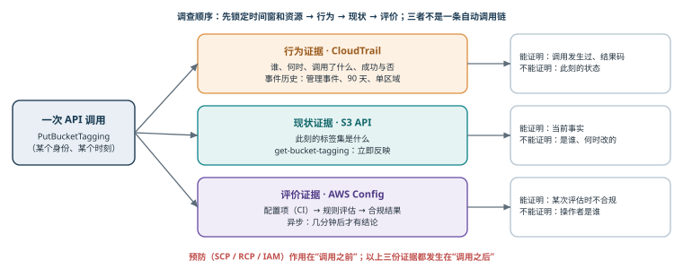
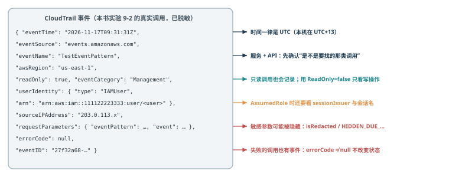
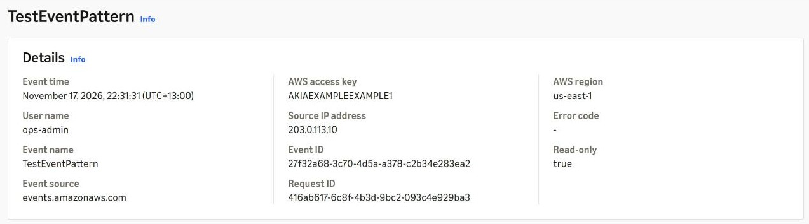
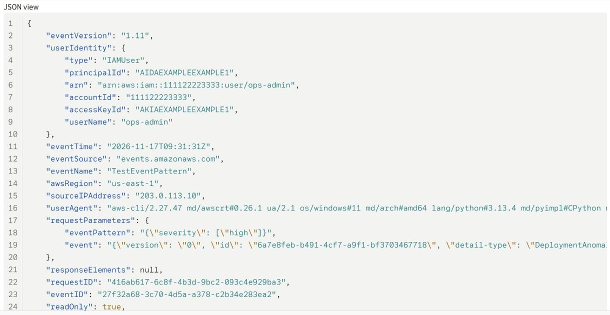
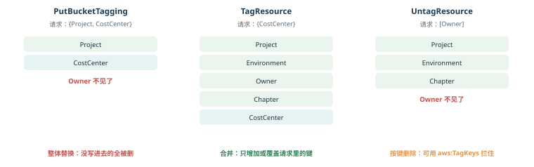
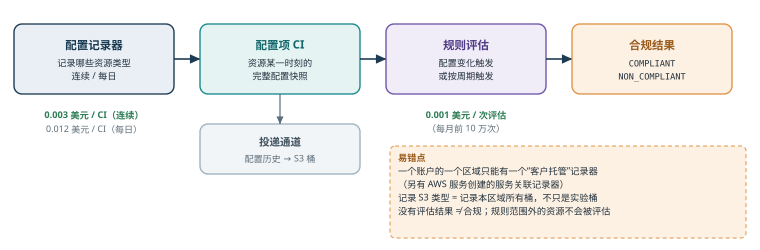
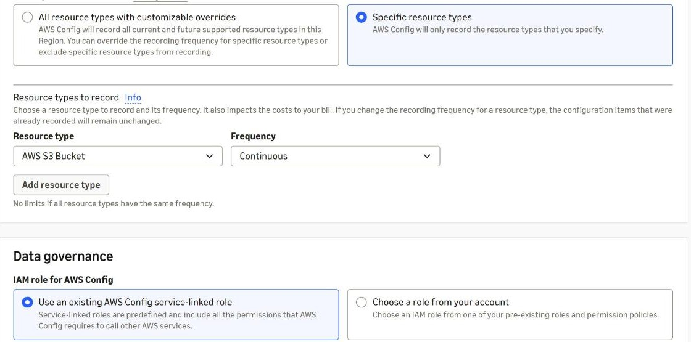
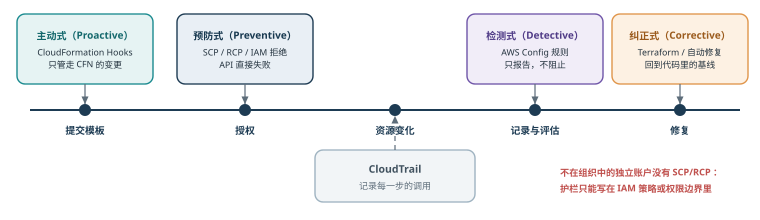

::::: cover
[第 11 讲 · 审计与合规 ①]{.kicker}

<h1>CloudTrail × Config：<br>谁改了配置？现在还合规吗？</h1>

[一次变更会留下三份证据：CloudTrail 记录行为，S3 API 给出现状，AWS Config 给出评价。本讲用一个空桶上“消失的 Owner 标签”讲清楚三份证据各自能证明什么，再加上一道能被模拟器验证的护栏。]{.subtitle}

::: cover-meta
- **讲次**：11 / 19
- **建议学时**：4 课时（讲授 2 + 实验 2）
- **实验费用**：Part A 近乎 0；启用 Config 一轮约 0.02 美元
- **适用版本**：CloudTrail 事件历史；AWS Config（2026）；S3 ABAC（2025-11）
:::

::: scenario
测试账户里一个存储桶的 Owner 标签突然不见了，成本分摊报表因此漏掉了它。同事说：“我只是给它加了一个 CostCenter 标签。”值班工程师要回答三个问题：**谁在什么时候改的？现在的状态合不合规？以后能不能让这件事根本发生不了？**
:::

## 学习目标 {.nonum}

:::: cards
::: {.card title="理解"}
- 行为、现状、评价三种证据的分工
- 事件历史的边界与事件字段的含义
- 配置记录器、配置项、规则、投递通道
:::
::: {.card title="推理"}
- 从一条事件推出能下和不能下的结论
- 解释“加一个标签却删了一个标签”
- 选择预防、主动、检测、纠正控制
:::
::: {.card title="实操"}
- 只读查询真实事件历史并自动脱敏
- 护栏策略经 IAM 模拟器 6/6 验证
- Terraform：空桶 + 可选的 Config 规则
:::
::: {.card title="排障"}
- 事件历史里查不到
- Config 一直没有评估结果
- 投递通道 AccessDenied
:::
::::

| 本讲结构 | 要回答的问题 | 产出 |
|---|---|---|
| 一、三份证据 | CloudTrail 为什么不能代替 Config？ | 证据分工图、结论边界表 |
| 二、行为证据 | 一条事件能证明什么？ | 真实事件解剖、ctquery |
| 三、根因 | 为什么“加一个标签”会删掉 Owner？ | 三种标签 API 的语义 |
| 四、评价证据 | Config 怎样发现不合规？ | 记录器与规则、费用 |
| 五、护栏 | 怎样让这件事发生不了？ | 控制类型、可验证的护栏 |
| 六～八、实操与练习 | 一轮完整取证怎么做？ | Terraform、脚本、例题、故障卡、练习 |
:::::

::: {.opener .nobreak}
[一 · 三份证据]{.kicker}

# CloudTrail 为什么不能代替 Config？

[一次 API 调用，三个系统各留下一份证据，回答三个不同的问题。把它们当成一条自动调用链，或者用其中一份去回答另一份的问题，是审计结论出错的主要原因。]{.subtitle}
:::



| 观察到的事实 | 可以下的结论 | 不能下的结论 |
|---|---|---|
| CloudTrail 有一条成功的 PutBucketTagging | 某个身份在某个时刻调用过它 | 桶现在仍是那次调用后的状态 |
| CloudTrail 的事件带 `errorCode: AccessDenied` | 这次请求被拒绝了 | 没有别人用其他方式改过这个桶 |
| Config 显示 NON_COMPLIANT | 某次评估时，规则条件不满足 | 已经找到了操作者 |
| Config 显示 COMPLIANT | 该规则的条件在评估时满足 | 桶没有其他安全问题 |
| Config 没有任何评估结果 | 记录器或规则没有覆盖到它 | 它是合规的 |

::: {.opener}
[二 · 行为证据]{.kicker}

# 一条 CloudTrail 事件能证明什么？

[事件历史不用任何配置就能查最近 90 天的管理事件。先弄清它的边界，再学会读一条事件的关键字段。]{.subtitle}
:::

## 事件历史的边界

| 维度 | 事件历史（无需配置） | 需要长期或更全的记录时 |
|---|---|---|
| 事件类型 | 只有**管理事件**（读和写都有）；没有数据事件（如 GetObject）、Insights 事件、网络活动事件 | 创建跟踪（trail）并按需开启数据事件 |
| 时间与范围 | 最近 90 天；单账户、单区域 | 跟踪写入 S3，留存时长自己定；组织跟踪覆盖所有账户 |
| 查询能力 | 一次只能按一个属性过滤，外加时间范围 | 把跟踪写到 CloudWatch Logs 后用 Logs Insights 查（第 09 讲） |
| 费用 | 查看不收费 | 第一份管理事件副本免费；额外副本 2.00 美元/10 万条；数据事件 0.10 美元/10 万条 |

::: warn
**CloudTrail Lake 已不再向新客户开放（2026-05-31 起）。** 已在使用的客户不受影响；新的跨区域、多属性查询需求，AWS 建议改用 Amazon CloudWatch（例如把跟踪送入 CloudWatch Logs）。本书实验账户中没有任何跟踪，也没有 Lake 事件数据存储（只读查询确认）。
:::

## 读一条真实的事件

下面是本书第 09 讲实验 9-2 调用 `TestEventPattern` 时，CloudTrail 在本账户留下的真实记录（经 `ctquery.py` 自动脱敏）：



在控制台的 Event history 里打开同一条事件：Details 区回答“谁、何时、从哪里、用哪把密钥”（图 11-3），Event record 是完整 JSON（图 11-4）。注意两处时间的差别：列表与 Details 显示浏览器本地时间（22:31:31，UTC+13:00），JSON 里的 `eventTime` 是 UTC（09:31:31Z）——写时间线时一律用 UTC。

{.shot}

{.shot width=76%}

:::: {.lab title="实验 11-1｜ctquery：只读查询事件历史，输出前自动脱敏"}
::: labmeta
- **目标**：按一个属性查事件，只保留调查需要的字段
- **时长**：15 分钟
- **费用**：0 元（LookupEvents 不收费）
- **权限**：`cloudtrail:LookupEvents`
:::

`labs/02-ctquery/ctquery.py` 调用 `aws cloudtrail lookup-events`，按事件名、资源名或事件源查询，并把账户号、IP、访问密钥、用户名与会话名替换成占位符后再打印（3 个单元测试验证脱敏不漏）。在本书实验账户中实际运行：

```{.console title="python ctquery.py …（本书实测输出，2026-11-18，us-east-1）"}
$ python ctquery.py --name TestEventPattern --hours 48 --max 1
EventName=TestEventPattern，最近 48 小时，us-east-1：1 条
  eventTime          2026-11-17T09:31:31Z
  eventSource        events.amazonaws.com
  readOnly           True
  errorCode          -
  identity           IAMUser
  requestParameters  event, eventPattern

$ python ctquery.py --name SimulateCustomPolicy --hours 48 --max 1
  eventTime          2026-11-17T22:40:31Z
  readOnly           True
  requestParameters  （CloudTrail 已隐藏：HIDDEN_DUE_TO_SECURITY_REASONS）

$ python ctquery.py --name PutBucketTagging --hours 2160
EventName=PutBucketTagging，最近 2160 小时，us-east-1：0 条
```

三个细节：时间是 UTC（本机处在 UTC+13，本地看是 11 月 18 日上午）；只读调用也被记录；IAM 策略模拟的请求参数被 CloudTrail 主动隐藏——**事件里看不到参数，不代表请求没有参数**。最后一条说明本账户 90 天内没有人改过桶标签——事件历史只覆盖 90 天，再早的事就要靠跟踪。
::::

::: pitfalls
1. **AssumedRole 不等于自然人。** 看到 `type: AssumedRole` 时，要沿 `sessionIssuer` 找到角色，再用会话名和身份中心的登录记录对应到人。
2. **区域要对。** 事件记录在“调用发生的区域”。S3 桶的管理事件记录在桶所在的区域；IAM 等全球服务的事件记录在 us-east-1。
3. **刚发生的事件要等几分钟。** 事件历史有短暂的投递延迟，查不到时先确认时间窗，不要急着去建跟踪。
:::

::: {.opener}
[三 · 根因]{.kicker}

# 为什么“加一个标签”会删掉 Owner？

[同事没有说谎，他确实只想加一个标签。问题出在 API 的语义：PutBucketTagging 不是“添加”，而是“整体替换”。]{.subtitle}
:::



2025 年 11 月起，S3 通用存储桶支持**基于属性的访问控制（ABAC）**：按桶开启后，可以用桶标签写授权条件；与此同时，开启 ABAC 的桶会**拒绝 PutBucketTagging**，标签只能通过 `TagResource` / `UntagResource` 管理——它们是“合并”和“按键删除”，并且可以用 `aws:TagKeys`、`aws:RequestTag` 写条件。ABAC 默认关闭，存量脚本里的 PutBucketTagging 会继续生效，直到有人开启它。

:::: {.lab title="实验 11-2｜s3tagged：回放事故，并复现规则的判定"}
::: labmeta
- **目标**：用代码复现三种标签 API 与托管规则 S3_BUCKET_TAGGED 的语义
- **时长**：15 分钟
- **费用**：0 元
- **工具**：Python 3.11+
:::

```{.console title="python s3tagged.py；python s3tagged.py --abac（本书实测输出）"}
时间   操作                                      Owner         S3_BUCKET_TAGGED
09:00  Terraform 创建的基线                      cloudops-lab  COMPLIANT
       标签：Chapter, Environment, Owner, Project
09:03  PutBucketTagging 只写了两个标签           （无）        NON_COMPLIANT
       标签：CostCenter, Project
09:10  terraform apply 回到代码里的标签集        cloudops-lab  COMPLIANT
       标签：Chapter, Environment, Owner, Project

09:03  TagResource 只加 CostCenter               cloudops-lab  COMPLIANT
       标签：Chapter, CostCenter, Environment, Owner, Project
09:05  UntagResource Owner（被拒，见实验 11-3）  cloudops-lab  COMPLIANT
```

规则逻辑按官方说明实现：没有任何标签为 NON_COMPLIANT；指定 `requiredKeyTags`（逗号分隔、区分大小写）时缺任何一个键为 NON_COMPLIANT；以 `aws:` 开头的标签不计入（7 个单元测试）。注意 09:10 这一行：`terraform apply` 恢复的是**代码里的**标签集，同事加的 CostCenter 也会被删掉——想保留它，就把它写进代码。
::::

::: {.opener}
[四 · 评价证据]{.kicker}

# AWS Config 怎样发现“不合规”？

[Config 不监听 API，它记录资源的配置快照，再拿规则去评价快照。所以它回答的是“状态对不对”，而且总比变更晚一点。]{.subtitle}
:::



| 组件 | 本章的选择 | 为什么 |
|---|---|---|
| 配置记录器 | 只记录 `AWS::S3::Bucket`，连续记录 | 降低配置项数量；但仍会记录本区域**所有**桶 |
| 记录器角色 | 账户已有的服务关联角色 AWSServiceRoleForConfig | 官方推荐；不必自建角色 |
| 投递通道 | 专用桶，策略限定 `aws:SourceAccount` | 防止别的账户借用 Config 写入（混淆代理） |
| 规则 | S3_BUCKET_TAGGED，`requiredKeyTags = Owner`，范围只含实验桶 | 只评估一个资源，结果清楚、费用低 |

控制台的设置向导把前两行做成了表单（图 11-7）：记录策略选“特定资源类型”、资源类型 AWS S3 Bucket、频率 Continuous，角色用已有的服务关联角色。向导第三步才会真正创建记录器和投递通道——本书只填表、没有确认。

{.shot width=62%}

两条硬约束：一个账户的一个区域只能有**一个客户托管的配置记录器**（AWS 服务还可以创建自己的服务关联记录器），已有时要复用而不是再建；S3_BUCKET_TAGGED 在部分区域不可用（官方列出的例外包括 Asia Pacific (New Zealand)、Mexico (Central)、GovCloud 等），选区域前先查规则页。

本书实验账户 us-east-1 的现状（`scripts/preflight.sh`，只读）：没有任何配置记录器、投递通道和规则，服务关联角色已存在，账户中没有任何 S3 桶——所以启用 Part B 时，记录器只会记录实验自己的两个桶。按 Price List API 的单价（连续记录 0.003 美元/配置项，规则评估 0.001 美元/次），一轮“基线 → 漂移 → 恢复”大约产生 4～6 个配置项和几次评估，约 0.02 美元。

::: {.opener}
[五 · 护栏]{.kicker}

# 怎样让这件事根本发生不了？

[Config 只能事后报告。要“发生不了”，必须在授权阶段拒绝——而且拒绝条件要写得足够精确，只挡住危险操作。]{.subtitle}
:::



| 控制 | 典型技术 | 生效时机 | 局限 |
|---|---|---|---|
| 预防式 | SCP、RCP、IAM 中的 Deny | API 授权时 | SCP/RCP 只在 AWS Organizations 中可用，且不授予权限、不影响管理账户 |
| 主动式 | CloudFormation Hooks（Control Tower 主动控制） | 通过 CFN 部署前 | 拦不住直接调用 API、CLI 或 Terraform |
| 检测式 | AWS Config 规则 | 资源变化后 / 周期评估 | 只报告，不阻止 |
| 纠正式 | Terraform、自动修复 | 发现之后 | 会顺带抹掉代码之外的合法改动 |

:::: {.lab title="实验 11-3｜保护 Owner 标签：6 个判定交给 IAM 策略模拟器"}
::: labmeta
- **目标**：证明护栏只挡住“删除 Owner”和“整体替换”，不妨碍正常打标签
- **时长**：15 分钟
- **费用**：0 元
- **权限**：`iam:SimulateCustomPolicy`
:::

`labs/03-guardrail/protect-owner-tag.json` 的核心是两条 Deny：对 `s3:UntagResource`，只要 `aws:TagKeys` 中**任何一个**是 Owner 就拒绝（`ForAnyValue:StringEquals`）；对 `s3:PutBucketTagging` 一律拒绝，迫使所有人改用只会合并的 TagResource。

```{.console title="python gsim.py --live（本书实测输出，2026-11-18）"}
G1  s3:UntagResource     TagKeys=Owner              预期=explicitDeny AWS=explicitDeny ✓
G2  s3:UntagResource     TagKeys=CostCenter         预期=allowed      AWS=allowed      ✓
G3  s3:UntagResource     TagKeys=CostCenter,Owner   预期=explicitDeny AWS=explicitDeny ✓
G4  s3:TagResource       TagKeys=CostCenter         预期=allowed      AWS=allowed      ✓
G5  s3:PutBucketTagging  TagKeys=-                  预期=explicitDeny AWS=explicitDeny ✓
G6  s3:GetBucketTagging  TagKeys=-                  预期=allowed      AWS=allowed      ✓

6 个用例，不一致：0
```

同一份策略分别以 IAM 策略和 SCP 的类型交给 Access Analyzer `validate-policy`，都没有任何发现。G3 说明了 `ForAnyValue` 的作用：一次删多个键时，只要其中有 Owner 就整体拒绝。本书账户不在 AWS Organizations 中（`describe-organization` 返回 AWSOrganizationsNotInUseException），所以这里验证的是策略逻辑；在组织中，把它作为 SCP 挂到 OU 之前，还要在隔离的成员账户里演练并准备回滚。
::::

::: {.opener}
[六 · 实操]{.kicker}

# 一轮完整的取证：基线 → 漂移 → 调查 → 恢复

[Terraform 默认只建一个空的私有桶；Config 是独立的计费开关。每一步都用与 Terraform 无关的查询取证。]{.subtitle}
:::

:::: {.lab title="实验 11-4｜Terraform：空桶 + 可选的 Config 规则"}
::: labmeta
- **目标**：固定基线（标签、公共访问阻止、ACL 失效、加密），并按需加上检测
- **时长**：20 分钟
- **费用**：Part A 近乎 0；Part B 一轮约 0.02 美元
- **前提**：先运行 `scripts/preflight.sh`
:::

```{.hcl title="labs/04-terraform/main.tf（节选）· 记录器与规则"}
resource "aws_config_configuration_recorder" "this" {
  count    = local.config
  name     = "a11-recorder"
  role_arn = local.slr_arn                                  # 已有的服务关联角色 AWSServiceRoleForConfig
  recording_group {
    all_supported                 = false
    include_global_resource_types = false
    resource_types                = ["AWS::S3::Bucket"]    # 仍会记录本区域所有桶
    recording_strategy { use_only = "INCLUSION_BY_RESOURCE_TYPES" }
  }
  recording_mode { recording_frequency = "CONTINUOUS" }   # DAILY 更便宜，但最多晚一天
}

resource "aws_config_config_rule" "owner_tag" {
  count            = local.config
  name             = "a11-s3-requires-owner-tag"
  input_parameters = jsonencode({ requiredKeyTags = "Owner" })
  source {
    owner             = "AWS"
    source_identifier = "S3_BUCKET_TAGGED"
  }
  scope {
    compliance_resource_types = ["AWS::S3::Bucket"]
    compliance_resource_id    = aws_s3_bucket.lab.bucket   # 只评估实验桶
  }
  depends_on = [aws_config_configuration_recorder_status.this]
}
```

```{.console title="terraform test 与只读 plan（本书实测输出，2026-11-18）"}
$ terraform test
  run "part_a_is_private_and_tagged"... pass
  run "config_is_opt_in"... pass
  run "config_needs_a_delivery_bucket"... pass
  run "config_records_only_buckets_with_the_slr"... pass
  run "bucket_name_is_validated"... pass
Success! 5 passed, 0 failed.

$ terraform plan -var bucket_name=a11-lab01-demo-2611
Plan: 4 to add, 0 to change, 0 to destroy.
$ terraform plan … -var enable_config=true -var config_bucket_name=a11-lab01-config-2611
  + role_arn = "arn:aws:iam::111122223333:role/aws-service-role/config.amazonaws.com/
                AWSServiceRoleForConfig"            # 实测输出为一行，此处为排版折行
Plan: 11 to add, 0 to change, 0 to destroy.
```
::::

```{.bash title="在 labs/04-terraform 目录中依次执行（实验账户）"}
./scripts/preflight.sh                          # ⓪ 只读盘点：已有记录器 / 通道就停下来
B=a11-<你的后缀>                                  #    桶名全球唯一
terraform apply -var bucket_name=$B -var enable_config=true -var config_bucket_name=$B-cfg
./scripts/investigate.sh                        # ① 基线：Owner 在；规则 COMPLIANT（首次评估要等几分钟）
./scripts/drift.sh                              # ② 复现事故：PutBucketTagging {Project, CostCenter}
./scripts/investigate.sh us-east-1 2            # ③ 取证：事件 + 现状（缺 Owner）+ 评价
terraform apply …（同上参数）                   # ④ 恢复：plan 中可以看到标签被改回
./scripts/investigate.sh                        #    规则重新评估为 COMPLIANT
terraform destroy …（同上参数）
```

::: warn
实验 11-4 的阶段性结果由机制推导得出；本书遵循只读原则，没有在账户中创建桶、启用 Config 或修改标签。`preflight.sh` 与 `ctquery.py` 是只读的，书中输出为真实运行结果。Config 的投递桶设置了 `force_destroy = true`，仅适用于实验；生产中的配置历史要按留存要求保存。
:::

::: {.opener}
[七 · 综合与排障]{.kicker}

# 把三份证据写成一份调查结论

[先给事实和时间，再推结论；每个结论都标明它来自哪份证据。]{.subtitle}
:::

:::: {.example title="例题 11-1｜“Owner 标签不见了”的调查结论"}
已知（UTC）：09:00 桶标签含 Owner（Terraform 基线）；09:03 CloudTrail 有一条成功的 PutBucketTagging，身份为 AssumedRole `OpsRole/<session>`，请求中的标签只有 Project 与 CostCenter；09:08 Config 规则判定 NON_COMPLIANT；09:10 `terraform apply` 恢复标签；09:14 规则重新判定 COMPLIANT。求：根因、责任链与防再发措施。

::: steps
1. **定位行为。** 用事件名 + 桶名 + 时间窗在事件历史中找到 09:03 的调用；`errorCode` 为空，说明请求成功；会话名对应到具体的人。
2. **核对现状。** `get-bucket-tagging` 只返回 Project、CostCenter——与请求中的标签集完全一致，印证“整体替换”。
3. **解释评价。** 09:08 的 NON_COMPLIANT 来自 09:03 之后生成的配置项；五分钟的间隔是 Config 的异步记录与评估，不是第二次修改。
4. **确认恢复。** 恢复后同一条规则对同一个桶重新评估为 COMPLIANT；同时提醒同事：CostCenter 也被恢复动作删除了，需要写进代码。
5. **防再发。** 按实验 11-3 部署护栏：禁止 PutBucketTagging、禁止删除 Owner；Config 规则保留，作为护栏失效时的检测。
:::

::: answer
根因是使用了整体替换语义的 PutBucketTagging（行为证据：09:03 的事件；现状证据：标签集与请求一致）。Config 在 09:08 发现不合规（评价证据），09:10 由 Terraform 纠正、09:14 复评合规。责任链指向 OpsRole 的那个会话，但这是“操作失误”而不是“恶意”——事件里的请求参数和同事的陈述一致。防再发靠预防式护栏，而不是只加一条告警。
:::
::::

::: {.fault title="故障 1｜事件历史里查不到 PutBucketTagging"}
现象
:   确定刚改过标签，按事件名查却是 0 条。

根因
:   区域不对（应查桶所在区域）；时间窗没有覆盖（事件时间是 UTC）；刚发生，还在投递中；或者对开启了 ABAC 的桶用的是 TagResource，事件名不是 PutBucketTagging。

修复
:   改按资源名（桶名）查，放宽时间窗，几分钟后再查。
:::

::: {.fault title="故障 2｜Config 规则一直没有评估结果"}
现象
:   规则建好半小时，控制台里没有任何资源的评估结果。

根因
:   记录器没有启动（缺 `recorder_status` 或 `is_enabled = false`）；记录的资源类型不包含 S3 桶；规则范围写错了桶名；投递通道建立失败导致记录器无法启动。

修复
:   `describe-configuration-recorder-status` 看 `recording` 与 `lastStatus`；核对规则的 scope。记住：没有结果不等于合规。
:::

::: {.fault title="故障 3｜投递通道创建失败：AccessDenied 或 InsufficientDeliveryPolicy"}
现象
:   `terraform apply` 在创建投递通道时报错。

根因
:   投递桶策略缺少 GetBucketAcl / ListBucket / PutObject 三条中的某一条，或 PutObject 的路径不是 `AWSLogs/<账户>/Config/*`，或缺少 `s3:x-amz-acl = bucket-owner-full-control` 条件。

修复
:   按实验 11-4 的三条语句写策略，并保留 `aws:SourceAccount` 条件；不要把桶策略放宽成 `s3:*`。
:::

::: {.fault title="故障 4｜想再建一个记录器，API 报 MaxNumberOfConfigurationRecordersExceeded"}
现象
:   别的团队已经在这个区域启用了 Config，本章的 Terraform 创建记录器失败。

根因
:   一个账户的一个区域只能有一个客户托管的配置记录器。

修复
:   复用现有记录器：只创建本章的规则（确认现有记录器记录了 S3 桶），不要用 Terraform 接管或覆盖别人的记录器。
:::

::: {.fault title="故障 5｜护栏上线后，部署流水线突然失败"}
现象
:   某个流水线在给桶打标签时报 AccessDenied。

根因
:   流水线还在用 PutBucketTagging 设置完整标签集，被护栏一并拒绝。

修复
:   改用 TagResource（或在创建桶时直接带上标签）；上线护栏前，先用 CloudTrail 按事件名找出所有还在调用 PutBucketTagging 的身份。
:::

::: {.opener}
[八 · 练习]{.kicker}

# 练一练：你能分清三份证据吗？

[先独立作答，再对照解析。]{.subtitle}
:::

## 随堂练习

::: {.exercise title="练习 1｜事件类型"}
在事件历史中能查到某个对象的 GetObject 吗？如果需要，应该怎么做？
:::

::: {.exercise title="练习 2｜失败的调用"}
CloudTrail 中有一条 PutBucketTagging，`errorCode` 为 AccessDenied。桶的标签被改了吗？还需要什么证据？
:::

::: {.exercise title="练习 3｜合规"}
Config 对某个桶显示 COMPLIANT，能否说明这个桶是安全的？
:::

::: {.exercise title="练习 4｜记录器"}
账户里已有别的团队创建的配置记录器，你还能用 Terraform 再建一个吗？
:::

::: {.exercise title="练习 5｜SCP"}
SCP 会给角色授予 `s3:TagResource` 权限吗？一个不在组织中的账户能用 SCP 吗？
:::

::: {.exercise title="练习 6｜主动控制"}
把“桶必须有 Owner 标签”做成 CloudFormation Hook，能拦住同事用 CLI 执行的 PutBucketTagging 吗？
:::

## 参考答案与解析

::: {.solution title="1"}
不能。GetObject 是数据事件，事件历史只有管理事件。需要创建跟踪（或其他记录方式）并为该桶开启 S3 数据事件，按 0.10 美元/10 万条计费。
:::

::: {.solution title="2"}
这次请求没有改变标签——失败的调用不改变状态。但它不能证明别人没有用别的方式改过：要用 `get-bucket-tagging` 看现状，并按资源名查同一时间窗内的其他事件。
:::

::: {.solution title="3"}
不能。COMPLIANT 只说明“这条规则”在“那次评估”时条件满足；公共访问、加密、策略等问题要由别的规则或检查回答。
:::

::: {.solution title="4"}
不能。每个账户每个区域只能有一个客户托管的记录器。应复用现有记录器，只增加规则。
:::

::: {.solution title="5"}
不会。SCP 只限定成员账户中身份的“最大权限”，从不授予权限；权限仍要由 IAM 策略授予。SCP 是 AWS Organizations 的功能，不在组织中的独立账户不能使用，只能在 IAM 策略或权限边界里写 Deny。
:::

::: {.solution title="6"}
不能。Hook 只在 CloudFormation 部署资源时生效；直接调用 API 或 CLI 的变更绕过 CloudFormation。要拦住它，需要预防式控制（IAM / SCP 的 Deny）。
:::

## 这一讲，你应该记住 {.nonum}

:::: summary
::: {.card tag="分工"}
**行为 · 现状 · 评价**

CloudTrail、S3 API、Config 各答一题。
:::
::: {.card tag="事件"}
**UTC、读写都记、可能隐藏参数**

事件历史：管理事件、90 天、单区域。
:::
::: {.card tag="根因"}
**PutBucketTagging 是整体替换**

TagResource 合并，UntagResource 按键删。
:::
::: {.card tag="护栏"}
**预防在授权时，检测在变化后**

用模拟器证明护栏只挡危险操作。
:::
::::

::: refs
## 参考资料 {.nonum}

[实测说明：查询、现状、护栏判定与校验均为 us-east-1 只读调用；价格来自 Price List API（2026-11-18）；图 11-3、11-4、11-7 为 2026-11-18 控制台实拍（敏感值已在页面中替换，未提交任何表单）。]{.small}

1. CloudTrail 事件历史 <https://docs.aws.amazon.com/awscloudtrail/latest/userguide/view-cloudtrail-events.html>；Lake 可用性变化 <https://docs.aws.amazon.com/awscloudtrail/latest/userguide/cloudtrail-lake-service-availability-change.html>
2. s3-bucket-tagged <https://docs.aws.amazon.com/config/latest/developerguide/s3-bucket-tagged.html>；投递桶权限 <https://docs.aws.amazon.com/config/latest/developerguide/s3-bucket-policy.html>
3. S3 通用存储桶 ABAC <https://aws.amazon.com/blogs/aws/introducing-attribute-based-access-control-for-amazon-s3-general-purpose-buckets>
:::
