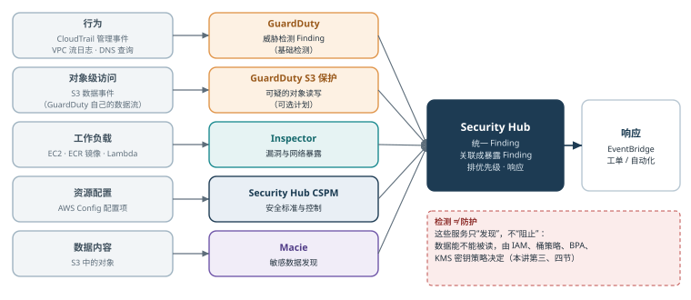
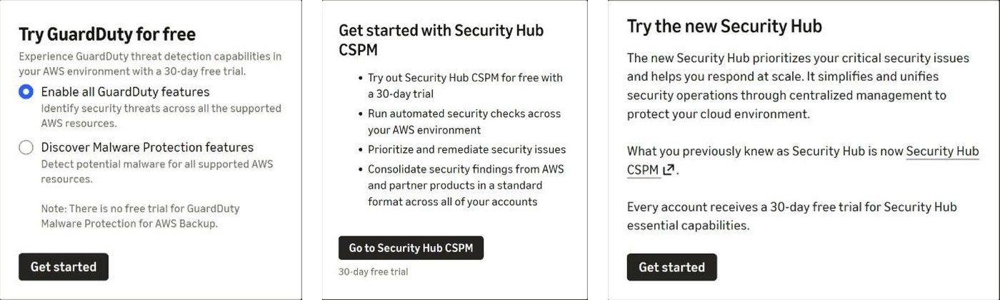
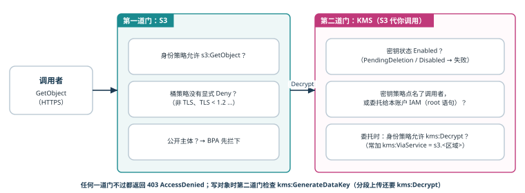
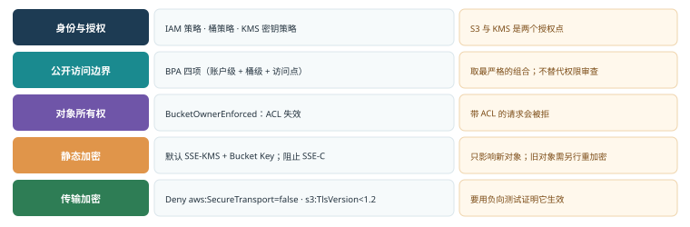
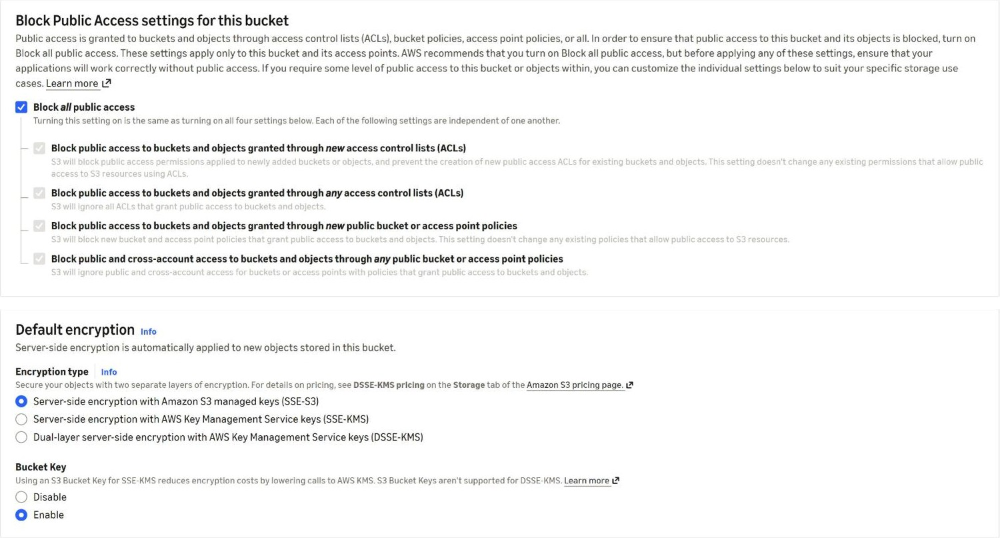
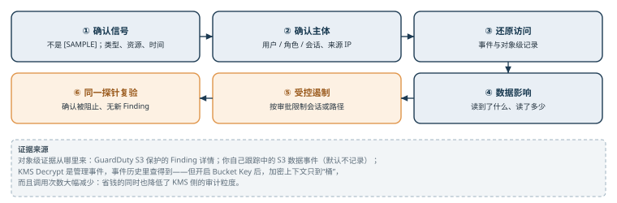

::::: cover
[第 12 讲 · 审计与合规 ②]{.kicker}

<h1>安全检测与数据保护：<br>配置合规了，数据就安全吗？</h1>

[检测服务回答“有没有可疑的事”，数据保护控制回答“谁能读到数据”。本讲先分清各个安全服务各看什么，再把 SSE-KMS 的读写拆成 S3 与 KMS 两道门逐一验证。]{.subtitle}

::: cover-meta
- **讲次**：12 / 19
- **建议学时**：4 课时（讲授 2 + 实验 2）
- **实验费用**：本地与模拟器 0 元；数据桶约 1 美元/月（KMS 密钥）
- **适用版本**：Security Hub（2025 新版）与 Security Hub CSPM；S3 默认阻止 SSE-C（2026-04）
:::

::: scenario
一个账户的 Terraform plan 与配置检查全部通过：存储桶阻止了公开访问、默认 SSE-KMS 加密、只接受 HTTPS。几小时后，GuardDuty 却报告了一条“异常的对象读取”。安全负责人问：**加密了、合规了，数据为什么还能被读走？那条 Finding 又该怎么查？**
:::

## 学习目标 {.nonum}

:::: cards
::: {.card title="理解"}
- 检测类服务各自的观察对象与输出
- SSE-KMS 读写的两道授权门
- S3 数据保护的五层控制
:::
::: {.card title="推理"}
- 由 403 判断卡在 S3 门还是 KMS 门
- 判断一条 Finding 能证明什么
- 识别“合规但不安全”的配置
:::
::: {.card title="实操"}
- 两道门模型推理 10 个场景
- 桶策略经 IAM 模拟器验证；看清模拟器的边界
- Terraform：密钥职责分离的数据桶
:::
::: {.card title="排障"}
- PutObject / GetObject 的 AccessDenied
- 带 ACL 的上传被拒
- 事件历史里找不到 GetObject
:::
::::

| 本讲结构 | 要回答的问题 | 产出 |
|---|---|---|
| 一、谁在看什么 | GuardDuty、Inspector、CSPM、Security Hub 有何不同？ | 信号地图、账户现状 |
| 二、两道门 | 加密了，为什么还能被读走？ | SSE-KMS 授权模型 |
| 三、策略验证 | 怎样证明 TLS 策略和密钥策略真的生效？ | 模拟器实测与它的局限 |
| 四、五层控制 | 一个“合规”的桶由哪些控制组成？ | Terraform 数据桶 |
| 五～七、调查与练习 | 收到 Finding 后怎么查？ | 调查流程、故障卡、练习 |
:::::

::: {.opener .nobreak}
[一 · 谁在看什么]{.kicker}

# 检测服务各看什么？

[它们都把结果送进 Security Hub，但观察对象、检测方法和能证明的事情完全不同。先问“它看的是什么”，再问“它说的是什么”。]{.subtitle}
:::



| 服务 | 观察对象 | 输出 | 不能证明的事 |
|---|---|---|---|
| GuardDuty | CloudTrail 管理事件、VPC 流日志、DNS 查询；可选的 S3 保护等计划 | 威胁检测 Finding（可疑行为） | Finding 不是数据泄露的最终证据 |
| Inspector | EC2、ECR 镜像、Lambda | 软件漏洞、网络暴露 | 某次 API 调用是否恶意 |
| Security Hub CSPM | 资源配置（依赖 AWS Config 记录） | 安全标准与控制的通过 / 失败 | “控制通过”不代表没有攻击 |
| Macie | S3 中的对象内容 | 敏感数据发现 | 谁读过这些数据 |
| Security Hub（新） | 上述服务的 Finding | 关联成“暴露 Finding”、排优先级、响应 | 它本身不是检测引擎 |

2025 年起，原来的 Security Hub 更名为 **Security Hub CSPM**（专注安全标准与控制），新的 **Security Hub** 在其上关联 CSPM、GuardDuty、Inspector、Macie 的结果，生成“暴露 Finding”（可能的攻击路径）。本书实验账户 us-east-1 的现状（`labs/02-posture/posture.sh`，只读）：

```{.console title="./posture.sh（本书实测输出，2026-11-18，账户号已替换）"}
GuardDuty 检测器数          0
Security Hub CSPM           … Account 111122223333 is not subscribed to AWS Security Hub CSPM
Inspector                   DISABLED
Macie                       … Macie is not enabled
账户级 S3 BPA               … The public access block configuration was not found
AWS 托管密钥 aws/s3         AWS    Enabled
本区域 KMS 密钥总数         6
```

注意 API 自己的报错已经使用“Security Hub CSPM”这个名字。另一个值得记下的现状：**账户级 BPA 没有配置**——2023 年 4 月以后新建的桶默认开启桶级 BPA，但账户级设置要自己开；它能兜住“将来某个桶被人手动关掉 BPA”的情况。

三个服务在控制台里的入口页说的是同一件事（图 12-2）：GuardDuty 与 Security Hub CSPM 都处在“未启用、可试用 30 天”的状态；新 Security Hub 的入口页直接写明“过去的 Security Hub 现在叫 Security Hub CSPM”。试用期结束后按量计费，所以实验做完要记得关闭。

{.shot}

::: pitfalls
1. **样例 Finding 不是事件。** GuardDuty 控制台或 `create-sample-findings` 生成的样例，标题带 `[SAMPLE]`、详情里 `sample: true`，只用于测试展示、筛选和自动化流程。
2. **S3 保护不需要你建跟踪。** GuardDuty 的 S3 保护用自己的数据流分析对象级 API；你自己的跟踪默认不记录 S3 数据事件，事件历史里也查不到 GetObject——两者是两条独立的路径。
3. **检测服务按账户和区域开启。** 一个区域没开，就是那个区域的盲区；组织内应由委派管理员统一开启。
:::

::: {.opener}
[二 · 两道门]{.kicker}

# 加密了，数据为什么还能被读走？

[SSE-KMS 保护的是“磁盘上的数据”，不是“有权限的人”。一个同时拥有 s3:GetObject 与 kms:Decrypt 的身份读取对象，正是加密设计要允许的事。]{.subtitle}
:::



KMS 的授权规则与其他服务不同：**除非密钥策略允许，任何 IAM 策略都无法授予对密钥的访问。**密钥策略可以直接点名主体，也可以用一条“委托给本账户”（`Principal` 为账户 root）的语句，把决定权交给 IAM——此时调用者自己的身份策略还要允许对应的 `kms:` 动作。写对象时第二道门检查 `kms:GenerateDataKey`，分段上传在合并时还要 `kms:Decrypt`。

:::: {.lab title="实验 12-1｜twogates：10 个场景，看清卡在哪一道门"}
::: labmeta
- **目标**：由配置推出读写结果，以及失败发生在哪道门
- **时长**：20 分钟
- **费用**：0 元
- **工具**：Python 3.11+
:::

```{.console title="python twogates.py scenarios.json（本书实测输出，节选）"}
T2   reader 用 HTTP 读取
     S3 门：桶策略显式拒绝：aws:SecureTransport = false
     KMS 门：未到达
     → AccessDenied（S3 门）
T3   只有 s3:GetObject、没有 kms:Decrypt 的 auditor
     S3 门：允许 s3:GetObject
     KMS 门：密钥策略委托给 IAM，但身份策略缺少 kms:Decrypt
     → AccessDenied（KMS 门）
T5   writer 只有 GenerateDataKey，分段上传大文件
     S3 门：允许 s3:PutObject
     KMS 门：密钥策略委托给 IAM，但身份策略缺少 kms:Decrypt
     → AccessDenied（KMS 门）
T10  对象是 SSE-S3（旧对象，默认加密改动前上传）
     S3 门：允许 s3:GetObject
     KMS 门：对象不是 SSE-KMS：不经过 KMS
     → 成功
```

T3 与 T10 是同一个 auditor：读新对象失败、读旧对象成功——默认加密只作用于**之后上传**的对象。5 个单元测试覆盖全部 10 个场景。
::::

:::: {.example title="例题 12-1｜同一个 403，卡在哪道门？"}
已知：桶默认 SSE-KMS（客户托管密钥，密钥策略含委托给本账户的 root 语句）、只接受 TLS。角色 `report-job` 的身份策略只有 `s3:GetObject`。它通过 HTTPS 读取一个新上传的对象，得到 403 AccessDenied。求：卡在哪道门？最小修复？

::: steps
1. **先看 S3 门。** HTTPS 请求不触发 TLS 拒绝；身份策略允许 GetObject；不是公开主体 → S3 门通过。
2. **再看 KMS 门。** 新对象是 SSE-KMS → S3 代为调用 Decrypt；密钥策略委托给 IAM → 需要 `report-job` 的身份策略允许 `kms:Decrypt`，而它没有。
3. **最小修复。** 只给 `report-job` 增加对该密钥 ARN 的 `kms:Decrypt`，并加 `kms:ViaService = s3.us-east-1.amazonaws.com` 条件——它只能经由 S3 解密，不能拿密钥去解别的东西。
4. **复验。** 同一个请求再读一次；同时确认它仍然不能用 HTTP 读取。
:::

::: answer
卡在 KMS 门。错误信息里通常会提到 KMS；排查时若只盯着桶策略，会走很多弯路。注意不要用“给密钥策略加一条允许所有人解密”来修复——那会让所有拥有 `s3:GetObject` 的身份都能读。
:::
::::

::: {.opener}
[三 · 策略验证]{.kicker}

# 怎样证明策略真的生效？

[“策略已配置”和“策略已生效”之间隔着一次验证。能用模拟器的地方用模拟器，模拟器不可靠的地方要知道它不可靠。]{.subtitle}
:::

:::: {.lab title="实验 12-2｜用 IAM 策略模拟器验证桶策略，并看清它对 KMS 的局限"}
::: labmeta
- **目标**：用真实模拟器验证 TLS 拒绝；识别模拟器给出错误答案的场景
- **时长**：15 分钟
- **费用**：0 元
- **权限**：`iam:SimulateCustomPolicy`
:::

`labs/03-policysim/policysim.sh` 把桶策略作为资源策略（`--resource-policy`）交给模拟器，并提供 `aws:SecureTransport`、`s3:TlsVersion` 上下文；再用同样的方法评估一份“只授权 a12-app”的密钥策略：

```{.console title="./policysim.sh（本书实测输出，2026-11-18）"}
== S3 门：桶策略（模拟器可以正确评估）
GetObject，HTTPS，TLS 1.3                        allowed
GetObject，HTTP（无 TLS）                        explicitDeny
GetObject，HTTPS，TLS 1.1                        explicitDeny
== KMS 门：密钥策略（模拟器按通用规则评估，结果不能代表 KMS）
Decrypt：密钥策略只授权 a12-app，调用者无 KMS 权限   implicitDeny
Decrypt：同上，但调用者的身份策略允许 kms:Decrypt     allowed
（真实 KMS 中第二条也会被拒绝：密钥策略既未点名调用者，也未委托给本账户 IAM。）
```

前三行证明 TLS 策略的逻辑正确（同一份桶策略经 Access Analyzer 校验也没有任何发现）。最后一行是本书实测到的**模拟器局限**：它按“同账户内身份策略或资源策略任一允许即可”的通用规则给出 allowed，而 KMS 要求密钥策略本身授权或委托。所以**密钥策略要用真实调用验证**（实验 12-3 的 verify.sh），或者在模型里推理（实验 12-1），不能只看模拟器。
::::

::: {.opener}
[四 · 五层控制]{.kicker}

# 一个“配置合规”的数据桶由什么组成？

[每一层解决一个具体的问题，也各有一个容易被误解的边界。少了哪一层，就要知道少了什么保护。]{.subtitle}
:::



两个 2026 年的新事实：S3 自 **2026 年 4 月**起对新建的通用存储桶默认**阻止 SSE-C**（客户自带密钥），带 SSE-C 头的上传会被 403 拒绝；需要它的应用必须在建桶后显式解除。另外，默认加密从来只影响**之后**上传的对象，修改默认加密不会重加密存量对象。

建桶页面能直接看到其中两层（图 12-5）：桶级 BPA 默认四项全开；默认加密只能在 SSE-S3、SSE-KMS、DSSE-KMS 之间选择，SSE-KMS 时 Bucket Key 默认启用。SSE-C 是逐个请求自带密钥的方式，不在这里配置——它是否被允许，由建桶后的桶属性决定。

{.shot width=68%}

:::: {.lab title="实验 12-3｜Terraform：密钥职责分离的数据桶（可选 GuardDuty）"}
::: labmeta
- **目标**：把五层控制与密钥职责分离写成代码，并用测试锁住
- **时长**：25 分钟
- **费用**：KMS 密钥 1 美元/月起（按版本、按小时分摊）+ 请求费；S3 按量
- **前提**：独立实验账户；GuardDuty 已开启的账户不要再开
:::

```{.hcl title="labs/04-terraform/main.tf（节选）· 密钥策略的三条语句"}
{ Sid = "EnableIAMPolicies"                    # 委托给本账户 IAM：防止密钥被锁死
  Principal = { AWS = "arn:aws:iam::${local.account}:root" }, Action = "kms:*" },
{ Sid = "KeyAdministrators"                    # 管理面：能改策略、轮换、计划删除……
  Principal = { AWS = local.admins }           # ……但没有 Encrypt / Decrypt / GenerateDataKey
  Action = ["kms:Create*", "kms:Describe*", "kms:Put*", "kms:ScheduleKeyDeletion", …] },
{ Sid = "DataUsersThroughS3Only"               # 数据面：只能经由 S3、只能在本账户内使用
  Principal = { AWS = var.key_user_arns }
  Action    = ["kms:Decrypt", "kms:GenerateDataKey*", …]
  Condition = { StringEquals = { "kms:ViaService" = "s3.${var.region}.amazonaws.com",
                                 "kms:CallerAccount" = local.account } } }
```

```{.hcl title="labs/04-terraform/main.tf（节选）· 默认加密"}
resource "aws_s3_bucket_server_side_encryption_configuration" "data" {
  bucket = aws_s3_bucket.data.id
  rule {
    apply_server_side_encryption_by_default {
      sse_algorithm     = "aws:kms"
      kms_master_key_id = aws_kms_key.data.arn
    }
    bucket_key_enabled       = true          # 减少 KMS 请求；不改变授权要求
    blocked_encryption_types = ["SSE-C"]     # 新桶已默认如此，这里显式写出
  }
}
```

```{.console title="terraform test 与只读 plan（本书实测输出，2026-11-18）"}
$ terraform test
  run "key_policy_separates_admins_from_users"... pass
  run "bucket_has_four_layers"... pass
  run "guardduty_is_opt_in"... pass
  run "guardduty_with_s3_protection"... pass
Success! 4 passed, 0 failed.

$ terraform plan -var bucket_name=a12-lab01-data-2611
  + rotation_period_in_days = 365
  + blocked_encryption_types = [ "SSE-C" ]
Plan: 7 to add, 0 to change, 0 to destroy.
$ terraform plan … -var enable_guardduty=true
Plan: 9 to add, 0 to change, 0 to destroy.
```

部署后，`scripts/verify.sh` 上传一个**不带任何加密参数**的对象，再用 HeadObject 等 API 逐层读回配置；`scripts/negative-tls.sh` 用明文 HTTP 端点读同一个对象，期望 403——这才是“TLS 策略生效”的证据。启用 GuardDuty 时，`scripts/sample-findings.sh` 生成一条带 `[SAMPLE]` 的 S3 类样例 Finding，用来测试筛选和自动化。
::::

按 AWS Price List API 查到的单价（us-east-1，2026-11-18）：

| 计费项 | 单价 | 说明 |
|---|---|---|
| KMS 客户托管密钥 | 1 美元/月（按密钥版本） | 按小时分摊；计划删除期间不收月费 |
| KMS 请求 | 0.03 美元/1 万次 | Bucket Key 大幅减少请求次数 |
| GuardDuty S3 保护 | 0.0000008 美元/事件（0.80 美元/百万） | 新开通有 30 天试用 |

::: warn
实验 12-3 的部署与样例 Finding 步骤按机制编写，本书遵循只读原则，没有在账户中创建桶、密钥或开启 GuardDuty。`posture.sh`、`policysim.sh` 是只读的，书中输出为真实运行结果。
:::

::: {.opener}
[五 · 调查]{.kicker}

# 收到一条 S3 Finding，怎么查？

[信号 → 主体 → 访问 → 影响 → 遏制 → 复验。不要一看到高危 Finding 就删资源——证据会跟着消失。]{.subtitle}
:::



一条值得单独记住的取证细节：KMS 的 Decrypt、GenerateDataKey 都是**管理事件**，即使没有配置 S3 数据事件，也能在事件历史里查到（事件历史不能排除 KMS 事件）。但开启 Bucket Key 后，加密上下文只到“桶”这一级，调用次数也大幅减少——省钱的同时，KMS 侧的审计粒度从“对象”降到了“桶”。需要对象级审计时，靠的是跟踪中的 S3 数据事件或 GuardDuty 的 Finding 详情。

::: {.fault title="故障 1｜PutObject 返回 AccessDenied"}
现象
:   写对象失败，桶策略看起来没问题。

根因
:   KMS 门：调用者缺 `kms:GenerateDataKey`，或密钥策略没有授权 / 委托；分段上传还缺 `kms:Decrypt`。也可能是请求带了 ACL（BucketOwnerEnforced 下被拒）。

修复
:   先看错误信息是否提到 KMS；按实验 12-1 的两道门逐一核对。
:::

::: {.fault title="故障 2｜GetObject 返回 AccessDenied，但另一个对象能读"}
现象
:   同一个身份，读旧对象成功、读新对象失败。

根因
:   两个对象的加密方式不同：旧对象是 SSE-S3，新对象是 SSE-KMS，而该身份没有 `kms:Decrypt`。

修复
:   用 HeadObject 看每个对象的 `ServerSideEncryption` 与 `SSEKMSKeyId`；按需授予解密权限，或按计划重加密存量对象。
:::

::: {.fault title="故障 3｜事件历史里找不到 GetObject"}
现象
:   想确认某个对象是否被读过，事件历史按事件名查不到。

根因
:   GetObject 是数据事件，事件历史只有管理事件；你的跟踪默认也不记录数据事件。

修复
:   查 GuardDuty Finding 详情；查 KMS Decrypt 事件（注意 Bucket Key 的粒度限制）；今后对敏感桶在跟踪中开启 S3 数据事件。
:::

::: {.fault title="故障 4｜上传带 SSE-C 头的对象被 403 拒绝"}
现象
:   一个老应用迁移到新桶后，上传全部失败。

根因
:   2026 年 4 月起新桶默认阻止 SSE-C，或桶配置显式阻止了它。

修复
:   优先改用 SSE-KMS；确需 SSE-C 时，在建桶后用 PutBucketEncryption 显式解除阻止，并评估密钥管理风险。
:::

::: {.fault title="故障 5｜IsPublic=false，却仍被安全团队判为风险"}
现象
:   `get-bucket-policy-status` 显示 `IsPublic: false`。

根因
:   它只评估桶策略本身是否公开；访问点策略、身份策略里过宽的 `s3:*`、跨账户的密钥授权都不在它的视野里。

修复
:   结合 IAM Access Analyzer 的外部访问发现与 Security Hub CSPM 控制一起看，不要只依赖一个布尔值。
:::

::: {.opener}
[六 · 练习]{.kicker}

# 练一练：你能分清检测与防护吗？

[先独立作答，再对照解析。]{.subtitle}
:::

## 随堂练习

::: {.exercise title="练习 1｜样例"}
GuardDuty 里出现一条 `[SAMPLE] Exfiltration:S3/AnomalousBehavior`，能作为入侵证据吗？
:::

::: {.exercise title="练习 2｜S3 保护"}
开启 GuardDuty S3 保护，需要先建一个记录 S3 数据事件的跟踪吗？
:::

::: {.exercise title="练习 3｜加密与读取"}
桶已默认 SSE-KMS，某角色仍能读到对象。这与“静态加密已启用”矛盾吗？
:::

::: {.exercise title="练习 4｜BPA"}
桶级 BPA 四项全开，还需要审查 IAM 策略和密钥策略吗？账户级 BPA 有什么额外作用？
:::

::: {.exercise title="练习 5｜模拟器"}
同事用 IAM 策略模拟器证明“某用户可以 kms:Decrypt 我们的密钥”，你应该接受这个结论吗？
:::

::: {.exercise title="练习 6｜Bucket Key"}
开启 Bucket Key 之后，事件历史里的 KMS Decrypt 事件变少了。是有人停止了访问吗？
:::

## 参考答案与解析

::: {.solution title="1"}
不能。样例 Finding 用占位数据，标题带 `[SAMPLE]`、详情里 `sample: true`，只用于测试展示与自动化。
:::

::: {.solution title="2"}
不需要。S3 保护使用 GuardDuty 自己的数据流；你自己的跟踪是另一条审计留存路径，按需另配并另计费。
:::

::: {.solution title="3"}
不矛盾。SSE-KMS 保护的是存储介质上的数据；同时拥有 `s3:GetObject` 与 `kms:Decrypt` 的身份正常读取，正是设计允许的。要限制“谁能读”，靠的是两道门里的授权。
:::

::: {.solution title="4"}
需要。BPA 只阻止“公开”的访问路径，对已授权的身份不起作用。账户级 BPA 覆盖账户内所有桶，即使将来有人关掉某个桶的桶级 BPA，公开访问仍被拦住。
:::

::: {.solution title="5"}
不能直接接受。实验 12-2 实测：模拟器对 KMS 按通用规则评估，在密钥策略既不点名也不委托的情况下，仍可能给出 allowed。应以密钥策略本身的分析和真实调用为准。
:::

::: {.solution title="6"}
不一定。Bucket Key 让 S3 在桶级缓存数据密钥，KMS 调用本来就会大幅减少，加密上下文也只到桶。要判断对象是否被读，需要 S3 数据事件或 GuardDuty 的对象级 Finding。
:::

## 这一讲，你应该记住 {.nonum}

:::: summary
::: {.card tag="检测"}
**发现 ≠ 阻止**

各服务观察对象不同；样例不是事件。
:::
::: {.card tag="两道门"}
**S3 门 + KMS 门**

密钥策略不允许，IAM 再允许也没用。
:::
::: {.card tag="五层"}
**授权 · BPA · ACL · 加密 · TLS**

默认加密只管新对象；SSE-C 默认被阻止。
:::
::: {.card tag="验证"}
**负向测试 + 知道工具边界**

模拟器验桶策略，不验密钥策略。
:::
::::

::: refs
## 参考资料 {.nonum}

[实测说明：posture.sh、policysim.sh 为 us-east-1 只读调用；价格来自 Price List API；Terraform 只执行 test 与只读 plan；图 12-2、12-5 为 2026-11-18 控制台实拍（账户号已替换，未启用服务、未提交表单）。]{.small}

1. 暴露 Finding <https://docs.aws.amazon.com/securityhub/latest/userguide/exposure-findings.html>；GuardDuty S3 保护 <https://docs.aws.amazon.com/guardduty/latest/ug/s3-protection.html>；KMS 密钥策略 <https://docs.aws.amazon.com/kms/latest/developerguide/key-policies.html>
2. SSE-C 默认变更 <https://docs.aws.amazon.com/AmazonS3/latest/userguide/default-s3-c-encryption-setting-faq.html>；BPA <https://docs.aws.amazon.com/AmazonS3/latest/userguide/access-control-block-public-access.html>
:::
