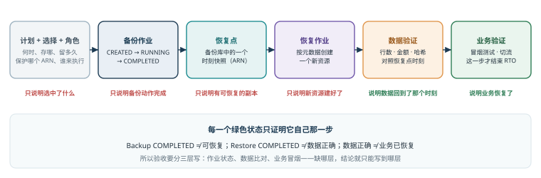
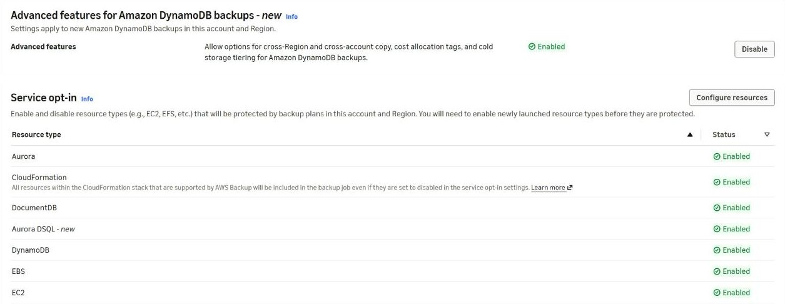
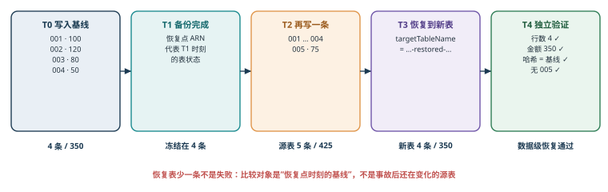
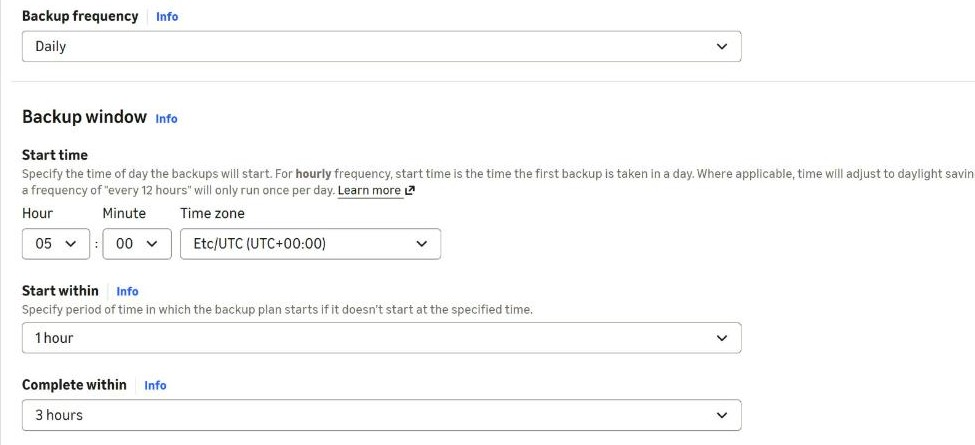
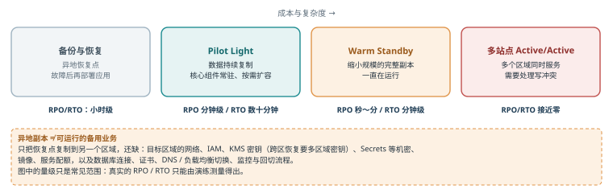

::::: cover
[第 13 讲 · 可靠性 ②]{.kicker}

<h1>备份恢复与灾备：<br>备份“绿了”，业务为何仍恢复不了？</h1>

[一个备份是否有用，要等恢复出来、和恢复点时刻的基线比对过、业务验证过才知道。本讲用一张 DynamoDB 表做“4 → 5 → 4”的恢复实验，把三层证据分开，再讨论 RPO、RTO 与灾备策略。]{.subtitle}

::: cover-meta
- **讲次**：13 / 19
- **建议学时**：4 课时（讲授 2 + 实验 2）
- **实验费用**：本地 0 元；云上一轮按量几乎为 0（数据只有几 KB）
- **适用版本**：AWS Backup（DynamoDB 高级备份）；DynamoDB PITR 1–35 天
:::

::: scenario
订单系统每天备份，控制台里一片绿色。一次误删之后，团队从备份恢复，发现恢复出来的表里少了一笔订单，也说不清到底丢了多长时间的数据。**这是备份失败了，还是这个恢复点本来就不包含那笔订单？“丢了多少”和“多久恢复”又该怎么算？**
:::

## 学习目标 {.nonum}

:::: cards
::: {.card title="理解"}
- 计划、选择、角色、备份库、恢复点、恢复作业
- 恢复点的时间语义
- RPO 与 RTO 的定义和测量边界
:::
::: {.card title="推理"}
- 判断“少一条”是否符合恢复点语义
- 由备份频率推最坏 RPO
- 为业务目标选择灾备策略
:::
::: {.card title="实操"}
- 规范化哈希比对恢复结果
- Terraform：表 + 备份库 + 计划 + 两个角色
- 备份 → 后置写入 → 恢复到新表 → 验证
:::
::: {.card title="排障"}
- 备份作业 FAILED
- 恢复作业 FAILED
- 备份库删不掉
:::
::::

| 本讲结构 | 要回答的问题 | 产出 |
|---|---|---|
| 一、机制 | “备份成功”到“业务恢复”中间隔着什么？ | 六个阶段与各自的证据 |
| 二、时间 | 丢了多少数据？多久恢复？ | RPO / RTO 计算与策略对比 |
| 三、验证 | 恢复表少一条算不算失败？ | 规范化哈希、4 → 5 → 4 实验 |
| 四、实操 | 怎样用最少的钱完整做一次？ | Terraform、脚本、验收 |
| 五～七、灾备与练习 | 异地副本够不够？ | 策略光谱、故障卡、练习 |
:::::

::: {.opener .nobreak}
[一 · 机制]{.kicker}

# 从“备份成功”到“业务恢复”，中间隔着什么？

[AWS Backup 里有六个容易混用的概念。把它们排成一条链，每个绿色状态只证明它自己那一步。]{.subtitle}
:::



| 对象 | 负责什么 | 不能推出什么 |
|---|---|---|
| 备份计划（Plan） | 什么时候备份、存到哪个备份库、保留多久 | 只建计划 ≠ 选中了任何资源 |
| 资源选择（Selection） | 按 ARN 或标签选中要保护的资源 | 被选中 ≠ 作业一定成功 |
| 服务角色 | 允许 AWS Backup 代表账户执行备份或恢复 | 角色有权限 ≠ 调用者被授权发起恢复 |
| 备份库（Vault） | 保存与管理恢复点（可加锁定、可用逻辑隔离库） | 它不是恢复后的运行环境 |
| 恢复点（Recovery Point） | 资源在“发起备份那一刻”的状态 | 有恢复点 ≠ 已验证可恢复 |
| 恢复作业（Restore Job） | 按资源类型的元数据创建**新**资源 | 作业完成 ≠ 业务已恢复 |

本书实验账户 us-east-1 的现状（`scripts/preflight.sh`，只读）：

```{.console title="./scripts/preflight.sh（本书实测输出，2026-11-18）"}
DynamoDB 已纳入 AWS Backup： True
DynamoDB 高级功能（由 AWS Backup 完整管理）： True
已纳入的资源类型： 19 / 19
备份库：0  计划：0  受保护资源：0  恢复测试计划：0
DynamoDB 表：0
```

“DynamoDB 高级功能”打开时，恢复点由 AWS Backup 完整管理（ARN 以 `arn:aws:backup` 开头），支持跨区域 / 跨账户复制、冷存储与恢复时选择加密密钥；较老的账户可能需要在区域设置中手动开启。

控制台的 AWS Backup → Settings 页给出同一结论（图 13-2）：本区域所有资源类型都已纳入（Service opt-in 全部 Enabled），DynamoDB 高级功能也已开启。

{.shot width=86%}

::: {.opener}
[二 · 时间]{.kicker}

# 丢了多少数据？多久恢复？

[RPO 和 RTO 是业务目标；实际值只能来自一条写清楚的时间线。最常见的错误，是把“恢复作业耗时”当成 RTO。]{.subtitle}
:::


::: formula
实际丢失窗口 = 故障时刻 − 最后一个可用恢复点的时刻 [对照 RPO]{.unit}

实际恢复耗时 = 业务验证通过的时刻 − 中断时刻 [对照 RTO]{.unit}
:::

:::: {.lab title="实验 13-1｜recovery：计算实际 RPO / RTO，比较三种备份方式"}
::: labmeta
- **目标**：把时间线算成数字；看清备份频率与最坏 RPO 的关系
- **时长**：10 分钟
- **费用**：0 元
- **工具**：Python 3.11+
:::

```{.console title="python recovery.py timeline；python recovery.py strategies（本书实测输出）"}
  实际数据丢失窗口 = 10:20 − 10:00 = 20 分钟（对照 RPO）
  实际恢复耗时     = 11:05 − 10:20 = 45 分钟（对照 RTO）
  其中 Restore 作业 = 10:55 − 10:35 = 20 分钟——它只是 RTO 的一部分

  故障时刻：11-17 14:30
  每日 05:00（UTC）备份            最后恢复点 11-17 05:00  → 丢失   570 分钟
  每小时整点备份                    最后恢复点 11-17 14:00  → 丢失    30 分钟
  PITR（最新可恢复≈故障前 5 分钟）  最后恢复点 11-17 14:25  → 丢失     5 分钟
```

每日备份的最坏情况接近 24 小时（再加上启动窗口）；需要分钟级 RPO 的表应开启 **PITR**：它可以恢复到保留期（1–35 天，默认 35 天）内的任意一秒，最新可恢复时间通常比当前时间早约 5 分钟。PITR 与 AWS Backup 是互补的：前者管“最近”，后者管“长期留存、异地、隔离”。
::::

::: {.opener}
[三 · 验证]{.kicker}

# 恢复表少了一条，算不算失败？

[先找到恢复点的时刻，再拿“那一刻的基线”去比。拿事故之后还在变化的源表去比，永远比不出结论。]{.subtitle}
:::



:::: {.example title="例题 13-1｜4 条还是 5 条？"}
已知：T0 写入订单 001～004（金额 100、120、80、50），保存基线；T1 备份作业 COMPLETED；T2 写入订单 005（金额 75）；T3 用 T1 的恢复点恢复到新表。求：恢复表应有几条？金额合计多少？怎样证明恢复正确？

::: steps
1. **确定恢复点时刻。** 恢复点代表 T1 发起备份时的状态：订单 001～004。
2. **列出基线。** 4 条，金额 100 + 120 + 80 + 50 = 350。
3. **列出源表现状。** T2 之后是 5 条，金额 350 + 75 = 425——它不是比较对象。
4. **选择证明方式。** 行数和金额合计只能发现“多了少了”；要证明“每一条都对”，需要对规范化后的全部条目算哈希，与 T0 基线比较。
:::

::: answer
恢复表应为 4 条、合计 350，且规范化哈希与 T0 基线一致；订单 005 不在其中。结论只能写到“DynamoDB 数据级恢复通过”——没有应用冒烟测试与切流，不能说业务 RTO 已验证。
:::
::::

:::: {.lab title="实验 13-2｜canon：规范化之后再算哈希"}
::: labmeta
- **目标**：让“恢复表与基线一致”成为可重复验证的结论
- **时长**：15 分钟
- **费用**：0 元
- **工具**：Python 3.11+
:::

`labs/01-recovery-math/canon.py` 读取两份 `aws dynamodb scan` 的输出，先规范化再比较。规范化至少要做四件事：按主键排序（scan 不保证顺序）、属性按名称排序、数字按数值比较（DynamoDB 以字符串传数字，`"100"` 与 `"100.0"` 是同一个数）、集合排序。样例文件故意打乱了顺序、改了数字写法：

```{.console title="python canon.py sample-baseline.json sample-restored.json / sample-source-now.json（本书实测输出）"}
  行数      基线 4      恢复 4      ✓
  金额合计  基线 350    恢复 350    ✓
  多出 无；缺少 无
  SHA-256   基线 1c5758e0f5ad4eb5…  恢复 1c5758e0f5ad4eb5…  ✓
  结论： 恢复表与恢复点时刻的基线一致

  行数      基线 4      恢复 5      ✗
  金额合计  基线 350    恢复 425    ✗
  多出 ['ORDER#005']；缺少 无
  SHA-256   基线 1c5758e0f5ad4eb5…  恢复 f745343417e584bc…  ✗
```

6 个单元测试锁定了这些结论，包括“一条记录的状态从 PENDING 变成 PAID 能被发现”。实验 13-3 的 `verify.sh` 直接调用它做失败即退出的验收。
::::

::: {.opener}
[四 · 实操]{.kicker}

# 用最少的钱，完整做一次备份与恢复

[按需计费的 DynamoDB 表 + 专用备份库 + 每日计划。立即发起一次备份，再恢复到一张新表——不覆盖源表，差异才看得清。]{.subtitle}
:::

:::: {.lab title="实验 13-3｜Terraform：表、备份库、计划、选择与两个角色"}
::: labmeta
- **目标**：用代码固定保护范围与保留策略
- **时长**：20 分钟
- **费用**：几乎为 0（见下方单价）
- **前提**：独立实验账户
:::

```{.hcl title="labs/03-terraform/main.tf（节选）"}
resource "aws_backup_plan" "daily" {
  name = "${local.prefix}-daily"
  rule {
    rule_name                    = "daily-dynamodb"
    target_vault_name            = aws_backup_vault.lab.name
    schedule                     = "cron(0 5 ? * * *)"     # 每天 05:00
    schedule_expression_timezone = "UTC"
    start_window                 = 60                      # 必须在 60 分钟内开始——不是 RTO
    completion_window            = 180                     # 必须在 180 分钟内完成——不是 RTO
    lifecycle { delete_after = 7 }
  }
}

resource "aws_backup_selection" "orders" {
  plan_id      = aws_backup_plan.daily.id
  iam_role_arn = aws_iam_role.backup.arn                   # 恢复另用一个独立角色
  resources    = [aws_dynamodb_table.orders.arn]           # 按 ARN 精确选择，不按标签扫描
  # …
}
```

同一条规则在控制台的“创建备份计划”表单里就是图 13-5：开始时间 05:00、时区 UTC，开始窗口 1 小时，完成窗口 3 小时。两个窗口约束的是**作业**，与业务的 RTO 无关。

{.shot width=66%}

```{.console title="terraform test 与只读 plan（本书实测输出，2026-11-18）"}
$ terraform test
  run "selection_is_exact_and_daily"... pass
  run "backup_and_restore_roles_are_separate"... pass
  run "pitr_off_by_default"... pass
  run "pitr_window_is_configurable"... pass
  run "pitr_window_is_validated"... pass
Success! 5 passed, 0 failed.

$ terraform plan
Plan: 8 to add, 0 to change, 0 to destroy.
$ terraform plan -var enable_pitr=true
          + recovery_period_in_days = 7
Plan: 8 to add, 0 to change, 0 to destroy.
```
::::

```{.bash title="在 labs/03-terraform 目录中依次执行（实验账户）"}
./scripts/preflight.sh && terraform apply
./scripts/seed.sh                  # ① 写入 4 条，备份之前保存基线 state/baseline.json
./scripts/backup.sh                # ② 按需备份；非 COMPLETED 立即停止；保存恢复点 ARN
./scripts/change-and-restore.sh    # ③ 写入第 5 条，再恢复到一张新表
./scripts/verify.sh                # ④ 恢复表 vs 基线：4 / 350 / 哈希一致；源表 5 / 425
./scripts/inventory.sh             # ⑤ 清理前盘点：恢复点、恢复出的新表
aws dynamodb delete-table --table-name "$(cat state/restored-table.txt)" && terraform destroy
```

恢复元数据因资源类型而异；DynamoDB 可用的键是 `targetTableName`、`encryptionType`（`Default` 为 AWS 拥有的密钥，`KMS` 为托管或客户托管密钥）、`kmsMasterKeyArn`。目标表名不能已存在；恢复出的新表不归 Terraform 管理，要单独删除。

按 AWS Price List API 的单价（us-east-1，2026-11-18）：

| 计费项 | 单价 | 本实验 |
|---|---|---|
| AWS Backup 温存储（DynamoDB） | 0.10 美元/GB·月（冷存储 0.03） | 几 KB，约 0 |
| 从温存储恢复（DynamoDB） | 0.15 美元/GB | 几 KB，约 0 |
| 逻辑隔离备份库温存储 | 0.115 美元/GB·月 | 未使用 |
| DynamoDB PITR | 0.20 美元/GB·月 | 默认关闭 |
| DynamoDB 按需写 / 存储 | 0.625 美元/百万写请求单位；每月前 25 GB 存储免费 | 5 次写入 |

::: warn
实验 13-3 的云上步骤按机制编写；本书遵循只读原则，没有在账户中创建表、备份或恢复。`preflight.sh` 为真实只读运行。备份库设置了 `force_destroy = true`，destroy 时会删除库中的恢复点——这是不可逆操作，只适用于实验；生产备份库应保留，并考虑库锁定。
:::

::: {.opener}
[五 · 灾备]{.kicker}

# 把恢复点复制到另一个区域，就有灾备了吗？

[异地恢复点只是灾备的原材料。能不能在另一个区域把业务跑起来，取决于那里还缺什么、以及你演练过没有。]{.subtitle}
:::



| 策略 | 准备方式 | 适用场景 | 代价 |
|---|---|---|---|
| 备份与恢复 | 异地恢复点；故障后部署应用 | 可接受较长恢复时间 | 成本最低、步骤最多 |
| Pilot Light | 数据持续复制，核心组件常驻 | 要缩短 RTO 又想控费 | 常驻资源 + 演练自动化 |
| Warm Standby | 缩小规模的完整业务一直运行 | RTO 要求短 | 双区域持续费用 |
| 多站点 Active/Active | 多个区域同时服务和写入 | 几乎不能丢数据、不能停 | 一致性、全局路由、成本 |

::::: {.example title="例题 13-2｜订单库：RPO ≤ 15 分钟、RTO ≤ 2 小时，怎么配？"}
已知：订单表在 us-east-1；业务要求单表误删时 RPO ≤ 15 分钟、RTO ≤ 2 小时；另要求区域级故障时数据不丢超过 1 天，恢复可以慢一些（1 个工作日）。

::: steps
1. **先拆场景。** “误删一张表”和“整个区域不可用”是两个场景，各自有 RPO / RTO，不要用一个方案硬套。
2. **误删场景的 RPO。** 每日备份最坏丢近 24 小时，不满足 15 分钟；开启 PITR（保留期按审计需要设 7～35 天），最新可恢复时间约比当前早 5 分钟。
3. **误删场景的 RTO。** PITR 恢复到新表 + 应用切换表名 / 回填数据；用实验 13-3 的同一套脚本演练，计时从“发现误删”开始，直到业务验证通过。
4. **区域场景。** 在备份计划中加跨区域复制规则（目标区域的备份库 + 多区域 KMS 密钥），恢复点每日一个即可满足“丢不超过 1 天”；目标区域的基础设施用 Terraform 随时重建，并每季度演练一次。
:::

::: answer
误删用 PITR（RPO ≈ 5 分钟），区域故障用 AWS Backup 跨区域复制（RPO ≤ 1 天）。两个 RTO 都必须由演练测得并记录，不能从文档或架构图推出来。
:::
:::::

AWS Backup 还提供两个与“恢复有效性”直接相关的能力：**恢复测试**（Restore Testing）按计划自动从恢复点恢复、运行验证并按设定清理测试资源（每次测试另行计费）；**逻辑隔离备份库**与**库锁定**让恢复点在账户被入侵时也不能被删除。它们都不能替代一次真正的业务级演练。

::: {.fault title="故障 1｜备份作业 FAILED"}
现象
:   计划到点触发，作业状态 FAILED。

根因
:   服务角色缺少托管策略或信任关系；资源类型未在区域设置中纳入 AWS Backup；跨账户、跨区域的密钥不可用；作业在启动窗口内没能开始（EXPIRED）。

修复
:   读 `describe-backup-job` 的 StatusMessage；核对角色、区域设置与资源 ARN 的区域。
:::

::: {.fault title="故障 2｜恢复作业 FAILED"}
现象
:   `describe-restore-job` 显示 FAILED。

根因
:   目标表名已存在；元数据键写错；恢复角色缺少 AWSBackupServiceRolePolicyForRestores；指定的 KMS 密钥不可用或无权使用。

修复
:   换一个新表名；按资源类型核对元数据；检查恢复角色与密钥策略。
:::

::: {.fault title="故障 3｜恢复表里有 5 条"}
现象
:   预期 4 条，恢复出来 5 条。

根因
:   操作顺序错了：第 5 条在备份**之前**就已写入；或者恢复用的不是预期的那个恢复点。

修复
:   核对 `state/backup.json` 中恢复点的创建时间与第 5 条的写入时间；这种情况下 5 条才是正确结果。
:::

::: {.fault title="故障 4｜哈希不一致，但行数和金额都对"}
现象
:   4 条、350 都对，哈希却不同。

根因
:   要么数据真的变了（例如某条记录的状态被改过），要么规范化规则不一致（排序、数字写法、属性顺序）。

修复
:   先用 canon.py 逐条对比找出差异属性；规范化规则在基线和验证两端必须用同一份代码。
:::

::: {.fault title="故障 5｜terraform destroy 删不掉备份库"}
现象
:   销毁时报备份库不为空。

根因
:   库中还有恢复点（没有设置 force_destroy，或启用了库锁定）。

修复
:   先盘点并确认归属，再删除本实验的恢复点；库锁定（合规模式）下在保留期内无法删除——这正是它的设计目的，不要尝试绕过。
:::

::: {.opener}
[六 · 练习]{.kicker}

# 练一练：你能分清“备份成功”和“恢复成功”吗？

[先独立作答，再对照解析。]{.subtitle}
:::

## 随堂练习

::: {.exercise title="练习 1｜状态"}
备份作业 COMPLETED，就算恢复成功了吗？还缺哪些证据？
:::

::: {.exercise title="练习 2｜RPO"}
14:30 故障，最近一个恢复点是 14:05。实际丢失窗口是多少？是否可接受由谁决定？
:::

::: {.exercise title="练习 3｜RTO"}
14:30 中断，14:50 恢复作业完成，15:20 业务验证通过。实际恢复耗时是多少？
:::

::: {.exercise title="练习 4｜选择"}
只建备份计划、不建资源选择，资源会被保护吗？
:::

::: {.exercise title="练习 5｜PITR"}
需要 RPO 不超过 15 分钟，每日备份够吗？应该怎么做？
:::

::: {.exercise title="练习 6｜灾备"}
已经把恢复点复制到了另一个区域，能否承诺“区域故障时 1 小时内恢复”？
:::

## 参考答案与解析

::: {.solution title="1"}
不算。还需要：找到正确的恢复点 ARN、恢复作业成功创建新资源、数据与恢复点时刻的基线比对一致；要说“业务恢复”，还需要冒烟测试与切流。
:::

::: {.solution title="2"}
25 分钟。是否可接受取决于业务定下的 RPO，而不是技术团队。
:::

::: {.solution title="3"}
50 分钟（15:20 − 14:30）。恢复作业的 20 分钟只是其中一部分，发现、决策、验证都要计入。
:::

::: {.solution title="4"}
不会。计划只定义“何时、存哪、留多久”，没有选择就没有任何资源被备份。
:::

::: {.solution title="5"}
不够：每日备份的最坏丢失接近 24 小时。应开启 DynamoDB PITR（最新可恢复时间通常只比当前早约 5 分钟），AWS Backup 继续负责长期留存与异地副本。
:::

::: {.solution title="6"}
不能。还要准备目标区域的网络、IAM、密钥（跨区要多区域密钥）、机密、镜像、配额，以及数据库连接、DNS 与负载均衡切换和回切流程；承诺必须来自演练测量。
:::

## 这一讲，你应该记住 {.nonum}

:::: summary
::: {.card tag="证据"}
**作业 → 数据 → 业务**

每个绿色状态只证明自己那一步。
:::
::: {.card tag="比较"}
**和恢复点时刻的基线比**

规范化之后再算哈希。
:::
::: {.card tag="时间"}
**RPO 看最后恢复点，RTO 看业务**

每日备份最坏丢近一天；要分钟级用 PITR。
:::
::: {.card tag="灾备"}
**异地副本 ≠ 备用业务**

承诺来自演练，不来自架构图。
:::
::::

::: refs
## 参考资料 {.nonum}

[实测说明：preflight 为 us-east-1 只读调用；recovery.py、canon.py 为本地真实运行；价格来自 Price List API（2026-11-18）；Terraform 仅执行 test 与只读 plan；图 13-2、13-5 为 2026-11-18 控制台实拍（只读查看与填表，未创建任何资源）。]{.small}

1. 恢复 DynamoDB <https://docs.aws.amazon.com/aws-backup/latest/devguide/restoring-dynamodb.html>；高级 DynamoDB 备份 <https://docs.aws.amazon.com/aws-backup/latest/devguide/advanced-ddb-backup.html>
2. DynamoDB PITR <https://docs.aws.amazon.com/amazondynamodb/latest/developerguide/Point-in-time-recovery.html>；恢复测试 <https://docs.aws.amazon.com/aws-backup/latest/devguide/restore-testing.html>
3. 灾备策略 <https://docs.aws.amazon.com/whitepapers/latest/disaster-recovery-workloads-on-aws/disaster-recovery-options-in-the-cloud.html>
:::
