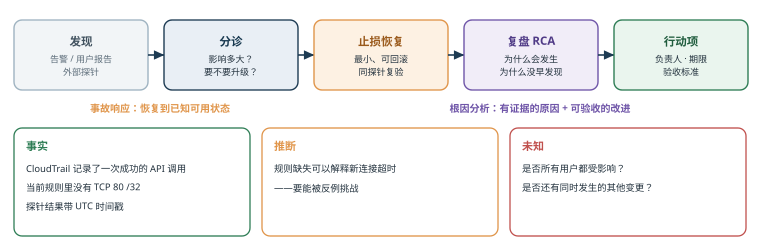
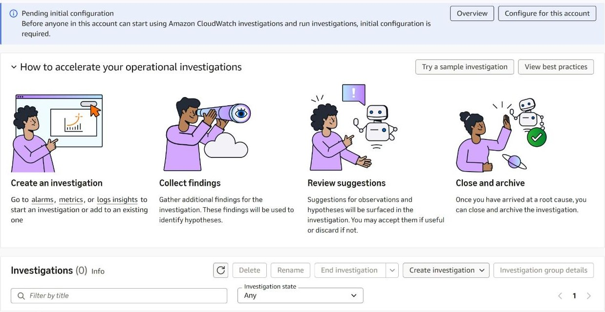
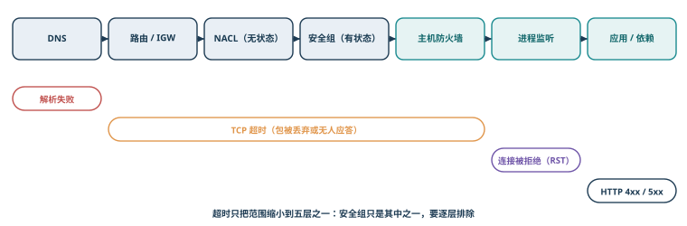
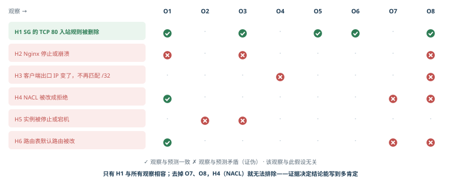
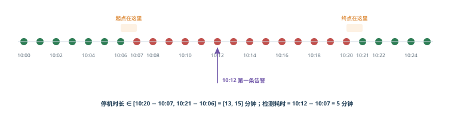

::::: cover
[第 14 讲 · 运维流程 ①]{.kicker}

<h1>事故响应与根因分析：<br>从现象走到可复核的根因</h1>

[一条“安全组规则被删除”的 CloudTrail 记录，并不自动等于故障根因。本讲用鉴别诊断证伪竞争假设，用探针数据给停机时长画出区间，再把结论写成一份可验收的复盘。]{.subtitle}

::: cover-meta
- **讲次**：14 / 19
- **建议学时**：4 课时（讲授 2 + 实验 2）
- **实验费用**：本地 0 元；云上约 0.01 美元/小时
- **适用版本**：CloudWatch investigations（2025 GA）；AWS Provider 6.x
:::

::: scenario
一个 Web 入口刚才还返回 HTTP 200，现在客户端一直等到超时。值班工程师在 CloudTrail 里看到 10:05 有一条安全组变更记录，马上在群里说：“找到了，就是这个。”**这个判断对吗？在写进事故报告之前，还需要哪些证据？停机到底持续了多久？**
:::

## 学习目标 {.nonum}

:::: cards
::: {.card title="理解"}
- 事故响应与根因分析的不同目标
- 事实、推断、未知三类信息
- 超时、拒绝、4xx/5xx 分别指向哪些层
:::
::: {.card title="推理"}
- 用观察证伪竞争假设
- 由探针数据推出停机时长区间
- 判断证据能把结论写到多肯定
:::
::: {.card title="实操"}
- ir.py：鉴别诊断与时间窗
- Terraform：可注入故障的 Web 入口
- 注入 → 取证 → 最小恢复 → 复测
:::
::: {.card title="写作"}
- 时间线写成区间
- 直接原因、促成条件、检测缺口分开
- 行动项有负责人和验收标准
:::
::::

| 本讲结构 | 要回答的问题 | 产出 |
|---|---|---|
| 一、两件事 | 响应和复盘分别要什么结果？ | 流程图、信息三分法 |
| 二、现象到层次 | 超时说明了什么？ | 症状—层次对照 |
| 三、鉴别诊断 | 怎样证明不是别的原因？ | 假设矩阵 |
| 四、时间 | 停了多久？多久发现？ | 区间估计 |
| 五、实操 | 怎样完整走一遍？ | Terraform、脚本 |
| 六～八、复盘与练习 | 报告怎么写？ | RCA 模板、故障卡、练习 |
:::::

::: {.opener .nobreak}
[一 · 两件事]{.kicker}

# 事故响应与根因分析，各要什么结果？

[事故响应要的是“尽快、安全地恢复”；根因分析要的是“有证据的原因和能验收的改进”。混在一起做，往往两件都做不好。]{.subtitle}
:::



AWS 在 2025—2026 年调整了事故工具链，选型时要知道：**CloudWatch investigations** 于 2025 年 6 月正式发布，可以根据告警、指标、日志和 CloudTrail 变更自动提出假设并生成事故报告（含“5 Whys”根因流程），本身不另收费；**Systems Manager Incident Manager 自 2025 年 11 月 7 日起不再向新客户开放**，已在使用的账户不受影响，AWS 建议新用户改用 Systems Manager OpsCenter 或合作伙伴的值班产品；安全类事件则有专门的 AWS Security Incident Response。工具能帮你更快地提出假设，但“证伪”和“写结论”仍然是人的责任。

在本书账户的控制台里，investigations 位于 CloudWatch → AI Operations（图 14-2）：页面顶部提示“需要先为账户完成初始配置”（创建调查组）才能发起调查；四步流程——创建调查、收集发现、审阅建议、关闭归档——与图 14-1 的五步法是同一套思路。

{.shot width=84%}

::: {.opener}
[二 · 现象到层次]{.kicker}

# 请求超时，说明了什么？

[客户端看到的现象只能把范围缩小到几层。超时尤其模糊：从路由到主机防火墙，五层都可能让包“石沉大海”。]{.subtitle}
:::



| 现象 | curl 退出码 | 可能的层 | 下一步 |
|---|---|---|---|
| 解析失败 | 6 | DNS | 先看解析结果 |
| 连接超时 | 28 | 路由、NACL、安全组、主机防火墙、目标无应答 | 核对源 IP、路由、NACL、安全组规则与实例状态 |
| 连接被拒绝 | 7 | 目标可达，但端口没有进程监听 | 看服务进程与监听端口 |
| HTTP 4xx / 5xx | 0 | 应用、代理、依赖 | 看应用日志与依赖健康 |

两个在前面几讲实测过的机制，在这里决定了实验怎么做：安全组是**有状态**的，删除规则**不会**切断已被跟踪的连接（第 04 讲、第 10 讲），所以每次探测都必须是新进程、新 TCP 连接；CloudTrail 记录的是**控制面 API**，不是数据包——它能证明“规则被删了”，不能证明“这个包被丢了”。

::: {.opener}
[三 · 鉴别诊断]{.kicker}

# 怎样证明不是别的原因？

[像医生看病一样：先列出所有能解释现象的假设，再让每一条观察去“证伪”它们。被证伪的划掉，剩下的才有资格叫候选根因。]{.subtitle}
:::



:::: {.lab title="实验 14-1｜ir：用观察证伪假设，用探针数据给出时间区间"}
::: labmeta
- **目标**：把“为什么是它”写成可复核的推理
- **时长**：20 分钟
- **费用**：0 元
- **工具**：Python 3.11+
:::

`labs/01-ir/case.json` 记录了 8 条观察（O1：新连接超时而不是拒绝；O3：实例本机 curl 返回 200；O5：10:05 有一条成功的 RevokeSecurityGroupIngress，目标正是该 SG；O7：同一窗口内路由与 NACL 没有变更事件；O8：只恢复这一条规则后新连接返回 200……）和 6 个假设，每个假设对相关观察给出预测：

```{.console title="python ir.py dx case.json（本书实测输出）"}
  H1  存活    SG 的 TCP 80 入站规则被删除（得到 O1,O3,O5,O6,O8 支持）
  H2  证伪    Nginx 停止或崩溃（被 O1,O3,O8 证伪）
  H3  证伪    客户端出口 IP 变了，不再匹配 /32（被 O4,O8 证伪）
  H4  证伪    NACL 被改成拒绝（被 O7,O8 证伪）
  H5  证伪    实例被停止或宕机（被 O2,O3 证伪）
  H6  证伪    路由表默认路由被改（被 O7,O8 证伪）
```

4 个单元测试中有一个专门验证：去掉 O7 与 O8 两条观察，H4（NACL）就无法排除——**结论能写到多肯定，取决于你收集了哪些观察**，而不是取决于你有多确信。
::::

:::: {.example title="例题 14-1｜“找到了，就是这条变更”——还缺什么？"}
已知：10:05 CloudTrail 有一条 RevokeSecurityGroupIngress；10:07 探针开始超时。值班工程师据此宣布根因。

::: steps
1. **核对对象。** 事件里的 SG ID、账户、区域，是否就是 Web 实例关联的那个 SG？本账户 90 天内就有 3 次 RevokeSecurityGroupIngress、8 次 AuthorizeSecurityGroupIngress（只读查询实测），时间接近不等于对象相同。
2. **核对结果。** 事件的 `errorCode` 为空吗？失败的调用不改变规则。
3. **核对现状。** `describe-security-group-rules` 中，TCP 80 /32 这条规则此刻确实不存在吗？
4. **排除竞争假设。** 同一窗口内的路由、NACL 变更事件；实例状态；本机服务是否正常；客户端出口 IP 是否变化。
5. **做恢复实验。** 只恢复这一条规则，用同一来源、同一 URL、新连接复测，观察 UP → TIMEOUT → UP。
:::

::: answer
只凭“时间上先后发生”不能定根因。当资源 ID 一致、调用成功、现状吻合、竞争假设被证伪、并且“只恢复这一条”就能复现恢复时，才能把“规则缺失”写成本次故障的直接原因——同时在报告中注明它的证据来源。
:::
::::

::: {.opener}
[四 · 时间]{.kicker}

# 停了多久？多久才发现？

[探针每分钟观测一次，真实的中断起点和终点都藏在两次观测之间。所以停机时长只能给区间，不能给一个精确的数。]{.subtitle}
:::



```{.console title="python ir.py window probes.jsonl --alert 2026-11-17T10:12:00Z（本书实测输出）"}
  last_ok              2026-11-17T10:06:00Z
  first_fail           2026-11-17T10:07:00Z
  last_fail            2026-11-17T10:20:00Z
  first_ok_after       2026-11-17T10:21:00Z
  duration_min_lower   13.0
  duration_min_upper   15.0
  detect_min           5.0
```

::: formula
停机时长 ∈ [最后一次失败 − 第一次失败，第一次恢复 − 最后一次成功] = [13, 15] 分钟 [探针间隔越小，区间越窄]{.unit}
:::

原稿把“10:21 − 10:07 = 14 分钟”当作停机时长，这只是两次观测之间的间隔。检测耗时（第一次失败观测到第一条告警）是 5 分钟——它直接对应复盘里的“检测缺口”。

::: {.opener}
[五 · 实操]{.kicker}

# 完整走一遍：注入 → 取证 → 最小恢复

[一次只改一个变量；恢复前审查 plan，只允许出现那一条规则；恢复后用同一个探针复测。]{.subtitle}
:::

:::: {.lab title="实验 14-2｜Terraform：一个可注入故障的 Web 入口"}
::: labmeta
- **目标**：把实验环境写成可审查、可恢复的基线
- **时长**：30 分钟
- **费用**：约 0.01 美元/小时，做完立即 destroy
- **前提**：独立实验账户；知道自己的公网 IPv4
:::

```{.hcl title="labs/02-terraform/main.tf（节选）"}
resource "aws_vpc_security_group_ingress_rule" "http_from_operator" {
  security_group_id = aws_security_group.web.id
  cidr_ipv4         = var.client_cidr          # 必须是单个 /32，变量校验拒绝 0.0.0.0/0 和网段
  ip_protocol       = "tcp"
  from_port         = 80
  to_port           = 80
}
# 入站、出站都用独立规则资源：Terraform 能精确发现“少了哪一条”，
# 也不能再和内联规则或旧的 aws_security_group_rule 混用
```

```{.console title="terraform test 与只读 plan（本书实测输出，2026-11-18）"}
$ terraform test
  run "only_the_operator_can_reach_port_80"... pass
  run "instance_is_hardened_and_serves_http"... pass
  run "world_open_cidr_is_rejected"... pass
  run "subnet_range_is_rejected"... pass
Success! 4 passed, 0 failed.

$ terraform plan -var client_cidr=203.0.113.10/32
Plan: 9 to add, 0 to change, 0 to destroy.
```
::::

```{.bash title="在 labs/02-terraform 目录中依次执行（实验账户）"}
export CLIENT_CIDR="$(curl -s https://checkip.amazonaws.com)/32"
terraform apply -var client_cidr=$CLIENT_CIDR
./scripts/probe.sh 5 60          # ① 基线：连续 5 次 HTTP 200（nginx 安装需要一两分钟）
./scripts/inject.sh              # ② 只删除那一条入站规则（按规则 ID），记录 UTC 时间
./scripts/probe.sh 5 60          #    新连接超时：curl 退出码 28
./scripts/investigate.sh         # ③ 事件（按 SG ID）+ 现状 + 路由 / NACL 对照 + plan 摘要
terraform plan -var client_cidr=$CLIENT_CIDR   # ④ 审查：只应出现这一条规则；多出任何东西就停下
terraform apply -var client_cidr=$CLIENT_CIDR
./scripts/probe.sh 5 60          #    同一探针复测：恢复 200
python ../01-ir/ir.py window probes.jsonl      # ⑤ 用真实探针记录算停机区间，写进 rca-template.md
terraform destroy -var client_cidr=$CLIENT_CIDR
```

::: warn
实验 14-2 的云上步骤按机制编写；本书遵循只读原则，没有创建实例或注入故障。书中的事件计数为对实验账户的只读查询。若 `terraform plan` 在恢复时还要替换实例、改路由或删除其他资源，立即停止并解释原因——不能为了恢复一条规则批准额外的破坏性变更。
:::

::: {.opener}
[六 · 复盘]{.kicker}

# 恢复之后，复盘报告怎么写？

[把直接原因、促成条件、检测缺口和行动项分开写；每一句都标明证据来源。“加强管理”不是行动项。]{.subtitle}
:::

| 字段 | 应该写什么 | 本例写法 |
|---|---|---|
| 摘要 | 用户看到了什么；结论的置信度 | 实验入口的新连接超时；直接原因置信度高（竞争假设均被证伪） |
| 影响 | 谁、什么功能、多久（写成区间） | 仅确认到指定来源的探针；停机 13～15 分钟 |
| 直接原因 | 哪条机制直接导致故障 | 安全组缺少操作者 /32 的 TCP 80 入站规则 |
| 促成条件 | 系统为何允许它发生 | 有证据才写，例如“该角色可以绕过 IaC 直接修改安全组” |
| 检测缺口 | 为什么没更早发现 | 第一次失败观测到第一条告警用了 5 分钟 |
| 被排除的假设 | 每个假设被哪条观察证伪 | 见实验 14-1 输出 |

| 把“加强管理”改成可验收的行动项 | 负责人 | 验收标准 |
|---|---|---|
| 生产安全组只能经 IaC 流水线修改 | 平台负责人 | 直接修改的权限被拒绝（模拟器与真实调用双重验证）；变更都有 plan 审批记录 |
| 关键入口增加外部合成探针与告警 | SRE | 故障注入后，告警在约定阈值内触发 |
| 每日检测配置漂移 | 云运维 | 漂移项自动建单，有负责人和关闭证据 |

无责复盘不等于没有责任：重点是找出系统、权限、流程与检测上的缺口，并确保改进真正完成。AWS Well-Architected 要求对影响客户的事件开展事后分析，识别促成因素并制定预防措施。

::: {.fault title="故障 1｜删了规则，探针却一直成功"}
现象
:   注入后探针仍返回 200。

根因
:   探针复用了已建立的连接（已被跟踪，不会因规则删除而中断）；或者安全组里还有别的规则放行了 80 端口。

修复
:   每次探测用新进程、`Connection: close`；用 `describe-security-group-rules` 确认 80 端口真的没有任何规则放行。
:::

::: {.fault title="故障 2｜基线就失败"}
现象
:   apply 之后立即探测，一直超时或被拒绝。

根因
:   nginx 还没装完（被拒绝）；出站 443 被删，dnf 下载失败；`client_cidr` 不是你此刻的出口 IP（超时）。

修复
:   等两三分钟再测；检查实例系统日志；重新获取出口 IP。基线不通过，不要注入故障。
:::

::: {.fault title="故障 3｜恢复的 plan 里多了一项“替换实例”"}
现象
:   只想恢复一条规则，plan 却显示 1 to add、1 to replace。

根因
:   有人还改了实例属性（例如 user_data），或者 AMI 参数更新了。

修复
:   停止。先解释每一项差异，再决定是否只用 `-target` 恢复规则，并把其余差异单独处理。
:::

::: {.fault title="故障 4｜事件历史里有好几条安全组变更"}
现象
:   按事件名能查到多条 Revoke / Authorize。

根因
:   账户里有其他安全组的正常变更。

修复
:   改按资源名（SG ID）查询，并核对 `requestParameters` 中的规则 ID 与 `errorCode`。
:::

::: {.opener}
[七 · 练习]{.kicker}

# 练一练：你的结论站得住吗？

[先独立作答，再对照解析。]{.subtitle}
:::

## 随堂练习

::: {.exercise title="练习 1｜证据"}
10:05 有安全组变更，10:07 探针超时。还缺哪些证据才能支持根因判断？
:::

::: {.exercise title="练习 2｜连接跟踪"}
删除规则后，为什么已有连接可能仍能通信？怎样复测才可靠？
:::

::: {.exercise title="练习 3｜日志边界"}
CloudTrail 事件历史能否证明某个 TCP 包被安全组丢弃？
:::

::: {.exercise title="练习 4｜时间"}
探针每 5 分钟一次：10:00 成功、10:05 失败、10:30 失败、10:35 成功。停机时长的区间是多少？
:::

::: {.exercise title="练习 5｜退出码"}
探针的 curl 退出码是 7 而不是 28。哪些假设可以直接划掉？
:::

::: {.exercise title="练习 6｜行动项"}
把“加强安全组变更管理”改写成一条可验收的行动项。
:::

## 参考答案与解析

::: {.solution title="1"}
核对 SG ID 与实例关联一致、调用成功（errorCode 为空）、当前规则确实缺失、同来源新连接失败、只恢复这一条后成功，并排除同一窗口内的路由、NACL、实例与服务变化。
:::

::: {.solution title="2"}
安全组跟踪连接，删除规则不会中断已被跟踪的连接。每次用新进程、新 TCP 连接（`Connection: close`），并保持同一来源与同一 URL。
:::

::: {.solution title="3"}
不能。事件历史记录的是管理事件（控制面 API）；证明丢包需要数据面证据，例如 VPC 流日志中的 REJECT 记录。
:::

::: {.solution title="4"}
[10:30 − 10:05, 10:35 − 10:00] = [25, 35] 分钟。探针间隔从 1 分钟变成 5 分钟，区间宽度就从 2 分钟变成 10 分钟。
:::

::: {.solution title="5"}
退出码 7 是连接被拒绝：包到达了主机，主机回了 RST。路由、NACL、安全组（这些会造成超时）都可以先划掉，重点查服务进程与监听端口。
:::

::: {.solution title="6"}
例如：“生产安全组只允许由 IaC 流水线角色修改；平台负责人在 12 月 15 日前完成；验收标准：工程师角色直接调用 RevokeSecurityGroupIngress 被拒绝（模拟器与真实调用各验证一次），且过去 30 天的变更都有 plan 审批记录。”
:::

## 这一讲，你应该记住 {.nonum}

:::: summary
::: {.card tag="分开"}
**响应求恢复，复盘求原因**

事实、推断、未知分开写。
:::
::: {.card tag="诊断"}
**用观察证伪假设**

剩下的才是候选根因。
:::
::: {.card tag="时间"}
**停机时长是区间**

探针间隔决定区间宽度。
:::
::: {.card tag="行动"}
**负责人 + 期限 + 验收标准**

“加强管理”不是行动项。
:::
::::

::: refs
## 参考资料 {.nonum}

[实测说明：事件计数为 us-east-1 只读查询；ir.py 为本地真实运行；Terraform 仅执行 test 与只读 plan；图 14-2 为 2026-11-18 控制台实拍（未做任何配置）。]{.small}

1. Well-Architected：事后分析 <https://docs.aws.amazon.com/wellarchitected/latest/framework/ops_evolve_ops_perform_rca_process.html>；CloudWatch investigations <https://docs.aws.amazon.com/AmazonCloudWatch/latest/monitoring/Investigations.html>
2. Incident Manager 可用性变化 <https://docs.aws.amazon.com/incident-manager/latest/userguide/incident-manager-availability-change.html>；安全组连接跟踪 <https://docs.aws.amazon.com/AWSEC2/latest/UserGuide/security-group-connection-tracking.html>
:::
