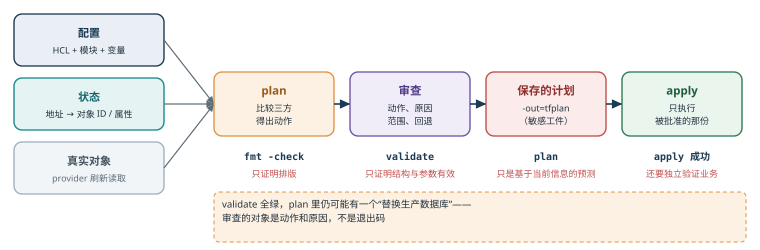
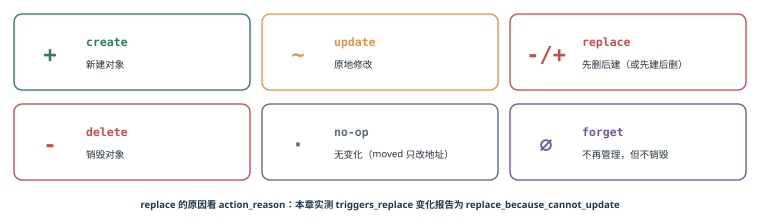
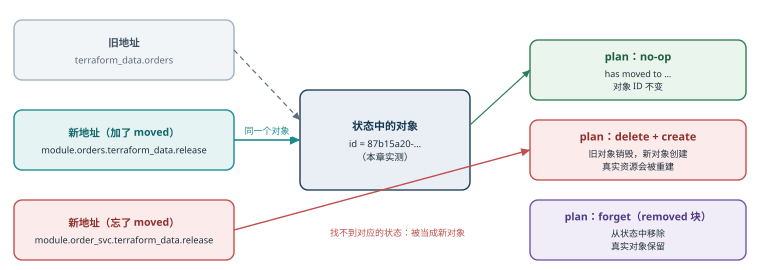
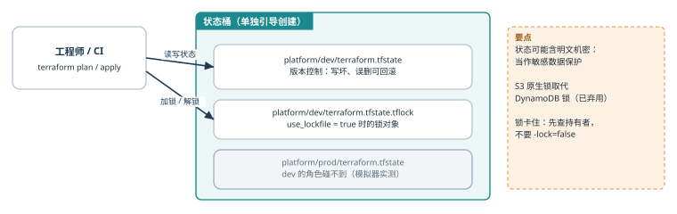

::::: cover
[第 15 讲 · 基础设施即代码 ①]{.kicker}

<h1>Terraform 计划、状态与模块：<br>validate 全绿，为什么还不能 apply？</h1>

[validate 只证明配置有效，plan 才告诉你要发生什么；状态把地址绑定到真实对象，模块重构稍有不慎就会“删旧建新”。本讲在本机零云资源地真实跑完六个阶段，再设计一个最小权限的远程状态。]{.subtitle}

::: cover-meta
- **讲次**：15 / 19
- **建议学时**：4 课时（讲授 2 + 实验 2）
- **实验费用**：生命周期实验 0 元（本机）；状态桶约 0
- **适用版本**：本书用 Terraform 1.15.5 实测；2026-11 最新为 1.17.2
:::

::: scenario
CI 里 `terraform validate` 一片绿色。工程师打开 plan，发现生产数据库前面标着 `-/+`。另一位同事刚把一组资源“挪进了一个模块”，说只是改了个目录名。**这两个变更能直接 apply 吗？Terraform 是怎么判断“这是同一个对象”的？**
:::

## 学习目标 {.nonum}

:::: cards
::: {.card title="理解"}
- 配置、状态、真实对象三者的关系
- plan 中六种动作的含义
- 资源地址是 Terraform 认人的唯一依据
:::
::: {.card title="推理"}
- 判断一次重构会不会重建资源
- 读懂替换的原因（action_reason）
- 判断计划文件、状态文件的敏感性
:::
::: {.card title="实操"}
- 本机真实运行六个生命周期阶段
- 用计划 JSON 做自动审批闸门
- 远程状态桶 + 最小权限（模拟器 8/8）
:::
::: {.card title="排障"}
- 改名之后删旧建新
- 状态锁卡住
- 计划文件里的明文机密
:::
::::

| 本讲结构 | 要回答的问题 | 产出 |
|---|---|---|
| 一、计划 | validate、plan、apply 各证明什么？ | 变更流程、六种动作 |
| 二、地址与状态 | Terraform 怎么认出“同一个对象”？ | moved、removed 的实测 |
| 三、审批闸门 | 怎样不靠肉眼拦住危险变更？ | inspect_plan.py |
| 四、远程状态 | 状态放哪里、谁能读写、怎么加锁？ | 引导工程、最小权限策略 |
| 五～六、排障与练习 | 出了异常先做什么？ | 故障卡、练习 |
:::::

::: {.opener .nobreak}
[一 · 计划]{.kicker}

# validate、plan、apply 各证明什么？

[Terraform 拿配置、状态和真实对象三方比较，得出一份“打算做什么”的计划。审查的对象是计划里的动作和原因，不是命令的退出码。]{.subtitle}
:::





::: pitfalls
1. **validate 通过 ≠ 可以 apply。** 它只检查配置的结构与参数，不知道这次会替换哪些对象。
2. **`sensitive = true` ≠ 加密。** 它只让终端不显示；值仍然写进状态和保存的计划文件（本讲实验 15-1 阶段 5 实测）。真正不落盘要用临时值（ephemeral）与只写参数（第 07 讲）。
3. **plan 是预测，不是保证。** apply 时 provider 的 API 仍可能失败；成功之后还要独立验证业务与成本。
:::

::: {.opener}
[二 · 地址与状态]{.kicker}

# Terraform 怎么认出“同一个对象”？

[状态把“代码里的地址”映射到“真实对象的 ID”。地址一变，Terraform 就认为是另一个对象——除非你用 moved 告诉它。]{.subtitle}
:::



:::: {.lab title="实验 15-1｜在本机真实运行六个阶段（terraform_data，零云资源）"}
::: labmeta
- **目标**：亲眼看到 create、moved、replace、no-op、删旧建新、forget
- **时长**：20 分钟
- **费用**：0 元（`terraform_data` 只存在于本地状态中）
- **工具**：Terraform ≥ 1.7（本书 1.15.5）、Python 3.11+
:::

`labs/01-lifecycle/run.sh` 依次把 `stages/` 下的配置复制成 `work/main.tf`，每个阶段都 `plan -out` → `show -json` → 用 `inspect_plan.py` 检查动作 → `apply` 保存的计划：

```{.console title="./run.sh（本书实测输出，Terraform v1.15.5，节选）"}
================ 阶段 0：根模块里创建 terraform_data.orders（release=v1）
  create   terraform_data.orders
对象 ID：87b15a20-75c1-73d7-0a56-0e730b74c6f3

================ 阶段 1：收进模块 + moved（期望：no-op，仅地址变化）
  # terraform_data.orders has moved to module.orders.terraform_data.release
  no-op    module.orders.terraform_data.release（由 terraform_data.orders 移来）
对象 ID：87b15a20-75c1-73d7-0a56-0e730b74c6f3  （与阶段 0 相同：没有重建）

================ 阶段 2：release v1 → v2（期望：replace——由 triggers_replace 引起）
  replace  module.orders.terraform_data.release  原因：replace_because_cannot_update
  闸门：拒绝

================ 阶段 2b：同样的 v2 再 plan 一次
No changes. Your infrastructure matches the configuration.

================ 阶段 3：模块改名却忘了 moved（只 plan 不 apply）
  create   module.order_svc.terraform_data.release
  delete   module.orders.terraform_data.release  原因：delete_because_no_resource_config
  闸门：拒绝

================ 阶段 4：removed + destroy=false
 # module.orders.terraform_data.release will no longer be managed by Terraform, but will not be destroyed
  forget   module.orders.terraform_data.release

================ 阶段 5：sensitive 变量会不会出现在计划文件里？
  计划 JSON 中包含明文 “Example-Not-A-Real-Secret-42”
          + password = (sensitive value)
```

三个值得记住的实测细节：moved 之后对象 ID 一字不差；`triggers_replace` 引起的替换，计划里给出的原因是 `replace_because_cannot_update`；阶段 5 中终端显示 `(sensitive value)`，同一份计划的 JSON 里却是明文。5 个离线测试用 `fixtures/` 中保存的这些真实计划 JSON 锁定了上述结论。
::::

:::: {.example title="例题 15-1｜把一组资源挪进模块，怎样保证一个都不重建？"}
已知：生产中 `aws_db_instance.orders` 等 6 个资源要收进 `module.orders`。要求：plan 中不得出现任何 delete 或 replace。

::: steps
1. **为每个地址写 moved。** `from` 是旧地址，`to` 是新地址；模块内部的资源名也要一一对应。
2. **保持输入不变。** 模块的输入要产生与原来完全相同的属性；属性一变，即使地址对上了也会 update 或 replace。
3. **保存计划并自动检查。** `plan -out` → `show -json` → `inspect_plan.py --allow no-op`；任何非 no-op 的动作都让闸门失败。
4. **apply 那份计划，再 plan 一次。** 第二次必须是 “No changes”。
5. **保留 moved。** 发布模块时保留历史上的 moved 块，让还在用旧版本的调用方也能平滑升级。
:::

::: answer
六条 moved + 不变的输入 + 闸门 `--allow no-op`。只要计划里出现 delete 或 replace，就说明还有地址或属性没对上，必须停下来，而不是“先 apply 了再说”。
:::
::::

::: {.opener}
[三 · 审批闸门]{.kicker}

# 怎样不靠肉眼拦住危险变更？

[人会看漏，尤其是在几百行的计划里。把审批规则写成代码，让机器先拦一道，人再审剩下的。]{.subtitle}
:::

`inspect_plan.py` 读取 `terraform show -json` 的输出，把每个资源变化归纳成 create、update、replace、delete、no-op、forget 之一，并用 `--allow` 声明本次变更允许的动作——出现清单外的动作就返回非零退出码，CI 据此停止流水线。实验 15-1 中，阶段 2 与阶段 3 的计划都被它拒绝了。

| 审查问题 | 要确认什么 |
|---|---|
| 对象身份 | 账户、区域、工作区、后端、资源地址都对吗？ |
| 动作 | create / update / replace / delete 各多少？有没有清单外的动作？ |
| 替换原因 | `action_reason` 是什么？会换 ID、丢数据、断连接吗？ |
| 依赖 | 下游资源和业务会受什么影响？ |
| 权限 | 做 plan 的身份、做 apply 的身份、状态桶的权限是否最小？ |
| 回退 | 有备份、验证方法和回滚计划吗？ |
| 敏感性 | 保存的计划与 JSON 只对谁开放？保留多久？ |

Terraform 1.17（2026-11）把原生的策略即代码（`-policies`）推向正式可用，可以在 plan、apply 时直接评估策略；但无论用哪种工具，“规则写进代码、例外需要审批”的原则不变。

::: {.opener}
[四 · 远程状态]{.kicker}

# 状态放在哪里，谁能读写，怎么加锁？

[团队协作时，状态必须放在一个私有、有版本、加了锁的地方；每个环境的读写权限要能单独授予。]{.subtitle}
:::



S3 后端现在支持**原生锁**：设置 `use_lockfile = true` 后，加锁就是在状态旁边写一个 `<key>.tflock` 对象；基于 DynamoDB 的锁已被标记为弃用，将在后续版本移除。官方强烈建议给状态桶开启版本控制，以便在误删、写坏时回滚。状态桶本身要由一个**单独的引导工程**先建好——不能用一个后端去创建它自己所在的桶。

:::: {.lab title="实验 15-2｜状态桶引导工程 + 最小权限的状态访问策略"}
::: labmeta
- **目标**：私有、版本化、只接受 TLS 的状态桶；一个环境一份权限
- **时长**：20 分钟
- **费用**：plan / test / 模拟器 0 元；建桶后按量（KB 级）
- **权限**：`iam:SimulateCustomPolicy`（验证策略）
:::

工程输出一份 `backend_block`（可以直接贴进其他工程）和一份 `state_access_policy`：只允许列出 `platform/dev/` 前缀、读写 dev 的状态文件、读写删除 dev 的 `.tflock`。把它交给 IAM 策略模拟器：

```{.console title="./statesim.sh（本书实测输出，2026-11-18）"}
s3:GetObject       …/platform/dev/terraform.tfstate          allowed
s3:PutObject       …/platform/dev/terraform.tfstate          allowed
s3:DeleteObject    …/platform/dev/terraform.tfstate          implicitDeny
s3:PutObject       …/platform/dev/terraform.tfstate.tflock   allowed
s3:DeleteObject    …/platform/dev/terraform.tfstate.tflock   allowed
s3:GetObject       …/platform/prod/terraform.tfstate         implicitDeny
s3:ListBucket      （s3:prefix = platform/dev/）              allowed
s3:ListBucket      （s3:prefix = platform/prod/）             implicitDeny
```

dev 的角色删不掉状态文件（只能删锁对象），也读不到 prod 的状态；Access Analyzer 校验这份策略没有任何发现。引导工程本身：`terraform test` 2/2 通过，只读 plan 为 7 to add（桶、版本控制、加密、BPA、所有权、生命周期、桶策略）。
::::

::: {.opener}
[五 · 排障]{.kicker}

# 计划或状态异常时，先做什么？

[先确认目标环境、留住证据、缩小范围。最危险的是那些“一条命令就能让报错消失”的捷径。]{.subtitle}
:::

::: {.fault title="故障 1｜计划里出现了陌生的 replace"}
现象
:   只改了一个标签，plan 却要替换实例。

根因
:   某个属性的变化无法原地更新（看 `action_reason` 与计划中标注 “forces replacement” 的属性）；也可能是 provider 升级改变了默认值，或有人在代码之外改过资源。

修复
:   找到触发替换的属性，决定是改代码、`ignore_changes` 还是接受替换；不要用 `-replace` 掩盖根因。
:::

::: {.fault title="故障 2｜状态锁一直等待"}
现象
:   `Error acquiring the state lock`，锁信息显示另一个 ID 与操作者。

根因
:   另一个 CI 作业正在运行，或之前的作业中途崩溃，锁对象没有被删除。

修复
:   先确认持有者的作业是否还在运行；确认已结束后再用 `terraform force-unlock <ID>`。不要用 `-lock=false` 绕过——两个进程同时写状态会把它写坏。
:::

::: {.fault title="故障 3｜状态里的对象“丢了”"}
现象
:   plan 要重新创建一堆早已存在的资源。

根因
:   后端的 key 或工作区选错了；或状态被覆盖、删除。

修复
:   核对后端配置与 `terraform workspace show`；从状态桶的历史版本中恢复。不要 `terraform state push` 去覆盖远端。
:::

::: {.fault title="故障 4｜计划文件出现在公开的 CI 制品里"}
现象
:   安全扫描在流水线制品中发现了数据库密码。

根因
:   保存的计划与 `show -json` 输出包含明文敏感值（实验 15-1 阶段 5）。

修复
:   把计划文件当机密：限定访问、设保留期、用完即删；机密改用临时值与只写参数，并立即轮换泄露的密码。
:::

::: {.opener}
[六 · 练习]{.kicker}

# 练一练：说出反例，而不只是背定义

[先独立作答，再对照解析。]{.subtitle}
:::

## 随堂练习

::: {.exercise title="练习 1｜判断"}
validate 通过，plan 显示 `-/+`。可以让 CI 自动 apply 吗？
:::

::: {.exercise title="练习 2｜地址"}
把模块 `orders` 改名为 `order_svc`，不写 moved，plan 会怎样？
:::

::: {.exercise title="练习 3｜计划文件"}
保存的 tfplan 可以作为公开的 CI 制品上传吗？
:::

::: {.exercise title="练习 4｜锁"}
远程状态被锁住，是否应该直接加 `-lock=false`？
:::

::: {.exercise title="练习 5｜放手"}
想把一个资源交给另一个 Terraform 工程管理，又不能销毁它，该怎么写？
:::

::: {.exercise title="练习 6｜no-op"}
plan 显示 No changes，业务却出了问题，可能是什么原因？
:::

## 参考答案与解析

::: {.solution title="1"}
不能。替换可能重建真实对象：要确认原因、数据、依赖与回退方案，并单独审批。闸门应把 replace 默认挡下。
:::

::: {.solution title="2"}
旧地址的对象被销毁，新地址创建一个新对象（实验 15-1 阶段 3：create + delete，原因 `delete_because_no_resource_config`）。
:::

::: {.solution title="3"}
不可以。计划文件和它的 JSON 可能含明文敏感值，只能受限保存、审计访问、设保留期。
:::

::: {.solution title="4"}
不应该。先确认锁的持有者和作业状态；绕过锁可能导致并发写入，把状态写坏。
:::

::: {.solution title="5"}
在原工程里用 `removed { from = … lifecycle { destroy = false } }`（计划动作为 forget），在新工程里用 `import` 块接管。
:::

::: {.solution title="6"}
plan 只比较 Terraform 管理的属性：代码之外的运行时行为、未被管理的资源、应用本身的问题都不在它的视野里。
:::

## 这一讲，你应该记住 {.nonum}

:::: summary
::: {.card tag="计划"}
**审查动作和原因，不看退出码**

replace / delete 默认挡下。
:::
::: {.card tag="地址"}
**地址是 Terraform 认人的依据**

重构用 moved，放手用 removed。
:::
::: {.card tag="敏感"}
**sensitive 不是加密**

计划与状态都按机密保护。
:::
::: {.card tag="状态"}
**私有 · 版本化 · 原生锁**

一个环境一份权限。
:::
::::

::: refs
## 参考资料 {.nonum}

[实测说明：实验 15-1 在本机用 Terraform 1.15.5 真实运行（零云资源）；状态访问策略由 IAM 策略模拟器与 Access Analyzer 验证；引导工程只执行 test 与只读 plan。]{.small}

1. 重构与 moved 块 <https://developer.hashicorp.com/terraform/language/modules/develop/refactoring>；removed 块 <https://developer.hashicorp.com/terraform/language/resources/syntax#removing-resources>
2. terraform_data <https://developer.hashicorp.com/terraform/language/resources/terraform-data>；JSON 输出格式 <https://developer.hashicorp.com/terraform/internals/json-format>
3. S3 后端与原生锁 <https://developer.hashicorp.com/terraform/language/backend/s3>；Terraform 1.17 变更日志 <https://github.com/hashicorp/terraform/blob/v1.17/CHANGELOG.md>
:::
