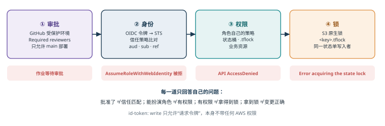
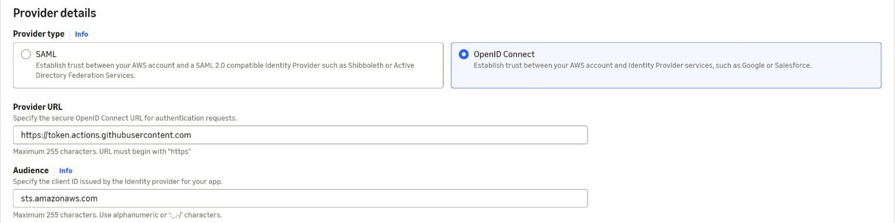
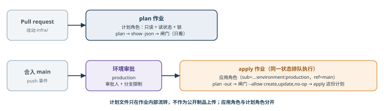
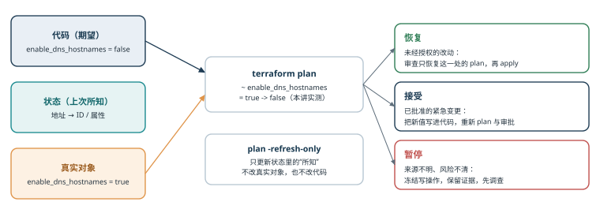

::::: cover
[第 16 讲 · 基础设施即代码 ②]{.kicker}

<h1>远程状态、OIDC 与漂移：<br>没有长期密钥，怎样安全地 apply？</h1>

[一次 CI 部署要连续通过审批、身份、权限、锁四道控制，任何一道“通过”都不代表其他几道通过。部署之后，真实环境还会悄悄偏离代码——漂移该恢复、接受还是暂停，取决于来源与授权。]{.subtitle}

::: cover-meta
- **讲次**：16 / 19
- **建议学时**：4 课时（讲授 2 + 实验 2）
- **实验费用**：全部只读或本地，0 元
- **适用版本**：Terraform 1.17（本书 1.15.5 实测）；configure-aws-credentials v6
:::

::: scenario
一个合入 main 的变更，在 GitHub 上已经由两位审批人批准，apply 作业却报 `AssumeRoleWithWebIdentity` 被拒。另一边，例行 plan 发现生产 VPC 的一个属性和代码不一致——值班同事说那是上周事故里临时改的。**审批都通过了，为什么 AWS 还拒绝？这份不一致，应该让 apply 改回去吗？**
:::

## 学习目标 {.nonum}

:::: cards
::: {.card title="理解"}
- 审批、身份、权限、锁四道控制
- 新格式 OIDC sub 与 ref 条件
- 代码、状态、真实对象三方比较
:::
::: {.card title="推理"}
- 由报错判断卡在哪一道控制
- 为漂移选择恢复、接受或暂停
- 判断 refresh-only 的作用边界
:::
::: {.card title="实操"}
- 四道控制的推理模型（7 + 3 场景）
- 只读 plan 实测漂移与配置生成
- 受保护的工作流与信任策略校验
:::
::: {.card title="排障"}
- 审批通过却 STS 拒绝
- 状态锁冲突
- 生成的配置无法 plan
:::
::::

| 本讲结构 | 要回答的问题 | 产出 |
|---|---|---|
| 一、四道控制 | 为什么不能合成一道？ | 控制链、推理模型 |
| 二、身份 | 审批通过，STS 为何拒绝？ | 信任策略与 Access Analyzer 实测 |
| 三、流水线 | 计划与应用怎样分权？ | 工作流文件 |
| 四、漂移 | 发现不一致，该怎么办？ | 只读 plan 实测、三条路线 |
| 五～六、排障与练习 | 出了问题先查哪里？ | 故障卡、练习 |
:::::

::: {.opener .nobreak}
[一 · 四道控制]{.kicker}

# 四道控制，为什么不能合成一道？

[它们由不同的系统执行，回答不同的问题：GitHub 决定作业能不能开始，STS 决定能不能拿到凭证，IAM 决定凭证能做什么，锁决定同一时刻谁能写状态。]{.subtitle}
:::



:::: {.lab title="实验 16-1｜pipeline：七次部署尝试，各卡在哪一道？"}
::: labmeta
- **目标**：由配置推出失败的控制与报错
- **时长**：15 分钟
- **费用**：0 元
- **工具**：Python 3.11+
:::

```{.console title="python pipeline.py scenarios.json（本书实测输出，节选）"}
  D1  [通过] production 环境已批准，令牌与信任一致
  D2  [审批] production 环境尚未批准
       → 作业等待审批（尚未请求令牌）
  D3  [身份] 已批准，但信任策略只认 main 分支格式的 sub
  D4  [身份] 已批准，信任写的是旧格式 sub（新仓库令牌含数字 ID）
  D5  [权限] 能扮演角色，但角色没有 ssm:PutParameter
       → 拿到了凭证，但 ssm:PutParameter 被拒（AccessDenied）
  D6  [锁] 一切正常，但另一个作业正持有状态锁
       → Error acquiring the state lock（持有者：runner-17 / run 4521）
  D7  [身份] 别人的仓库伪造同名环境
```

3 个单元测试锁定了“每道控制都可以单独失败”。D3 正是情境中的问题：使用 `environment:` 的作业，令牌的 sub 是 `…:environment:production`，而不是 `…:ref:refs/heads/main`——GitHub 的审批与 AWS 的信任是两次独立的判断。
::::

::: {.opener}
[二 · 身份]{.kicker}

# 审批通过了，STS 为什么还拒绝？

[STS 只做一件事：把令牌里的 aud、sub（以及你写进条件的其他声明）与信任策略逐字比较。它不知道 GitHub 上有没有人批准过。]{.subtitle}
:::

| 工作流上下文 | 令牌的 sub（示例） |
|---|---|
| 旧仓库，main 分支 | `repo:example-org/cloudops-lab:ref:refs/heads/main` |
| 2026-07-15 后新建或改名的仓库，main 分支 | `repo:example-org@1234/cloudops-lab@5678:ref:refs/heads/main` |
| 使用环境的作业 | `repo:example-org@1234/cloudops-lab@5678:environment:production` |
| Pull request | `repo:example-org@1234/cloudops-lab@5678:pull_request` |

信任链的起点是账户里的 OIDC 身份提供商（图 16-2）：颁发者 `https://token.actions.githubusercontent.com`，受众 `sts.amazonaws.com`；本书账户里还没有任何身份提供商，表单只填写、未创建。新格式的 sub 带上了所有者与仓库的数字 ID，仓库被删除后同名重建也不会继承信任（第 07 讲）。环境与 PR 类型的 sub **不含分支**，Access Analyzer 会据此给出警告。把两份信任策略交给它校验（`labs/03-workflow`，免费）：

{.shot width=80%}

```{.console title="bash validate.sh（Access Analyzer，本书实测输出，2026-11-18）"}
== trust-plan-role.json（sub = …:pull_request）
SUGGESTION  CONFIRM_AUDIENCE_CLAIM_TYPE
WARNING     SPECIFIC_GITHUB_REPO_AND_BRANCH_RECOMMENDED
== trust-apply-role.json（sub = …:environment:production）
SUGGESTION  CONFIRM_AUDIENCE_CLAIM_TYPE
WARNING     SPECIFIC_GITHUB_REPO_AND_BRANCH_RECOMMENDED
            … If the subject claim does not include the branch,
            specify it in a token.actions.githubusercontent.com:ref condition key.
== trust-apply-role-with-ref.json（再加 ref = refs/heads/main）
SUGGESTION  CONFIRM_AUDIENCE_CLAIM_TYPE
```

加上 `token.actions.githubusercontent.com:ref = refs/heads/main` 之后，应用角色的警告消失——它被同时钉在“这个仓库、这个环境、main 分支”上。计划角色的警告无法这样消除：PR 作业的 ref 是 `refs/pull/<编号>/merge`，来源分支任意，这正是它只能只读的原因。剩下的建议只是提醒 aud 是单值声明、不要加 `ForAnyValue` 之类的限定符。

::: pitfalls
1. **不要用通配 sub 修复报错。** 把 `sub` 改成 `repo:example-org/*` 能让报错消失，也能让组织里任何仓库、任何分支扮演生产角色。IAM 对 GitHub 这类共享提供商本就要求必须评估 sub（第 07 讲）。
2. **`id-token: write` 不是 AWS 权限。** 它只允许作业向 GitHub 请求令牌；能做什么由角色的策略决定。
3. **计划角色与应用角色分开。** PR 来自不受信任的分支，计划角色只能只读（加读状态与锁）；写权限只给受保护环境里的应用角色。
:::

::: {.opener}
[三 · 流水线]{.kicker}

# 计划与应用，怎样分权？

[PR 上只做 plan；合入后在受保护环境里重新 plan、过闸门、apply 同一份计划。计划文件只在作业内部流转。]{.subtitle}
:::



```{.text title="labs/03-workflow/.github/workflows/terraform.yml（节选）"}
  apply:
    if: github.event_name == 'push'
    environment: production                      # 审批发生在作业开始之前
    concurrency:
      group: terraform-state-production          # 同一份状态排队执行（锁之外的第二道保险）
      cancel-in-progress: false
    permissions: { contents: read, id-token: write }
    steps:
      - uses: actions/checkout@v7
      - uses: aws-actions/configure-aws-credentials@v6   # 生产中固定到提交 SHA
        with: { role-to-assume: "${{ vars.APPLY_ROLE_ARN }}", aws-region: us-east-1 }
      - uses: hashicorp/setup-terraform@v4
        with: { terraform_version: 1.17.2, terraform_wrapper: false }
      - run: terraform -chdir=infra init -input=false
      - run: terraform -chdir=infra plan -input=false -lock-timeout=5m -out=tfplan
      - run: terraform -chdir=infra show -json tfplan > plan.json
      - run: python tools/inspect_plan.py plan.json --allow create,update,no-op
      - run: terraform -chdir=infra apply -input=false tfplan
```

闸门脚本就是第 15 讲的 `inspect_plan.py`：计划里出现 delete 或 replace，作业失败，变更回到人工审批。状态后端使用 S3 原生锁（`use_lockfile = true`）与第 15 讲的最小权限状态策略；`-lock-timeout=5m` 让作业在锁被占用时等待，而不是立即失败。`terraform_wrapper: false` 关掉 setup-terraform 默认安装的包装脚本——我们把 JSON 直接重定向到文件，不需要它把输出转成步骤变量。版本号为 2026-11 核对时的最新主版本（checkout v7、configure-aws-credentials v6.3.0、setup-terraform v4.0.1）。

::: {.opener}
[四 · 漂移]{.kicker}

# 发现不一致，该让 apply 改回去吗？

[漂移不是一个“自动修复”按钮，而是一个需要判断来源与授权的事件。同一份不一致，可能该恢复、该接受，也可能该先暂停。]{.subtitle}
:::



:::: {.lab title="实验 16-2｜只读 plan：让 Terraform 说出真实对象与代码的差异"}
::: labmeta
- **目标**：亲眼看到 plan 如何表达“代码 ≠ 真实”，以及配置生成的局限
- **时长**：15 分钟
- **费用**：0 元（只执行 plan，不导入、不修改）
- **前提**：账户中的默认 VPC（只读）
:::

`compare/` 用 `import` 块指向账户里真实存在的默认 VPC，但在代码中故意把 `enable_dns_hostnames` 写成 `false`（真实值是 `true`）——相当于“有人在控制台里打开了它”。只读 plan 的结果：

```{.console title="terraform plan（本书实测输出，2026-11-18，账户号已替换）"}
  # aws_vpc.default will be updated in-place
  # (imported from "vpc-0a891659a4b172ecd")
  ~ resource "aws_vpc" "default" {
        arn                  = "arn:aws:ec2:us-east-1:111122223333:vpc/vpc-0a891659a4b172ecd"
        cidr_block           = "172.31.0.0/16"
      ~ enable_dns_hostnames = true -> false
        enable_dns_support   = true
        …
    }
Plan: 1 to import, 0 to add, 1 to change, 0 to destroy.
```

`generate/` 则让 Terraform 用 `-generate-config-out` 从真实对象反推 HCL。生成成功了，但随后的 plan 报错：生成的代码里有 `ipv6_netmask_length = 0`，而该参数要求同时给出 `ipv6_ipam_pool_id`（实测输出存于 `generated-2026-11-18.tf.txt`）。**生成的配置是起点，不是成品**——要删掉空值与默认值、补上有意义的设置，再纳入代码评审。
::::

:::: {.example title="例题 16-1｜一份漂移，三种处理"}
已知：例行 plan 显示生产 SSM 参数 `/checkout/timeout` 将从 15 改回 5。

::: steps
1. **先找来源。** 按资源名查 CloudTrail（第 11 讲 ctquery）：谁、何时、经什么身份改了它？
2. **再看授权。** 有对应的变更单或事故记录吗？是否经过批准？
3. **选路线。** 无授权的改动 → 恢复（审查一份只改这一处的 plan 再 apply）；事故中获批的临时改动 → 接受（把 15 写进代码，走正常审批）；找不到来源或风险不明 → 暂停（冻结该资源的写操作，保留状态与日志）。
4. **防再发。** 让生产只能经流水线修改（预防），并保留例行 plan 或 AWS Config 规则做检测。
:::

::: answer
不能一概而论“apply 改回去”。若这是事故中批准的修复，直接 apply 会让事故重演；若来源不明，任何写操作都可能破坏证据。漂移的处理由“来源 + 授权 + 风险”决定。
:::
::::

`terraform plan -refresh-only` 只计划把状态中的“所知”更新为真实值；对它 apply 只改状态，不改真实对象，也不改代码——下一次普通 plan 仍会提议把真实对象改回代码的值。它适合“接受”路线中的一步，而不是漂移的解药。

::: {.opener}
[五 · 排障]{.kicker}

# 出了问题，先查哪一道控制？

[按图 16-1 的顺序：作业开始了吗？拿到凭证了吗？哪个 API 被拒？锁在谁手里？]{.subtitle}
:::

::: {.fault title="故障 1｜审批通过了，STS 仍然拒绝"}
现象
:   `Not authorized to perform sts:AssumeRoleWithWebIdentity`。

根因
:   信任策略的 sub 与令牌不一致：环境作业的 sub 是 `…:environment:…`；新仓库的 sub 含数字 ID；或 aud 不是 `sts.amazonaws.com`。

修复
:   在作业里打印令牌声明（不要打印令牌本身）核对 sub，按实际格式精确修改信任策略；不要改成通配。
:::

::: {.fault title="故障 2｜拿到凭证，但 terraform init 报 AccessDenied"}
现象
:   STS 成功，读取状态时 403。

根因
:   角色缺少状态桶的 ListBucket、状态对象的 Get/Put，或 `.tflock` 的 Get/Put/Delete；使用 KMS 加密的状态还需要密钥权限。

修复
:   按第 15 讲的状态访问策略补齐，并用模拟器验证。
:::

::: {.fault title="故障 3｜两个作业互相等锁"}
现象
:   一个作业 `Error acquiring the state lock`，另一个作业早已结束。

根因
:   上一个作业被取消或崩溃，`.tflock` 没被删除。

修复
:   确认持有者作业确已结束，再 `terraform force-unlock <ID>`；用 `concurrency` 让同一状态的作业排队，减少竞争。
:::

::: {.fault title="故障 4｜用生成的配置导入资源，plan 报错"}
现象
:   `-generate-config-out` 之后，plan 报 Missing required argument。

根因
:   生成器把真实对象的所有属性都写了出来，包括互相依赖的空值与零值（本讲实测：`ipv6_netmask_length = 0`）。

修复
:   删除空值、默认值与互斥参数，只保留有意义的设置；导入前让计划只出现 import，没有 update。
:::

::: {.opener}
[六 · 练习]{.kicker}

# 练一练：每道控制各管什么？

[先独立作答，再对照解析。]{.subtitle}
:::

## 随堂练习

::: {.exercise title="练习 1｜认证与授权"}
作业成功扮演了角色，是否意味着它能执行 `ssm:PutParameter`？
:::

::: {.exercise title="练习 2｜审批与身份"}
环境审批已通过，为什么仍可能出现 STS 拒绝？
:::

::: {.exercise title="练习 3｜版本与锁"}
状态桶开了版本控制，是否等于启用了状态锁？
:::

::: {.exercise title="练习 4｜锁冲突"}
两个作业同时写状态的风险，能不能用 `-lock=false` 解决？
:::

::: {.exercise title="练习 5｜refresh-only"}
对 `plan -refresh-only` 执行 apply 之后，下一次普通 plan 还会提议改回去吗？
:::

::: {.exercise title="练习 6｜ref 条件"}
为什么应用角色的信任策略在 sub 之外还要加 `ref = refs/heads/main`？
:::

## 参考答案与解析

::: {.solution title="1"}
不能。扮演成功只说明满足信任策略；API 能否调用取决于角色自己的策略、资源策略以及组织策略。
:::

::: {.solution title="2"}
GitHub 的审批与 AWS 的信任是两次独立判断：令牌的 aud / sub（以及 ref 等条件）必须与信任策略逐字匹配。
:::

::: {.solution title="3"}
不等于。版本控制保留历史、用于恢复；锁要在后端显式设置 `use_lockfile = true`。
:::

::: {.solution title="4"}
不能。应保留锁、用 `concurrency` 排队、调查竞争来源；绕过锁可能把状态写坏。
:::

::: {.solution title="5"}
会。refresh-only 只更新状态，代码没变；普通 plan 仍以代码为期望值。要“接受”新值，必须修改代码。
:::

::: {.solution title="6"}
环境类型的 sub 不包含分支：没有 ref 条件时，任何能在该环境部署的分支都能扮演角色（若环境的分支限制被放宽）。加上 ref 后，信任本身就钉住了 main；Access Analyzer 的警告也随之消失（实测）。
:::

## 这一讲，你应该记住 {.nonum}

:::: summary
::: {.card tag="四道控制"}
**审批 · 身份 · 权限 · 锁**

每道只回答自己的问题。
:::
::: {.card tag="身份"}
**sub 逐字匹配，环境再加 ref**

不要用通配修复报错。
:::
::: {.card tag="流水线"}
**计划只读，应用受保护**

只 apply 通过闸门的那份计划。
:::
::: {.card tag="漂移"}
**恢复 · 接受 · 暂停**

由来源与授权决定，不由 apply 决定。
:::
::::

::: refs
## 参考资料 {.nonum}

[实测说明：图 16-2 为 2026-11-18 控制台实拍（未创建）；漂移 plan 与配置生成为对默认 VPC 的只读 plan（账户号已替换）；信任策略经 Access Analyzer 校验；pipeline.py 为本地运行；工作流文件经 YAML 解析检查。]{.small}

1. GitHub OIDC 与 AWS <https://docs.github.com/en/actions/security-for-github-actions/security-hardening-your-deployments/configuring-openid-connect-in-amazon-web-services>；环境保护规则 <https://docs.github.com/en/actions/managing-workflow-runs-and-deployments/managing-deployments/managing-environments-for-deployment>
2. import 块与配置生成 <https://developer.hashicorp.com/terraform/language/import/generating-configuration>；refresh-only <https://developer.hashicorp.com/terraform/tutorials/state/refresh>；S3 后端 <https://developer.hashicorp.com/terraform/language/backend/s3>
:::
