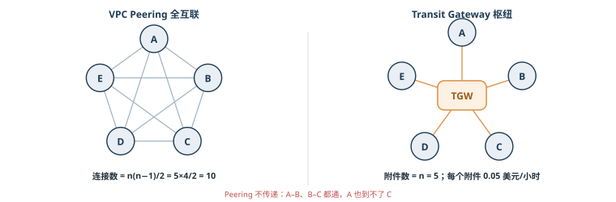
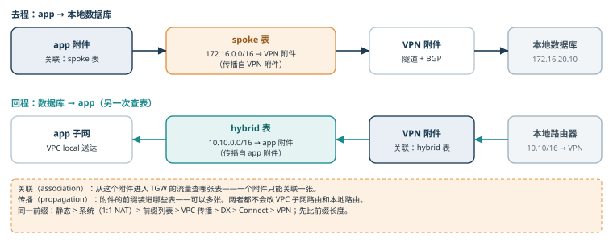
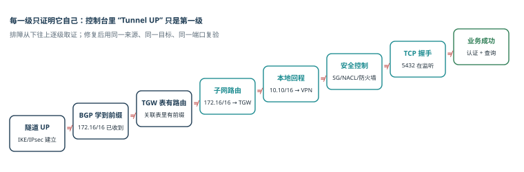
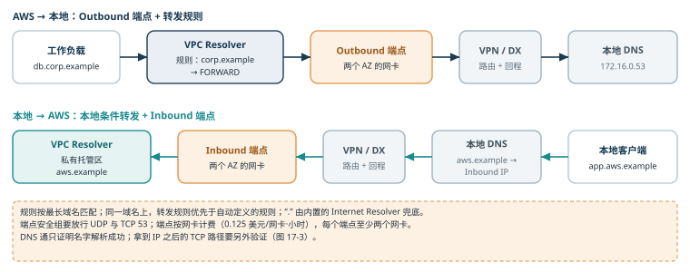
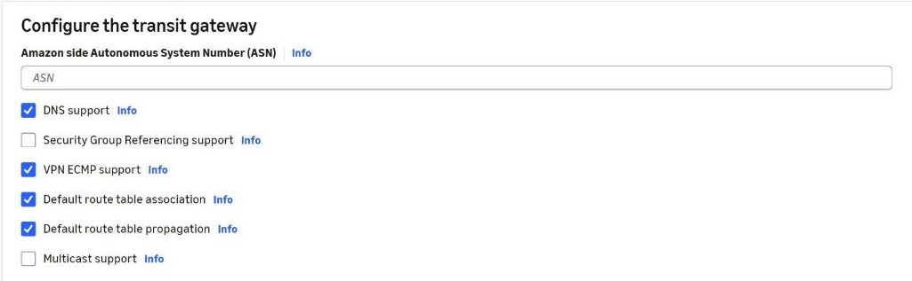

::::: cover
[第 17 讲 · 企业网络]{.kicker}

<h1>TGW、VPN 与企业 DNS：<br>隧道 UP 了，数据库为什么还超时？</h1>

[一个包从 AWS 到机房要查好几张路由表，回来时又是另一组表；名字解析则走着完全独立的路径。把每张表、每个方向分开验证，“隧道 UP 却不通”就不再神秘。]{.subtitle}

::: cover-meta
- **讲次**：17 / 19
- **建议学时**：4 课时（讲授 2 + 实验 2）
- **实验费用**：模型与只读 plan 0 元；可选云上实验约 0.10 美元/小时
- **适用版本**：AWS Provider 6.x；Terraform 1.17（本书 1.15.5 实测）
:::

::: scenario
公司有 10 个 VPC 和一座机房。起初用 VPC Peering 两两互联，连接越建越多、路由越来越难管；改用 Transit Gateway 之后，新的问题来了：VPN 控制台显示两条隧道都是 UP，`db.corp.example` 也解析出了 172.16.20.10，应用连数据库却一直超时。**隧道 UP 到底证明了什么？问题出在哪一张表？**
:::

## 学习目标 {.nonum}

:::: cards
::: {.card title="理解"}
- Peering 不传递，连接数按 n(n−1)/2 增长
- 关联与传播：查哪张表、装哪些前缀
- 同一前缀时的路由优先级
:::
::: {.card title="推理"}
- 去程与回程是两次独立的查表
- 最长前缀与黑洞路由
- DNS 查询方向与规则匹配
:::
::: {.card title="实操"}
- 12 个场景的往返推理模型
- 两张 TGW 表的 Terraform（测试 + 只读 plan）
- 只读盘点与价格计算
:::
::: {.card title="排障"}
- 隧道 UP 而 TCP 超时
- 附件可用却查不到路由
- DNS 通而 TCP 不通，或反之
:::
::::

| 本讲结构 | 要回答的问题 | 产出 |
|---|---|---|
| 一、拓扑 | 为什么不再两两直连？ | 连接数公式、选型 |
| 二、两张表 | 进了 TGW 查哪张表？ | 往返推理模型 |
| 三、混合连接 | 隧道 UP 证明了什么？ | 证据阶梯 |
| 四、企业 DNS | 谁向谁问名字？ | 规则匹配、两个探针 |
| 五、代码与成本 | 怎样让表与代码一一对应？ | Terraform、只读 plan |
| 六～七、排障与练习 | 先查哪一张表？ | 故障卡、练习 |
:::::

::: {.opener .nobreak}
[一 · 拓扑]{.kicker}

# 为什么 10 个 VPC 不再两两直连？

[Peering 是“点对点的桥”，不传递；TGW 是“区域路由器”，每个 VPC 只接一次，但每一跳都要查表。]{.subtitle}
:::



::: formula
Peering 全互联连接数 = n(n − 1) ÷ 2 [10 个 VPC：45 条；20 个：190 条]{.unit}
:::

这个数字只在“每两个 VPC 都必须直连”时成立。更关键的是 **Peering 不传递**：A–B、B–C 都已打通，A 也不会经 B 到达 C；而且每条 Peering 两端都要各自维护路由与安全组。TGW 把网络变成“每个 VPC 接一次、在中心查表”，代价是每个附件 0.05 美元/小时、每 GB 0.02 美元的数据处理费（us-east-1，Price List API，2026-11-18），以及一层必须认真管理的路由表。

| 方案 | 适合 | 别忽略 |
|---|---|---|
| VPC Peering | 少量 VPC、明确的点对点访问 | 不传递；两端路由；CIDR 不能重叠 |
| Transit Gateway | 多 VPC / 多账户 / 混合网络的集中路由 | 关联与传播、回程、附件 AZ、按小时计费 |
| Cloud WAN | 跨区域、按策略统一管理的全球网络 | 独立的产品与费用模型，不是本讲的默认方案 |

::: {.opener}
[二 · 两张表]{.kicker}

# 进了 TGW 之后，查哪张表？

[TGW 本身就是一台路由器：从哪个附件进来，就查那个附件“关联”的表；表里有哪些前缀，取决于谁“传播”进来。]{.subtitle}
:::



| 概念 | 回答的问题 | 本例 |
|---|---|---|
| 关联（association） | 从这个附件进来的流量查哪张表？一个附件只能关联一张 | app、data → spoke 表；VPN → hybrid 表 |
| 传播（propagation） | 附件的前缀装进哪些表？可以多张 | VPN 的 172.16/16 → spoke；两个 VPC 的前缀 → hybrid |
| VPC 子网路由 | 实例怎样把包交给 TGW？不会自动生成 | 172.16.0.0/16 → TGW |
| 本地回程 | 机房怎样把响应送回 AWS？ | 10.10.0.0/16 → VPN |

这个设计里，app 与 data 共用 spoke 表，而 spoke 表只装了本地前缀——两个 VPC 都能去机房，彼此却不可达。这就是“用路由表做隔离”的基本手法。

**选路规则**（官方文档“Route evaluation order”）：先比前缀长度，**越精确越优先**；前缀相同时，静态路由 > 系统路由（1:1 NAT）> 前缀列表引用 > VPC 传播 > Direct Connect 网关传播 > Connect 传播 > 经 DX 的 VPN 传播 > VPN 传播 > VPN Concentrator 传播 > ……；同类 BGP 路由再比 AS Path 长度与 MED。表里只显示当前选中的那一条，备用路由要等首选路由撤销后才会出现。

:::: {.example title="例题 17-1｜隧道 UP，数据库为何超时？"}
已知：app VPC 的 10.10.2.20 访问本地数据库 172.16.20.10:5432 超时；`db.corp.example` 已正确解析；两条 VPN 隧道均为 UP。网络团队发现机房路由器上没有 10.10.0.0/16。求：最可能直接造成超时的是哪一处？

::: steps
1. **先把名字与连通分开。** DNS 已返回 172.16.20.10，名字层没有问题；之后的所有检查都用 IP 与端口进行。
2. **查去程。** 子网路由 172.16.0.0/16 → TGW；app 附件关联 spoke 表，表中 172.16.0.0/16 → VPN 附件（传播）。去程条件齐全。
3. **查回程。** 响应从机房出发：机房路由表里找不到 10.10.2.20 所在网段，响应根本不会被送进 VPN——TGW 的 hybrid 表此时还没有机会参与。
4. **最小修复与复验。** 只在机房补 10.10.0.0/16 → VPN（或经 BGP 学到它），不改安全组基线；用同一来源、同一目标、同一端口复验，再做数据库认证与查询。
:::

::: answer
在题设事实成立、其他控制点没有同时出错的前提下，**机房缺少回程路由**是最直接的原因。“隧道 UP”只证明 IPsec 隧道建立，不证明任何一张路由表正确。
:::
::::

:::: {.lab title="实验 17-1｜hybrid：12 个场景，每次只改一处"}
::: labmeta
- **目标**：用代码复现选路规则，推出每个场景卡在哪一跳
- **时长**：20 分钟
- **费用**：0 元（不发包、不调用 AWS）
- **工具**：Python 3.11+（标准库 ipaddress）
:::

`labs/01-hybrid/hybrid.py` 实现了 VPC 路由表、TGW 路由表（关联、传播、静态、黑洞、同前缀优先级）、附件的 AZ 覆盖、机房路由与 Resolver 规则匹配；`scenarios.json` 以图 17-2 为基线，每个场景只改一处：

```{.console title="python hybrid.py scenarios.json（本书实测输出，节选）"}
S1  DNS=ok TCP=ok     基线：app 访问本地数据库
S2  TCP=FAIL          隔离：app 访问 data（同在 spoke 表）
      └ 去程：TGW 表 spoke 中没有匹配 10.20.1.10 的路由
S3  TCP=FAIL          本地缺少 10.10/16 回程
      └ 回程：本地路由表没有到 10.10.2.20 的路由（不会送进 VPN）
S4  TCP=FAIL          spoke 表多了 172.16.20.0/24 黑洞
      └ 去程：TGW 表 spoke 命中 172.16.20.0/24 → blackhole（被丢弃）
S5  TCP=FAIL          app 附件关联错了表（hybrid）
      └ 去程：TGW 表 hybrid 中没有匹配 172.16.20.10 的路由
S6  TCP=FAIL          app 附件只开了 az1，源在 az2
      └ 去程：app-b 所在 use1-az2 没有 TGW 附件子网，进不了 TGW
S7  TCP=ok            DX 与 VPN 同时传播 172.16/16
S8  TCP=ok            再加一条静态 172.16/16 → VPN
S9  TCP=ok            默认表：所有附件关联并传播到 default
S10 DNS=FAIL TCP=ok   没有 corp.example 转发规则
S11 DNS=FAIL TCP=ok   本地防火墙拒绝 53 端口
S12 DNS=ok TCP=ok     本地 DNS 经 Inbound 端点查 AWS 名字
```

`--trace` 会打印逐跳过程。几个值得细看的结果：S7 中 DX 与 VPN 传播了同一前缀，去程选了 DX，而回程仍经 VPN 回来——**非对称路径**，机房的有状态防火墙可能因此丢包；S8 加了一条静态路由，静态压过所有传播路由；S9 把所有附件都关联、传播到默认表，S2 中的隔离立刻消失；S6 说明附件子网没有覆盖的 AZ 根本进不了 TGW。8 个单元测试锁定了这些规则。
::::

::: {.opener}
[三 · 混合连接]{.kicker}

# “隧道 UP”到底证明了什么？

[它只证明 IPsec 隧道建立了。前缀有没有学到、表里有没有路由、回程在不在、端口开没开，都是独立的证据。]{.subtitle}
:::



| 维度 | Site-to-Site VPN | Direct Connect |
|---|---|---|
| 连接 | 两条 IPsec 隧道，通常经互联网 | 运营商 / 合作伙伴交付的专用链路 |
| 加密 | IPsec 自带 | 默认不加密；按需 MACsec 或在 DX 上跑 VPN |
| 路由 | 静态或 BGP | BGP，经 DX 网关接 TGW |
| 高可用 | 两条隧道落在 AWS 两个端点，但客户侧设备与运营商仍可能是单点 | 需要冗余位置、链路与设备，并演练切换 |
| 费用（us-east-1） | 0.05 美元/连接·小时；接 TGW 再加附件费 | 端口与数据传输，另有运营商费用 |

2025—2026 年的变化：VPN 隧道新增**大带宽档（5 Gbps）**，只能接 TGW 或 Cloud WAN，不能接虚拟私有网关，us-east-1 为 0.60 美元/连接·小时，2026 年 5 月起可在现有连接上修改带宽档；2025 年 11 月推出的 **VPN Concentrator** 以一个 TGW 附件汇聚大量小站点（官方建议 25 个以上、每站点低于 100 Mbps），按 1.95 美元/小时加每站点 0.01 美元/小时计费（Price List API，2026-11-18）。它们改变的是带宽与规模，不改变图 17-3 的证据关系。

::: pitfalls
1. **两条隧道 ≠ 两个故障域。** 隧道在 AWS 一侧落在两个端点，但如果客户侧只有一台路由器、一条运营商线路，单点仍在你这边。
2. **静态路由不会自动切换。** BGP 会在隧道断开时撤销前缀；静态 VPN 需要你自己确认两条隧道的路由都在。
3. **同一前缀走 DX 还是 VPN，由优先级决定，回程由机房决定。** 两边选择不一致就会出现 S7 的非对称路径。
:::

::: {.opener}
[四 · 企业 DNS]{.kicker}

# 谁向谁问名字？

[DNS 查询有方向：AWS 查机房的名字走 Outbound 端点，机房查 AWS 的名字走 Inbound 端点。名字解析成功，和 TCP 通不通是两件事。]{.subtitle}
:::



| 方向 | 需要的组件 | 前提 |
|---|---|---|
| AWS → 机房 | Outbound 端点 + 转发规则 + 规则关联到 VPC | 到机房 DNS 的路由与回程；UDP/TCP 53 放行 |
| 机房 → AWS | Inbound 端点 + 机房 DNS 的条件转发 | 机房到 Inbound 网卡的路由与 53 放行 |
| VPC ↔ VPC | 私有托管区关联、共享规则或 Route 53 Profiles | TGW 只转发包，不负责解析别的 VPC 的私有托管区 |

**规则怎样匹配？** 按最长域名匹配：同时有 `corp.example` 和 `internal.corp.example` 两条规则时，后者优先；同一域名上转发规则优先于自动定义的规则；没有任何规则命中的名字，由内置的 Internet Resolver（域名“.”）递归解析。本书账户的只读盘点正好只剩这条兜底规则：

```{.console title="aws route53resolver …（本书实测输出，2026-11-18，us-east-1）"}
$ aws route53resolver list-resolver-endpoints --query 'length(ResolverEndpoints)'
0
$ aws route53resolver list-resolver-rules --query 'ResolverRules[].[Id,Name,RuleType,DomainName]'
rslvr-autodefined-rr-internet-resolver   Internet Resolver   RECURSIVE   .
$ aws ec2 describe-transit-gateways --query 'length(TransitGateways)'       # VPN、客户网关同为 0
0
```

2025 年 11 月起，原来的 Route 53 Resolver 改称 **Route 53 VPC Resolver**，以区别于新推出的 **Route 53 Global Resolver**（2026 年 3 月正式发布，面向 VPC 之外的客户端提供任播 DNS）。本讲讨论的端点与规则都属于 VPC Resolver。端点按网卡计费：每个网卡 0.125 美元/小时，一个端点至少两个网卡；经端点的查询 0.40 美元/百万次（Price List API）。

| DNS 探针 | IP:端口 探针 | 先查什么 |
|---|---|---|
| 失败 | 成功 | 转发规则、Outbound 端点、机房 DNS、UDP/TCP 53（S10、S11） |
| 成功 | 失败 | VPC / TGW / VPN / 机房回程、安全组与防火墙、监听 |
| 失败 | 失败 | 可能有两个问题：先确认底层传输，再查 DNS |
| 成功 | 成功 | 还要做数据库认证与业务查询 |

::: {.opener}
[五 · 代码与成本]{.kicker}

# 怎样让两张表与代码一一对应？

[TGW、附件、TGW 路由表、关联、传播、VPC 路由是六种不同的资源。少写一种，网络就会在某一跳断开。]{.subtitle}
:::

在控制台创建 TGW 时，“默认路由表关联”和“默认路由表传播”默认勾选（图 17-5）：之后每个新附件都会自动关联并传播到同一张默认表——这正是 S9 的情形，任何多表隔离设计都会被它绕过。代码里要显式关闭：

{.shot width=72%}

```{.hcl title="labs/02-terraform/main.tf（节选）"}
resource "aws_ec2_transit_gateway" "hub" {
  count                           = var.enable_paid_lab ? 1 : 0
  default_route_table_association = "disable"
  default_route_table_propagation = "disable"
}

resource "aws_ec2_transit_gateway_route_table_association" "spoke" {   # 关联自己的表
  for_each                       = local.spokes
  transit_gateway_attachment_id  = aws_ec2_transit_gateway_vpc_attachment.spoke[each.key].id
  transit_gateway_route_table_id = aws_ec2_transit_gateway_route_table.spoke[each.key].id
}

resource "aws_ec2_transit_gateway_route_table_propagation" "cross" {   # 传播到对端的表
  for_each                       = local.spokes
  transit_gateway_attachment_id  = aws_ec2_transit_gateway_vpc_attachment.spoke[each.key].id
  transit_gateway_route_table_id = aws_ec2_transit_gateway_route_table.spoke[local.peer[each.key]].id
}

resource "aws_route" "to_peer" {                                         # VPC 路由要自己写
  for_each               = local.spokes
  route_table_id         = aws_route_table.spoke[each.key].id
  destination_cidr_block = local.vpcs[local.peer[each.key]].cidr
  transit_gateway_id     = aws_ec2_transit_gateway.hub[0].id
}
```

:::: {.lab title="实验 17-2｜两张 TGW 表：默认零资源，测试先行"}
::: labmeta
- **目标**：用测试锁住“关联自己、传播对端、关闭默认表”
- **时长**：20 分钟
- **费用**：test 与 plan 0 元；apply 约 0.10 美元/小时
- **权限**：plan 只需读取可用区
:::

`enable_paid_lab` 默认为 false：plan 里一个资源都没有。附件子网是每个 AZ 一个 /28，这样两个 AZ 的实例都能进入 TGW（S6 的教训）。

```{.console title="terraform test 与只读 plan（本书实测输出，2026-11-18）"}
$ terraform test
  run "default_creates_nothing"... pass
  run "tgw_does_not_use_default_table"... pass
  run "each_attachment_spans_two_azs"... pass
  run "associate_own_table_propagate_to_peer"... pass
  run "optional_blackhole"... pass
  run "bad_blackhole_rejected"... pass
Success! 6 passed, 0 failed.

$ terraform plan                                  # 只有输出变化，没有资源
  + estimated_usd_per_hour = 0
$ terraform plan -var enable_paid_lab=true
      + availability_zone = "us-east-1a" … "us-east-1b"   # 真实可用区
      + default_route_table_association = "disable"
Plan: 23 to add, 0 to change, 0 to destroy.
```

测试里用 `override_resource` 给两张 TGW 表固定不同的 ID，才能在 plan 阶段断言“app 附件传播进的是 data 的表”——否则计算出的 ID 未知，断言无从比较。
::::

::: formula
云上实验费用 ≈ 附件数 × 0.05 美元/小时 + 数据量 × 0.02 美元/GB [本实验 0.10 美元/小时]{.unit}
:::

真实环境的账单往往来自被忽略的常驻项：一对 Inbound 与 Outbound 端点（各两个网卡）是 4 × 0.125 = 0.50 美元/小时，约 365 美元/月；一条 VPN 接 TGW 是 0.05（连接）+ 0.05（附件）= 0.10 美元/小时。这些资源只要存在就计费，与流量无关。

::: {.opener}
[六 · 排障]{.kicker}

# 出了问题，先查哪一张表？

[按图 17-3 从下往上：先分开名字与连通，再沿去程逐跳查，最后查回程。]{.subtitle}
:::

::: {.fault title="故障 1｜隧道 UP，TCP 超时"}
现象
:   VPN 两条隧道 UP，DNS 正常，`nc -vz 172.16.20.10 5432` 超时。

根因
:   机房缺少到 10.10.0.0/16 的回程（S3），或 BGP 没有收到前缀、防火墙拒绝。

修复
:   补精确的回程前缀；用同一来源、目标、端口复验，再验数据库认证。
:::

::: {.fault title="故障 2｜附件 Available，却查不到路由"}
现象
:   附件状态正常，`search-transit-gateway-routes` 在预期的表里找不到目标前缀。

根因
:   附件关联到了别的表（S5），或目标附件没有传播到这张表。

修复
:   先看附件关联哪张表，再看那张表里的前缀来自谁；必要时加静态路由。
:::

::: {.fault title="故障 3｜同一个子网段，有的实例通、有的不通"}
现象
:   az1 的实例能访问机房，az2 的不行。

根因
:   VPC 附件没有选 az2 的子网（S6），az2 的流量进不了 TGW。

修复
:   为每个用到的 AZ 指定一个附件子网（建议专用 /28）。
:::

::: {.fault title="故障 4｜隔离突然失效"}
现象
:   本应隔离的两个 VPC 可以互访。

根因
:   TGW 开着默认表的自动关联与传播，新附件都进了同一张表（S9）。

修复
:   关闭两个默认选项，按安全域显式关联与传播；必要时用黑洞路由兜底。
:::

::: {.fault title="故障 5｜DNS 失败，按 IP 却能连上"}
现象
:   `nslookup db.corp.example` 失败，按 IP 连接 5432 成功。

根因
:   没有 `corp.example` 的转发规则或没关联到这个 VPC（S10），或到机房 DNS 的 53 端口被拒（S11）。

修复
:   只修规则与 53 放行，不动网络基线；修完分别复验 DNS 与 TCP。
:::

::: {.opener}
[七 · 练习]{.kicker}

# 练一练：问题在哪一张表？

[先独立作答，再对照解析。]{.subtitle}
:::

## 随堂练习

::: {.exercise title="练习 1｜Peering 数学"}
6 个 VPC 两两直连需要多少条 Peering？A–B、B–C 已连通，A 能经 B 访问 C 吗？
:::

::: {.exercise title="练习 2｜最长前缀"}
spoke 表有 172.16.0.0/16 → VPN，还有 172.16.20.0/24 → blackhole。访问 172.16.20.10 会怎样？访问 172.16.30.10 呢？
:::

::: {.exercise title="练习 3｜同一前缀"}
spoke 表里 172.16.0.0/16 同时有 VPC 传播、DX 传播、VPN 传播三条候选，表里显示哪一条？再加一条静态路由指向 VPN 呢？
:::

::: {.exercise title="练习 4｜关联与传播"}
“把 data 附件传播到 app 的表”能让 data 访问 app 吗？
:::

::: {.exercise title="练习 5｜DNS 方向"}
机房的服务器要解析 `app.aws.example`（私有托管区），应该用哪种端点？要放行什么？
:::

::: {.exercise title="练习 6｜费用"}
一对 Resolver 端点（Inbound、Outbound 各两个网卡）加一条接 TGW 的 VPN，一个月（730 小时）的常驻费用大约是多少？
:::

## 参考答案与解析

::: {.solution title="1"}
6 × 5 ÷ 2 = 15 条。不能：Peering 不传递，A 到 C 需要自己的 Peering 或经 TGW。
:::

::: {.solution title="2"}
172.16.20.10 同时匹配 /16 与 /24，/24 更精确，命中黑洞被丢弃；172.16.30.10 只匹配 /16，经 VPN 送出。
:::

::: {.solution title="3"}
先比前缀长度（相同），再比类型：VPC 传播 > DX > VPN，表里只显示 VPC 传播那条（若三者确实同前缀）。加静态路由后，静态优先于所有传播路由。
:::

::: {.solution title="4"}
不一定。它只让“查 app 表的流量”（从 app 附件进来的去程）找到 data；data 发起的流量查的是 data 自己关联的表，还需要 app 的前缀传播进 data 的表，以及双方的 VPC 路由。
:::

::: {.solution title="5"}
Inbound 端点；机房 DNS 对 `aws.example` 做条件转发到 Inbound 网卡 IP。端点安全组放行来自机房 DNS 的 UDP 与 TCP 53，并确保机房到端点子网的路由与回程。
:::

::: {.solution title="6"}
端点：4 个网卡 × 0.125 × 730 ≈ 365 美元；VPN：（0.05 + 0.05）× 730 ≈ 73 美元。合计约 438 美元/月，尚未计入查询与数据费用。
:::

## 这一讲，你应该记住 {.nonum}

:::: summary
::: {.card tag="拓扑"}
**Peering 不传递**

全互联 n(n−1)/2；TGW 每个 VPC 接一次。
:::
::: {.card tag="两张表"}
**关联查表，传播装前缀**

去程与回程各查一次。
:::
::: {.card tag="证据"}
**隧道 UP 只是第一级**

逐级取证，按原样复验。
:::
::: {.card tag="DNS"}
**按方向选端点**

DNS 通 ≠ TCP 通。
:::
::::

::: refs
## 参考资料 {.nonum}

[实测说明：hybrid.py 为本地确定性模型（不发包、不调用 AWS）；Resolver 与 TGW 盘点为 us-east-1 只读查询；价格来自 Price List API（2026-11-18）；Terraform 只执行 test 与只读 plan；图 17-5 为 2026-11-18 控制台实拍（未创建）。]{.small}

1. TGW 工作原理与选路顺序 <https://docs.aws.amazon.com/vpc/latest/tgw/how-transit-gateways-work.html>；VPN 隧道选项 <https://docs.aws.amazon.com/vpn/latest/s2svpn/VPNTunnels.html>
2. VPC Resolver 转发规则 <https://docs.aws.amazon.com/Route53/latest/DeveloperGuide/resolver-overview-forward-vpc-to-network-using-rules.html>；Global Resolver <https://aws.amazon.com/about-aws/whats-new/2026/03/amazon-route-53-global-resolver/>
:::
