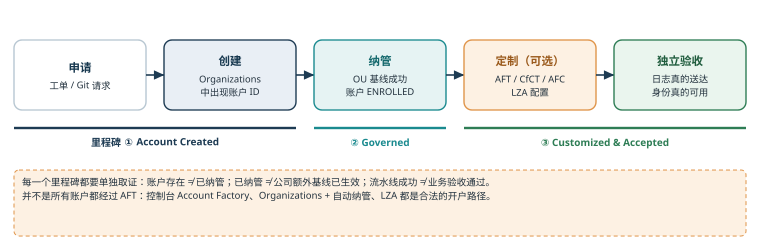
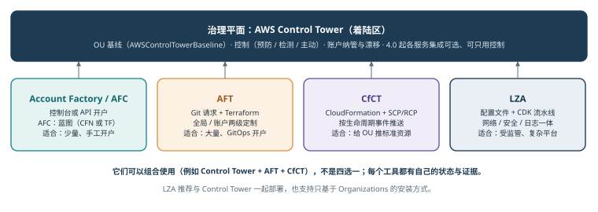
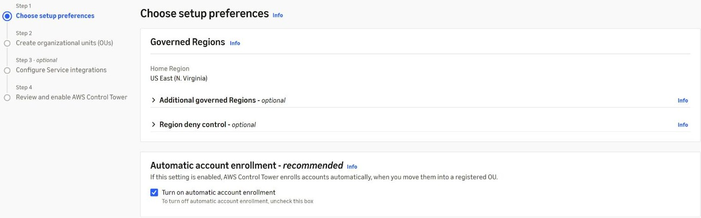
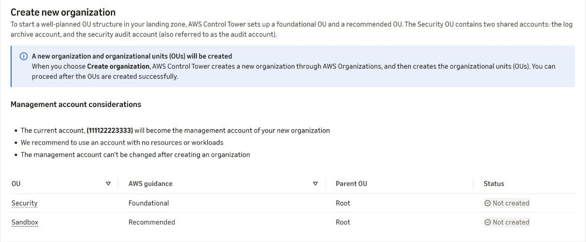
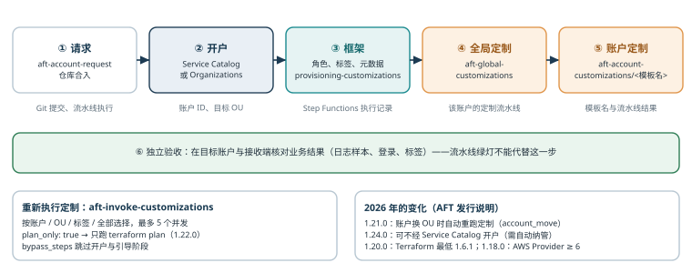
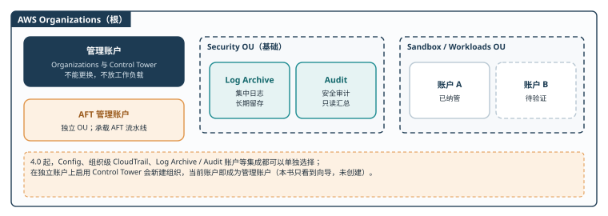

::::: cover
[第 18 讲 · 多账户治理]{.kicker}

<h1>Control Tower、AFT 与 LZA：<br>账户已经创建，为什么还不能交付？</h1>

[开一个账户要经过创建、纳管、定制、验收四段，由不同的系统负责、留下不同的证据。把“流水线成功”当成“可以交付”，是多账户治理里最常见的误判。]{.subtitle}

::: cover-meta
- **讲次**：18 / 19
- **建议学时**：4 课时（讲授 2 + 实验 2）
- **实验费用**：全部离线或只读，0 元
- **适用版本**：Control Tower 着陆区 4.0；AFT 1.24.0；Terraform ≥ 1.6.1
:::

::: scenario
平台团队通过 AFT 申请的沙箱账户已经出现在 AWS Organizations 里，AFT 的开户阶段显示成功；但公司要求的“额外日志订阅”没有把事件送到中央分析端，安全团队拒绝验收。**账户已经存在，为什么还不能交付？应该从哪一段查起？**
:::

## 学习目标 {.nonum}

:::: cards
::: {.card title="理解"}
- 创建、纳管、定制、验收四段与三个里程碑
- Control Tower、AFT、CfCT、AFC、LZA 的分工
- 着陆区 4.0 与 AFT 2026 年的新机制
:::
::: {.card title="推理"}
- 找出第一个挡住交付的关口
- 区分“失败”“没运行”“没有证据”
- 判断工具选型的代价
:::
::: {.card title="实操"}
- 账户交付的证据判定器（10 个案例）
- AFT 请求的合入前检查（terraform test）
- 治理现状的只读盘点
:::
::: {.card title="排障"}
- 定制失败时不重建账户
- 流水线全绿却验收失败
- OU 未注册导致开户失败
:::
::::

| 本讲结构 | 要回答的问题 | 产出 |
|---|---|---|
| 一、里程碑 | 账户存在等于可以交付吗？ | 交付链、判定器 |
| 二、分工 | 谁负责治理，谁负责定制？ | 工具地图、只读盘点 |
| 三、AFT | 每个阶段做什么、留下什么证据？ | 请求检查、plan-only |
| 四、结构与选型 | 账户怎样组织，工具怎样选？ | 账户结构、ADR、费用 |
| 五～六、排障与练习 | 先查哪一段？ | 故障卡、练习 |
:::::

::: {.opener .nobreak}
[一 · 里程碑]{.kicker}

# 账户存在，等于可以交付吗？

[不等于。“存在”“受治理”“已定制并验收”是三个里程碑，各有各的证据；前一个成立，推不出后一个。]{.subtitle}
:::



| 里程碑 | 证据 | 还不能证明 |
|---|---|---|
| ① Account Created | Organizations 中有账户 ID | 已被 Control Tower 纳管 |
| ② Governed | 目标 OU 的 AWSControlTowerBaseline 成功，账户为 ENROLLED | 公司额外的基线（日志订阅、角色）已部署 |
| ③ Customized & Accepted | 定制流水线成功，且在目标账户与接收端核对过业务结果 | 以后不会漂移 |

:::: {.example title="例题 18-1｜账户已纳管，额外日志却没有"}
已知：账户 ID 存在；目标 OU 的基线已启用，账户已纳管；AFT 开户与框架阶段成功；全局定制（Global Customization）显示 FAILED；额外日志订阅未部署。求：应该从哪一段查起？

::: steps
1. **锁定对象。** 确认账户 ID、Control Tower 主区域与目标 OU，保证后面所有证据指向同一个账户。
2. **确认前两个里程碑。** OU 基线成功、账户 ENROLLED——Control Tower 的基础治理成立，不要把问题归咎于它。
3. **找第一个失败的关口。** 按顺序，第一个 FAIL 是“全局定制”。去 AFT 管理账户看这个账户的定制流水线：哪一步、什么错误。
4. **修复后分别复验。** 修复并重新执行定制（可先用 plan-only 预览）；流水线变绿后，仍要到接收端核对指定时间段的日志样本。
:::

::: answer
从 **AFT 全局定制**查起，而不是重建账户或怀疑 Control Tower 失效。即使把它修成 SUCCEEDED，只要日志还没送达，就要继续查订阅目标、过滤条件与权限——流水线成功不等于业务验收。
:::
::::

:::: {.lab title="实验 18-1｜delivery：10 个账户，各卡在哪一关？"}
::: labmeta
- **目标**：按证据逐关判定，区分失败、没运行与没有证据
- **时长**：15 分钟
- **费用**：0 元
- **工具**：Python 3.11+
:::

`labs/01-delivery/delivery.py` 按八个关口顺序检查（账户存在 → OU 已注册 → 账户已纳管 → AFT 开户 → AFT 框架 → 全局定制 → 账户定制 → 独立验收），每关只给五种结论：PASS、FAIL、MISSING（必需却没有证据）、SKIP（不需要或不适用）、WARN（不需要的阶段失败，不挡交付）。

```{.console title="python delivery.py cases.json（本书实测输出）"}
C1  AFT 开户，全部通过
      → 可交付
C2  请求已提交，账户还不存在
      → 阻塞于「账户存在」：Organizations 中找不到
C3  目标 OU 没有启用基线
      → 阻塞于「OU 已注册」：NOT_ENABLED
C4  账户存在，但没有纳管
      → 阻塞于「账户已纳管」：NOT_ENROLLED
C5  例题 18-1：全局定制失败（必需）
      → 阻塞于「全局定制」：FAILED
C6  流水线全部成功，日志没送达
      → 阻塞于「独立验收」：未达成：额外日志送达
C7  全局定制不需要，也没运行
      → 可交付
C8  全局定制必需，状态查不到
      → 证据不足于「全局定制」：没有证据
C9  控制台 Account Factory 开户（不经 AFT）
      → 可交付
C10 不需要的账户定制失败了
      → 可交付（有 WARN）
```

6 个单元测试锁定了三条容易出错的规则：不需要且没运行的阶段不是失败（C7）；必需阶段“查不到状态”是证据不足，不能写成失败（C8）；不经 AFT 开户的账户（C9），AFT 的各关记为 SKIP，但验收一项也不能少。
::::

::: {.opener}
[二 · 分工]{.kicker}

# 谁负责治理，谁负责定制？

[Control Tower 管着陆区与“受治理”这件事；开户与定制有好几条路，各自有自己的引擎、状态与证据。]{.subtitle}
:::



| 工具 | 输入与引擎 | 何时采用 |
|---|---|---|
| Account Factory | 控制台 / API 开户（经 Service Catalog） | 开户数量少、流程简单 |
| AFC（Account Factory Customization） | 开户时套用蓝图（CloudFormation 或 Terraform） | 想要定制，又不想维护额外流水线 |
| AFT | Git 中的 Terraform 请求 + 全局 / 账户两级定制 | 大量开户、需要评审与 GitOps |
| CfCT | CloudFormation StackSets + SCP / RCP，由生命周期事件触发 | 给已治理的 OU 推送标准资源与策略 |
| LZA | 配置文件驱动，CDK 合成 CloudFormation 多账户部署 | 网络、安全、日志一体的受监管平台 |

**着陆区 4.0（2025-11-17 发布）**改变了“启用 Control Tower 就得全盘接受”的印象：AWS Config、组织级 CloudTrail、Log Archive 与 Audit 账户等集成都可以单独选择，甚至可以只启用控制而不建完整的着陆区。另一方面，**自动纳管**（把账户移进已注册的 OU 就自动 enroll）在 3.3 起已经提供，它也是 AFT 1.24.0 新增的“不经 Service Catalog 开户”方式的前提。

在本书的独立账户上打开 Control Tower 设置向导（只看、不提交）：第一步默认勾选自动纳管；第二步明确提示，向导会**新建一个组织，当前账户将成为它的管理账户，而且之后不能更换**——这正是官方建议用一个“干净”账户做管理账户的原因。

{.shot width=86%}

{.shot width=78%}

```{.console title="bash inventory.sh（只读盘点，本书实测输出，2026-11-18）"}
== 组织
An error occurred (AWSOrganizationsNotInUseException) … not a member of an organization.
== Control Tower 着陆区（us-east-1）
（无着陆区）
== Control Tower 基线目录
AWSControlTowerBaseline AuditBaseline BackupAdminBaseline BackupBaseline
BackupCentralVaultBaseline CentralConfigBaseline CentralSecurityRolesBaseline
ConfigBaseline IdentityCenterBaseline LogArchiveBaseline
== 已在 OU 上启用的基线
… could not assume the 'AWSControlTowerAdmin' role.
```

盘点说明了三件事：本书账户不属于任何组织，也没有着陆区；Control Tower 把“治理”拆成一组可启用的**基线**，在 OU 上启用 AWSControlTowerBaseline 就是“注册 OU”；没有着陆区时，连列出已启用基线这样的只读调用也会因为缺少 `AWSControlTowerAdmin` 角色而失败——报错本身就是证据。

::: {.opener}
[三 · AFT]{.kicker}

# AFT 的每个阶段在做什么？

[AFT 把开户变成一次 Git 合入：请求进入请求表，触发开户、框架、全局定制、账户定制。每一段都有自己的流水线和执行记录。]{.subtitle}
:::



一个账户请求长这样（与官方 `aft-account-request` 模块同一组输入；邮箱用 `.invalid` 域名，防止被误推到真实仓库）：

```{.hcl title="AFT 账户请求（教学示例）"}
module "sandbox_07" {
  source = "./modules/aft-account-request"
  control_tower_parameters = {
    AccountEmail              = "sandbox-07@example.invalid"
    AccountName               = "sandbox-07"
    ManagedOrganizationalUnit = "Sandbox"          # 嵌套 OU 写成 "Dev (ou-xxxx-xxxxxxxx)"
    SSOUserEmail              = "owner@example.invalid"
    SSOUserFirstName          = "Example"
    SSOUserLastName           = "Owner"
  }
  account_tags                 = { CostCenter = "training", Owner = "platform-team" }
  change_management_parameters = { change_requested_by = "Platform Team", change_reason = "…" }
  custom_fields                = { desired_baseline = "extra-logging" }
  account_customizations_name  = "sandbox-customizations"   # 必须是定制仓库里已有的目录
}
```

四个仓库各管一段，出了问题要到对应的仓库与流水线里找证据：

| 仓库 | 作用 | 什么时候生效 |
|---|---|---|
| aft-account-request | 每个账户一个 `module` 块，描述账户与归属 | 合入并推送后开户 |
| aft-account-provisioning-customizations | 开户之后、定制之前的自定义步骤（Step Functions） | 每个新账户 |
| aft-global-customizations | 对所有 AFT 账户执行的 Terraform 与脚本 | 框架阶段之后 |
| aft-account-customizations | 按模板目录名选择的账户级定制 | 全局定制之后 |

:::: {.lab title="实验 18-2｜在 git push 之前拦住坏请求"}
::: labmeta
- **目标**：把公司规则写成 Terraform 校验，用 terraform test 检查请求
- **时长**：15 分钟
- **费用**：0 元（不需要 provider 与凭证）
- **工具**：Terraform ≥ 1.6.1
:::

`labs/02-request` 用一个与官方模块“同形状”的替身代替 `aft-account-request`，在变量上声明公司规则：邮箱域名白名单、账户名格式、OU 写法（含嵌套 OU）、必填 CostCenter 与 Owner 标签、变更原因不少于 10 个字符、定制模板名必须存在。最后一条最有用：模板名拼错时，开户会成功，到“账户定制”阶段才失败。

```{.console title="terraform test（本书实测输出，离线运行）"}
  run "valid_request_is_accepted"... pass
  run "nested_ou_syntax_is_accepted"... pass
  run "missing_costcenter_tag_is_rejected"... pass
  run "real_email_domain_is_rejected"... pass
  run "bad_ou_syntax_is_rejected"... pass
  run "unknown_customization_template_is_rejected"... pass
Success! 6 passed, 0 failed.
```
::::

**先预览再执行。** AFT 1.22.0（2026-09）起，给 `aft-invoke-customizations` 这个 Step Functions 状态机传入 `"plan_only": true`，就只对全局与账户定制运行 `terraform plan`；Community Edition 会把每份计划的 JSON 导出到 AFT 管理账户中加密的计划输出桶。预览成功只说明“会做什么”，no changes 也不证明日志已经送达；预览本身也会启动云端流水线。

```{.json title="aft-invoke-customizations 的输入：只预览一个账户"}
{ "include": [ { "type": "accounts", "target_value": ["111122223333"] } ],
  "plan_only": true }
```

::: pitfalls
1. **定制失败不要重建账户。** 账户是长期资源，删除与关闭都有等待期与副作用；先看失败的流水线与错误。
2. **一次最多 5 个并发定制。** `include` 选中全部账户时，Step Functions 会分批循环，耗时可能很长。
3. **AFT 本身免费，环境不免费。** 默认 `aft_enable_vpc` 与 `aft_vpc_endpoints` 都为 true：NAT 网关 0.045 美元/小时、每个接口端点每个 AZ 0.01 美元/小时（us-east-1，Price List API），外加 CodeBuild、Step Functions 与日志。
:::

::: {.opener}
[四 · 结构与选型]{.kicker}

# 账户怎样组织，工具怎样选？

[管理账户只做治理，日志与审计各自独立，AFT 也有自己的管理账户。工具的选择要写成可以复审的决定，而不是“越复杂越好”。]{.subtitle}
:::



| 账户 | 职责 | 验收时看什么 |
|---|---|---|
| 管理账户 | Organizations 与 Control Tower 的入口 | 着陆区状态、OU 结构、谁有权限 |
| Log Archive | 集中日志与留存 | 日志源是否齐全、保留策略 |
| Audit | 安全审计与只读汇总 | 审计角色、安全服务的委派管理 |
| AFT 管理账户 | AFT 流水线、状态机、请求表 | 版本、仓库连接、费用 |
| 工作负载账户 | 运行业务 | 所属 OU、控制、身份、额外基线 |

**LZA 不是一段 Terraform。** 它由安装流水线（CloudFormation）部署一条核心流水线：读取配置文件，经 CDK 校验与合成，再把 CloudFormation 栈推到多个账户与区域。AWS 推荐把它和 Control Tower 一起使用，但也支持只基于 Organizations 的安装方式；它提供的是基础能力，不会自动让你“通过合规认证”。官方实施指南按 us-east-1 的示例配置、无业务负载估算约 430.22 美元/月——这是网络、日志与安全服务的常驻费用，不是软件费。

| ADR 要写清的 | 示例 |
|---|---|
| 背景 | 账户规模、监管要求、团队能维护什么、预算 |
| 决定 | 先用 Control Tower + Account Factory；开户超过每月 N 个再评估 AFT |
| 备选 | AFC 蓝图、CfCT、LZA、普通工作负载 Terraform |
| 代价 | 额外账户与流水线、权限面、回退难度、常驻费用 |
| 复审触发 | 开户量增长、新增监管要求、扩区域、AWS 服务行为变化 |

::: {.opener}
[五 · 排障]{.kicker}

# 出了问题，先查哪一段？

[按图 18-1 的顺序：对象 → 组织状态 → 正确的流水线 → 实际结果 → 记录与升级。只读优先，不可逆操作一律挡在审批之后。]{.subtitle}
:::

::: {.fault title="故障 1｜AFT 开户失败：OU 未注册"}
现象
:   请求合入后开户阶段失败，提示目标 OU 不受治理。

根因
:   目标 OU 没有成功启用 AWSControlTowerBaseline（C3）。AFT 1.24.0 起会在定制前主动检查 OU 基线与控制。

修复
:   在 Control Tower 中注册 OU（启用基线）并等待成功，再重试请求；不要在 Organizations 里手工移动账户来“绕过”。
:::

::: {.fault title="故障 2｜全局定制 FAILED"}
现象
:   开户成功，全局定制失败，账户缺少公司基线（C5）。

根因
:   定制仓库中的 Terraform 或脚本出错，或执行角色权限不足。

修复
:   看该账户定制流水线的失败步骤与日志；修复后先 plan-only 预览，再正常重新执行；不要删除账户。
:::

::: {.fault title="故障 3｜流水线全绿，验收不通过"}
现象
:   所有阶段 SUCCEEDED，接收端仍没有日志（C6）。

根因
:   部署成功只证明资源被创建：订阅目标、过滤条件、跨账户权限或 KMS 密钥策略仍可能不对。

修复
:   到接收端核对指定时间段的样本；逐项检查订阅与权限，修复后再次取证。
:::

::: {.fault title="故障 4｜账户定制阶段报找不到模板"}
现象
:   开户成功，账户定制失败，提示目录不存在。

根因
:   `account_customizations_name` 与定制仓库中的目录名不一致（拼写错误）。

修复
:   修正请求或补齐目录；用实验 18-2 的检查在合入前拦住这类错误。
:::

::: {.opener}
[六 · 练习]{.kicker}

# 练一练：卡在哪一关？

[先独立作答，再对照解析。]{.subtitle}
:::

## 随堂练习

::: {.exercise title="练习 1｜存在与纳管"}
一个账户在 Organizations 中可见，是否说明它已被 Control Tower 纳管？
:::

::: {.exercise title="练习 2｜没运行"}
某账户不需要全局定制，该阶段状态为 NOT_RUN。能据此判定交付失败吗？如果它是必需的、状态却查不到呢？
:::

::: {.exercise title="练习 3｜预览"}
plan-only 的结果是 no changes，能否宣布额外日志已经送达？
:::

::: {.exercise title="练习 4｜工具"}
CfCT、AFC、LZA 是不是 AFT 的别名？各自的引擎是什么？
:::

::: {.exercise title="练习 5｜管理账户"}
为什么不应该在已有业务的账户上直接启用 Control Tower？
:::

## 参考答案与解析

::: {.solution title="1"}
不能。还要确认目标 OU 已成功启用 AWSControlTowerBaseline，且账户状态为 ENROLLED。
:::

::: {.solution title="2"}
不需要的阶段没运行不是失败（C7）；必需阶段查不到状态是“证据不足”，应补取证据，不能直接写成失败（C8）。
:::

::: {.solution title="3"}
不能。plan-only 只说明定制代码不会再改动资源；日志是否送达要在接收端核对样本。
:::

::: {.solution title="4"}
不是。CfCT 用 CloudFormation StackSets 与 SCP/RCP；AFC 是开户时套用的蓝图（CloudFormation 或 Terraform）；LZA 由配置文件经 CDK 合成 CloudFormation。
:::

::: {.solution title="5"}
启用向导会新建组织，当前账户成为管理账户且不可更换（图 18-4）；管理账户不受 SCP 约束，权限面很大，应保持干净、只做治理。
:::

## 这一讲，你应该记住 {.nonum}

:::: summary
::: {.card tag="里程碑"}
**存在 ≠ 纳管 ≠ 验收**

每个里程碑单独取证。
:::
::: {.card tag="判定"}
**找第一个挡住交付的关口**

没运行、没证据、失败，三者不同。
:::
::: {.card tag="AFT"}
**先检查请求，先预览定制**

合入前测试，执行前 plan-only。
:::
::: {.card tag="选型"}
**写成 ADR，算清常驻费用**

工具可以组合，不必最复杂。
:::
::::

::: refs
## 参考资料 {.nonum}

[实测说明：delivery.py 为本地模型；请求检查为离线 terraform test；盘点为 us-east-1 只读调用；价格来自 Price List API（2026-11-18）；图 18-3、18-4 为 2026-11-18 控制台实拍（只看向导，未创建组织）。]{.small}

1. AFT 账户定制与 plan-only <https://docs.aws.amazon.com/controltower/latest/userguide/aft-account-customization-options.html>；AFT 发行说明 <https://github.com/aws-ia/terraform-aws-control_tower_account_factory/releases>
2. 着陆区 4.0 迁移指南 <https://docs.aws.amazon.com/controltower/latest/userguide/landing-zone-v4-migration-guide.html>；LZA 费用 <https://docs.aws.amazon.com/solutions/latest/landing-zone-accelerator-on-aws/cost.html>
:::
