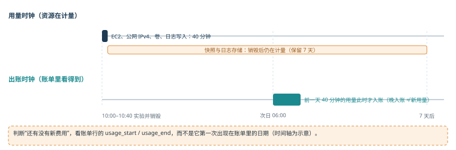
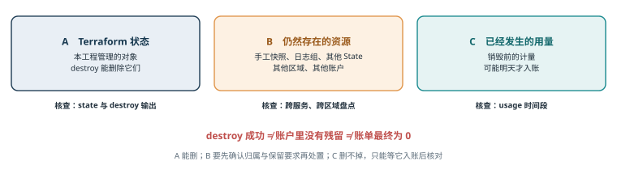
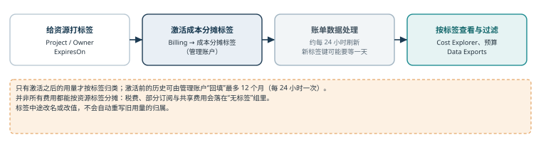
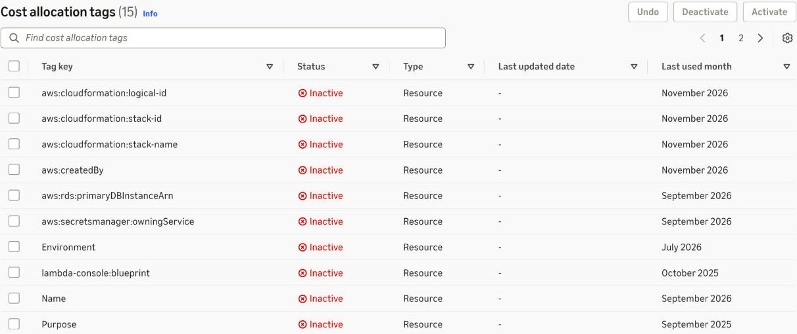
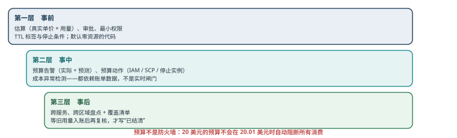
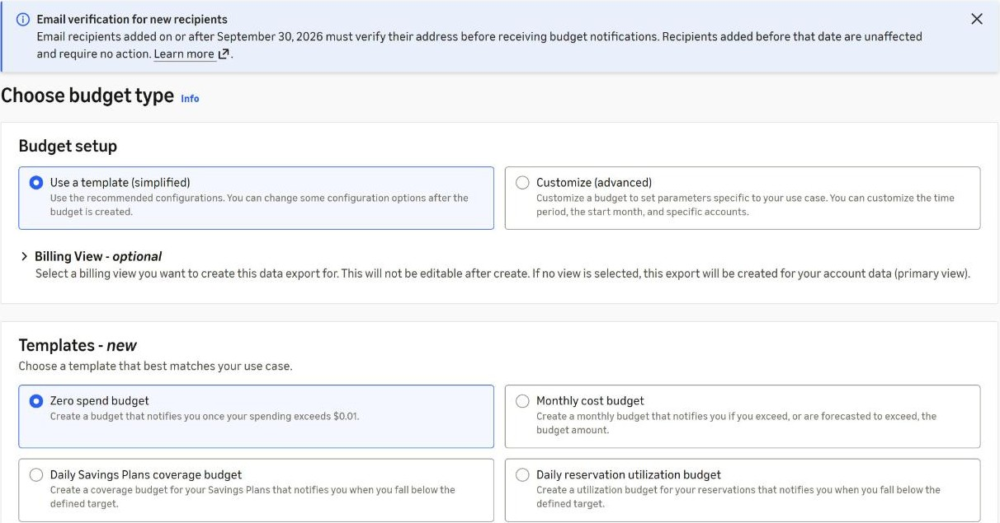

::::: cover
[第 19 讲 · 成本治理]{.kicker}

<h1>FinOps 与成本回收：<br>Destroy 完成，为什么账单还在增加？</h1>

[账单有两只时钟：用量发生的时间与它出现在账单里的时间。Terraform 只能删除它管理的对象；账户里的残留要靠盘点，历史用量只能等它入账后核对。]{.subtitle}

::: cover-meta
- **讲次**：19 / 19
- **建议学时**：4 课时（讲授 2 + 实验 2）
- **实验费用**：全部离线或只读，0 元
- **适用版本**：CUR 2.0 / Data Exports；AWS Provider 6.x
:::

::: scenario
10:00 到 10:40 做完一次实验，`terraform destroy` 显示 Destroy complete。第二天，账单里新出现了 EC2、快照和日志的费用。**是资源还在运行，还是昨天的用量今天才入账？怎样才能证明“清理完了”？**
:::

## 学习目标 {.nonum}

:::: cards
::: {.card title="理解"}
- 用量时钟与出账时钟
- State、存活资源、历史用量三个集合
- 成本分摊标签的激活与回填
:::
::: {.card title="推理"}
- 用 usage 时间段区分晚入账与新用量
- 区分残留、批准保留与覆盖不足
- 判断预算能做什么、不能做什么
:::
::: {.card title="实操"}
- 用真实单价估算一次实验
- 账单行分类器（6 个案例）
- 跨区域只读盘点；预算与标签的 Terraform
:::
::: {.card title="排障"}
- 销毁后第二天出现 EC2 费用
- 删了卷，快照费用还在
- 按标签过滤的预算一直为 0
:::
::::

| 本讲结构 | 要回答的问题 | 产出 |
|---|---|---|
| 一、两只时钟 | 账单增长是新用量吗？ | 估算与时间分段 |
| 二、三个集合 | 怎样证明清理完了？ | 分类器、盘点 |
| 三、标签 | 打了标签为何查不到成本？ | 激活与回填 |
| 四、防线 | 预算能阻止超支吗？ | 预算、Terraform |
| 五～六、排障与练习 | 先查什么？ | 故障卡、练习 |
:::::

::: {.opener .nobreak}
[一 · 两只时钟]{.kicker}

# 账单增长，是不是新的用量？

[先看账单行的用量时间段，再看它是哪一天出现的。“新显示”不等于“新产生”。]{.subtitle}
:::



Cost Explorer 的数据通常每 24 小时至少刷新一次，所以 10:40 销毁的实例，第二天早上才出现在账单里很正常。判断依据是账单行自己的字段：CUR 2.0（Data Exports）里的 `line_item_usage_start_date` / `line_item_usage_end_date` 说明用量发生在哪一段，`line_item_line_item_type` 说明它是用量（Usage）还是调整（Credit、Refund）。

:::: {.example title="例题 19-1｜40 分钟的实验，哪些费用会延续 7 天？"}
已知（us-east-1，Price List API 实时单价，2026-11-18）：t4g.nano 运行 40 分钟，带一个公网 IPv4 与 8 GiB gp3 卷；写入日志 0.2 GiB；销毁后保留 5 GiB 快照与日志各 7 天。求：费用多少，哪些发生在销毁之后？

::: steps
1. **列单位。** 实例与公网 IPv4 按小时；卷、快照、日志存储按 GB·月（按 730 小时/月折算）；日志写入按 GB。
2. **算销毁前。** 0.0042 × 40/60 = 0.0028；0.005 × 40/60 = 0.0033；0.08 × 8 × 0.667/730 = 0.0006；0.50 × 0.2 = 0.1000，小计 0.1067 美元。
3. **算销毁后。** 快照 0.05 × 5 × 168/730 = 0.0575；日志存储 0.03 × 0.2 × 168/730 = 0.0014，小计 0.0589 美元。
4. **标出时间。** 前四项在 10:40 之前就已发生，只是可能明天才入账；后两项在销毁后的 7 天里每小时都在发生。
:::

::: answer
合计约 0.1656 美元，其中 0.0589 美元发生在销毁之后——它们来自 Terraform 之外被保留的快照与日志。最大的一项不是实例，而是日志写入（0.10 美元）：**单价小的项目，用量一大就成了主角**。
:::
::::

:::: {.lab title="实验 19-2｜estimate：先用真实单价算，再部署"}
::: labmeta
- **目标**：单位对齐、分阶段估算
- **时长**：10 分钟
- **费用**：0 元（Price List API 免费）
- **工具**：Python 3.11+、AWS CLI
:::

`fetch_prices.py` 调用 Price List API 刷新 `prices.json`；`estimate.py` 按 `scenario.json` 计算：

```{.console title="python estimate.py prices.json scenario.json（本书实测输出）"}
单价来源：AWS Price List API，us-east-1，2026-11-18
  金额(美元)  单价          阶段    项目（用量）
   0.0028   0.0042/Hrs    销毁前  EC2 t4g.nano（40 分钟）
   0.0033   0.0050/Hrs    销毁前  公网 IPv4（40 分钟）
   0.0006   0.0800/GB-Mo  销毁前  EBS gp3 8 GiB（8 GiB × 40 分钟）
   0.1000   0.5000/GB     销毁前  日志写入（0.2 GiB）
   0.0575   0.0500/GB-Mo  销毁后  EBS 快照（5 GiB × 7 天）
   0.0014   0.0300/GB-Mo  销毁后  日志存储（0.2 GiB × 7 天）
  小计 销毁前：0.1067 美元
  小计 销毁后：0.0589 美元
  合计：0.1656 美元
```
::::

::: {.opener}
[二 · 三个集合]{.kicker}

# 怎样证明“清理完了”？

[destroy 只对 Terraform 状态里的对象负责。账户里还剩什么，要靠跨服务、跨区域的盘点；盘点没覆盖的地方，不能写“没有”。]{.subtitle}
:::



| 证据 | 能回答 | 不能单独推出 |
|---|---|---|
| Terraform 状态与 destroy 输出 | 本工程的对象已删除 | 其他 State、手工资源都不存在 |
| 跨服务实时盘点 | 快照、日志组、地址、端点……现在是否还在 | 历史费用已全部入账 |
| 账单行（Bills / Cost Explorer / CUR） | 用量时间段、服务、区域、用量类型 | 某个资源此刻是否存活 |
| 覆盖清单 | 查了哪些账户、区域、服务，哪些查询失败 | 没查的地方也没有残留 |

:::: {.lab title="实验 19-1｜audit：六种“账单增长”"}
::: labmeta
- **目标**：按用量时间段、盘点与覆盖范围给每一行账单分类
- **时长**：20 分钟
- **费用**：0 元
- **工具**：Python 3.11+
:::

`labs/01-audit/audit.py` 读取一次实验的证据（销毁时刻、盘点与覆盖范围、账单行），把每行分成六类：销毁前的用量（PRE_DESTROY）、批准保留（RETAINED）、残留（RESIDUAL）、无法解释（UNEXPLAINED）、覆盖不足（COVERAGE_GAP）、调整项（ADJUSTMENT）。账单行的金额就是例题 19-1 用真实单价算出的数：

```{.console title="python audit.py cases/*.json（本书实测输出，节选）"}
== F1 有晚入账，也有批准保留的快照与日志
   PRE_DESTROY  BoxUsage:t4g.nano          0.0028  销毁前的用量，销毁后才入账
   PRE_DESTROY  DataProcessing-Bytes       0.1000  销毁前的用量，销毁后才入账
   RETAINED     EBS:SnapshotUsage          0.0575  批准保留至 2026-11-25（platform-team）
   结论：已清理（保留项均获批准）：等旧用量入账后复核
== F3 忘了的 EBS 卷与闲置公网 IPv4
   RESIDUAL     EBS:VolumeUsage.gp3        0.1473  vol-0lab000000000001 仍存在且未获批准保留
   RESIDUAL     PublicIPv4:IdleAddress     0.8400  eipalloc-lab02 仍存在且未获批准保留
   结论：发现未批准的残留：按归属与审批处置
== F4 另一个区域的快照，盘点只查了 us-east-1
   COVERAGE_GAP EBS:SnapshotUsage          0.0575  us-west-2/AmazonEC2 不在盘点范围内
   结论：盘点覆盖不足：不能宣称已清理
```

F3 值得多看一眼：一个闲置的公网 IPv4 一周就是 0.005 × 168 = 0.84 美元，比整个实验还贵。6 个单元测试锁定了分类规则：晚入账不是新用量、批准保留不是残留、调整项不是用量、没覆盖的区域不能算干净。
::::

把盘点真正跑在本书账户上（`labs/03-inventory/inventory.sh`，全部为免费的只读调用），三个区域、九类资源：

```{.console title="REGIONS=\"us-east-1 us-west-2 ap-southeast-2\" bash inventory.sh（本书实测输出，节选）"}
region          resource                   count
us-east-1       ec2-instances(not-term)    0
us-east-1       ebs-snapshots(self)        0
us-east-1       elastic-ip                 0
us-east-1       log-groups                 0
us-west-2       log-groups                 1
us-west-2         never-expire             1
ap-southeast-2  log-groups                 0
global          s3-buckets                 0
coverage: regions=[us-east-1 us-west-2 ap-southeast-2] services=EC2,EBS,EIP,NAT,VPCE,Logs,Backup,S3
failed queries: 0
```

盘点在 us-west-2 找到一个真实的残留：2025 年 7 月由某个 Lambda 函数自动创建的日志组，函数早已不在，日志组还在，而且**保留期为“永不过期”**。它只有 449 字节，几乎不花钱，却正好说明两件事：Lambda 自动创建的日志组默认永不过期、不随函数删除；只盘点 us-east-1 的人永远看不到它。

::: {.opener}
[三 · 标签]{.kicker}

# 打了标签，为什么查不到成本？

[资源标签只是资源上的元数据；成本分摊标签要在账单侧激活，激活后的用量才会按它归类。]{.subtitle}
:::



本书账户的“成本分摊标签”页正好是反例（图 19-4）：15 个标签键都出现过——包括 `Environment`、`Name` 以及 CloudFormation 自动添加的 `aws:cloudformation:*`——但**全部是 Inactive**，所以在 Cost Explorer 里无法按它们分组。页面上还能看到“Backfill tags”按钮：自 2024 年 3 月起，管理账户可以把激活状态回填到最多 12 个月前（每 24 小时可提交一次）。

{.shot width=80%}

| 标签键 | 示例值 | 作用与边界 |
|---|---|---|
| Project | finops-lab | 归属；激活后才能在账单中按它分组 |
| Owner | platform-team | 审批与清理的联系人，不是删除权限 |
| ExpiresOn | 2026-11-25 | 计划回收日期，只是标记，不会自动删除任何东西 |

::: {.opener}
[四 · 防线]{.kicker}

# 预算能阻止超支吗？

[不能单独做到。预算依赖账单数据，有延迟；预算动作只作用于你明确配置的对象。真正的防线是三层：事前、事中、事后。]{.subtitle}
:::



| 机制 | 做什么 | 限制与费用 |
|---|---|---|
| 预算告警 | 实际或预测花费超过阈值时通知 | 依赖账单刷新；不带动作的预算免费 |
| 预算动作 | 附加 IAM 策略、应用 SCP、停止指定 EC2 / RDS | 只影响配置的目标；每账户前两个带动作的预算免费，之后 0.10 美元/天 |
| 成本异常检测 | 按历史模式发现异常增长 | 同样依赖账单数据，发现有延迟 |

控制台的“创建预算”页提供了模板，最省事的是“零花费预算”：花费一超过 0.01 美元就通知（图 19-6）。页面顶部还有一条 2026 年的变化：**2026-09-30 之后新添加的邮件收件人，必须先验证邮箱才能收到预算通知**——用 Terraform 批量配置预算时，别忘了这一步。

{.shot width=80%}

:::: {.lab title="实验 19-4｜把归属、保留期与预算写进代码"}
::: labmeta
- **目标**：日志组有限保留、激活成本分摊标签、按标签过滤的预算
- **时长**：15 分钟
- **费用**：test 与 plan 0 元；apply 后预算与标签激活免费
- **工具**：Terraform、AWS Provider 6.x
:::

```{.hcl title="labs/04-terraform/main.tf（节选）"}
resource "aws_cloudwatch_log_group" "lab" {
  count             = var.enable ? 1 : 0
  name              = "/finops/${var.project}/demo"
  retention_in_days = 7                 # 保留策略，不是“销毁计时器”
}

resource "aws_ce_cost_allocation_tag" "project" {
  count   = var.enable ? 1 : 0
  tag_key = "Project"
  status  = "Active"                    # 不激活，下面的过滤永远是 0
}

resource "aws_budgets_budget" "lab" {
  count        = var.enable && var.notify_email != "" ? 1 : 0
  budget_type  = "COST"
  limit_amount = tostring(var.monthly_limit_usd)
  time_unit    = "MONTHLY"
  cost_filter {
    name   = "TagKeyValue"
    values = [format("user:Project$%s", var.project)]
  }
  # notification：ACTUAL > 80%，FORECASTED > 100%
}
```

```{.console title="terraform test 与只读 plan（本书实测输出，2026-11-18）"}
$ terraform test
  run "default_creates_nothing"... pass
  run "log_group_has_finite_retention"... pass
  run "budget_filters_by_activated_tag_and_forecasts"... pass
  run "expires_on_format_is_checked"... pass
Success! 4 passed, 0 failed.
$ terraform plan
No changes. Your infrastructure matches the configuration.
$ terraform plan -var enable=true -var notify_email=ops@example.invalid
              + "user:Project$finops-lab",
Plan: 3 to add, 0 to change, 0 to destroy.
```

写这段代码时踩到的一个坑也值得记下：过滤值最初写成 `"user:Project$${var.project}"`，测试立刻失败——在 HCL 里 `$${` 是转义，结果是字面量 `${var.project}`，根本没有插值。改用 `format()` 之后测试通过。**测试先行**的价值正在于此。
::::

::: {.opener}
[五 · 排障]{.kicker}

# 出了问题，先查什么？

[先看账单行的时间段与资源 ID，再看盘点与覆盖范围；只处理属于这次实验、且获准删除的对象。]{.subtitle}
:::

::: {.fault title="故障 1｜销毁后第二天，账单出现 EC2 费用"}
现象
:   实例 10:40 已终止，次日账单新增 BoxUsage。

根因
:   通常是销毁前的用量晚入账；也可能还有别的实例。

修复
:   看该行的 usage 时间段与资源 ID；在相同区域核对实例状态。不要重复删除已不存在的资源。
:::

::: {.fault title="故障 2｜删了卷，快照费用还在"}
现象
:   EBS 卷已删除，账单仍有 EBS:SnapshotUsage。

根因
:   快照独立计费，不随卷删除；也可能被 AMI 或备份计划引用。

修复
:   确认快照归属与保留要求，解除 AMI 引用后再删；备份恢复点要在 AWS Backup 中按其规则处理。
:::

::: {.fault title="故障 3｜日志存储一直在涨"}
现象
:   没有新的工作负载，TimedStorage-ByteHrs 持续出现。

根因
:   日志组保留期为“永不过期”（Lambda 自动创建的日志组默认如此），且不随函数删除。

修复
:   为日志组设置保留期；用 Terraform 预先创建日志组，并在盘点中检查 never-expire。
:::

::: {.fault title="故障 4｜按标签过滤的预算一直是 0"}
现象
:   预算按 Project 标签过滤，实际花费显示为 0。

根因
:   标签没有激活为成本分摊标签，或激活前的用量没有回填。

修复
:   在管理账户激活标签（必要时回填），等待账单刷新后再看。
:::

::: {.fault title="故障 5｜实验结束了，每月还有几美元"}
现象
:   账单里有 PublicIPv4:IdleAddress。

根因
:   弹性 IP 没有释放；闲置的公网 IPv4 同样按 0.005 美元/小时计费（约 3.65 美元/月）。

修复
:   确认无人使用后释放地址，并把弹性 IP 纳入 Terraform 管理。
:::

::: {.opener}
[六 · 练习]{.kicker}

# 练一练：这是哪一种增长？

[先独立作答，再对照解析。]{.subtitle}
:::

## 随堂练习

::: {.exercise title="练习 1｜判断"}
销毁后第二天出现了新的 EC2 费用，能否说明实例还在运行？
:::

::: {.exercise title="练习 2｜计算"}
t4g.nano（0.0042 美元/小时）运行 40 分钟、5 GiB 快照（0.05 美元/GB·月）保留 30 天，各多少钱？
:::

::: {.exercise title="练习 3｜覆盖"}
只在 us-east-1 盘点到 0 个快照，能否写“已全部清理”？
:::

::: {.exercise title="练习 4｜预算"}
设置了 20 美元的月度预算，花费到 20.01 美元时会怎样？预算动作能做什么？
:::

::: {.exercise title="练习 5｜标签"}
资源上已经有 Project 标签，为什么 Cost Explorer 里按 Project 分组什么也看不到？
:::

## 参考答案与解析

::: {.solution title="1"}
不能。先看该行的 usage 时间段：若在销毁之前结束，只是晚入账；若在销毁之后，再核对资源 ID 是否还存在。
:::

::: {.solution title="2"}
实例 0.0042 × 40/60 = 0.0028 美元；快照 0.05 × 5 × 720/730 ≈ 0.2466 美元（30 天约 720 小时）。快照保留一个月的费用是这次实验实例费用的近 90 倍。
:::

::: {.solution title="3"}
不能。还要说明查了哪些区域、账户、服务，哪些查询失败；本书账户的残留正好在 us-west-2。
:::

::: {.solution title="4"}
默认只会发通知（且受账单延迟影响），不会阻断消费。预算动作可以附加 IAM 策略、应用 SCP、停止指定的 EC2 / RDS 实例，但只作用于配置的对象，且有审批与恢复的副作用。
:::

::: {.solution title="5"}
标签还没有在账单侧激活为成本分摊标签（本书账户 15 个键全部 Inactive），或激活前的用量没有回填；激活后还要等账单数据刷新。
:::

## 这一讲，你应该记住 {.nonum}

:::: summary
::: {.card tag="时间"}
**看 usage 时间段**

晚入账 ≠ 新用量。
:::
::: {.card tag="范围"}
**destroy 只管 State**

残留靠盘点，还要写明覆盖范围。
:::
::: {.card tag="标签"}
**先激活，才分摊**

可以回填 12 个月。
:::
::: {.card tag="防线"}
**预算不是防火墙**

事前估算 + 事中告警 + 事后复核。
:::
::::

::: refs
## 参考资料 {.nonum}

[实测说明：单价来自 Price List API（us-east-1，2026-11-18）；audit.py 为本地模型；盘点为三个区域的只读调用；Terraform 只执行 test 与只读 plan；图 19-4、19-6 为 2026-11-18 控制台实拍（未激活、未创建）。]{.small}

1. 成本分摊标签与回填 <https://docs.aws.amazon.com/awsaccountbilling/latest/aboutv2/cost-allocation-backfill.html>；Data Exports（CUR 2.0）<https://docs.aws.amazon.com/cur/latest/userguide/what-is-data-exports.html>
2. 预算动作 <https://docs.aws.amazon.com/cost-management/latest/userguide/budgets-controls.html>；预算定价 <https://aws.amazon.com/aws-cost-management/aws-budgets/pricing/>；删除快照 <https://docs.aws.amazon.com/ebs/latest/userguide/ebs-deleting-snapshot.html>
:::
